# A-09-shell-imagery UAT evidence

Superseded by `../uat-r15/REPORT.md` and then `../uat-r16/REPORT.md`. The landscape footer is now r16/05, byte-identical to r14/06.

Looked at by: Claude reviewer 9

Visual findings and acceptance below are transcribed from review 9; they describe this historical run, before round 11.

Command: `node tools/uat/run.mjs -- A-09-shell-imagery --phones 1 --out uat-r14 --max-mb 20`
Commit: `15aeef80ddea34a29d5986a88f2f5603df8370f0`
Viewports: 1920×1080, 1280×720, 390×844, 844×390

| Timing | ms | Status |
|---|---:|---|
| Create room through host page | 874.9 | completed |

Expected errors (count):
None

## Real server

| Screenshot | What it shows | Looked at by |
|---|---|---|
| 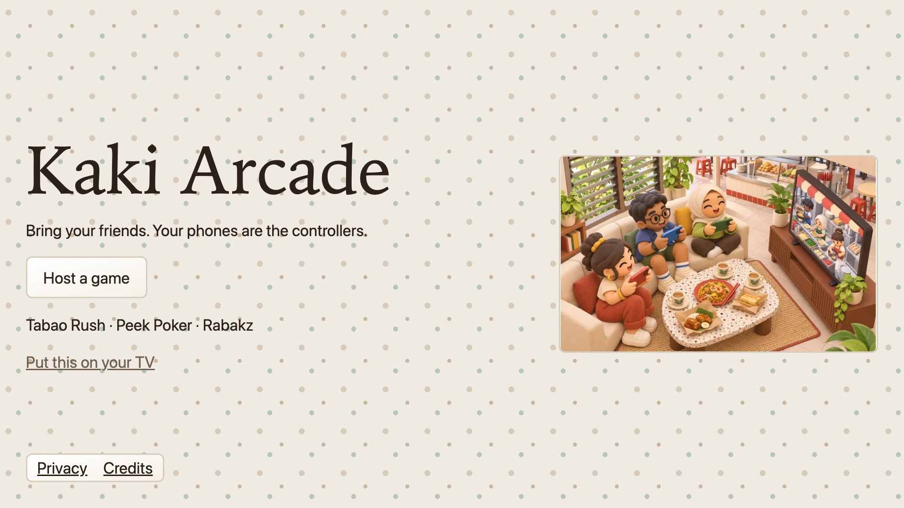 | Title, one line, "Host a game", the three games, "Put this on your TV" as a secondary link; the friends-on-sofa picture in the 1.618 : 1 right column; Privacy · Credits footer bottom-left, clear of the help link; dot-grid page. | Claude reviewer 9 |
| 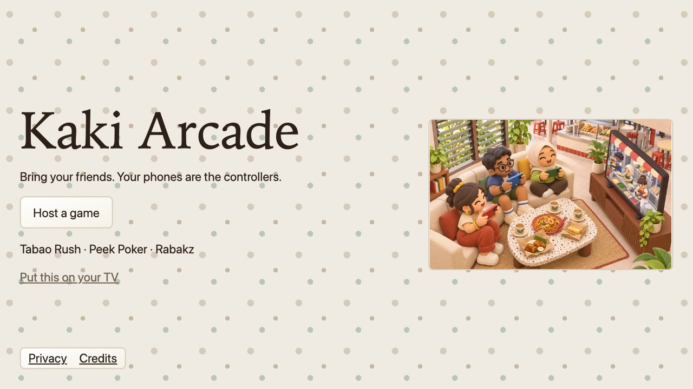 | Title, one line, "Host a game", the three games, "Put this on your TV" as a secondary link; the friends-on-sofa picture in the 1.618 : 1 right column; Privacy · Credits footer bottom-left, clear of the help link; dot-grid page. | Claude reviewer 9 |
| 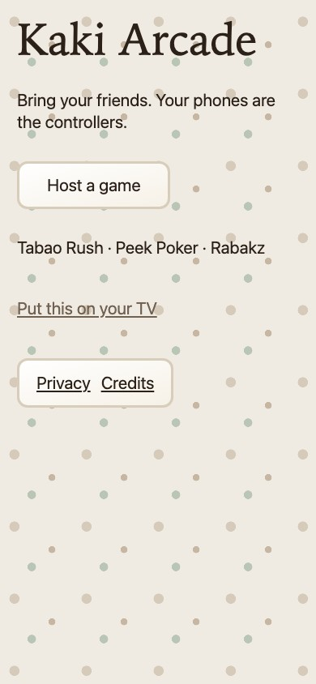 | Phone column, no picture: button label centred; the help link in a 55 px box; the footer 34 px below it in flow. | Claude reviewer 9 |
|  | Identical to 03 (the footer is already in view; no scroll happened). | Claude reviewer 9 |
| 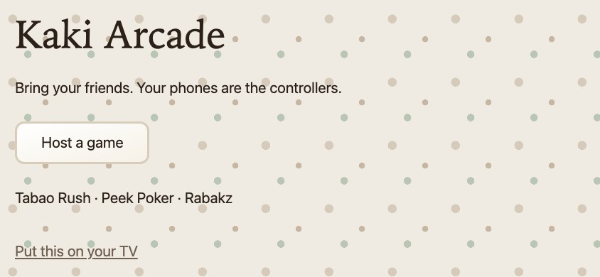 | Unscaled phone column in landscape; content scrolls rather than shrinking. | Claude reviewer 9 |
| 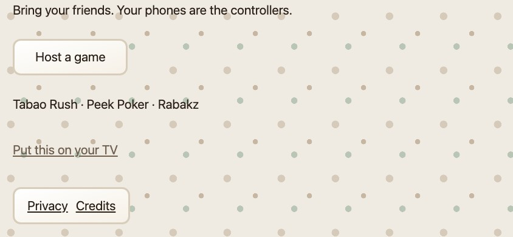 | Scrolled to the end: help link, then the footer with 55 px Privacy and Credits targets 34 px below. | Claude reviewer 9 |
| 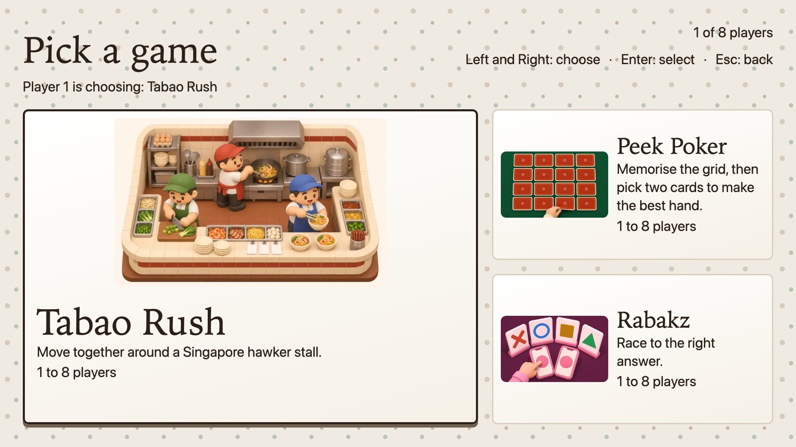 | Kitchen picture above name, line and range; side tiles with 38.2 % pictures beside their copy; 390 shows the scaled TV stage. | Claude reviewer 9 |
|  | Kitchen picture above name, line and range; side tiles with 38.2 % pictures beside their copy; 390 shows the scaled TV stage. | Claude reviewer 9 |
| 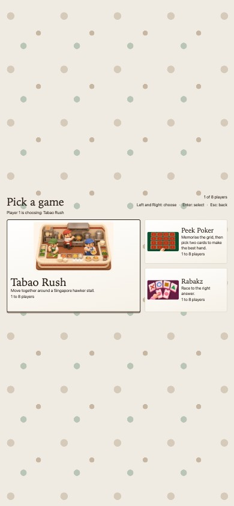 | Kitchen picture above name, line and range; side tiles with 38.2 % pictures beside their copy; 390 shows the scaled TV stage. | Claude reviewer 9 |
| 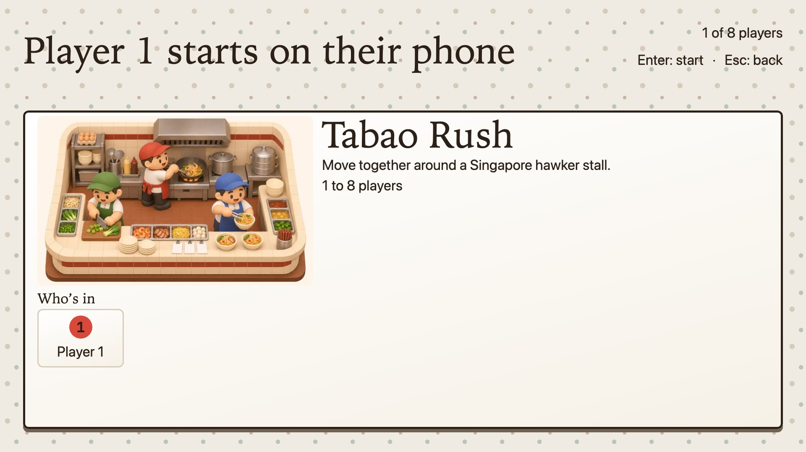 | Picture 13 px inside the card at left; copy top-aligned at right; "Who's in" 13 px below the picture (ink at 699 design px). | Claude reviewer 9 |
|  | Picture 13 px inside the card at left; copy top-aligned at right; "Who's in" 13 px below the picture (ink at 699 design px). | Claude reviewer 9 |
| 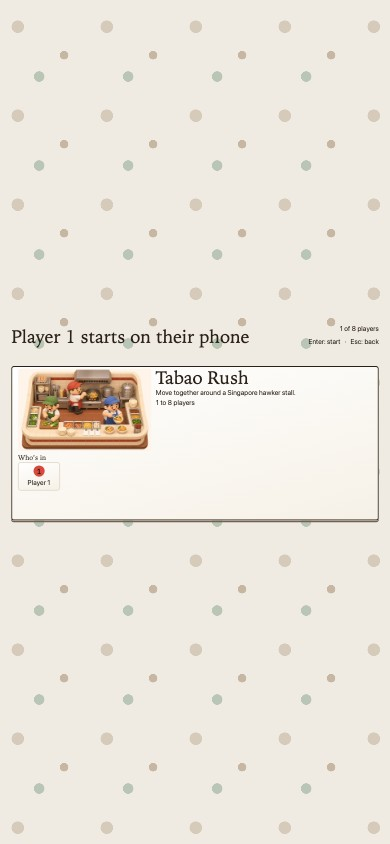 | Picture 13 px inside the card at left; copy top-aligned at right; "Who's in" 13 px below the picture (ink at 699 design px). | Claude reviewer 9 |
| 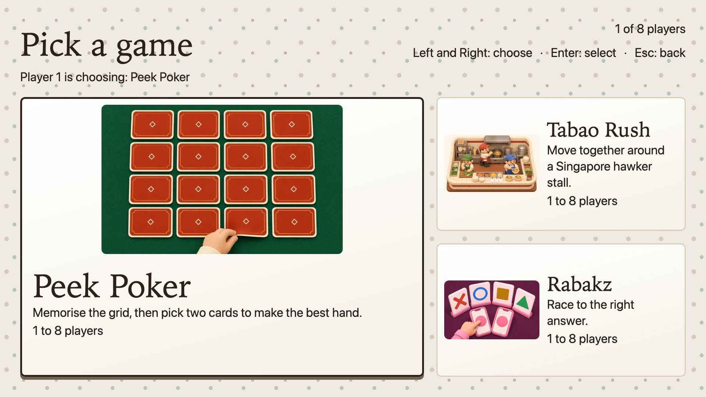 | Face-down 4 × 4 grid on felt; no chips or money. | Claude reviewer 9 |
|  | Face-down 4 × 4 grid on felt; no chips or money. | Claude reviewer 9 |
| 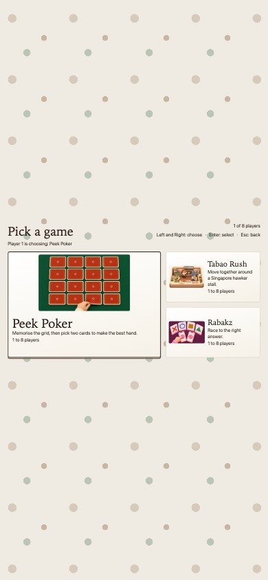 | Face-down 4 × 4 grid on felt; no chips or money. | Claude reviewer 9 |
| 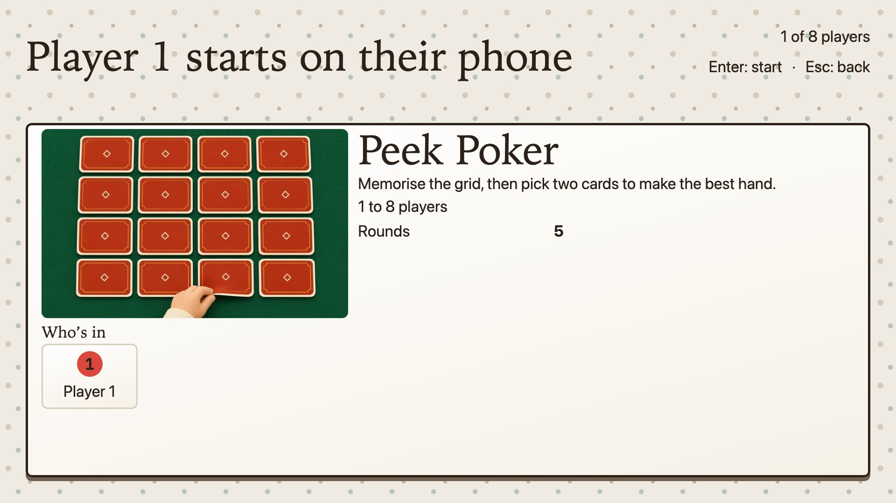 | As 31, plus "Rounds 5"; "Who's in" at the same height. | Claude reviewer 9 |
| 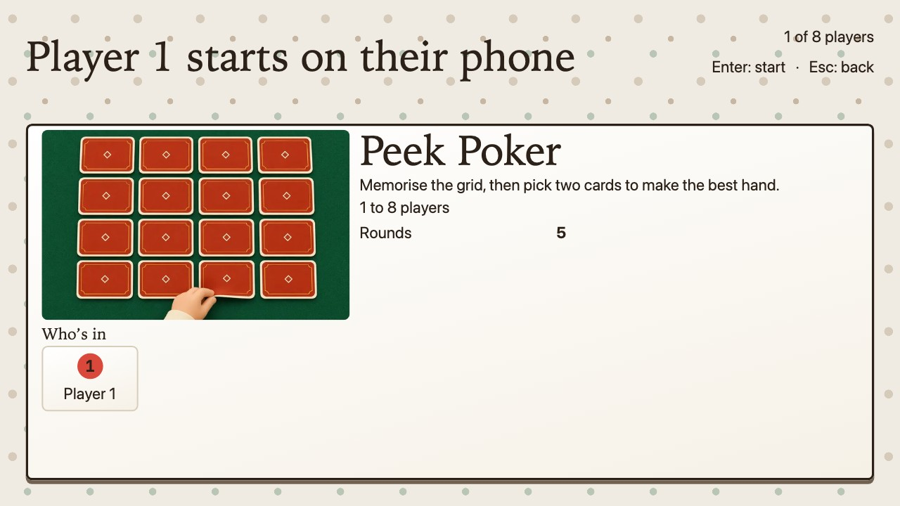 | As 31, plus "Rounds 5"; "Who's in" at the same height. | Claude reviewer 9 |
| 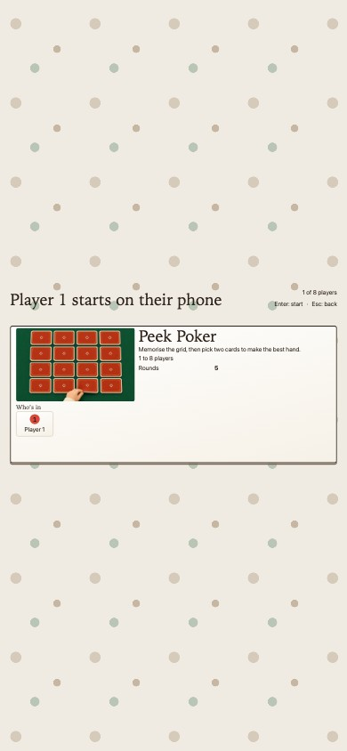 | As 31, plus "Rounds 5"; "Who's in" at the same height. | Claude reviewer 9 |
|  | Cross, circle, square and triangle answer cards behind phone buzzers on plum. | Claude reviewer 9 |
| 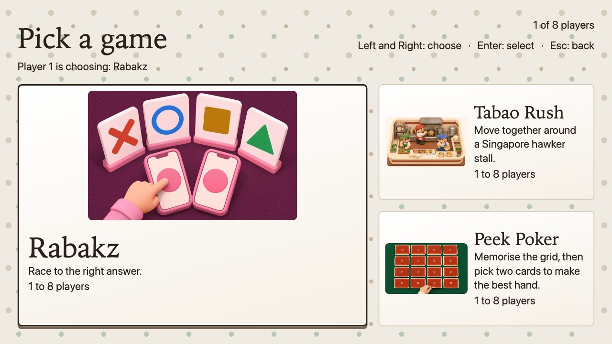 | Cross, circle, square and triangle answer cards behind phone buzzers on plum. | Claude reviewer 9 |
| 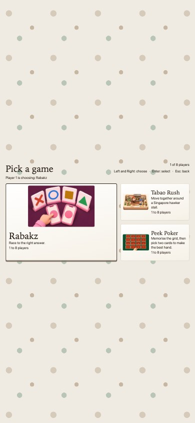 | Cross, circle, square and triangle answer cards behind phone buzzers on plum. | Claude reviewer 9 |
|  | Questions 10, Categories Mixed, Difficulty Mixed, Teams Off; "Who's in" at the same height as the other games (ink at 699). | Claude reviewer 9 |
| 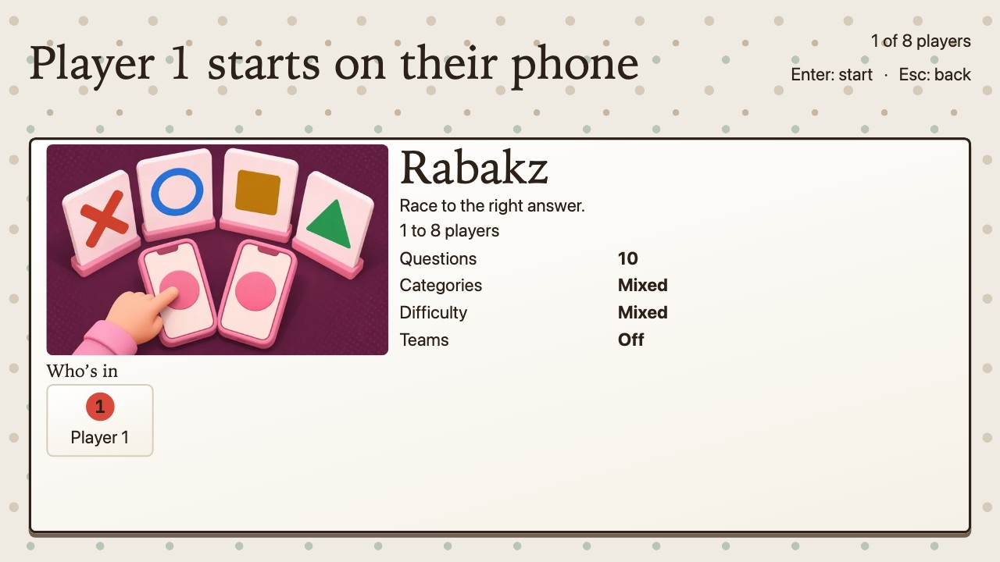 | Questions 10, Categories Mixed, Difficulty Mixed, Teams Off; "Who's in" at the same height as the other games (ink at 699). | Claude reviewer 9 |
| 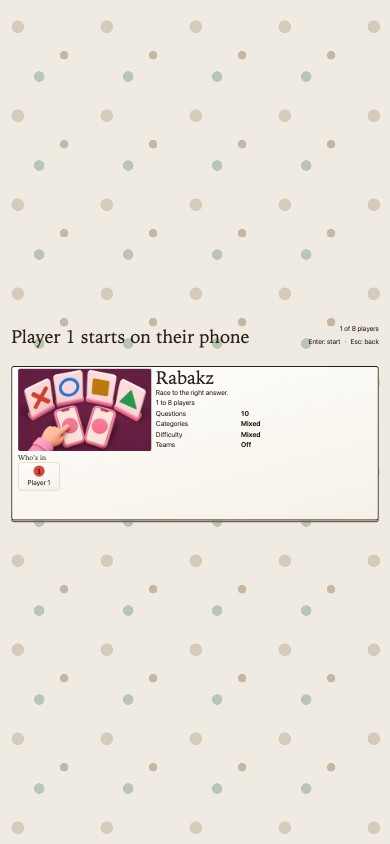 | Questions 10, Categories Mixed, Difficulty Mixed, Teams Off; "Who's in" at the same height as the other games (ink at 699). | Claude reviewer 9 |
| 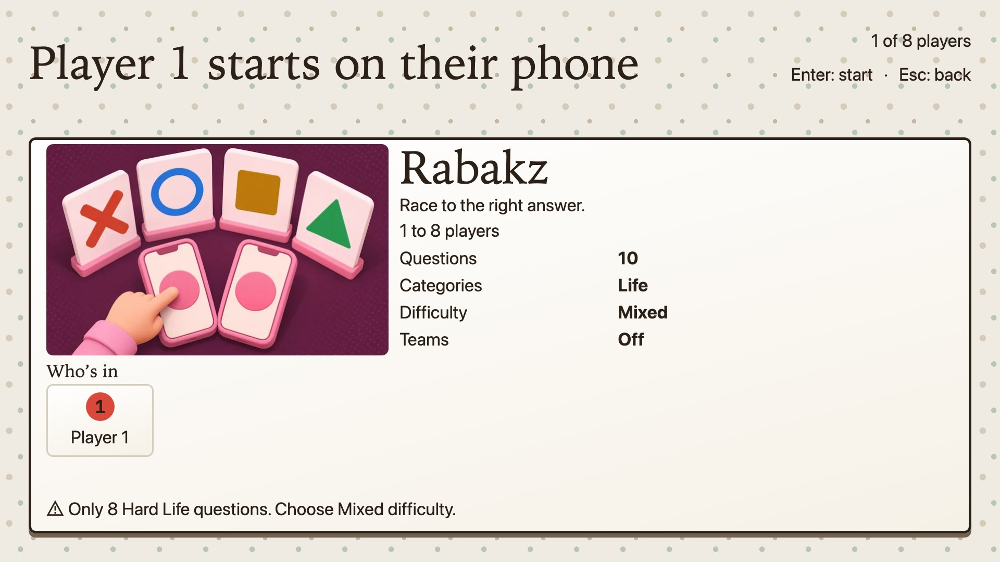 | Categories narrowed to Life; a refused Hard shows "Only 8 Hard Life questions. Choose Mixed difficulty." in the band at the card foot; "Who's in" still at 699. | Claude reviewer 9 |

## Strips

| Screenshot | What it shows | Looked at by |
|---|---|---|
| 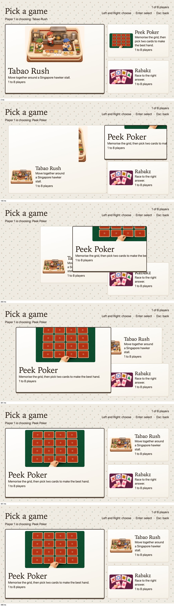 | Focus move with old and new tiles overlapping; settles by 400 ms; no blank frame or overshoot. At 100 ms there is a sliver of the old picture (and in 20 a "best hand." fragment) inside the wipe, for one frame. | Claude reviewer 9 |
| 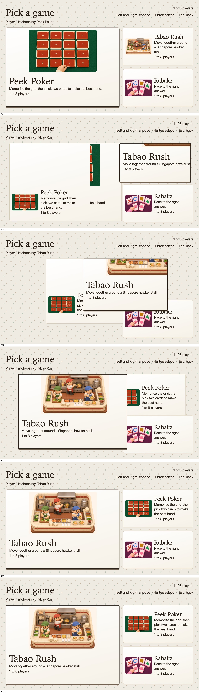 | Focus move with old and new tiles overlapping; settles by 400 ms; no blank frame or overshoot. At 100 ms there is a sliver of the old picture (and in 20 a "best hand." fragment) inside the wipe, for one frame. | Claude reviewer 9 |
| 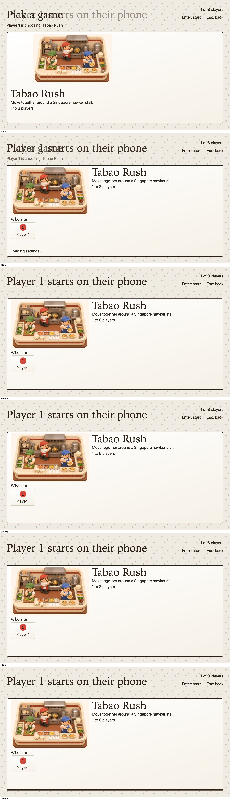 | The same tile expands; header crossfades; "Loading settings…" shows in the foot band at 125 ms and is gone by 256 ms; strip steady. | Claude reviewer 9 |
| 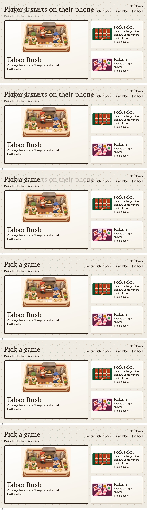 | The card returns to the picker; side tiles are revealed while the heading crossfades; no blank frame. | Claude reviewer 9 |
| 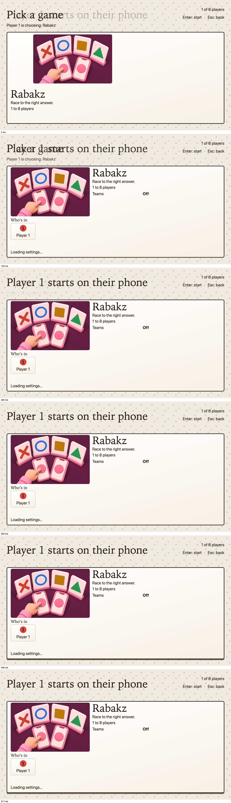 | Expansion, then "Loading settings…" in the foot band with Teams only through 517 ms; "Who's in" holds at 699 from 100 ms. | Claude reviewer 9 |
| 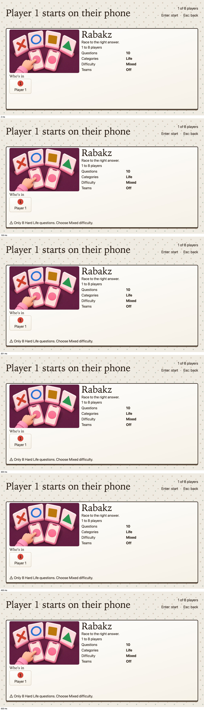 | The notice appears in the foot band by 100 ms; "Who's in" at 699 in all six frames. | Claude reviewer 9 |
| 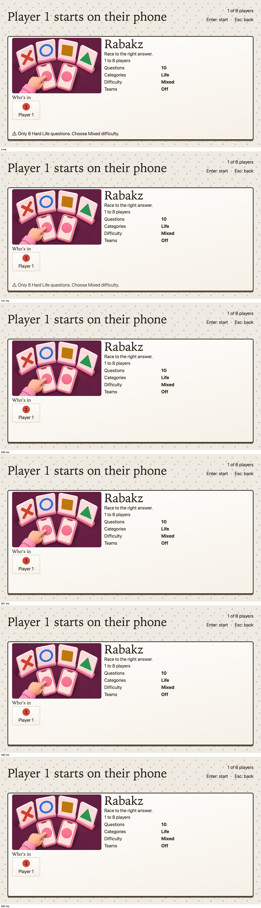 | Choosing Mixed fades the notice out (partial at 101 ms, faint at 200 ms, gone by 301 ms); "Who's in" at 699 in all six frames. | Claude reviewer 9 |
| 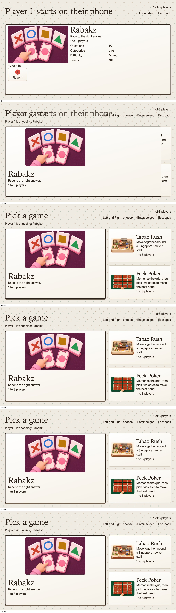 | The card returns to the picker; side tiles are revealed while the heading crossfades; no blank frame. | Claude reviewer 9 |

| Acceptance statement | Pass / fail | Evidence |
|---|---|---|
| Landing: one screen, one "Host a game", picture in the 1.618 : 1 column (REL-002) | Pass | 01, 02 |
| Phone landing: no picture, 55 px targets, footer in flow (D-189) | Pass | 03, 05, 06; legal.dom and shell-imagery.dom |
| Each game has its own picture in the picker and on the start screen (PLAT-020) | Pass | 21–49, 31–59 |
| "Who's in" at the same height on all three games | Pass | 31, 44, 57 (ink 699) |
| The strip does not move when a refusal appears or clears | Pass | 64, 67, 74; game-setup.dom |
| No blank frame, no overshoot in motion | Pass (one-frame wipe sliver noted) | 13, 20, 30, 40, 56, 81 |
