# C-08-join-page UAT evidence

Automated execution only. Visual review and acceptance decisions are pending.

Command: `node tools/uat/run.mjs -- C-08-join-page --phones 8 --out main-joincheck`
Commit: `2a706a74811d54653dec6babf7e80a4a5d9d4e8b`
Viewports: 844×390, 1920×1080, 390×844

| Timing | ms | Status |
|---|---:|---|
| Create room through host page | 1295.0 | completed |
| Join Mango | 302.6 | completed |
| Join Pebble | 242.8 | completed |
| Join Fern | 243.3 | completed |
| Join Comet | 221.6 | completed |
| Join Noodle | 245.7 | completed |
| Join Waffle | 223.2 | completed |
| Join Puddle | 221.2 | completed |
| Join Kite | 224.3 | completed |
| Ninth phone sees room full | 695.5 | completed |
| Phone reload keeps its seat | 592.5 | completed |
| Closed host disconnects phones; reopened host restores all eight | 9037.0 | completed |
| Pairing alone stopped for 25 seconds; rename still reaches host | 27479.4 | completed |
| Reduced motion rename reaches final host state within one frame | 170.6 | completed |
| Mango | 154.2 | joined |
| Pebble | 122.1 | joined |
| Fern | 110.5 | joined |
| Comet | 112.3 | joined |
| Noodle | 117.3 | joined |
| Waffle | 115.2 | joined |
| Puddle | 117.1 | joined |
| Kite | 115.7 | joined |

Expected errors (count):
- 5 × host: net::ERR_CONNECTION_REFUSED
- 5 × host: Failed to load resource: net::ERR_CONNECTION_REFUSED
- 4 × host: WebSocket connection to 'ws://127.0.0.1:5194/rooms/2XGDDCRC/host' failed: Error in connection establishment: net::ERR_CONNECTION_REFUSED

## Real server

| Screenshot | What it shows | Looked at by |
|---|---|---|
| 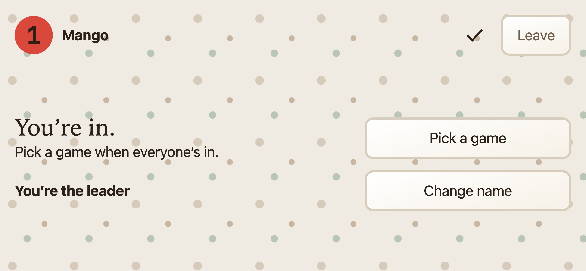 | | |
| 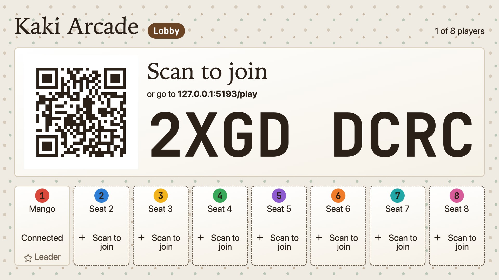 | | |
| 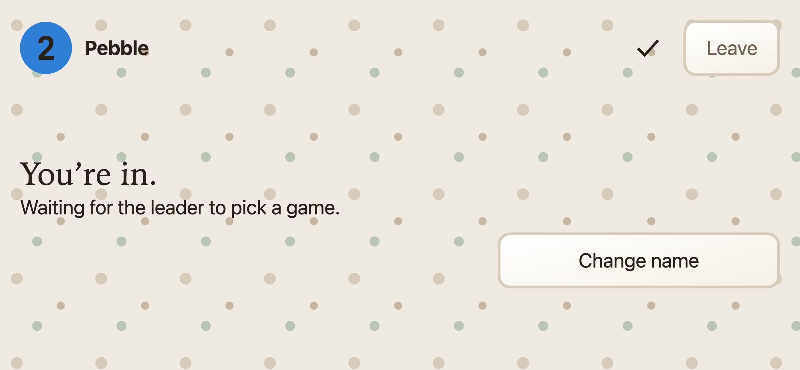 | | |
| 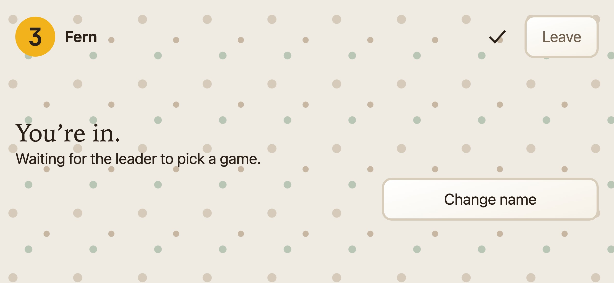 | | |
| 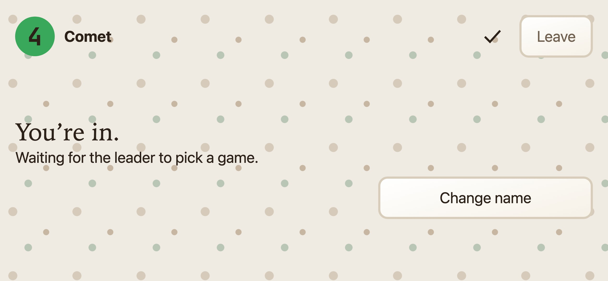 | | |
| 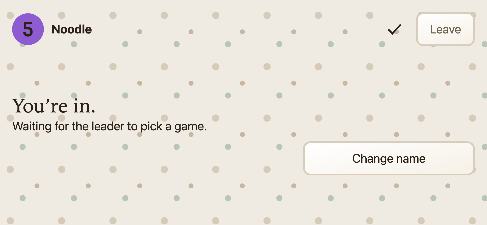 | | |
| 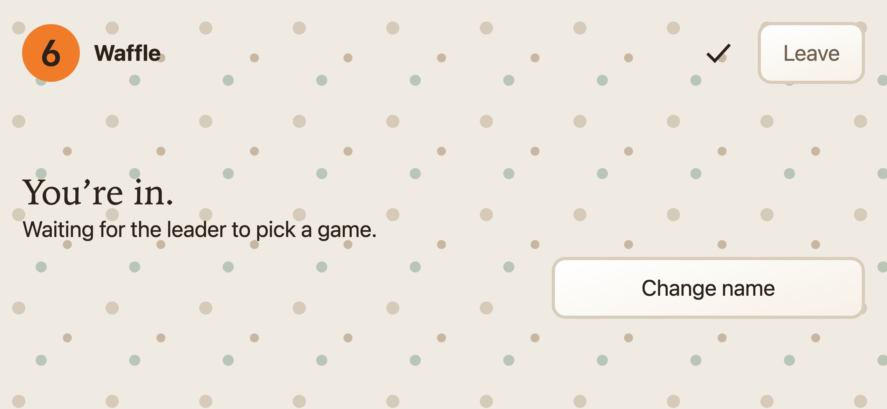 | | |
| 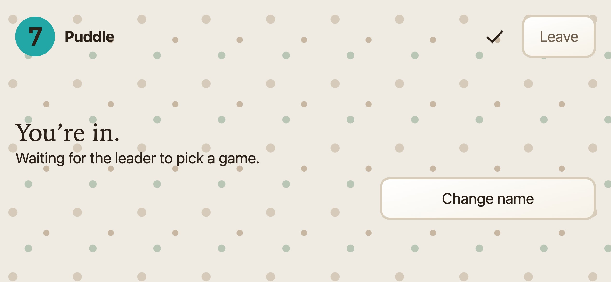 | | |
| 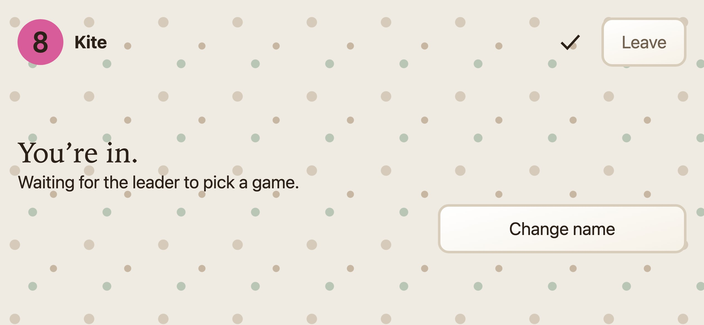 | | |
| 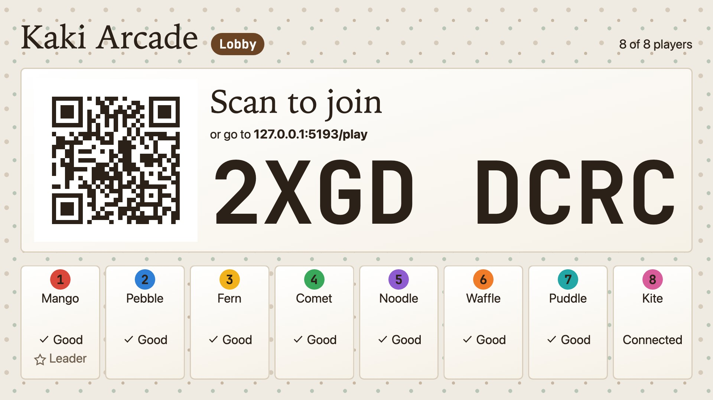 | | |
| 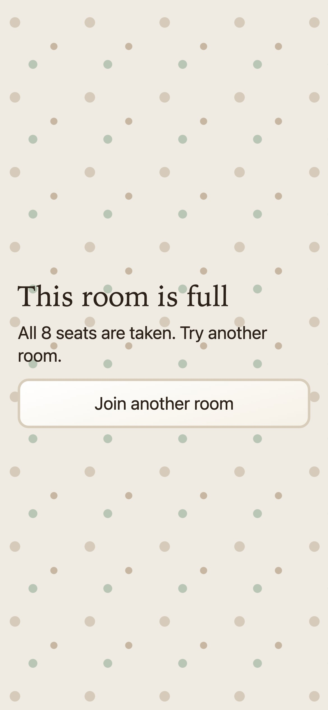 | | |
|  | | |
| 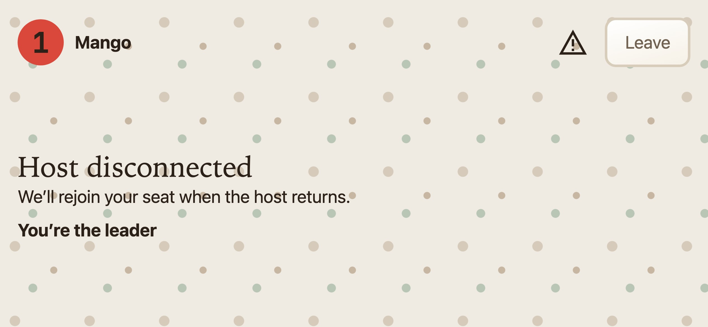 | | |
| 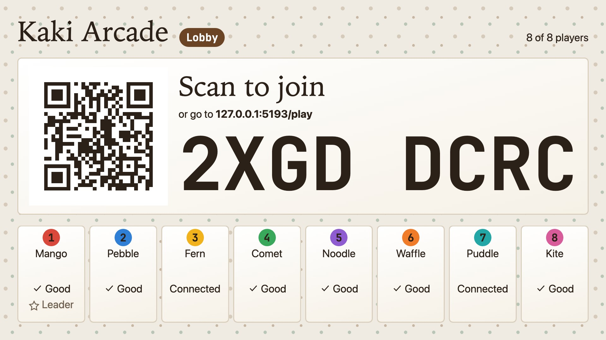 | | |
|  | | |
| 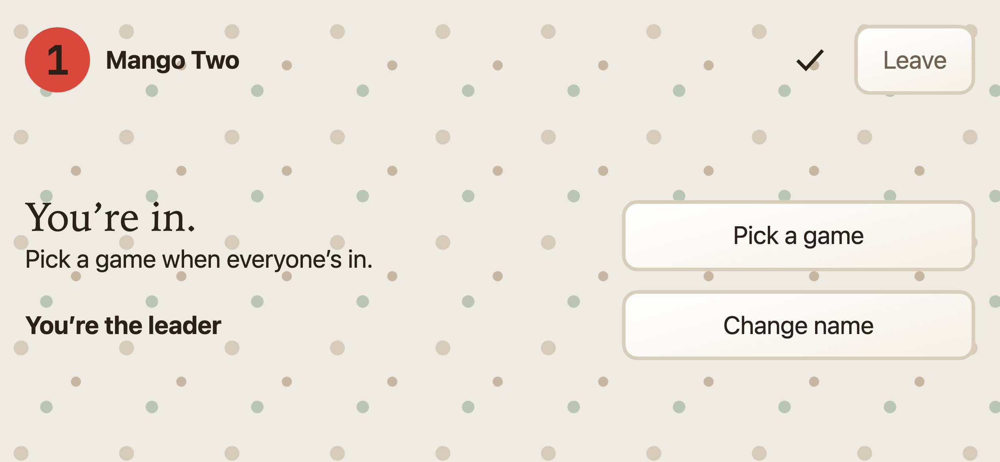 | | |
| 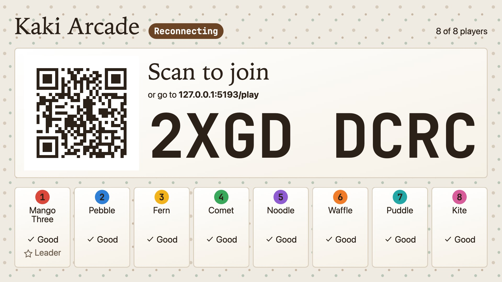 | | |

| Acceptance statement | Pass / fail | Evidence |
|---|---|---|
| | | |

## Integrator's look (2026-11-18)

Re-run on main after fixing a stale check: since C-16 the phone header shows connection as an
icon with the accessible label "Connected"/"Disconnected" (the visible word is aria-hidden), so
the script now finds `getByRole('img', { name })` instead of the text. Opened c08-main.jpg (shots
12, 13, 14, 16): host disconnected and rejoin, all eight back in the lobby, rename during the
pairing outage, reload keeps the seat. Exit 0.
