# C-11-team-setup UAT evidence

Automated execution only. Visual review and acceptance decisions are pending.

Command: `node tools/uat/run.mjs -- C-11-team-setup --phones 4 --out c11b-r8-phones4`
Commit: `1fb39e35a3a788f649dac9f05c41b8900dc1b88d`
Viewports: 844×390, 1920×1080, 667×375

| Timing | ms | Status |
|---|---:|---|
| Create room through host page | 1289.3 | completed |
| Optional teams default off; balanced automatic split | 1681.2 | completed |
| Switch and refusal, then leader move | 2047.0 | completed |
| Both phone sizes, including the leader move list | 1277.9 | completed |
| Leave and join during setup | 1260.9 | completed |
| Start Rabakz with teams | 1031.0 | completed |

Expected errors (count):
None

## Real server

| Screenshot | What it shows | Looked at by |
|---|---|---|
|  | | |
| 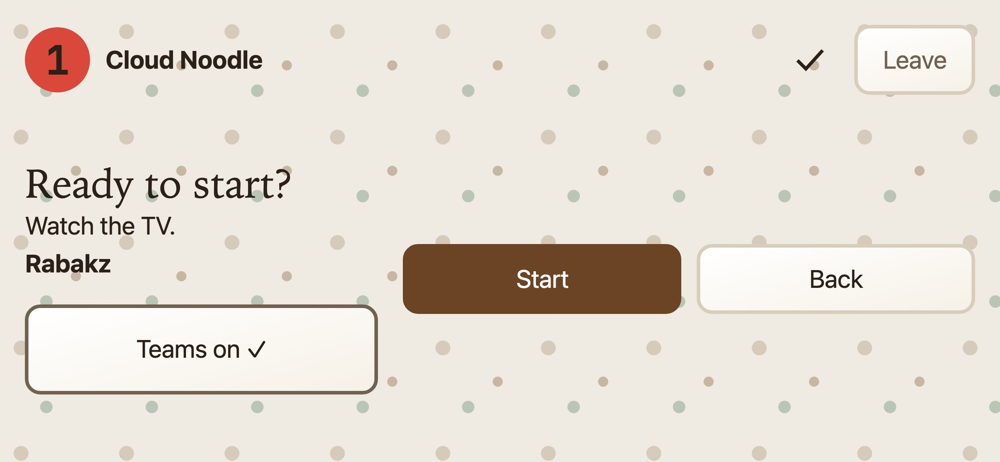 | | |
| 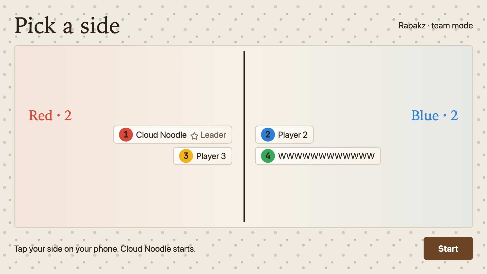 | | |
|  | | |
| 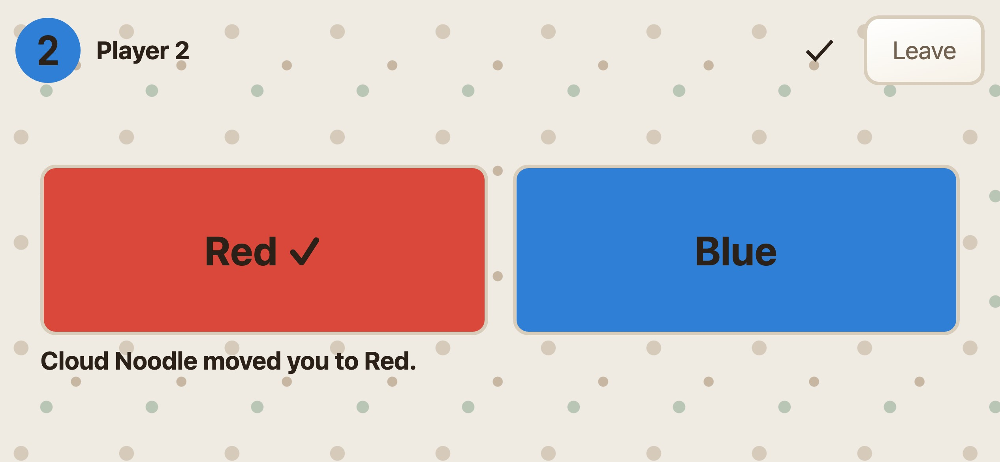 | | |
| 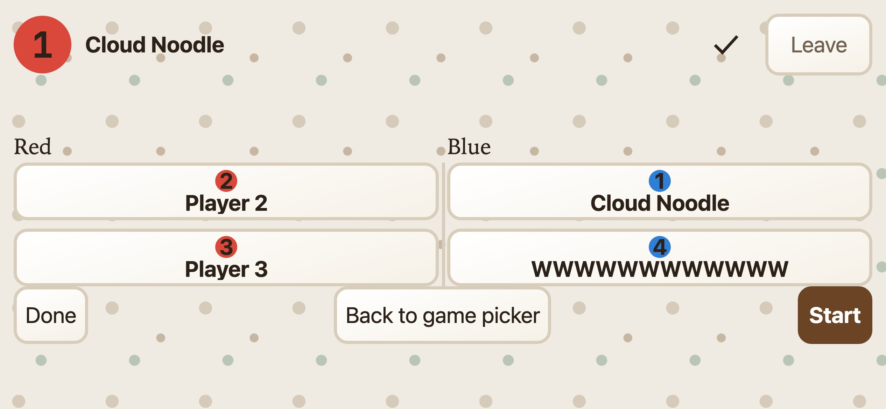 | | |
| 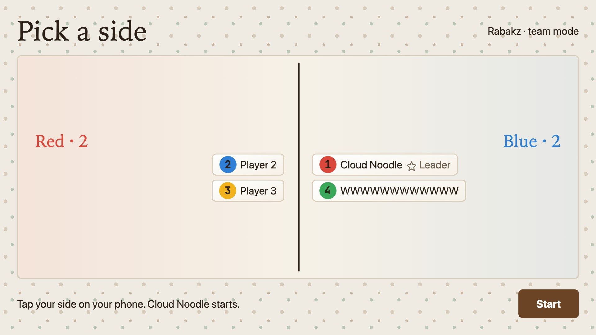 | | |
| 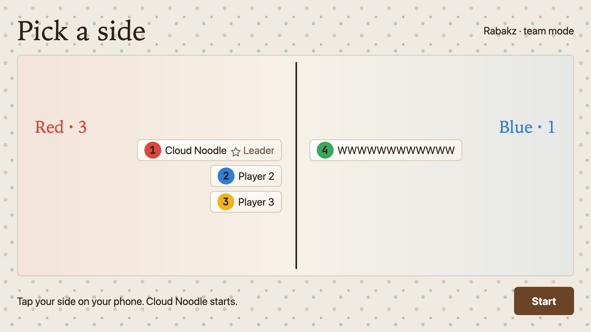 | | |
| 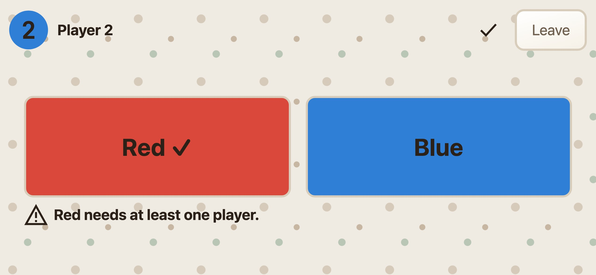 | | |
| 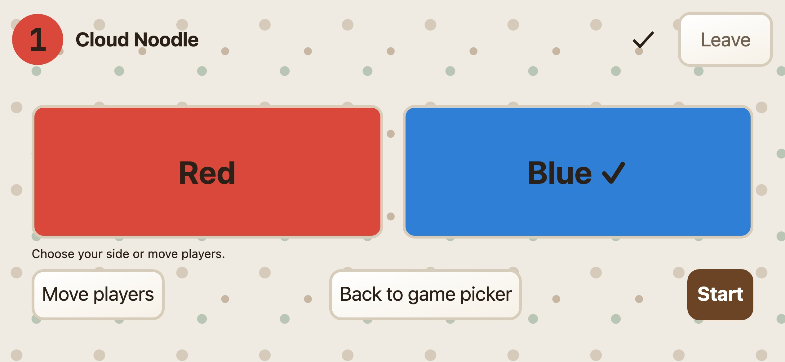 | | |
| 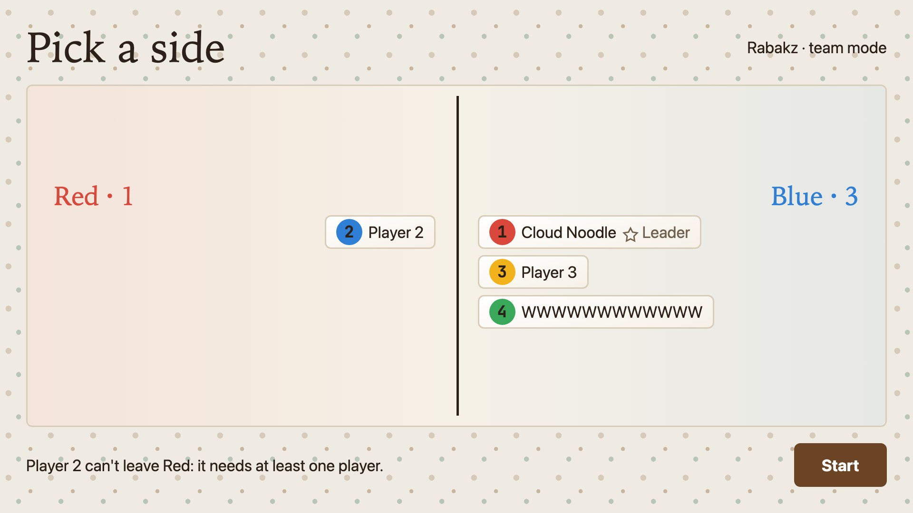 | | |
| 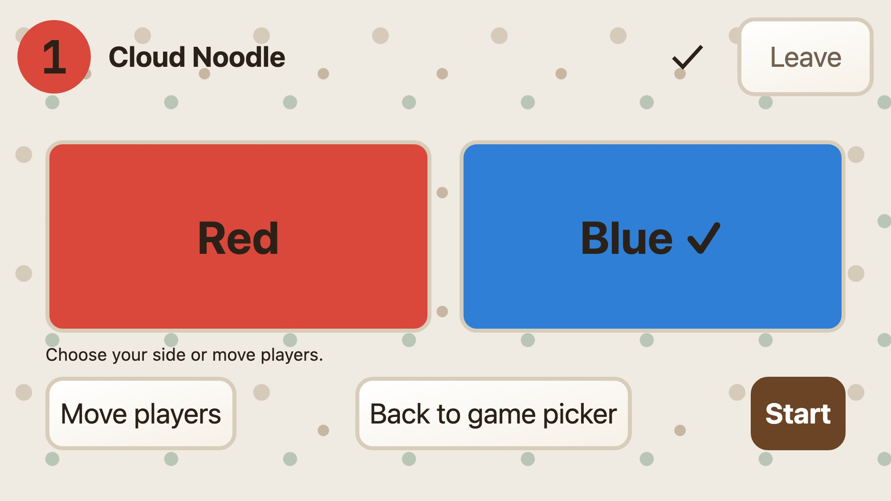 | | |
| 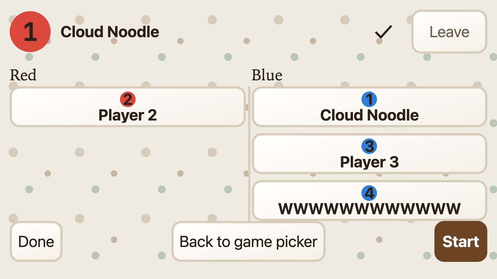 | | |
| 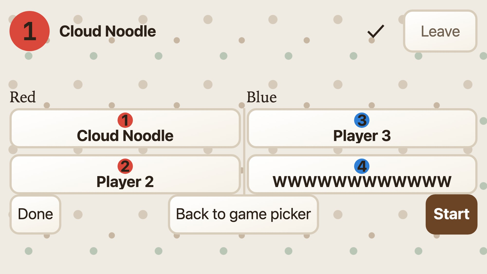 | | |
|  | | |
| 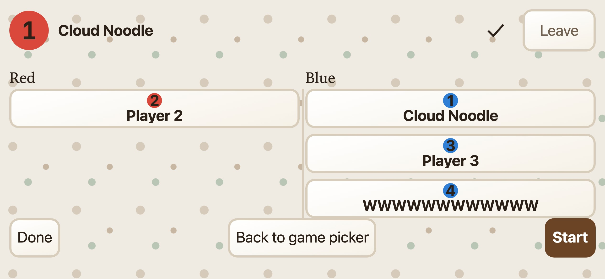 | | |
| 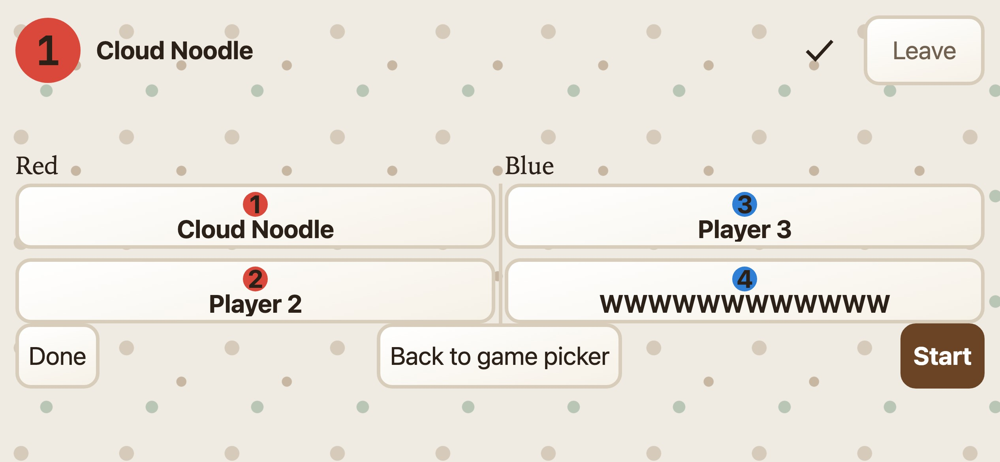 | | |
| 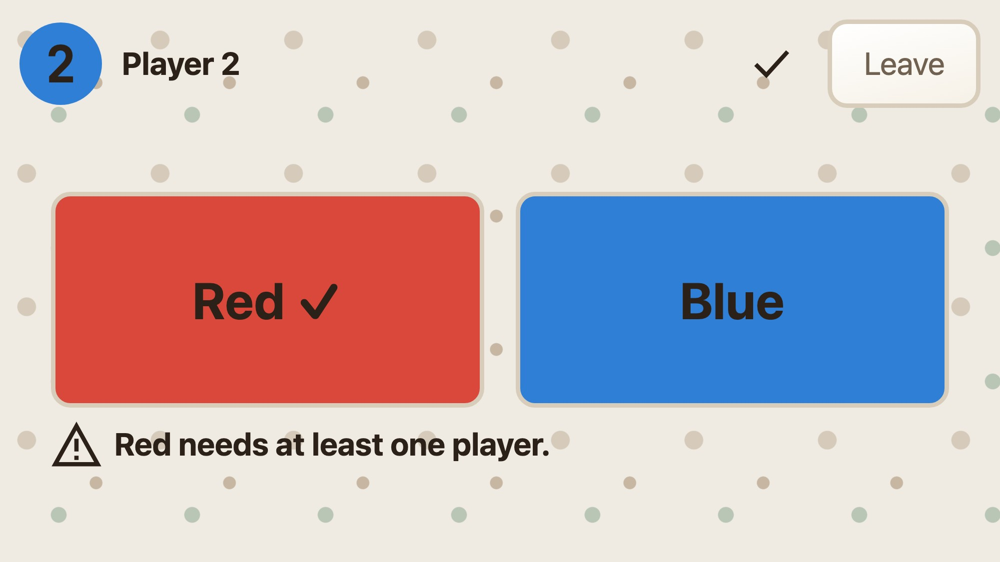 | | |
|  | | |
| 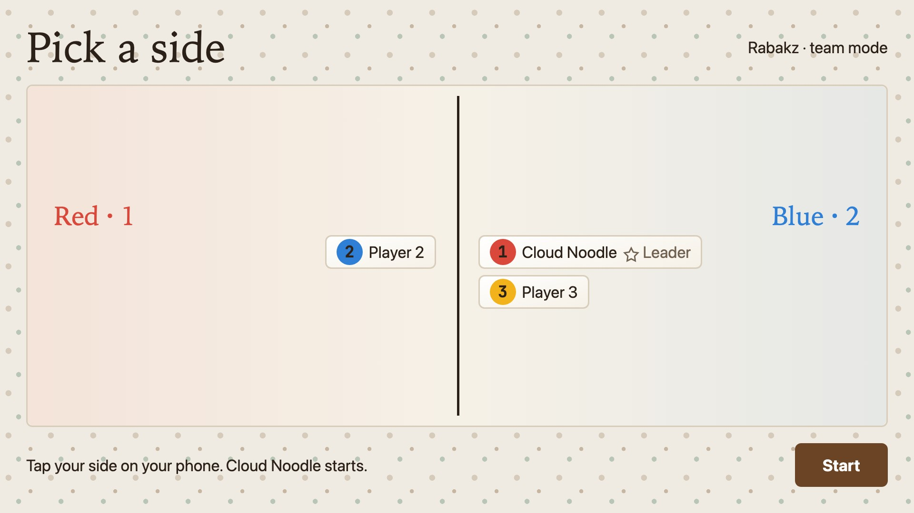 | | |
| 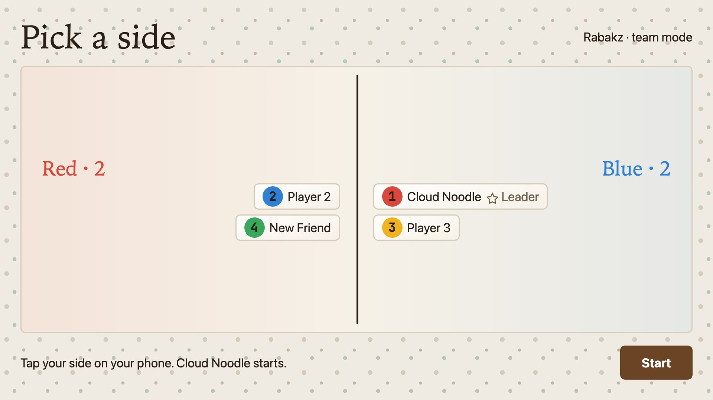 | | |
| 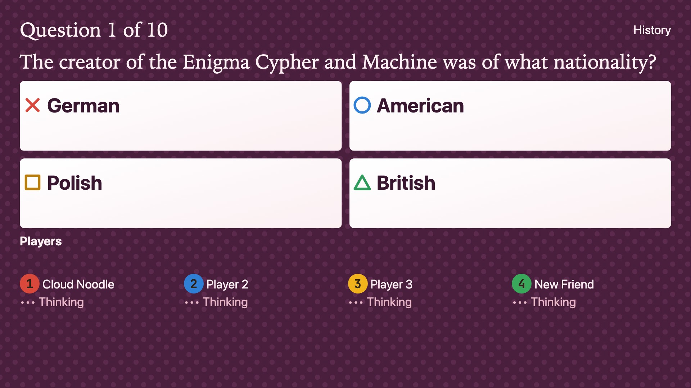 | | |
| 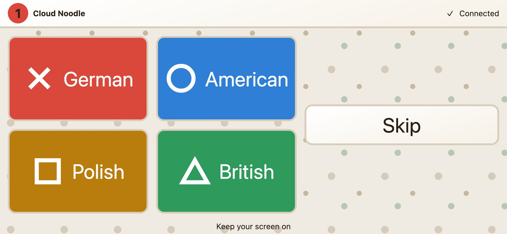 | | |

## Strips

| Screenshot | What it shows | Looked at by |
|---|---|---|
| 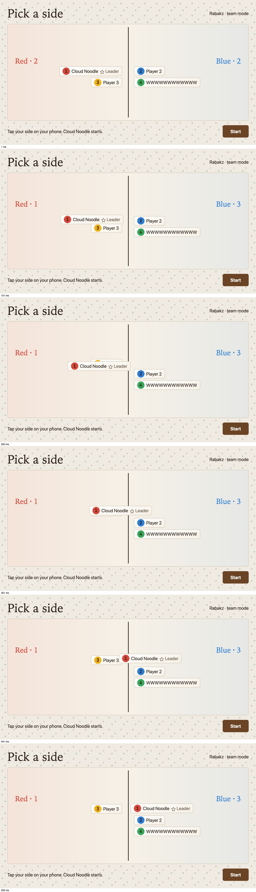 | | |

| Acceptance statement | Pass / fail | Evidence |
|---|---|---|
| | | |
