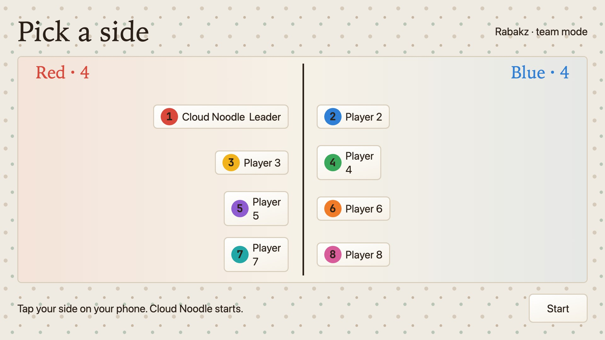
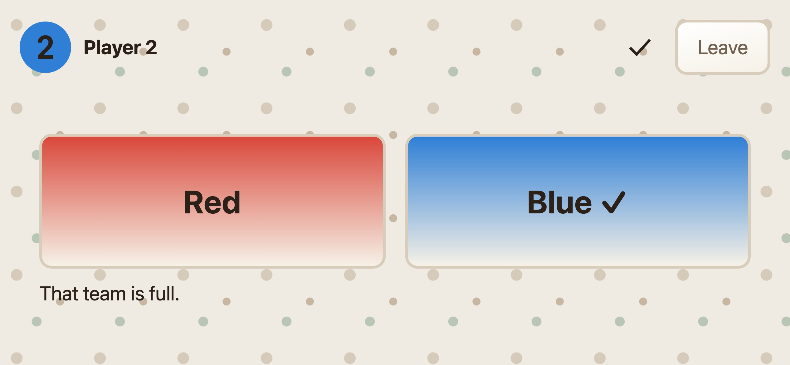
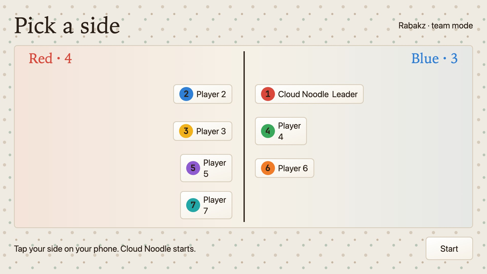
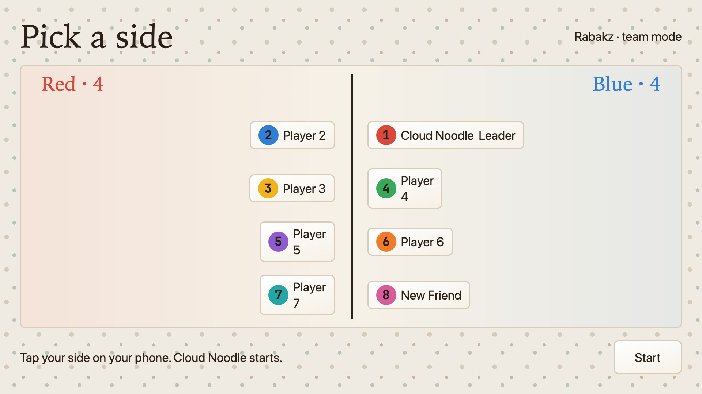
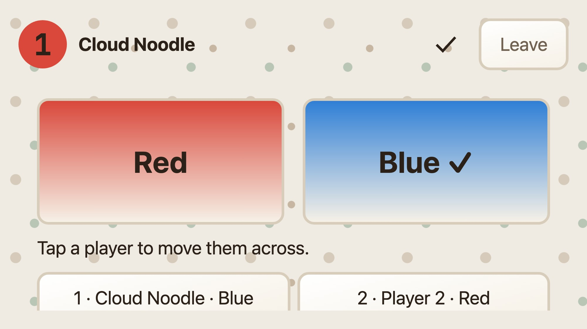
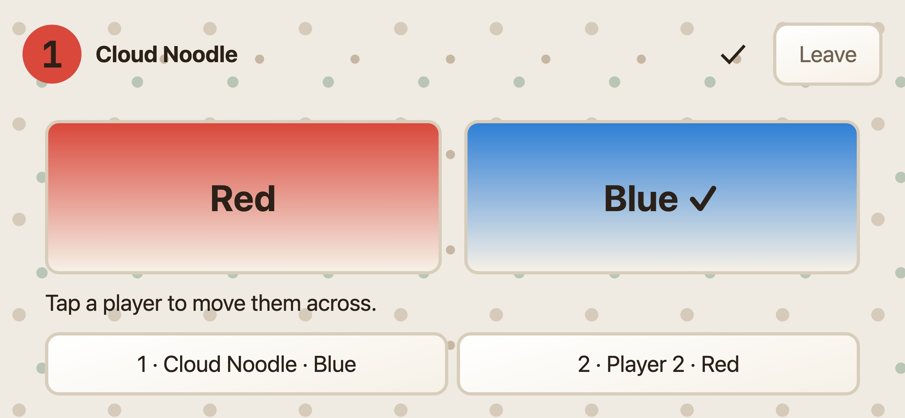
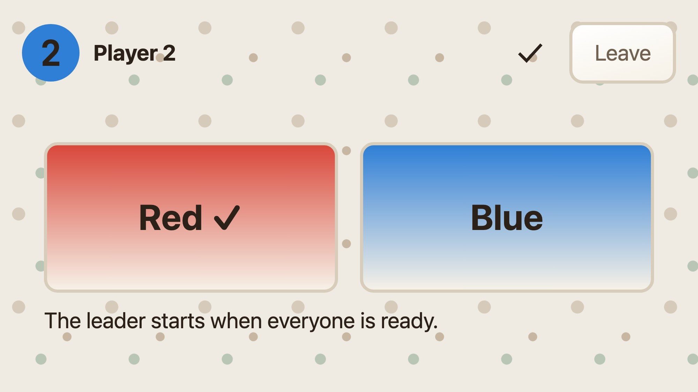
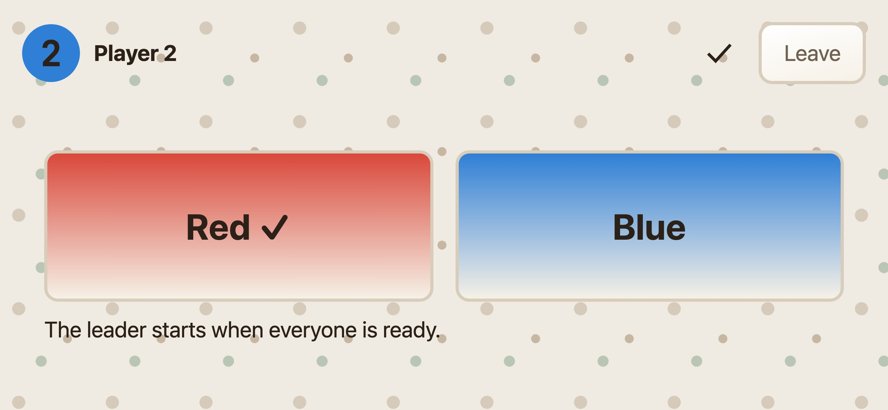
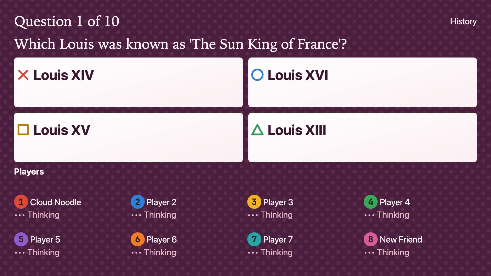
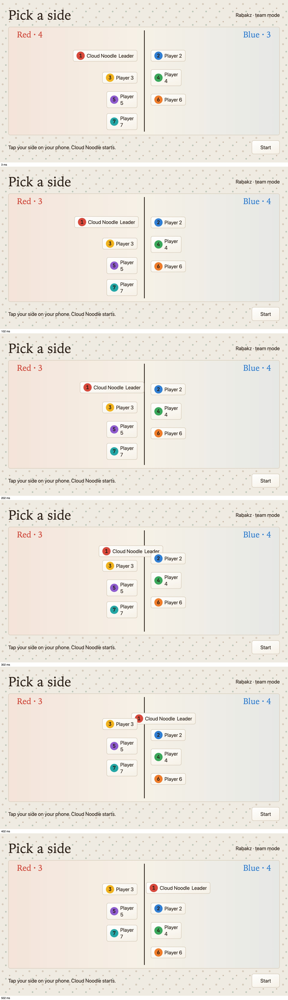

# C-11-team-setup UAT evidence

Automated execution only. Visual review and acceptance decisions are pending.

Command: `node tools/uat/run.mjs -- C-11-team-setup --phones 8 --out phones8`
Commit: `2e372feec76af7268119e1222f1bc5935a5c8fe3`
Viewports: 1920×1080, 844×390, 667×375

| Timing | ms | Status |
|---|---:|---|
| Create room through host page | 1687.0 | completed |
| Optional teams default off; balanced automatic split | 1217.7 | completed |
| Switch and refusal, then leader move | 1926.5 | completed |
| Leave and join during setup | 516.6 | completed |
| Both phone sizes, including the leader move list | 591.4 | completed |
| Start Rabakz with teams | 1464.5 | completed |

Expected errors (count):
None

## Real server

| Screenshot | What it shows | Looked at by |
|---|---|---|
|  | | |
|  | | |
|  | | |
|  | | |
|  | | |
|  | | |
|  | | |
|  | | |
|  | | |
|  | | |
|  | | |

## Strips

| Screenshot | What it shows | Looked at by |
|---|---|---|
|  | | |

| Acceptance statement | Pass / fail | Evidence |
|---|---|---|
| | | |

## Integrator's look (2026-11-18)

Opened every shot in round1-phones4 and round1-phones8 (contact sheets c11-phones4.jpg, c11-phones8.jpg) and the 8-phone switch strip as six frames (c11-strip8.jpg). Flow works: balanced split, refusals, leader move, join and leave, Rabakz starts, the switching chip crosses the line on an arc. Not accepted: names wrap on TV chips; TV chips about 13 px, far below the board; the leader move list is cut off after two players; the leader phone is blank after Rabakz starts in teams; Start not a primary button; team buttons fade to white. Round 3 brief: kaki-arcade-wt/_briefs/C-11.r3.md.
