# C-11-team-setup UAT evidence

Automated execution only. Visual review and acceptance decisions are pending.

Command: `node tools/uat/run.mjs -- C-11-team-setup --phones 4 --out phones4`
Commit: `ebf89d0d635ed59378c89dc1fadcf87e578e0481`
Viewports: 1920×1080, 844×390, 667×375

| Timing | ms | Status |
|---|---:|---|
| Create room through host page | 1899.2 | completed |
| Optional teams default off; balanced automatic split | 1221.4 | completed |
| Switch and refusal, then leader move | 2005.8 | completed |
| Leave and join during setup | 480.9 | completed |
| Both phone sizes, including the leader move list | 920.1 | completed |
| Start Rabakz with teams | 1367.8 | completed |

Expected errors (count):
None

## Real server

| Screenshot | What it shows | Looked at by |
|---|---|---|
| 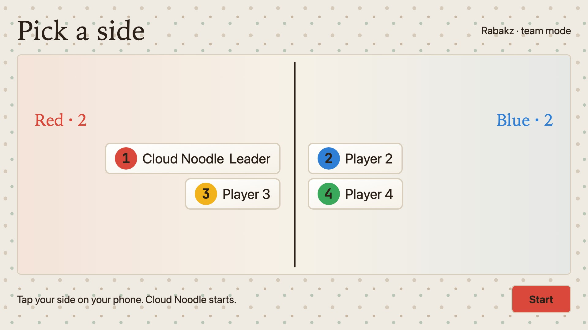 | | |
| 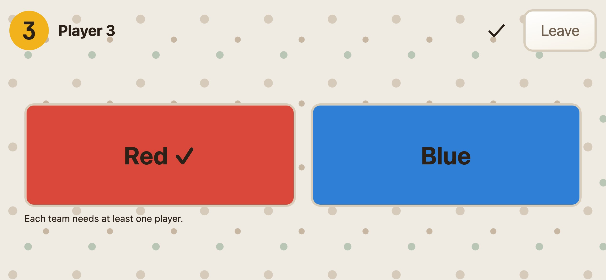 | | |
| 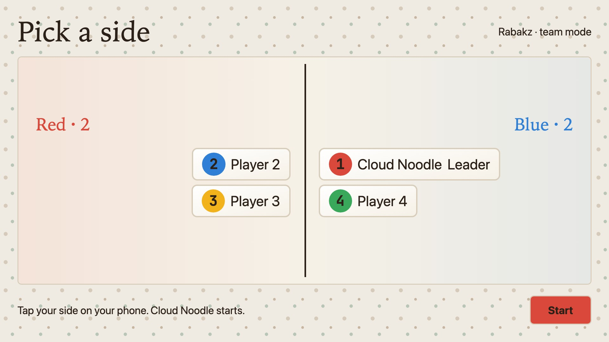 | | |
| 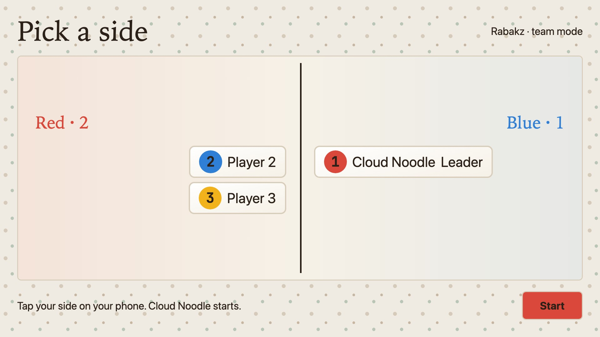 | | |
| 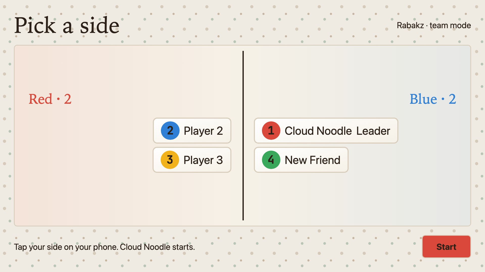 | | |
| 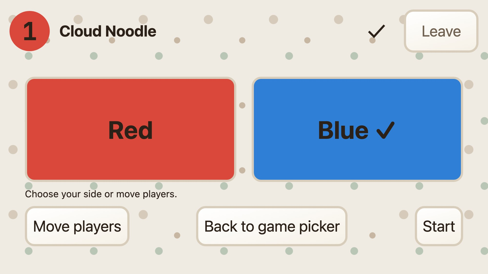 | | |
| 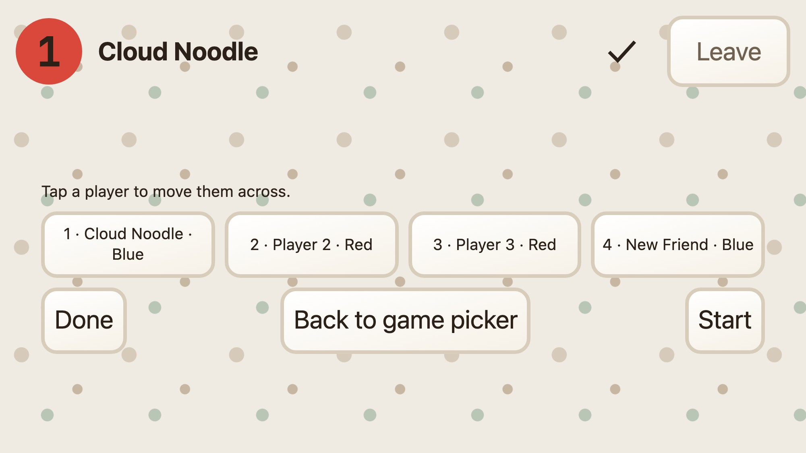 | | |
| 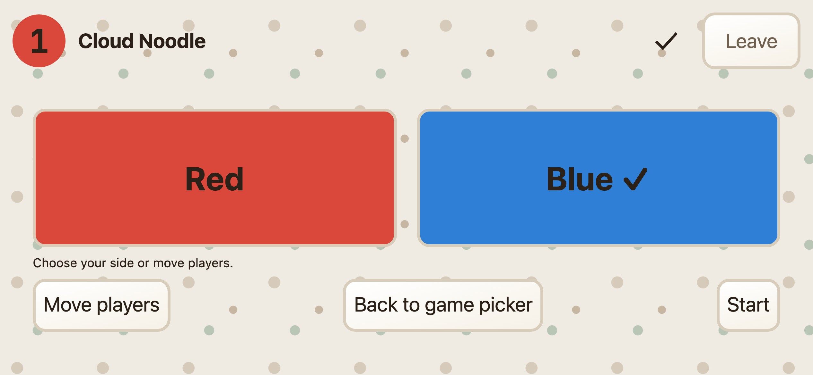 | | |
| 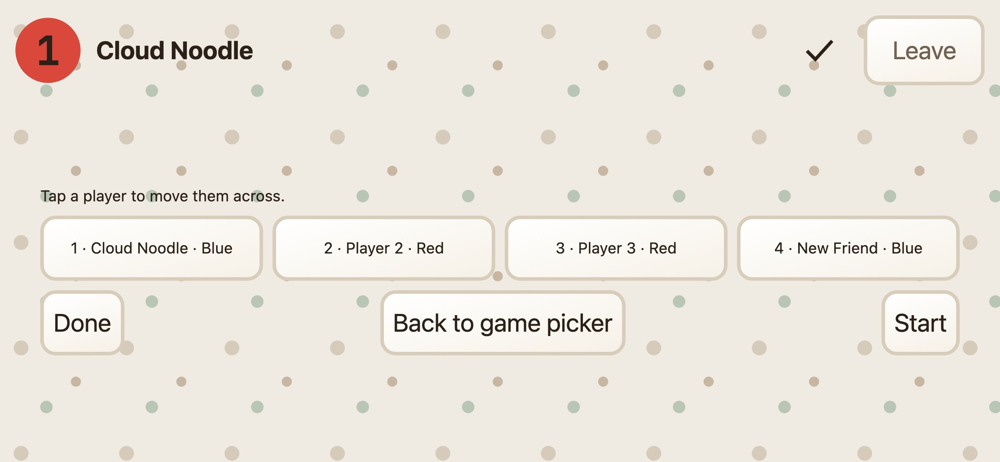 | | |
| 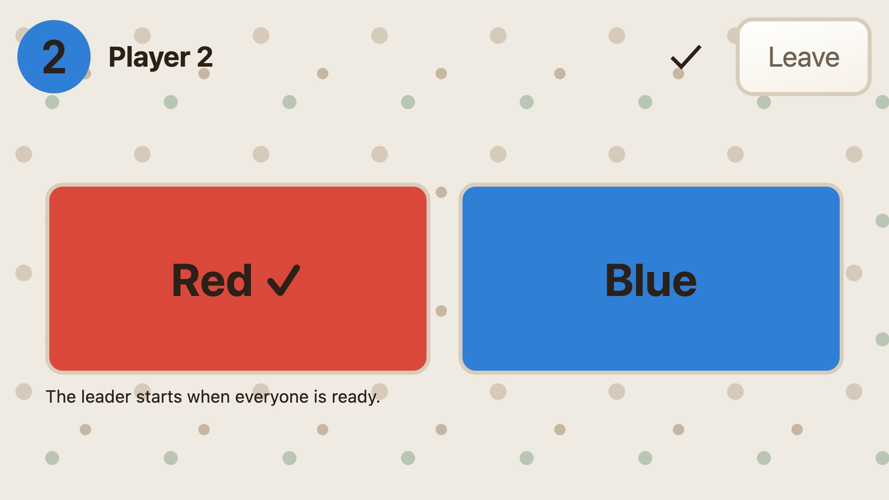 | | |
| 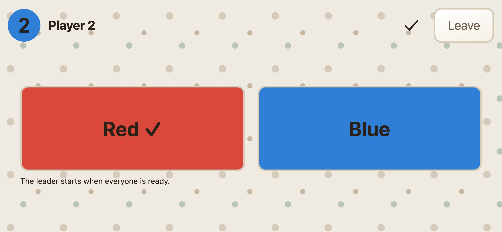 | | |
| 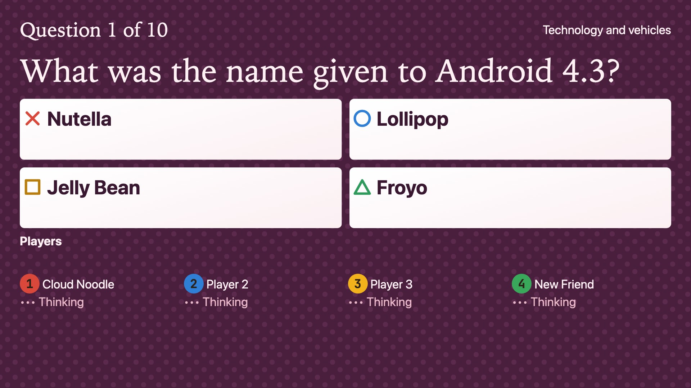 | | |
| 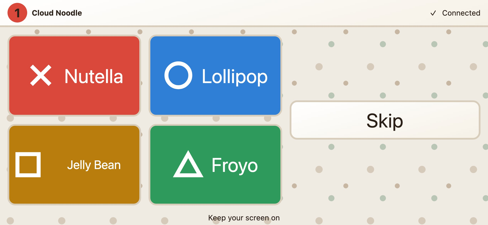 | | |

## Strips

| Screenshot | What it shows | Looked at by |
|---|---|---|
| 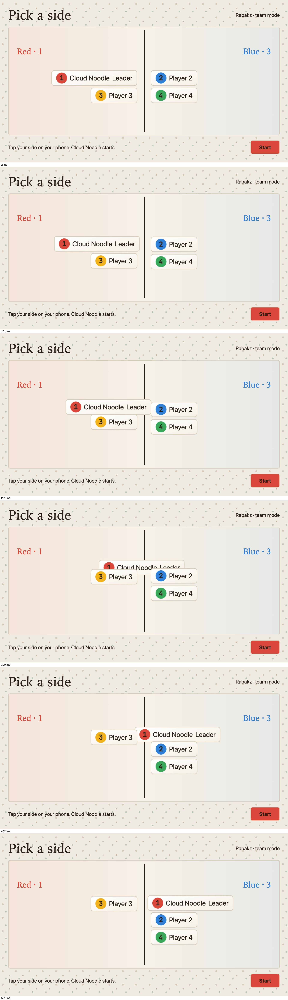 | | |

| Acceptance statement | Pass / fail | Evidence |
|---|---|---|
| | | |
