# C-11-team-setup UAT evidence

Automated execution only. Visual review and acceptance decisions are pending.

Command: `node tools/uat/run.mjs -- C-11-team-setup --phones 8 --out phones8`
Commit: `ebf89d0d635ed59378c89dc1fadcf87e578e0481`
Viewports: 1920×1080, 844×390, 667×375

| Timing | ms | Status |
|---|---:|---|
| Create room through host page | 1649.7 | completed |
| Optional teams default off; balanced automatic split | 1210.7 | completed |
| Switch and refusal, then leader move | 2093.4 | completed |
| Leave and join during setup | 497.1 | completed |
| Both phone sizes, including the leader move list | 989.8 | completed |
| Start Rabakz with teams | 1501.2 | completed |

Expected errors (count):
None

## Real server

| Screenshot | What it shows | Looked at by |
|---|---|---|
| 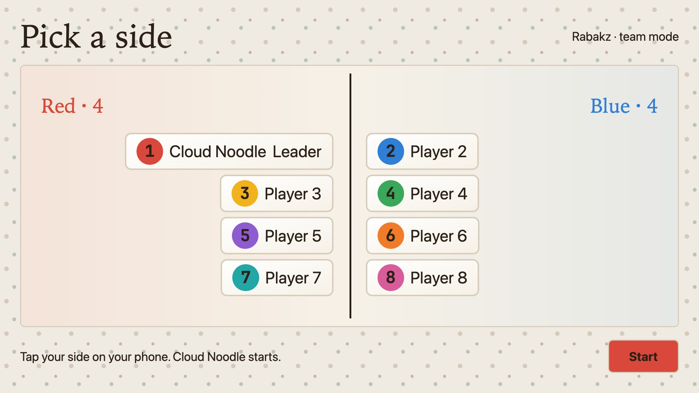 | | |
| 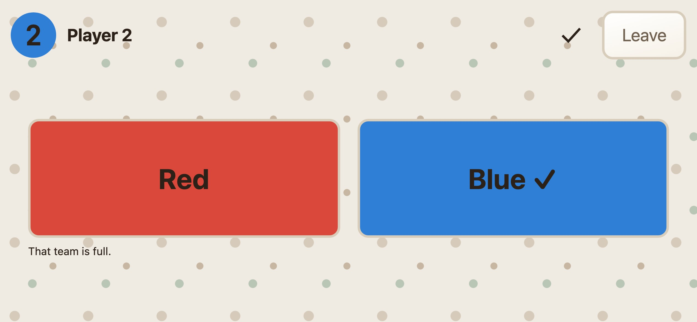 | | |
|  | | |
| 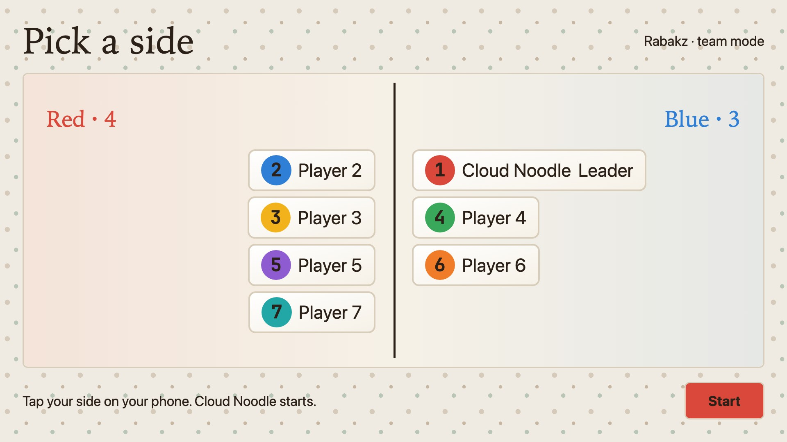 | | |
| 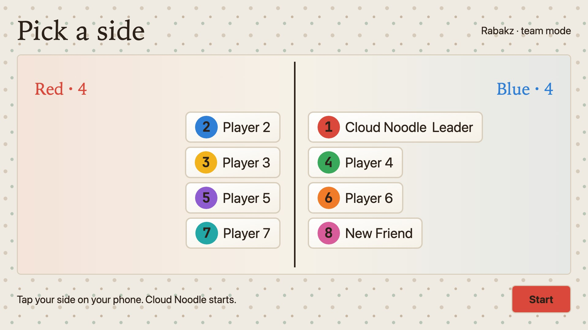 | | |
| 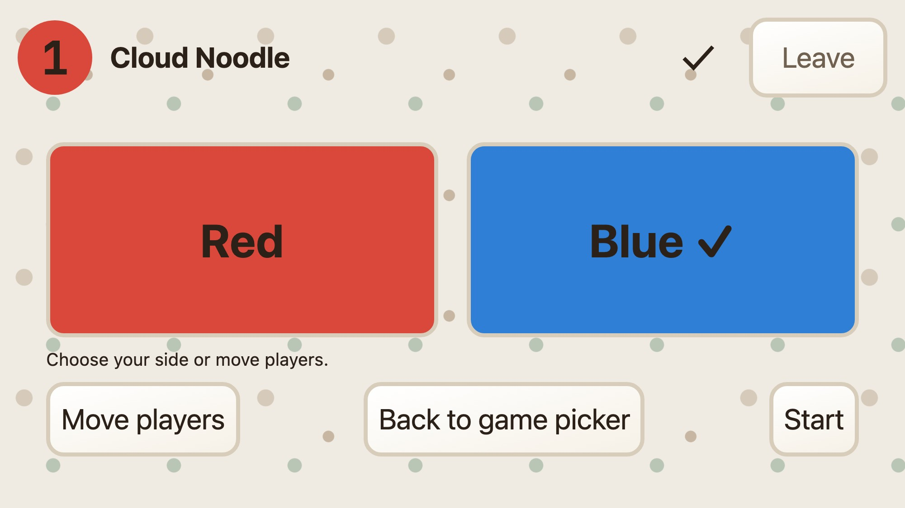 | | |
| 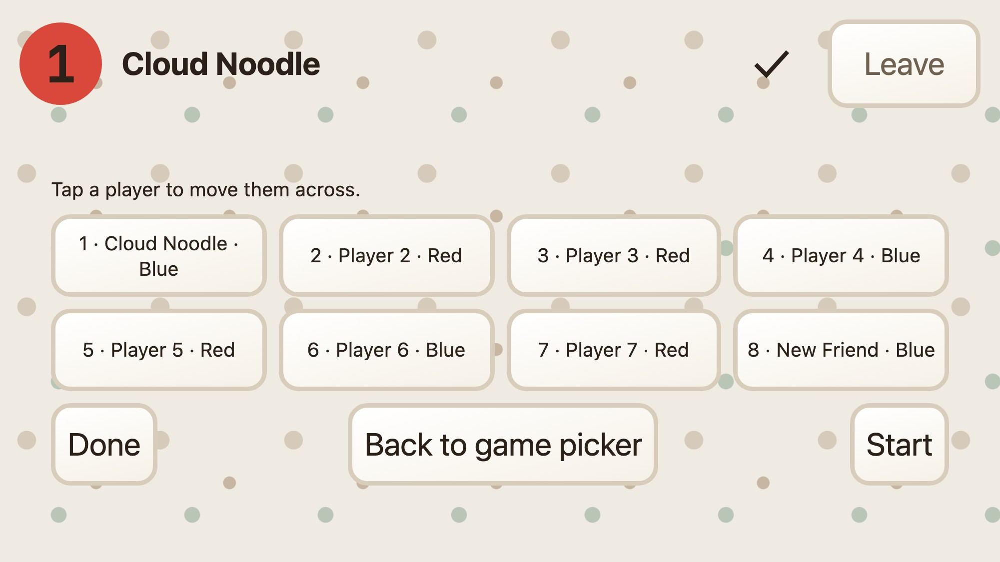 | | |
| 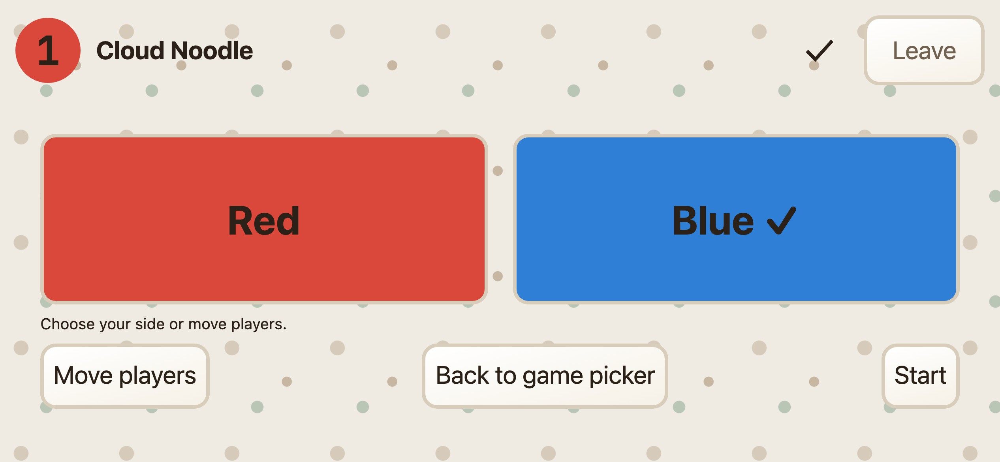 | | |
| 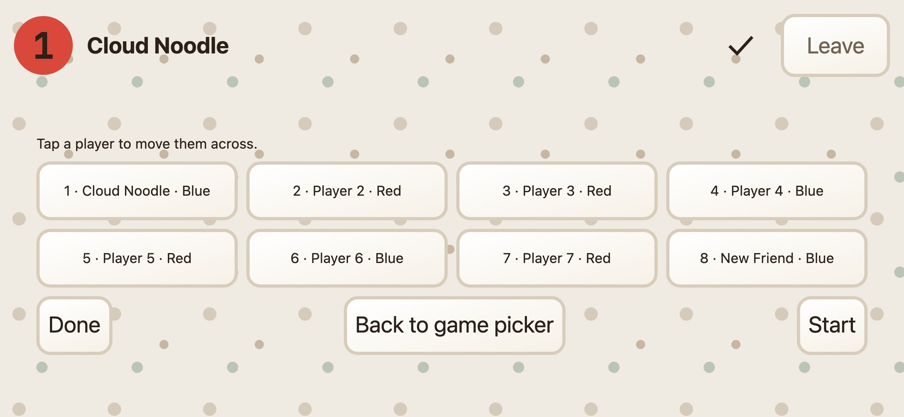 | | |
| 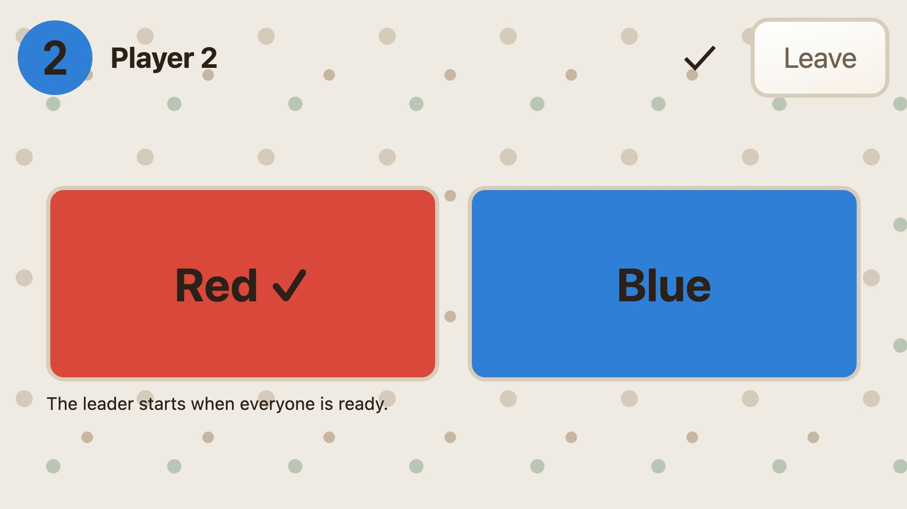 | | |
| 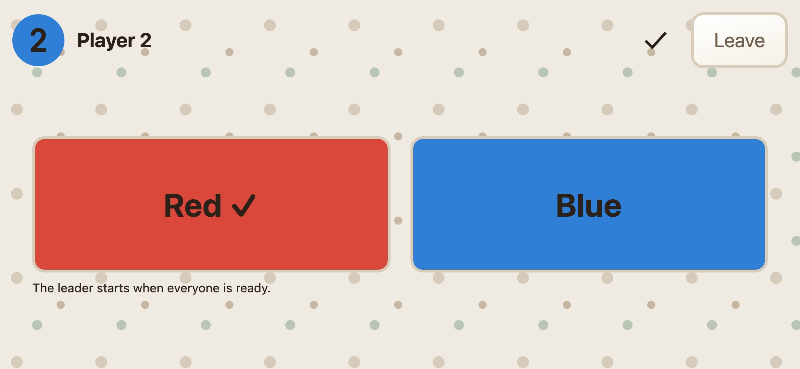 | | |
| 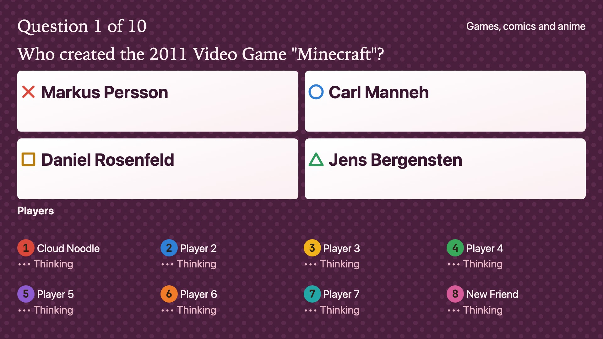 | | |
| 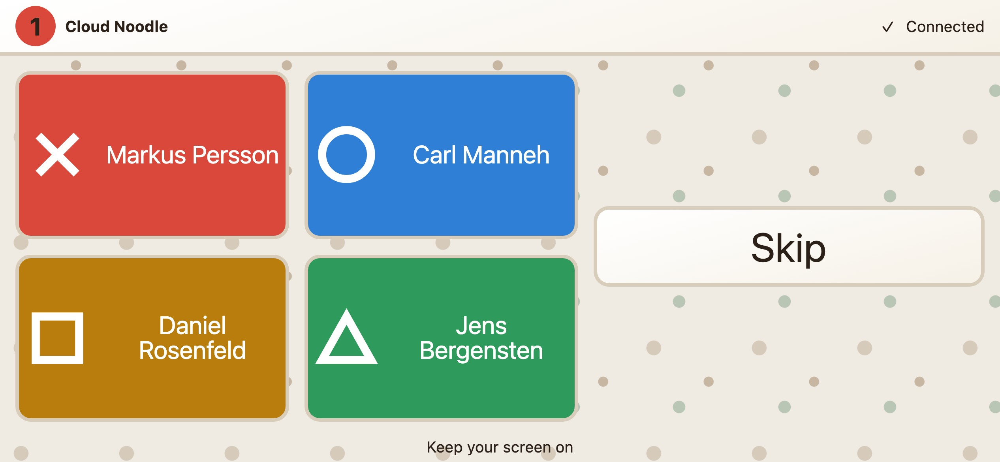 | | |

## Strips

| Screenshot | What it shows | Looked at by |
|---|---|---|
| 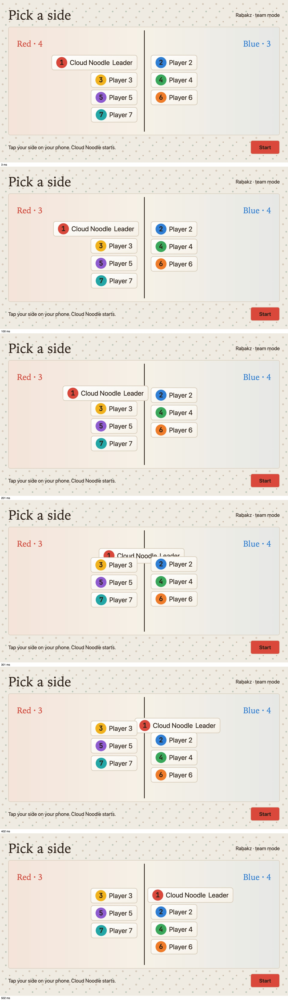 | | |

| Acceptance statement | Pass / fail | Evidence |
|---|---|---|
| | | |

## Integrator's look (2026-11-18, round 3)

Opened every shot in round3-phones4 and round3-phones8 (contact sheets c11r3-phones4.jpg, c11r3-phones8.jpg) and both switch strips as six frames each. Fixed from round 1: TV names on one line at a larger size; the leader opens Move players to a grid showing all 8 players at 667 x 375 and 844 x 390; the leader phone shows the Rabakz answer buttons after a team start; Start is a red primary button; team buttons are solid colour. The switching chip crosses the line on an arc. For the reviewer to measure: TV name size against the board (still smaller, field partly empty) and the Move players buttons and hint text at 844 x 390 against the 55 px touch target and minimum text size.
