# C-11-team-setup UAT evidence

Automated execution only. Visual review and acceptance decisions are pending.

Command: `node tools/uat/run.mjs -- C-11-team-setup --phones 8 --out round4-phones8`
Commit: `fb367c10a214a800c264e9e4d46ab9e40df3eb7b`
Viewports: 844×390, 1920×1080, 667×375

| Timing | ms | Status |
|---|---:|---|
| Create room through host page | 1572.7 | completed |
| Optional teams default off; balanced automatic split | 1608.8 | completed |
| Switch and refusal, then leader move | 2172.7 | completed |
| Leave and join during setup | 1242.2 | completed |
| Both phone sizes, including the leader move list | 862.1 | completed |
| Start Rabakz with teams | 1186.4 | completed |

Expected errors (count):
None

## Real server

| Screenshot | What it shows | Looked at by |
|---|---|---|
|  | | |
| 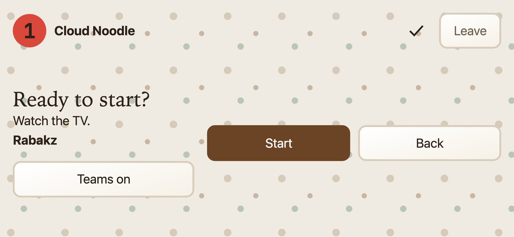 | | |
| 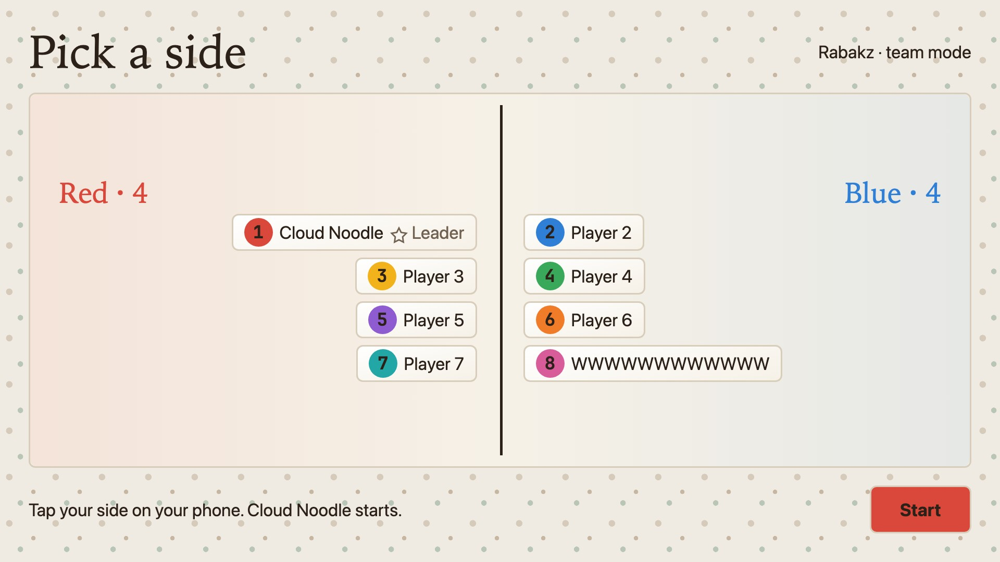 | | |
|  | | |
| 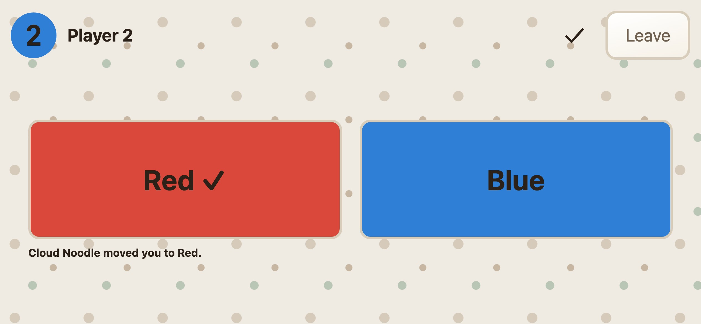 | | |
| 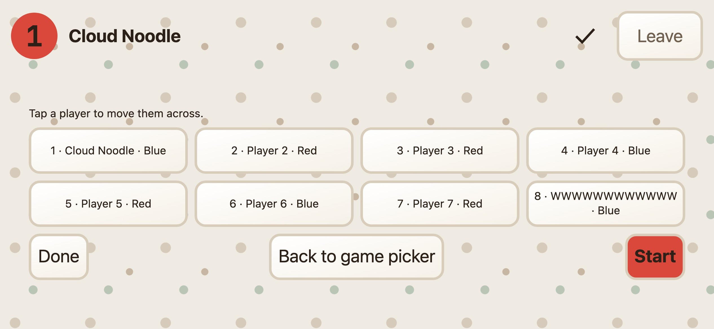 | | |
| 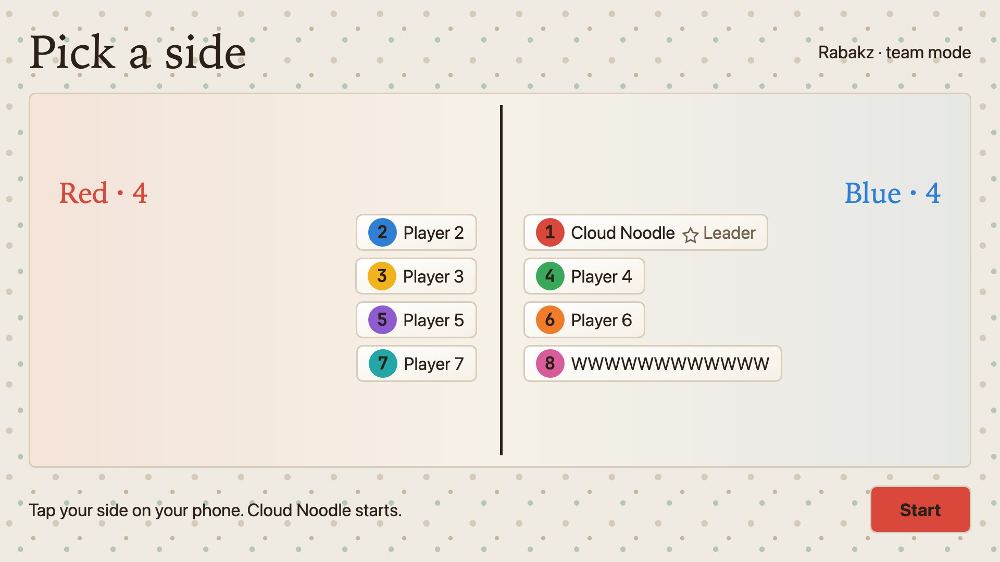 | | |
| 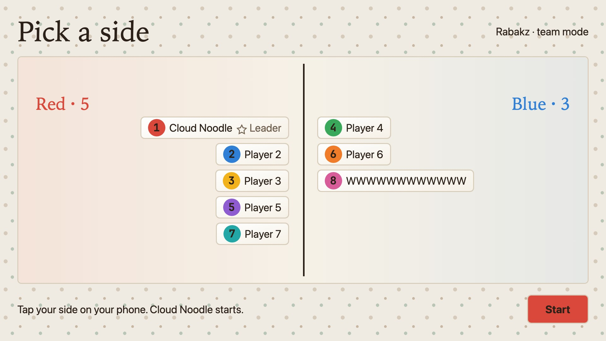 | | |
| 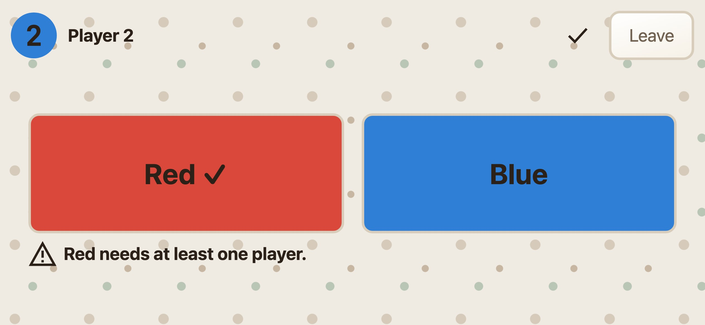 | | |
|  | | |
| 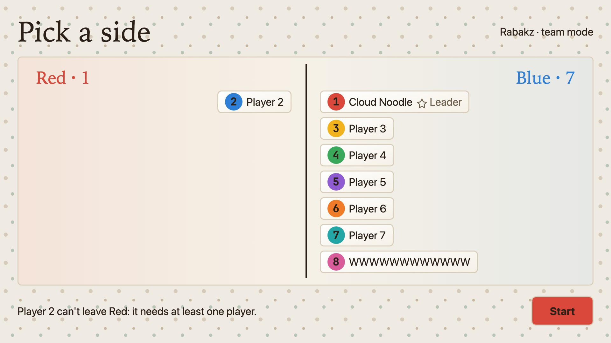 | | |
| 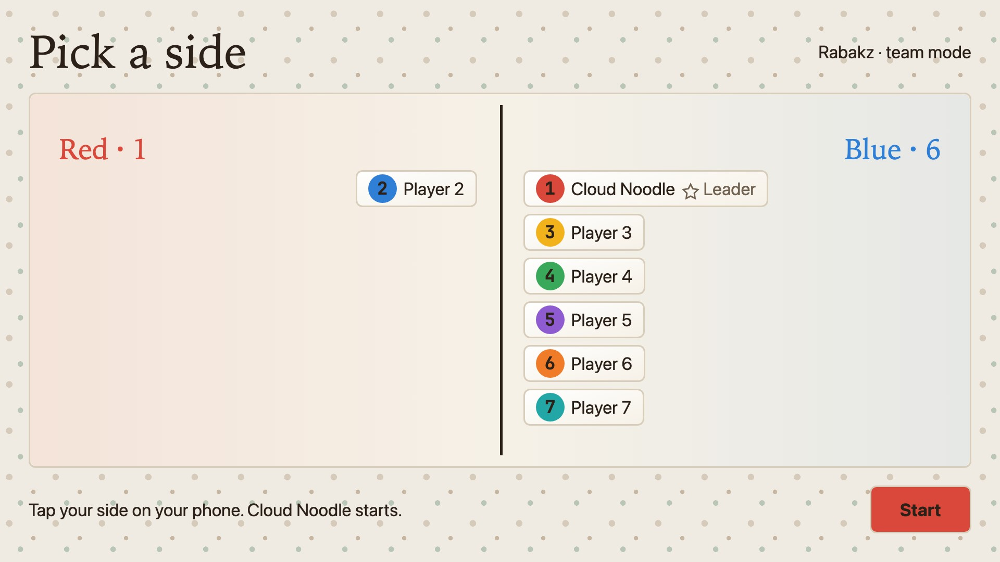 | | |
| 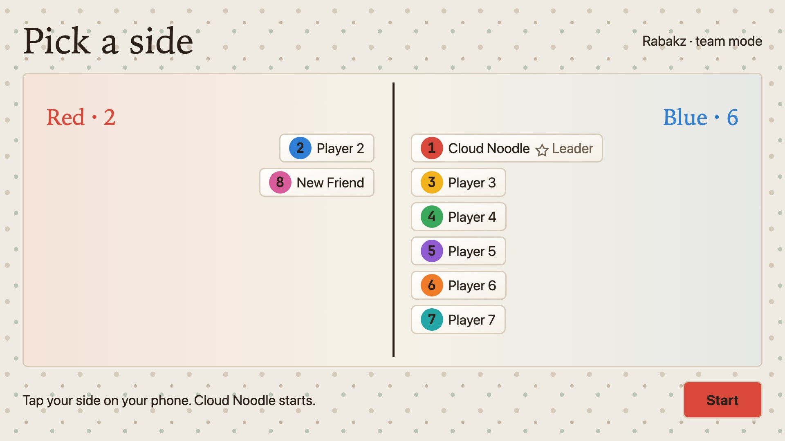 | | |
| 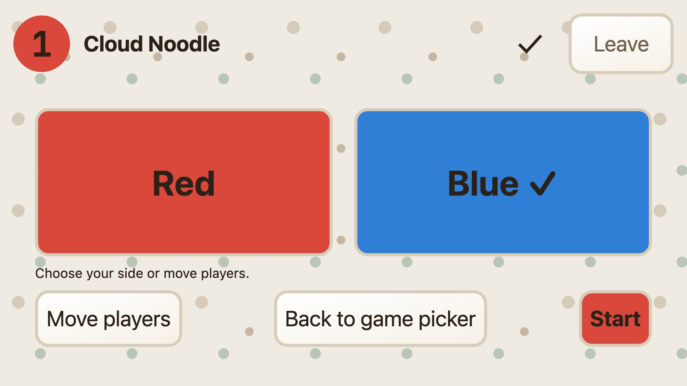 | | |
| 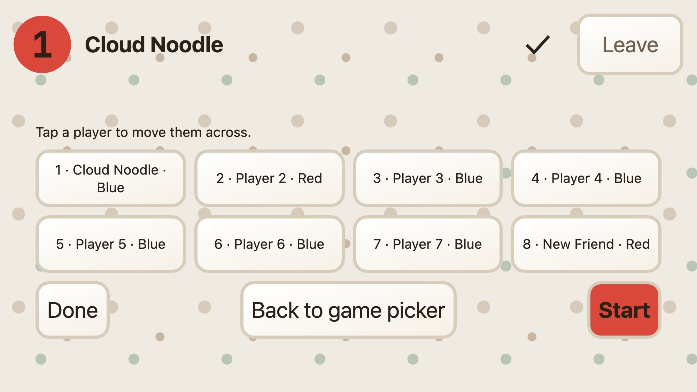 | | |
| 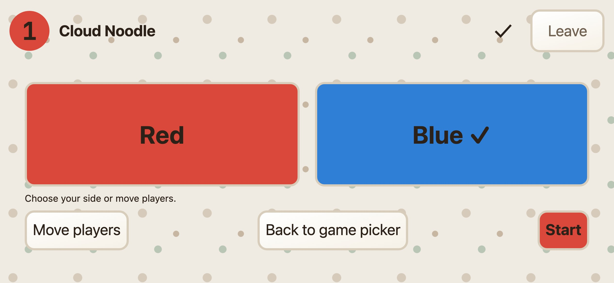 | | |
|  | | |
| 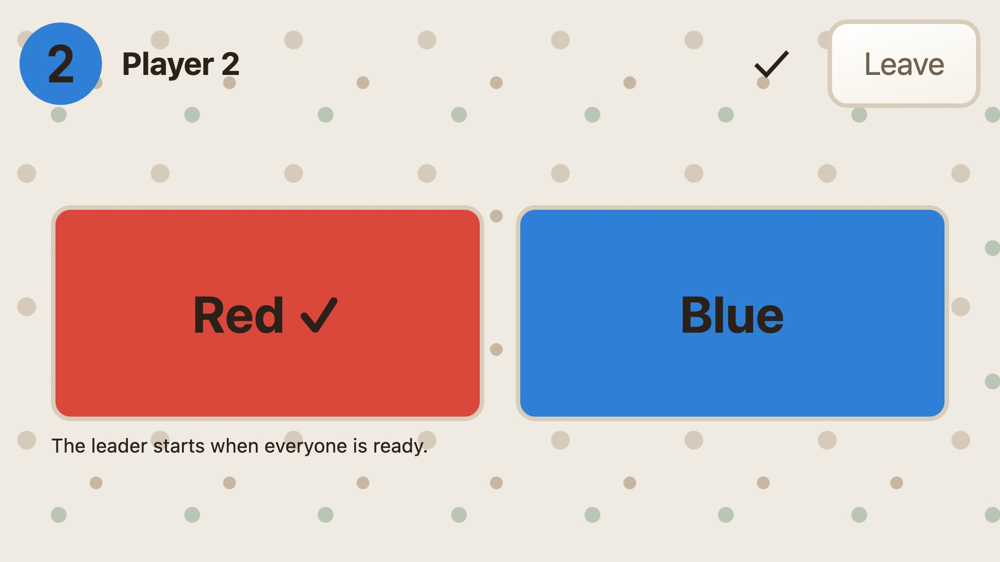 | | |
| 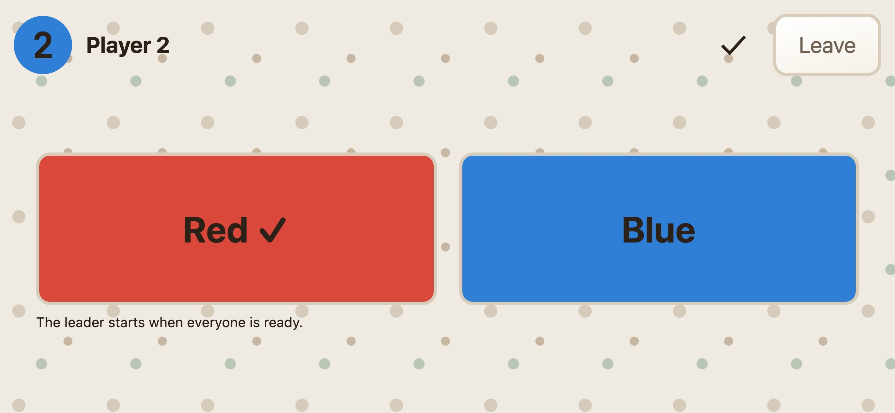 | | |
| 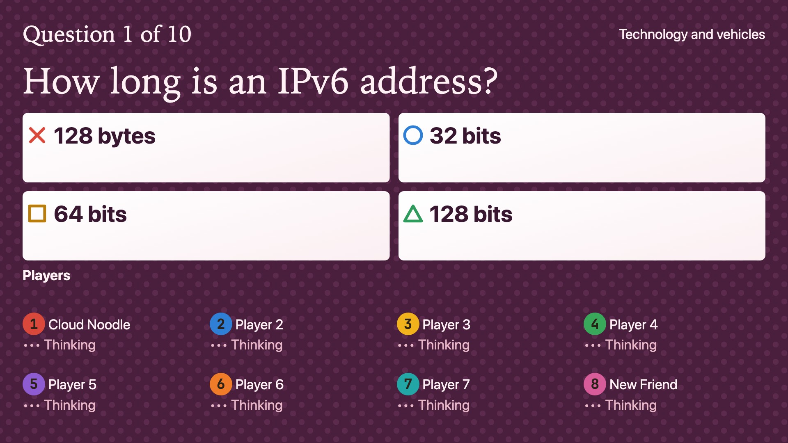 | | |
| 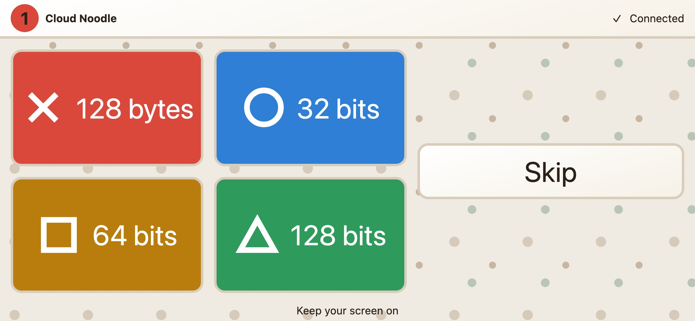 | | |

## Strips

| Screenshot | What it shows | Looked at by |
|---|---|---|
| 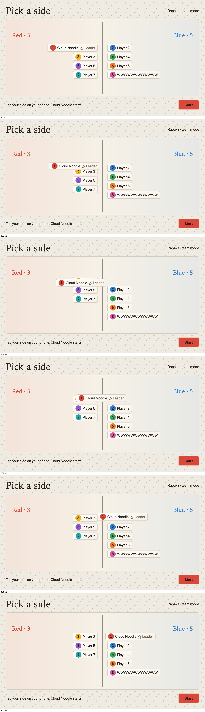 | | |

| Acceptance statement | Pass / fail | Evidence |
|---|---|---|
| | | |

## Integrator's look (2026-11-18)

Opened every shot in this folder (contact sheets ../c11r4-tv.jpg and ../c11r4-phones.jpg) and the
strip 11 at full size.
- 03/04: 4 v 4 at true TV tokens, names on one line, the 14-character name fits; "Leader" sits
  apart with the star icon in the secondary colour.
- 14: the leader moved at 8 players with nobody leaving first (no size cap, D-149).
- 18: the TV names who was refused ("Player 2 can't leave Red: it needs at least one player.");
  16 shows the refusal with the warning icon on the tapping phone only; 17 shows no message on
  another phone.
- 12: the moved player's phone says "Cloud Noodle moved you to Red."; 13 shows the grid after a move.
- 11 strip: the crossing chip arcs over the centre line and stays above its neighbours; the
  others reflow straight after it; nothing passes its rest position at these frames.
- 19/20: the leave and the join show different splits.
- 01/02: the Teams off/on toggle; 21-26: both phone sizes, every target readable.
- For the reviewer: at 667 the grid label "1 · Cloud Noodle · Blue" still wraps onto two lines;
  team-setup Start is red while the "Ready to start?" Start is brown.
