# C-12-host-keyboard UAT evidence

Automated execution only. Visual review and acceptance decisions are pending.

Command: `node tools/uat/run.mjs -- C-12-host-keyboard --phones 8 --out round10`
Commit: `f789353830f0cf70190720a2ea286a20938958ab`
Viewports: 1920×1080, 1280×720

| Timing | ms | Status |
|---|---:|---|
| Create room through host page | 2168.0 | completed |

Expected errors (count):
None

## Real server

| Screenshot | What it shows | Looked at by |
|---|---|---|
| 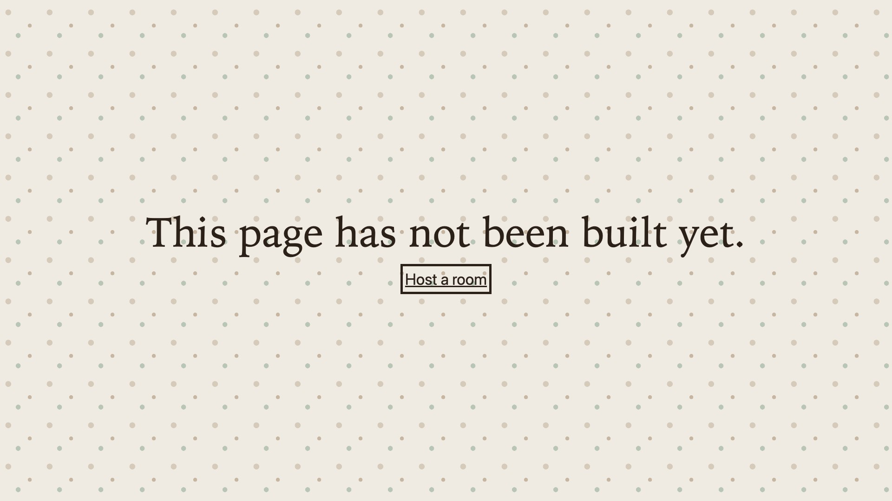 | Landing placeholder with Host a room focused. | |
| 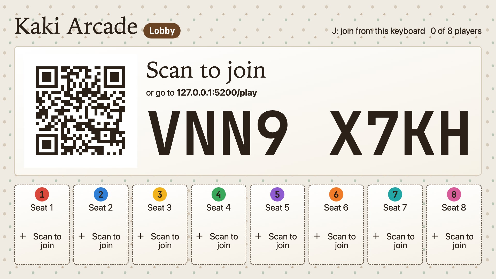 | Empty lobby with keyboard join hint and eight empty seats. | |
| 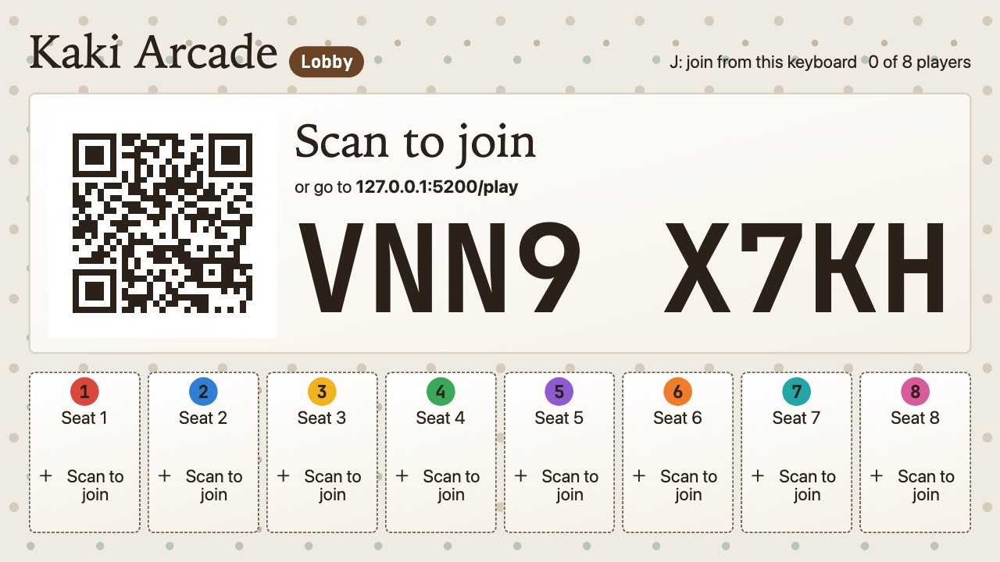 | Empty lobby at 720p with join panel and seats. | |
|  | Empty lobby with keyboard and mocked game-pad join hints. | |
| 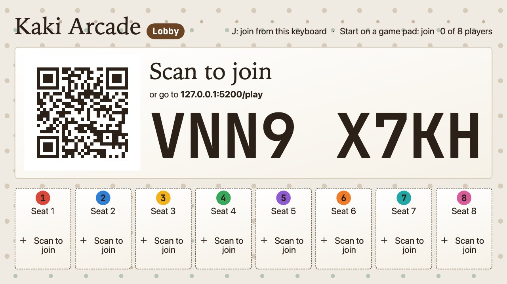 | Empty lobby with mocked pad join hint at 720p. | |
| 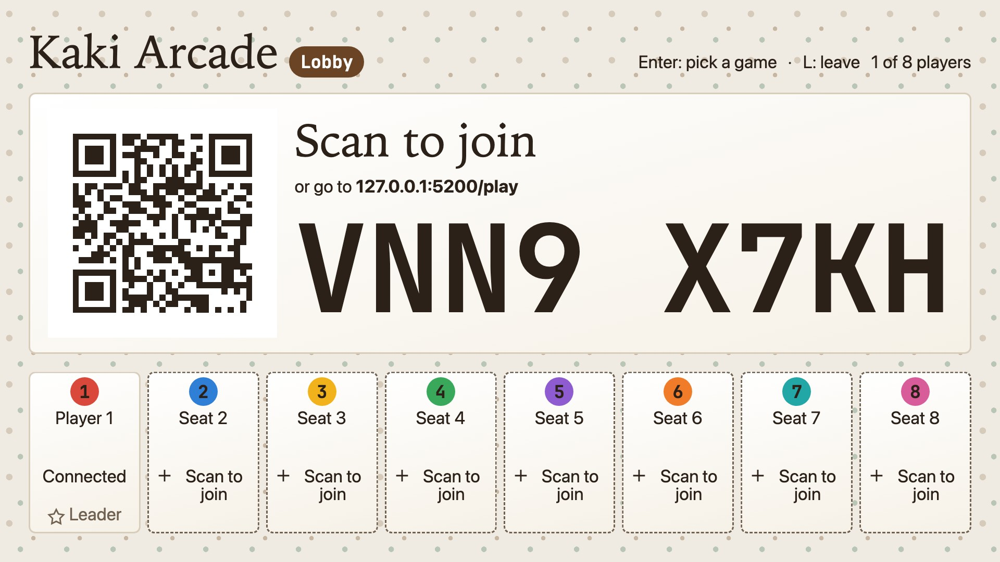 | Player 1 seated as leader; L: leave hint. | |
| 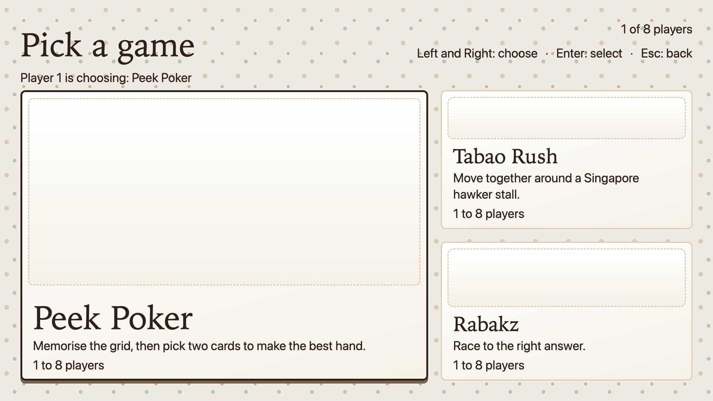 | Picker with Peek Poker focused and navigation hints. | |
| 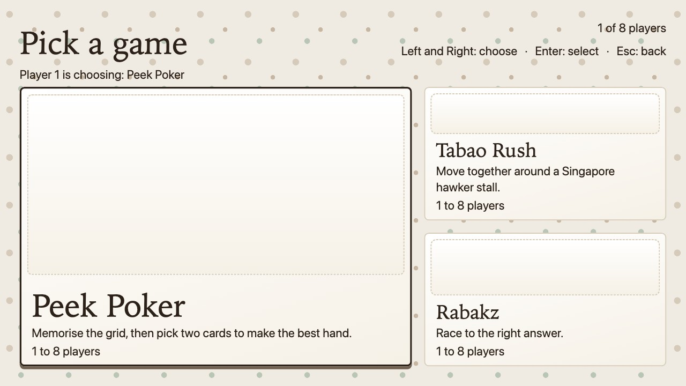 | Picker with Peek Poker focused at 720p. | |
| 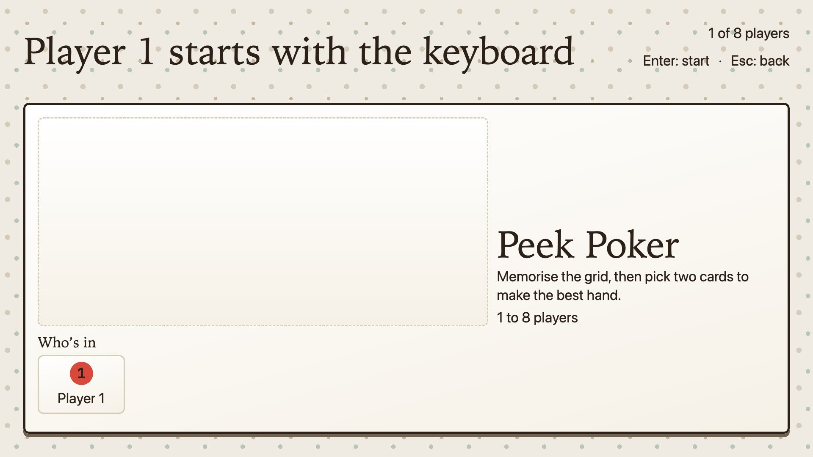 | Peek Poker start screen naming Player 1 as keyboard starter. | |
| 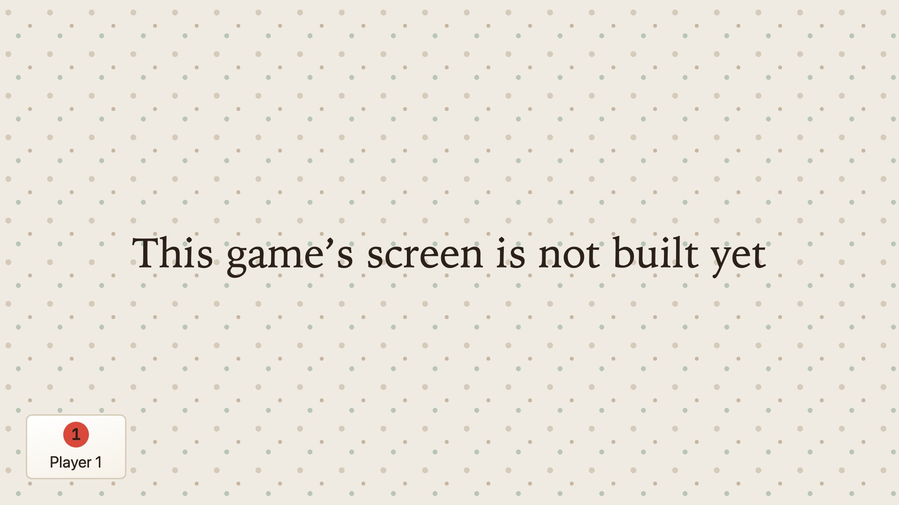 | Game placeholder with the local Player 1 seat. | |
| 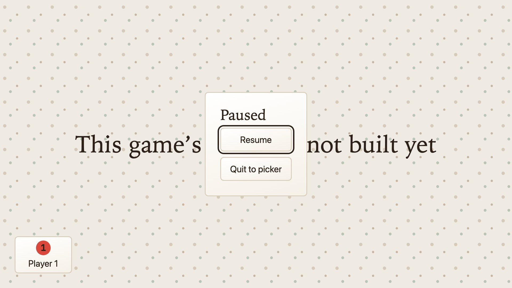 | Paused panel over the game placeholder; Resume focused. | |
|  | Lobby after Quit, retaining Player 1 and leadership. | |
| 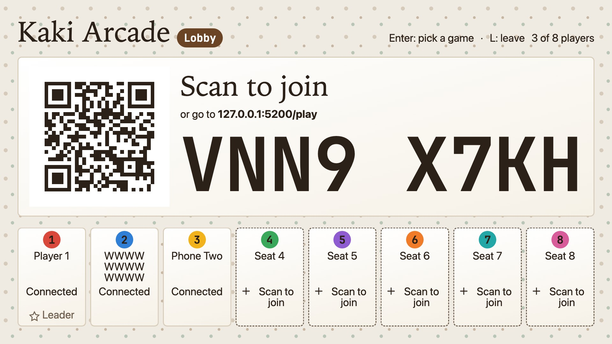 | Lobby with Player 1 and two phones seated. | |
| 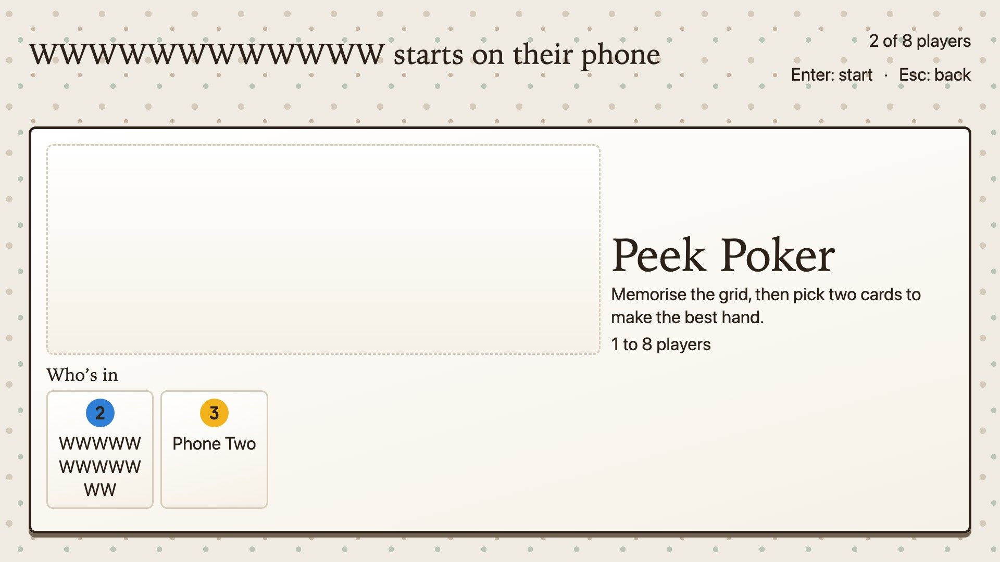 | Peek Poker start screen naming WWWWWWWWWWWW as phone starter. | |
| 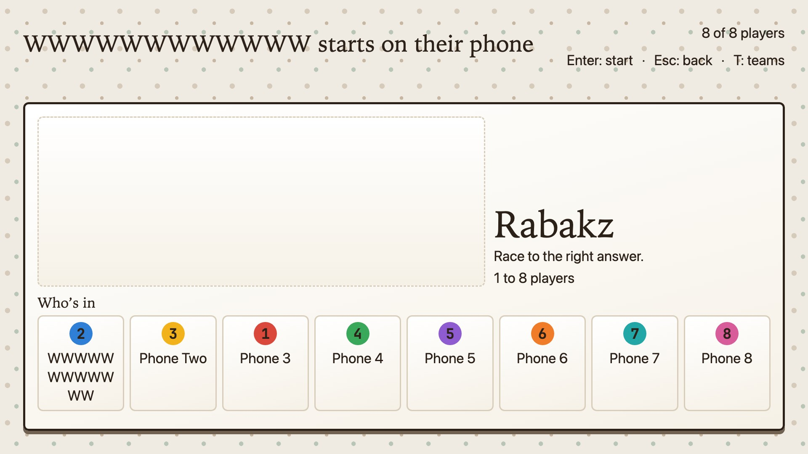 | Eight-phone Rabakz start screen at 1080p. | |
| 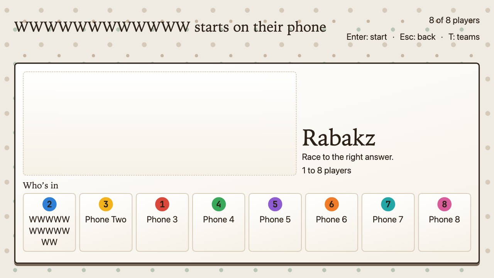 | Eight-phone Rabakz start screen at 720p. | |
| 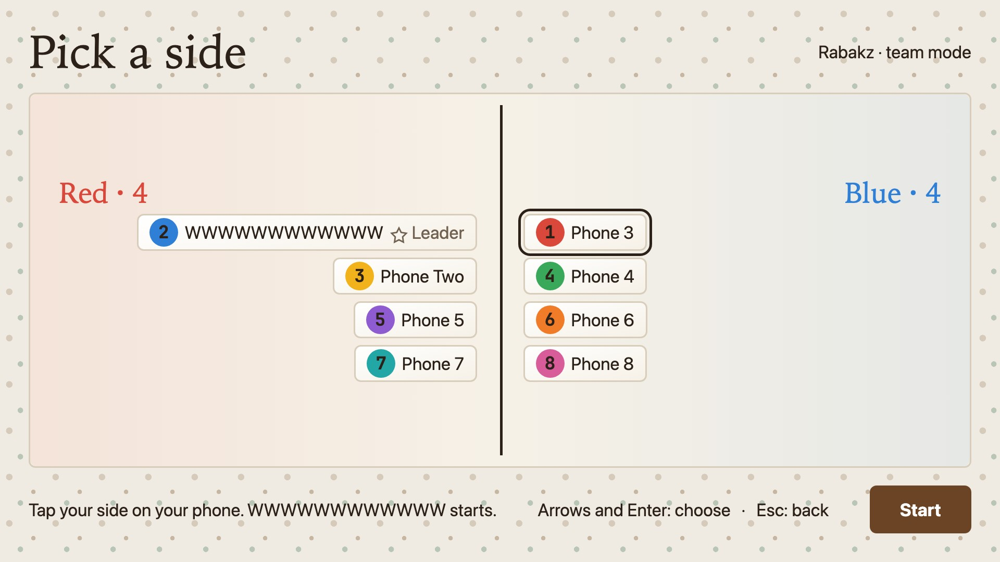 | Eight-phone team setup with side cards, phone sentence and keyboard hints. | |
| 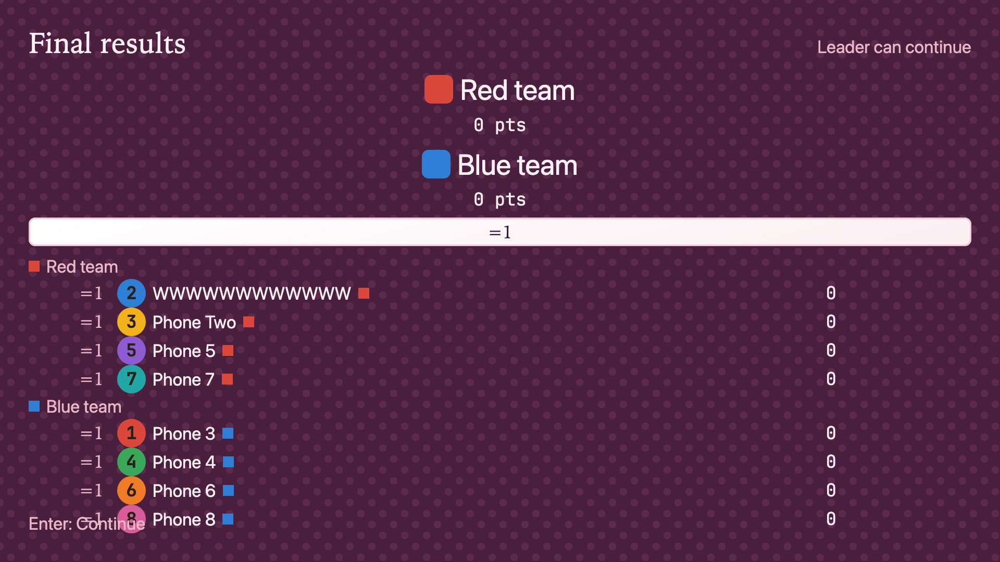 | Rabakz final team screen after phones disconnect, before results Enter. | |
|  | Results with tied teams, disconnected phones and keyboard actions. | |
| 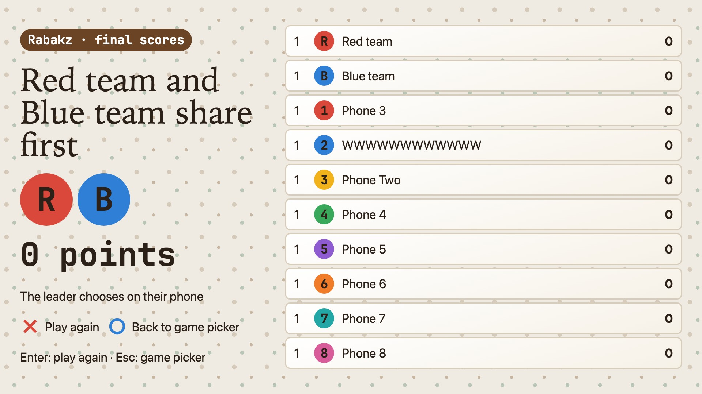 | Results keyboard actions without a visible focus ring (corrected by Round 11 script). | |

| Acceptance statement | Pass / fail | Evidence |
|---|---|---|
| | | |
