# C-12-host-keyboard UAT evidence

Automated execution only. Visual review and acceptance decisions are pending.

Command: `node tools/uat/run.mjs -- C-12-host-keyboard --phones 8 --out round5`
Commit: `377fd00c8c47e647310cef56b785f0467d462b58`
Viewports: 1920×1080

| Timing | ms | Status |
|---|---:|---|
| Create room through host page | 2054.1 | completed |

Expected errors (count):
None

## Real server

| Screenshot | What it shows | Looked at by |
|---|---|---|
| 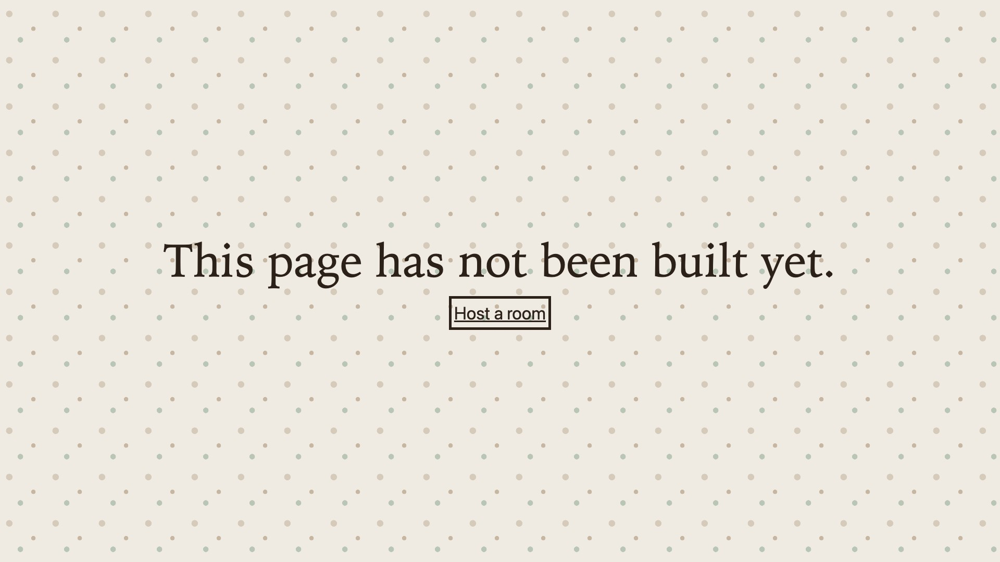 | | |
| 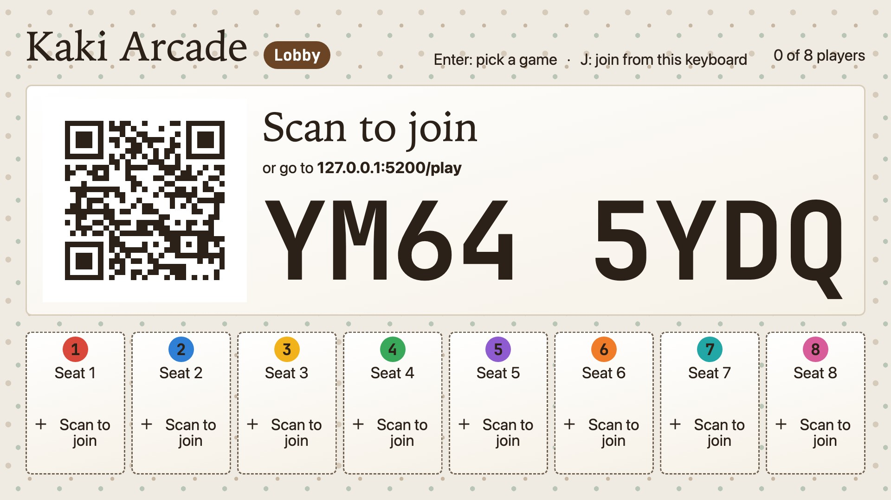 | | |
|  | | |
| 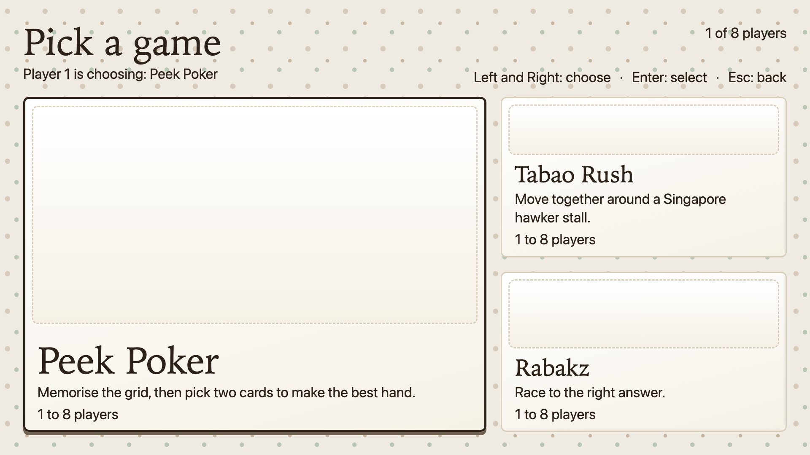 | | |
| 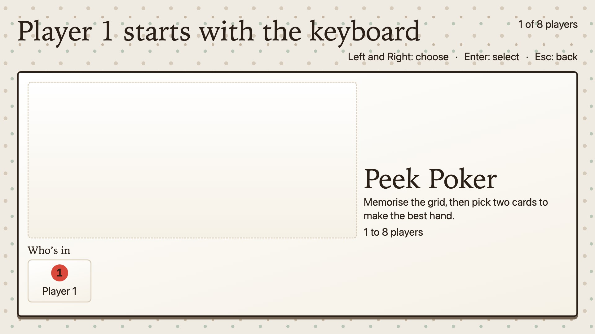 | | |
| 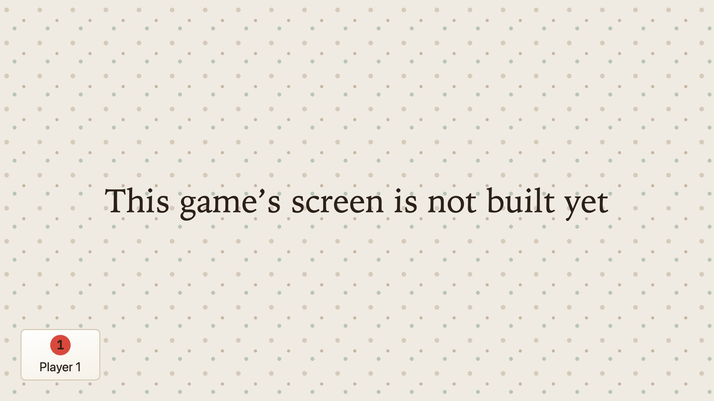 | | |
| 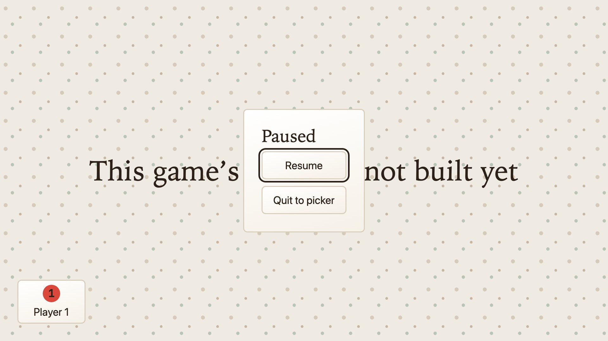 | | |
|  | | |
| 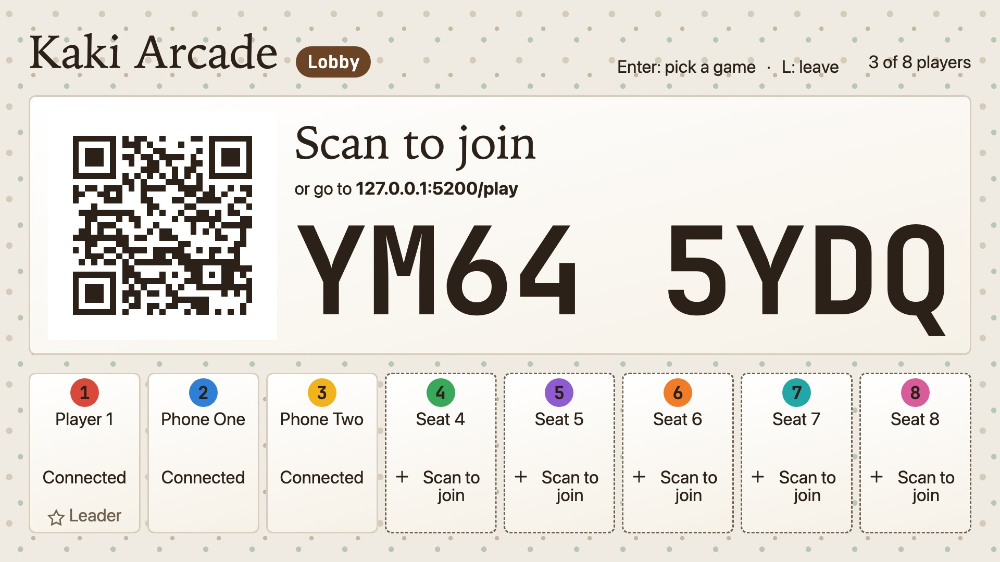 | | |
| 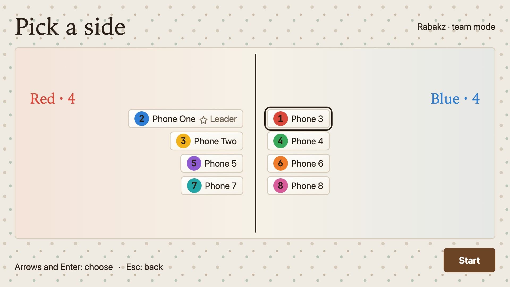 | | |
| 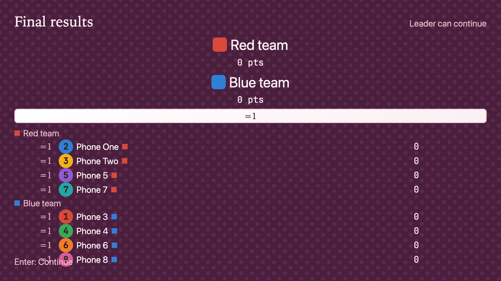 | | |
| 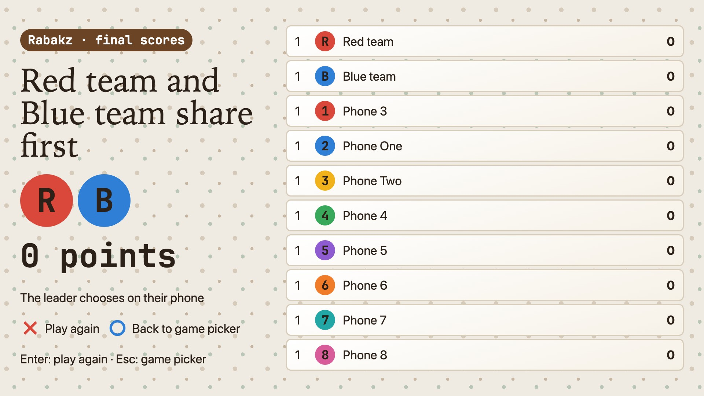 | | |
| 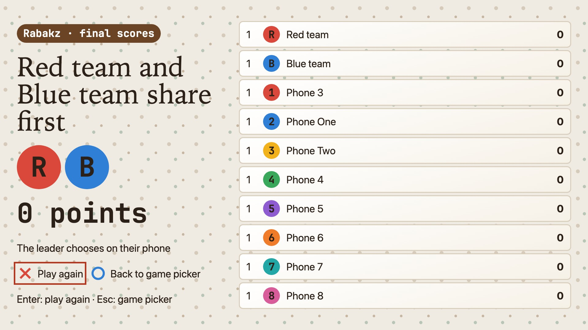 | | |

## Strips

| Screenshot | What it shows | Looked at by |
|---|---|---|
| 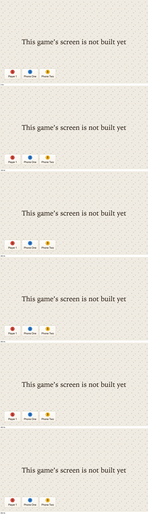 | | |

| Acceptance statement | Pass / fail | Evidence |
|---|---|---|
| | | |
