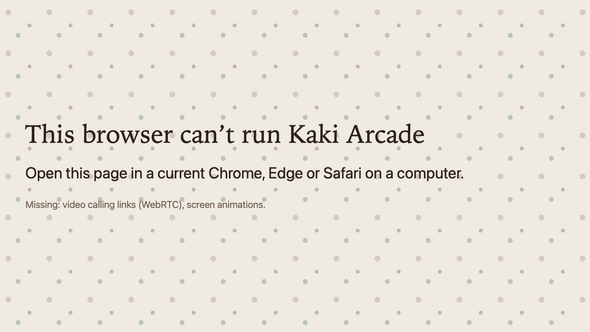

# C-14-unsupported-browser UAT evidence

Automated execution only. Visual review and acceptance decisions are pending.

Command: `node tools/uat/run.mjs -- C-14-unsupported-browser --phones 1`
Commit: `c2c0c0677765e8370039e46318260974bb81b422`
Viewports: 

| Timing | ms | Status |
|---|---:|---|
| Unsupported demo landing-1280 | 320.9 | failed |

Expected errors (count):
None

## Real server

| Screenshot | What it shows | Looked at by |
|---|---|---|
|  | | |

| Acceptance statement | Pass / fail | Evidence |
|---|---|---|
| | | |
