# C-14-unsupported-browser UAT evidence

Automated execution only. Visual review and acceptance decisions are pending.

Command: `node tools/uat/run.mjs -- C-14-unsupported-browser --phones 1`
Commit: `7d2a631344ba53826580a1dea4875527ac303295`
Viewports: 1280×720, 390×844, 320×568

| Timing | ms | Status |
|---|---:|---|
| Unsupported demo landing-1280 | 691.4 | completed |
| Normal route landing-1280 | 154.2 | completed |
| Unsupported demo host-1280 | 153.0 | completed |
| Normal route host-1280 | 1086.7 | completed |
| Unsupported demo play-1280 | 134.5 | completed |
| Normal route play-1280 | 533.9 | completed |
| Unsupported demo landing-390 | 128.7 | completed |
| Normal route landing-390 | 128.4 | completed |
| Unsupported demo host-390 | 128.9 | completed |
| Normal route host-390 | 1045.7 | completed |
| Unsupported demo play-390 | 132.9 | completed |
| Normal route play-390 | 512.9 | completed |
| Unsupported demo landing-320 | 129.3 | completed |
| Normal route landing-320 | 128.5 | completed |
| Unsupported demo host-320 | 130.0 | completed |
| Normal route host-320 | 1045.5 | completed |
| Unsupported demo play-320 | 129.3 | completed |
| Normal route play-320 | 512.6 | completed |
| Real missing WebSocket / | 187.7 | completed |
| Real missing WebSocket /host | 132.8 | completed |
| Real missing WebSocket /play | 133.6 | completed |
| Classic preflight / | 114.4 | completed |
| Classic preflight /host | 98.8 | completed |
| Classic preflight /play | 123.6 | completed |

Expected errors (count):
None

## Real server

| Screenshot | What it shows | Looked at by |
|---|---|---|
| 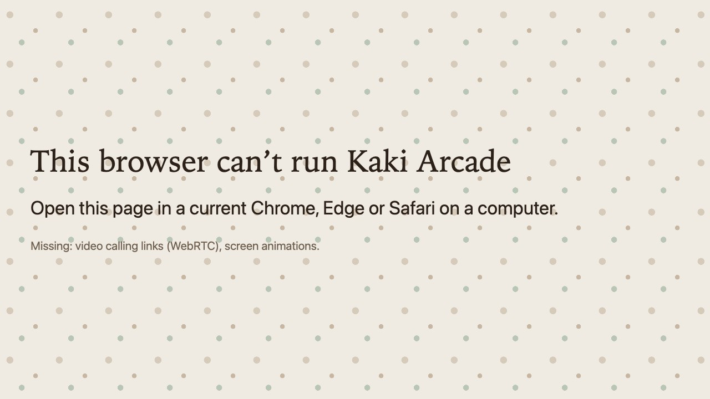 | | |
| 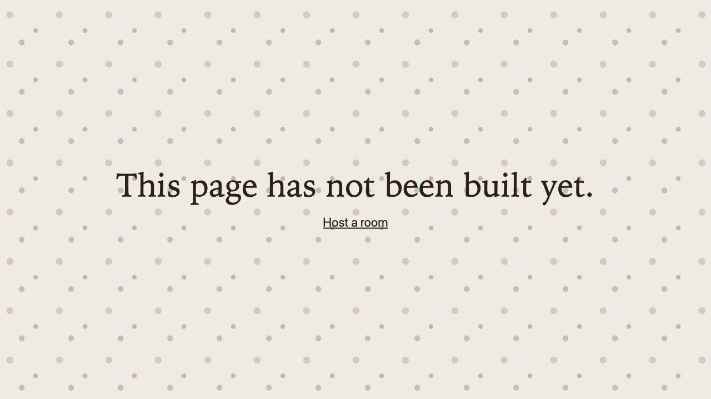 | | |
|  | | |
| 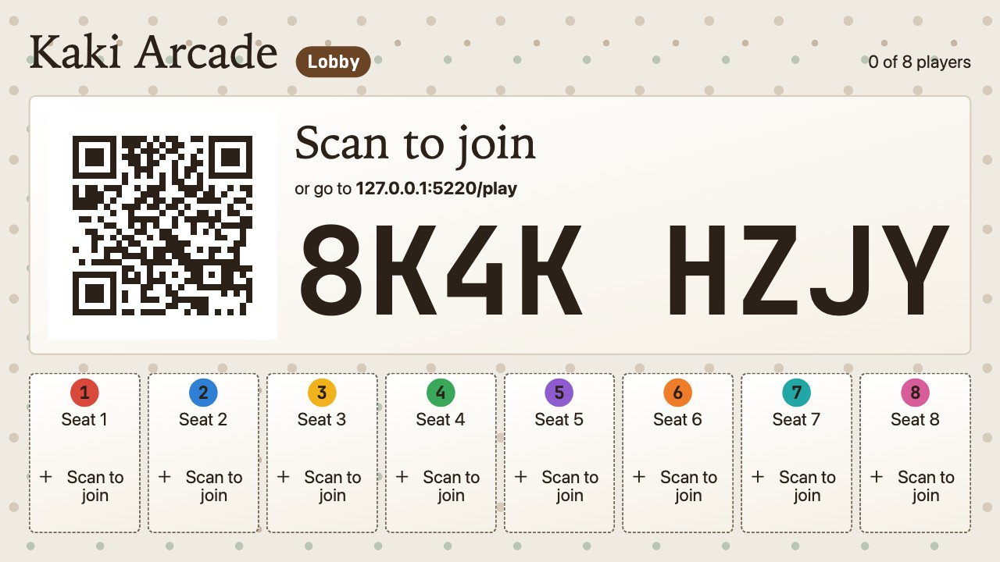 | | |
| 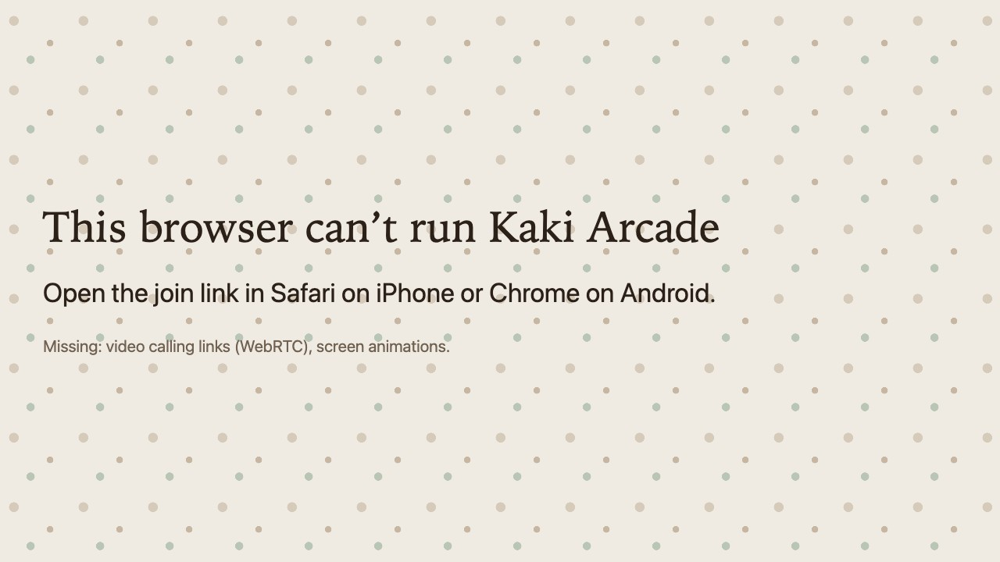 | | |
| 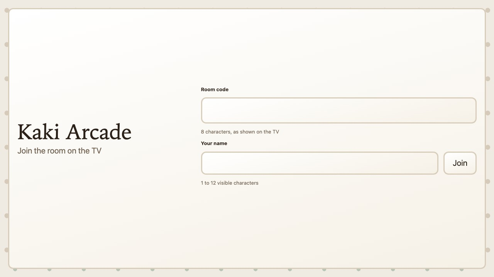 | | |
| 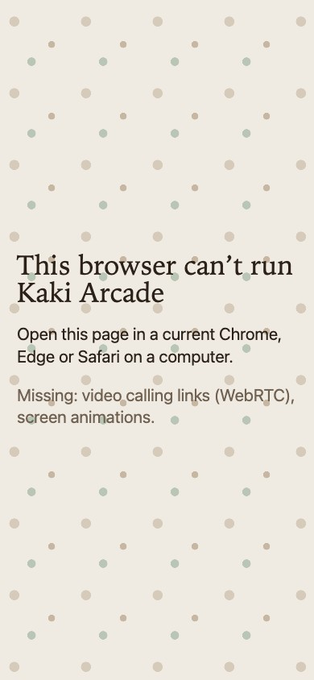 | | |
|  | | |
|  | | |
| 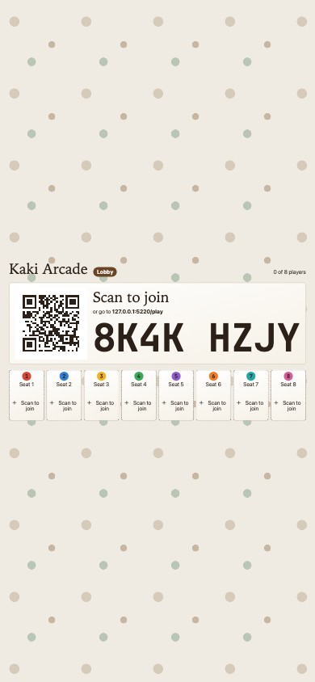 | | |
| 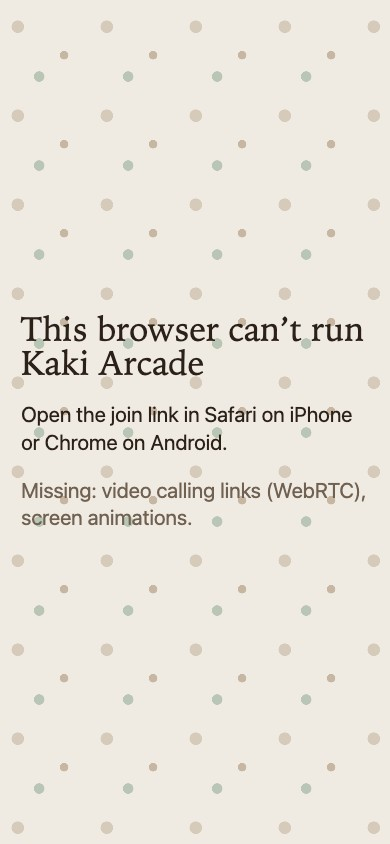 | | |
| 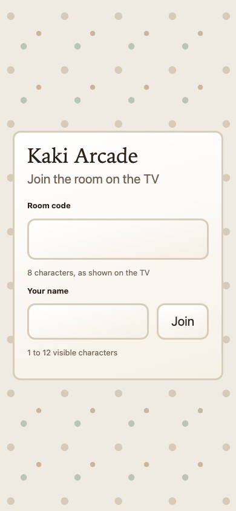 | | |
| 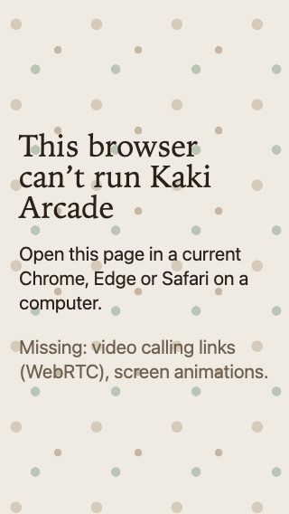 | | |
| 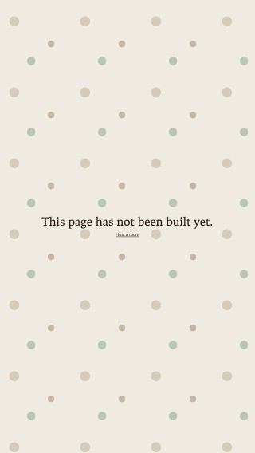 | | |
|  | | |
| 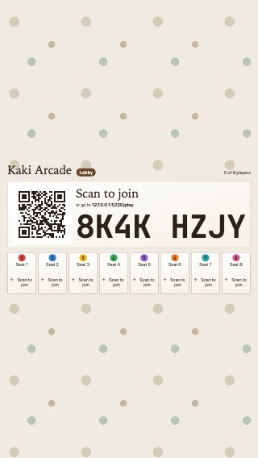 | | |
| 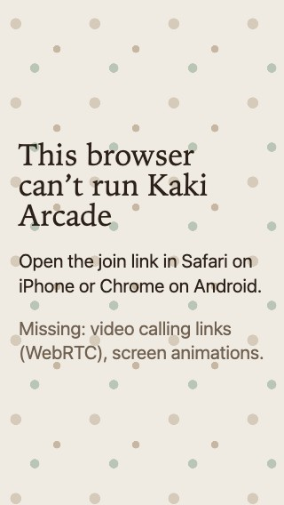 | | |
| 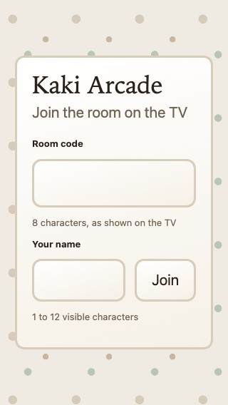 | | |
|  | | |
| 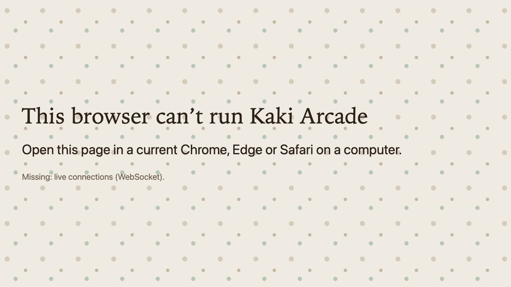 | | |
| 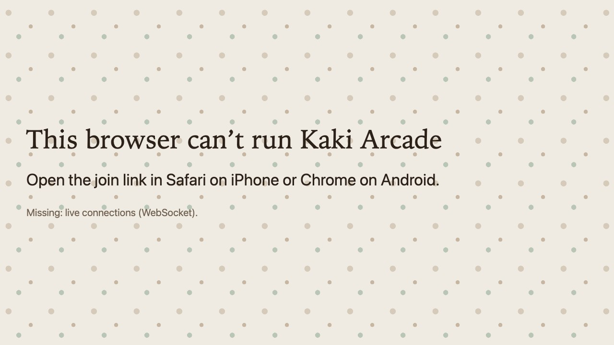 | | |
|  | | |
| 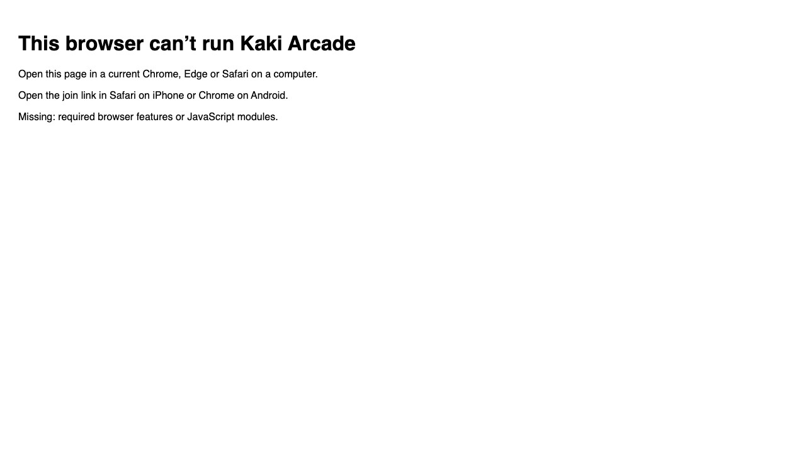 | | |
|  | | |

| Acceptance statement | Pass / fail | Evidence |
|---|---|---|
| | | |

## Integrator's look, round 2 (2026-11-17): passes

Exit 0 after integrator fixes at merge: main.tsx bound the five feature functions to window
(two attempts that read them through a copy or a proxy of window rendered a blank page or
reported every feature missing, caught by this run), and the script's normal-page locator takes
the first of `.lobby, .room-status`. Opened all 24 shots as one sheet: the module-rendered
message on /, /host and /play at 1280, 390 and 320 wide, with the route's line (computer on /
and /host; Safari on iPhone or Chrome on Android on /play) and the missing features in words;
the normal pages unchanged beside them; the real check with WebSocket deleted (19 to 21); the
classic static message (22 to 24) in plain system type on white, which is expected because it
cannot load the token CSS. Not checked: a real old browser; dark theme.
