# C-14-unsupported-browser UAT evidence

Automated execution only. Visual review and acceptance decisions are pending.

Command: `node tools/uat/run.mjs -- C-14-unsupported-browser --phones 1`
Commit: `47e22e2137f907deacaca78d8d0f4fdf77ca5ab5`
Viewports: 1280×720, 390×844, 320×568, 1920×1080

| Timing | ms | Status |
|---|---:|---|
| Unsupported demo landing-1280 | 751.4 | completed |
| Normal route landing-1280 | 180.1 | completed |
| Unsupported demo host-1280 | 175.7 | completed |
| Normal route host-1280 | 1144.2 | completed |
| Unsupported demo play-1280 | 175.4 | completed |
| Normal route play-1280 | 540.6 | completed |
| Unsupported demo landing-390 | 150.7 | completed |
| Normal route landing-390 | 149.5 | completed |
| Unsupported demo host-390 | 150.2 | completed |
| Normal route host-390 | 1069.2 | completed |
| Unsupported demo play-390 | 170.4 | completed |
| Normal route play-390 | 549.7 | completed |
| Unsupported demo landing-320 | 149.8 | completed |
| Normal route landing-320 | 167.3 | completed |
| Unsupported demo host-320 | 169.5 | completed |
| Normal route host-320 | 1066.5 | completed |
| Unsupported demo play-320 | 166.2 | completed |
| Normal route play-320 | 532.6 | completed |
| Delayed demo chunk keeps the static message hidden | 3609.4 | completed |
| Real missing WebSocket / | 225.1 | completed |
| Real missing WebSocket /host | 175.4 | completed |
| Real missing WebSocket /play | 174.6 | completed |

Expected errors (count):
None

## Real server

| Screenshot | What it shows | Looked at by |
|---|---|---|
|  | | |
| 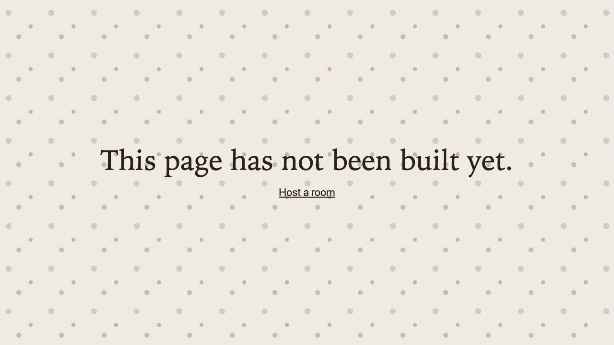 | | |
|  | | |
| 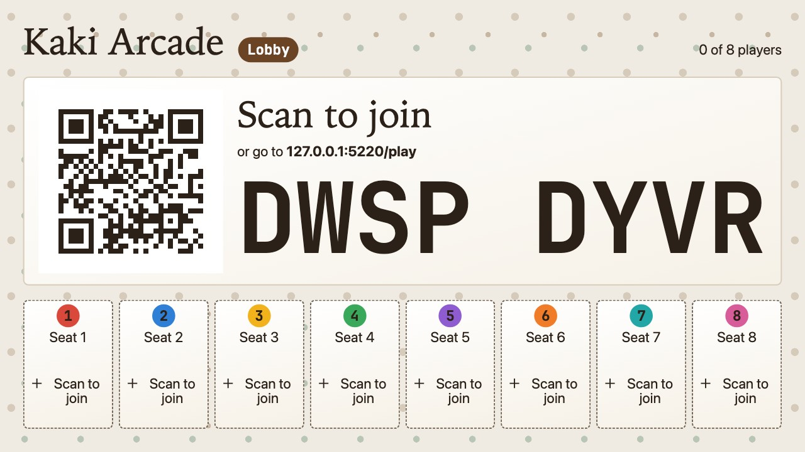 | | |
| 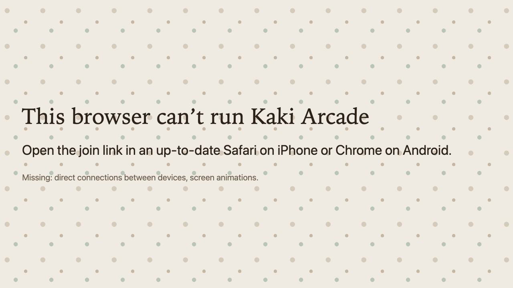 | | |
| 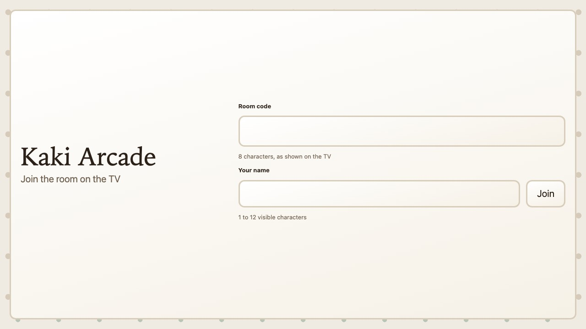 | | |
| 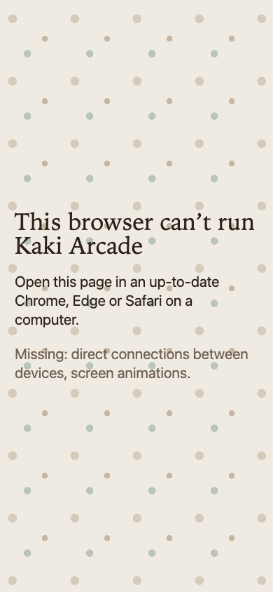 | | |
| 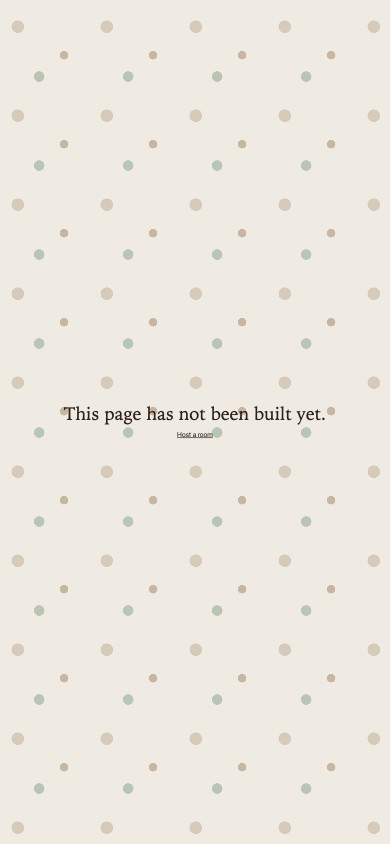 | | |
|  | | |
| 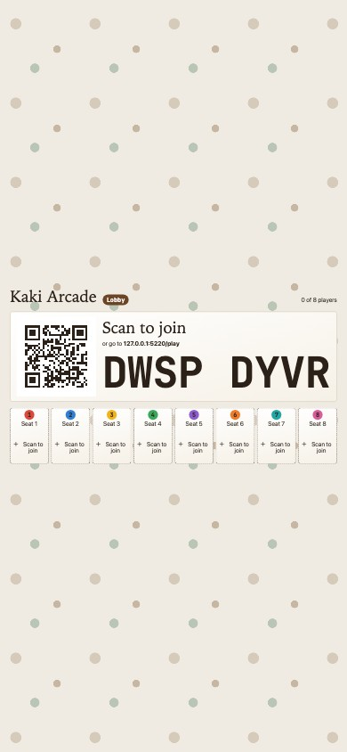 | | |
| 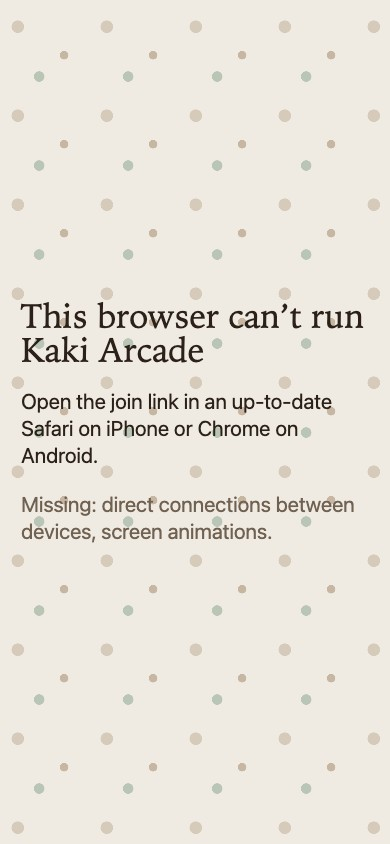 | | |
| 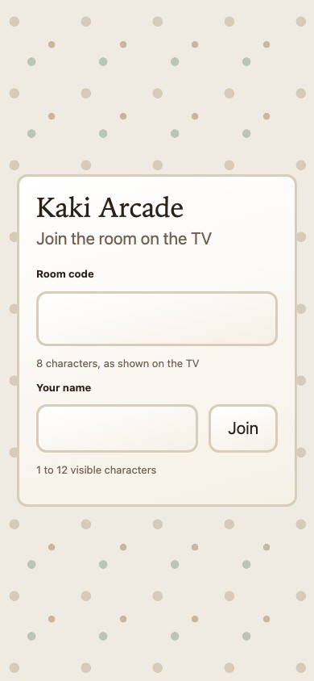 | | |
| 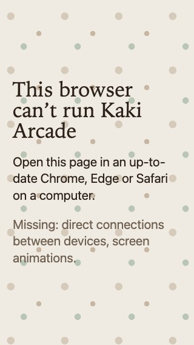 | | |
| 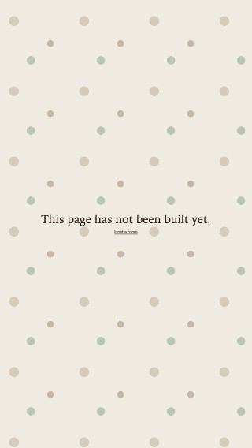 | | |
|  | | |
| 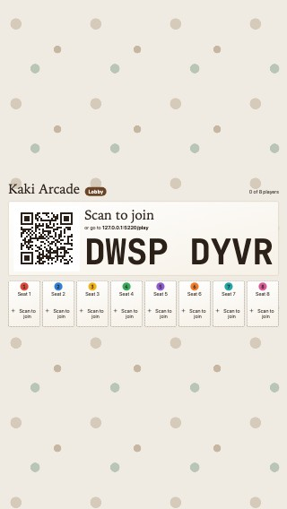 | | |
| 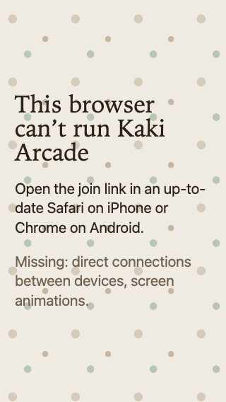 | | |
| 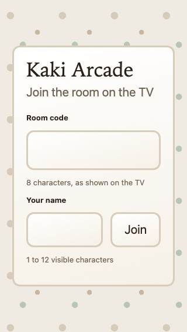 | | |
| 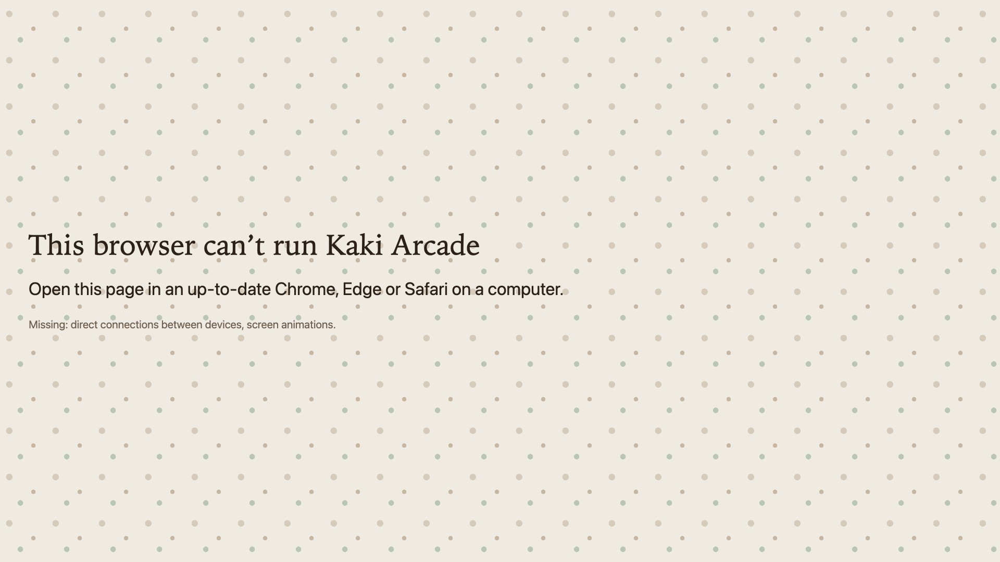 | | |
|  | | |
| 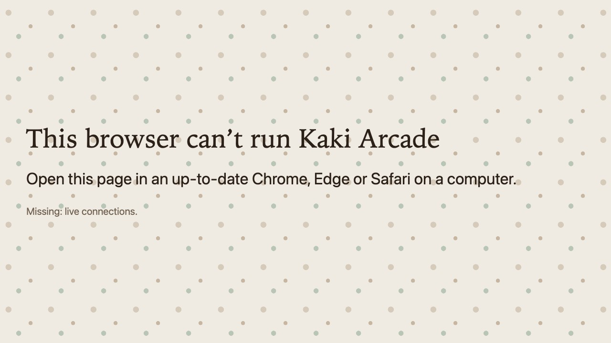 | | |
| 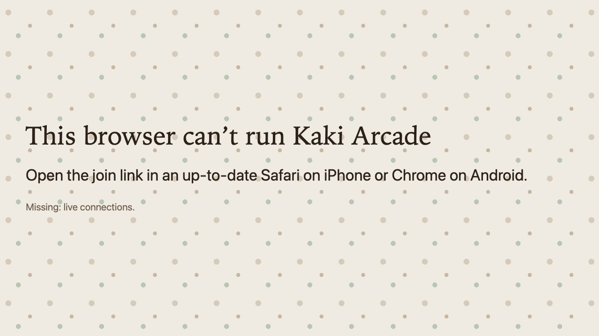 | | |

| Acceptance statement | Pass / fail | Evidence |
|---|---|---|
| | | |
