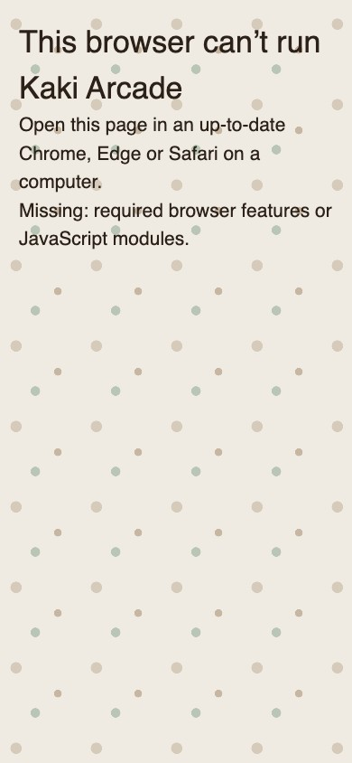
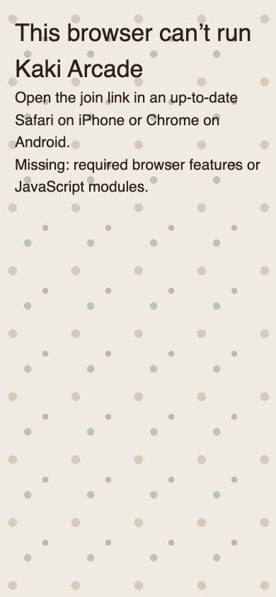

# C-14-unsupported-browser UAT evidence

Automated execution only. Visual review and acceptance decisions are pending.

Command: `node uat/slices/C-14-unsupported-browser.mjs --production`
Commit: `47e22e2137f907deacaca78d8d0f4fdf77ca5ab5`
Viewports: 390×844

| Timing | ms | Status |
|---|---:|---|
| Production classic / | 193.1 | completed |
| Production classic /host | 187.1 | completed |
| Production classic /play | 169.5 | completed |
| Production failed-preflight / | 188.5 | completed |
| Production failed-preflight /host | 185.6 | completed |
| Production failed-preflight /play | 147.5 | completed |
| Production parse / | 187.7 | completed |
| Production parse /host | 168.8 | completed |
| Production parse /play | 171.6 | completed |
| Production working browser keeps static message hidden | 80.4 | completed |

Expected errors (count):
None

## Real server

| Screenshot | What it shows | Looked at by |
|---|---|---|
|  | | |
|  | | |
|  | | |
|  | | |
|  | | |
|  | | |
|  | | |
|  | | |
|  | | |

| Acceptance statement | Pass / fail | Evidence |
|---|---|---|
| | | |
