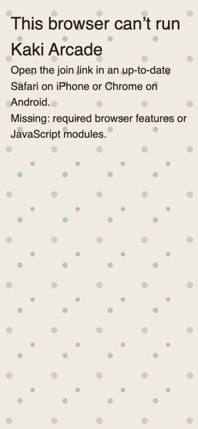
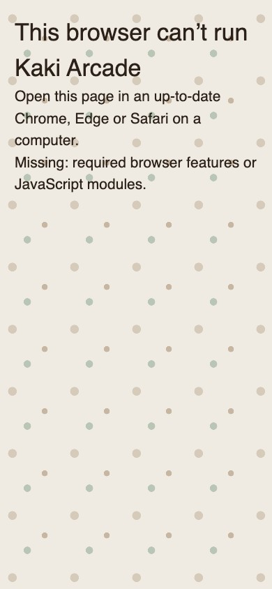
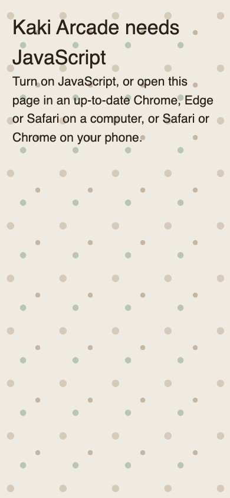
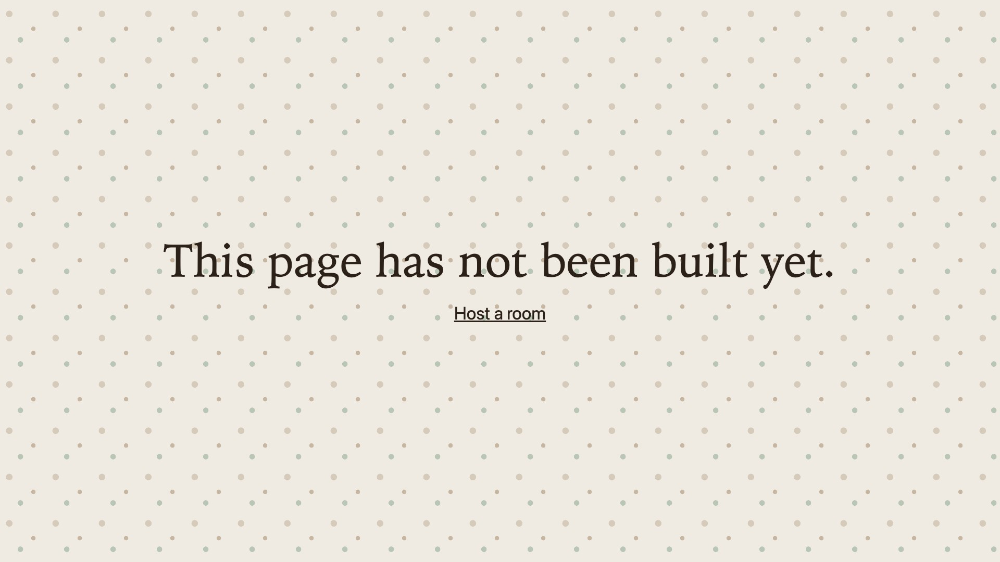
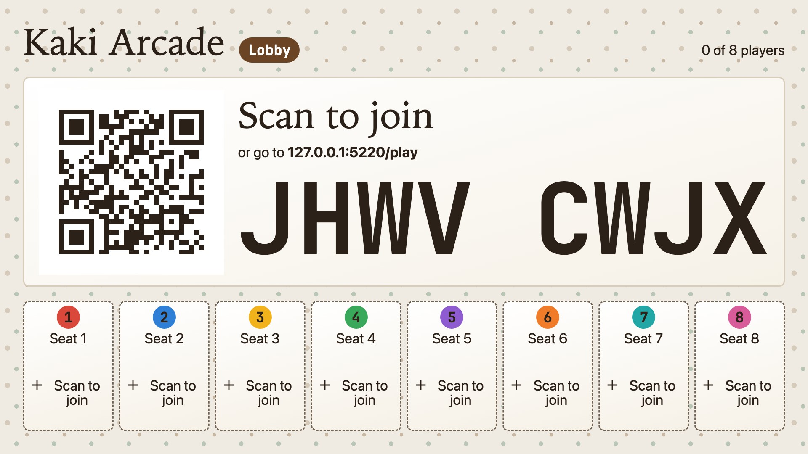
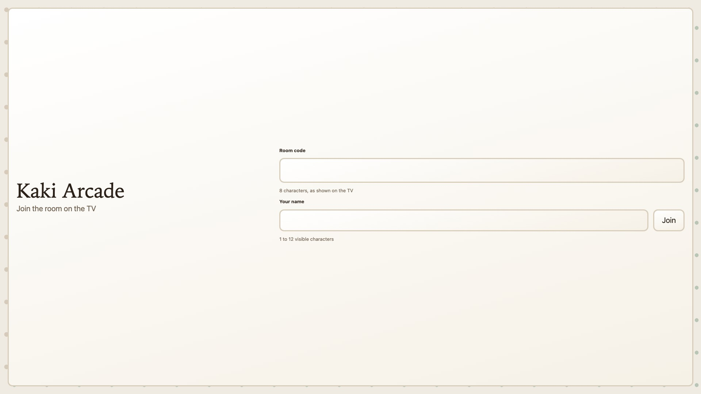

# C-14-unsupported-browser UAT evidence

Automated execution only. Visual review and acceptance decisions are pending.

Command: `node uat/slices/C-14-unsupported-browser.mjs --production`
Commit: `139b0dbed7b8017fcd60593d41fd0e6c5a46f2b2`
Viewports: 390×844, 1920×1080

| Timing | ms | Status |
|---|---:|---|
| Production classic / | 193.4 | completed |
| Production classic /host | 131.0 | completed |
| Production classic /play | 129.4 | completed |
| Production failed-preflight / | 130.3 | completed |
| Production failed-preflight /host | 129.9 | completed |
| Production failed-preflight /play | 131.5 | completed |
| Production parse / | 133.2 | completed |
| Production parse /host | 131.8 | completed |
| Production parse /play | 131.5 | completed |
| Production with JavaScript off shows the noscript message | 117.4 | completed |
| Production working browser / | 162.4 | completed |
| Production working browser /host | 1097.5 | completed |
| Production working browser /play | 513.4 | completed |

Expected errors (count):
None

## Real server

| Screenshot | What it shows | Looked at by |
|---|---|---|
|  | | |
|  | | |
|  | | |
|  | | |
|  | | |
|  | | |
|  | | |
|  | | |
|  | | |
|  | | |
|  | | |
|  | | |
|  | | |

| Acceptance statement | Pass / fail | Evidence |
|---|---|---|
| | | |

## Integrator's look (round 5, integrator's fixes at merge)
Run: `node uat/slices/C-14-unsupported-browser.mjs --production`, exit 0, 13 steps, no
process left. Adds `<noscript>` (review should-fix 1) and the working-browser check on all
three routes (should-fix 2). Opened c14r5.jpg and images 01 to 13.
- 10: JavaScript off: "Kaki Arcade needs JavaScript" and the guidance line, on screen at 390.
- 11 to 13: a working browser on the production build: landing placeholder, lobby with room
  code and seats, join form; the static message hidden on every route.
- 01 to 09: unchanged from round 4.
