# C-14-unsupported-browser UAT evidence

Host browser: webkit 27.2
Phone browser: chromium (legacy iPhone emulation) 156.0.8078.4

Visual review recorded below for all 22 stills (opened in contact sheets).

Command: `node tools/uat/run.mjs -- C-14-unsupported-browser --host-browser webkit --out x05-webkit`
Commit: `9e56fd4f5d4196e10d7e1fadbe62513cbcb4419d`
Provenance: re-run on clean tree `9e56fd4f` by the integrator, replacing the older run and its provenance. All 22 steps completed; run.json has `errors: []`. Development build only; the `productionChecks` selector edit has not been run under `--production`.

Viewports: 1280×720, 390×844, 320×568, 1920×1080

| Timing | ms | Status |
|---|---:|---|
| Unsupported demo landing-1280 | 1035.5 | completed |
| Normal route landing-1280 | 714.9 | completed |
| Unsupported demo host-1280 | 371.9 | completed |
| Normal route host-1280 | 1929.3 | completed |
| Unsupported demo play-1280 | 627.1 | completed |
| Normal route play-1280 | 405.0 | completed |
| Unsupported demo landing-390 | 397.7 | completed |
| Normal route landing-390 | 459.7 | completed |
| Unsupported demo host-390 | 424.8 | completed |
| Normal route host-390 | 1241.2 | completed |
| Unsupported demo play-390 | 360.7 | completed |
| Normal route play-390 | 406.3 | completed |
| Unsupported demo landing-320 | 415.4 | completed |
| Normal route landing-320 | 361.9 | completed |
| Unsupported demo host-320 | 355.6 | completed |
| Normal route host-320 | 1394.7 | completed |
| Unsupported demo play-320 | 369.8 | completed |
| Normal route play-320 | 369.0 | completed |
| Delayed demo chunk keeps the static message hidden | 4242.8 | completed |
| Real missing WebSocket / | 534.6 | completed |
| Real missing WebSocket /host | 469.0 | completed |
| Real missing WebSocket /play | 380.4 | completed |

Expected errors (count):
None

## Real server

| Screenshot | What it shows | Looked at by |
|---|---|---|
| 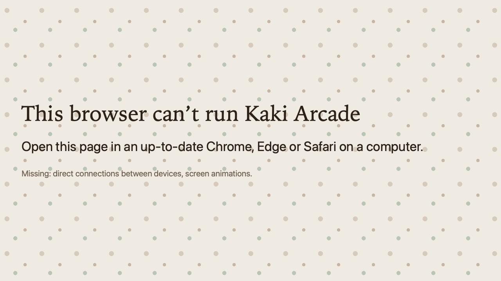 | 1280px landing: unsupported-browser message, advice to use up-to-date Chrome, Edge or Safari on a computer; missing direct connections between devices and screen animations. Text wraps within the viewport. | Claude, integrator review, 2026-11-18 |
| 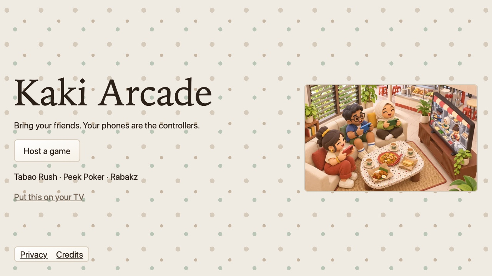 | 1280px landing: Kaki Arcade, Host a game, game names, Put this on your TV, Privacy and Credits; no unsupported message. Illustration visible beside the copy. | Claude, integrator review, 2026-11-18 |
|  | 1280px host: unsupported-browser message, advice to use up-to-date Chrome, Edge or Safari on a computer; missing direct connections between devices and screen animations. Text wraps within the viewport. | Claude, integrator review, 2026-11-18 |
| 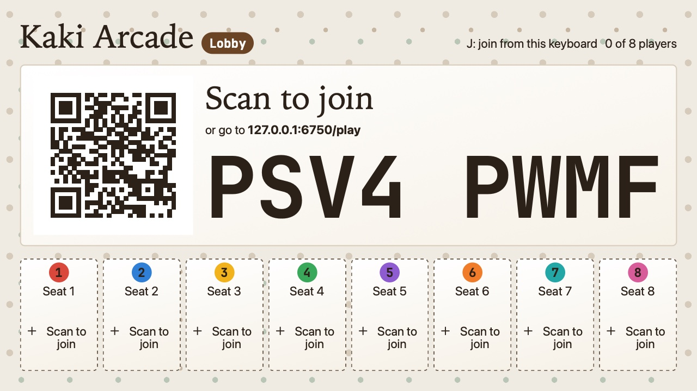 | 1280px host: full lobby with QR code, room code PSV4 PWMF, 0 of 8 players and eight empty seats; no Loading… placeholder or unsupported message. | Claude, integrator review, 2026-11-18 |
|  | 1280px play: unsupported-browser message, advice to use up-to-date Safari on iPhone or Chrome on Android; missing direct connections between devices and screen animations. Text wraps within the viewport. | Claude, integrator review, 2026-11-18 |
| 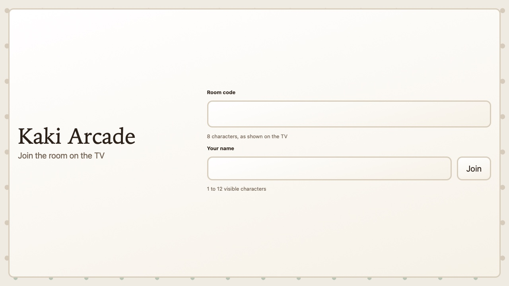 | 1280px play: join card with Room code and Your name fields, helper text and Join button; no unsupported message. | Claude, integrator review, 2026-11-18 |
| 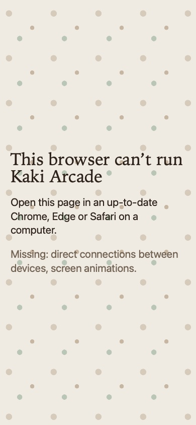 | 390px landing: unsupported-browser message, advice to use up-to-date Chrome, Edge or Safari on a computer; missing direct connections between devices and screen animations. Text wraps within the viewport. | Claude, integrator review, 2026-11-18 |
| 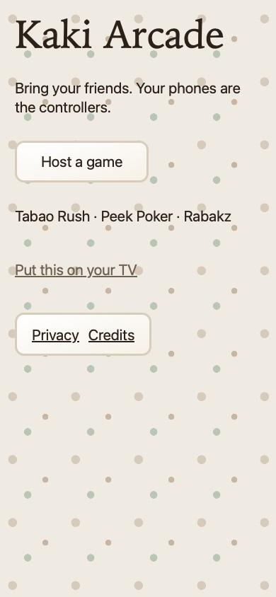 | 390px landing: Kaki Arcade, Host a game, game names, Put this on your TV, Privacy and Credits; no unsupported message. | Claude, integrator review, 2026-11-18 |
|  | 390px host: unsupported-browser message, advice to use up-to-date Chrome, Edge or Safari on a computer; missing direct connections between devices and screen animations. Text wraps within the viewport. | Claude, integrator review, 2026-11-18 |
| 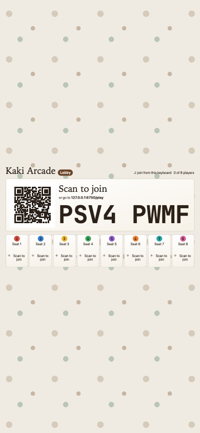 | 390px host: full lobby with QR code, room code PSV4 PWMF, 0 of 8 players and eight empty seats; no Loading… placeholder or unsupported message. Lobby is scaled down across the narrow viewport. | Claude, integrator review, 2026-11-18 |
| 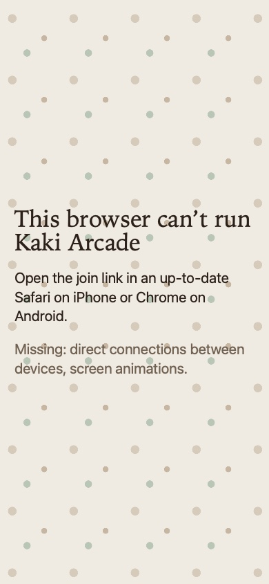 | 390px play: unsupported-browser message, advice to use up-to-date Safari on iPhone or Chrome on Android; missing direct connections between devices and screen animations. Text wraps within the viewport. | Claude, integrator review, 2026-11-18 |
| 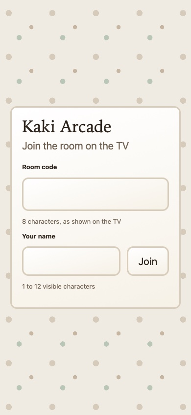 | 390px play: join card with Room code and Your name fields, helper text and Join button; no unsupported message. | Claude, integrator review, 2026-11-18 |
| 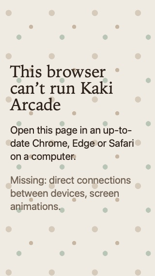 | 320px landing: unsupported-browser message, advice to use up-to-date Chrome, Edge or Safari on a computer; missing direct connections between devices and screen animations. Text wraps within the viewport. | Claude, integrator review, 2026-11-18 |
| 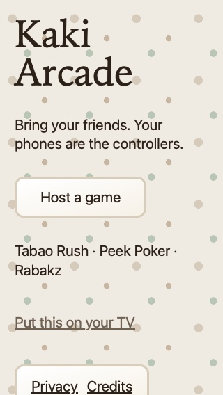 | 320px landing: Kaki Arcade, Host a game, game names, Put this on your TV, Privacy and Credits; no unsupported message. Title wraps onto two lines; footer reaches the bottom edge. | Claude, integrator review, 2026-11-18 |
|  | 320px host: unsupported-browser message, advice to use up-to-date Chrome, Edge or Safari on a computer; missing direct connections between devices and screen animations. Text wraps within the viewport. | Claude, integrator review, 2026-11-18 |
| 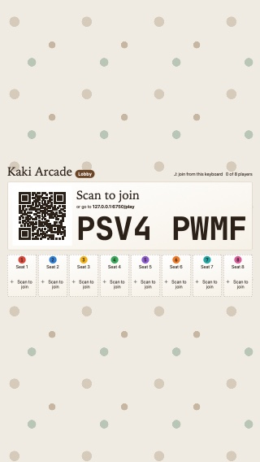 | 320px host: full lobby with QR code, room code PSV4 PWMF, 0 of 8 players and eight empty seats; no Loading… placeholder or unsupported message. Lobby is scaled down across the narrow viewport. | Claude, integrator review, 2026-11-18 |
| 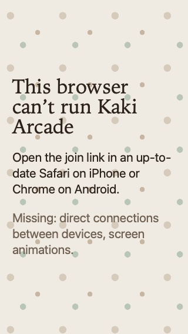 | 320px play: unsupported-browser message, advice to use up-to-date Safari on iPhone or Chrome on Android; missing direct connections between devices and screen animations. Text wraps within the viewport. | Claude, integrator review, 2026-11-18 |
| 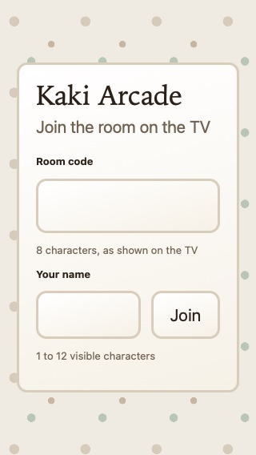 | 320px play: join card with Room code and Your name fields, helper text and Join button; no unsupported message. | Claude, integrator review, 2026-11-18 |
| 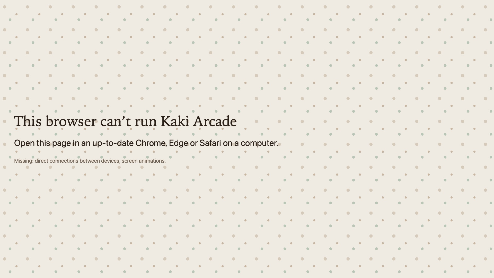 | Delayed demo: final unsupported message with computer-browser advice and missing direct connections between devices and screen animations. This still shows the final state; the delay assertion is in run.json. | Claude, integrator review, 2026-11-18 |
| 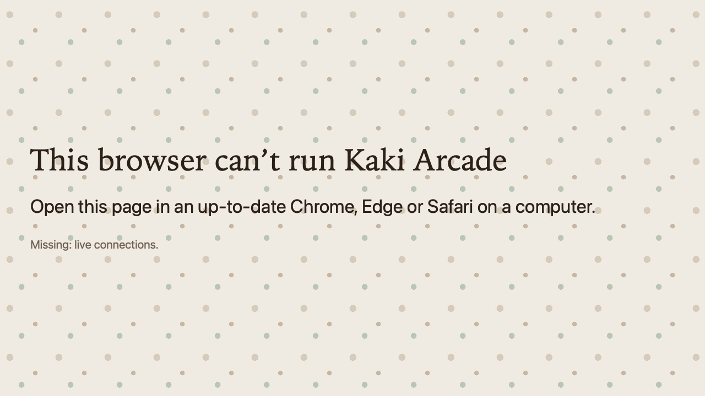 | Real missing WebSocket on /: unsupported message with computer-browser advice and “Missing: live connections”. | Claude, integrator review, 2026-11-18 |
|  | Real missing WebSocket on /host: unsupported message with computer-browser advice and “Missing: live connections”. | Claude, integrator review, 2026-11-18 |
| 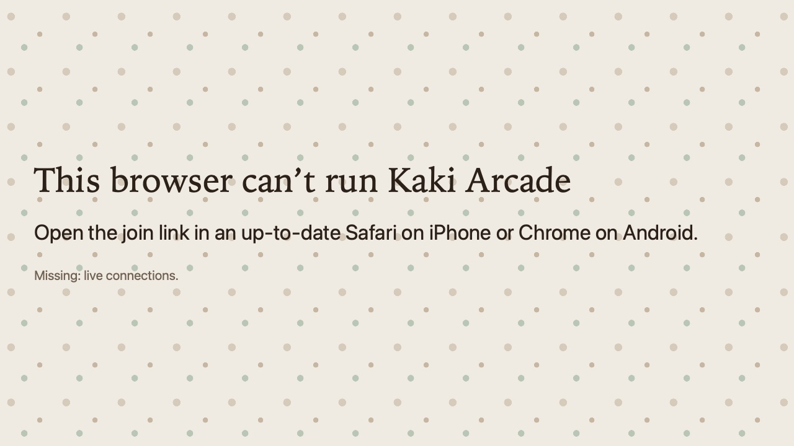 | Real missing WebSocket on /play: unsupported message with phone-browser advice and “Missing: live connections”. | Claude, integrator review, 2026-11-18 |

| Acceptance statement | Pass / fail | Evidence |
|---|---|---|
| REL-006: simulated missing features show readable route-appropriate guidance at all three widths | Pass (development build) | 01, 03, 05, 07, 09, 11, 13, 15, 17 |
| Supported routes render without the unsupported message; host waits for the lobby | Pass (development build) | 02, 04, 06, 08, 10, 12, 14, 16, 18 |
| Delayed demo reaches its final message; real missing WebSocket reports live connections | Pass (development build) | 19–22; run.json delay assertion and errors: [] |
| REL-006 overall coverage | In progress | Firefox, real old browsers and WebKit production remain untested; productionChecks selector edit not run under --production |
