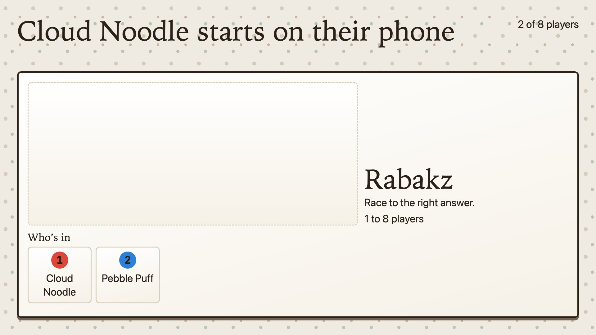
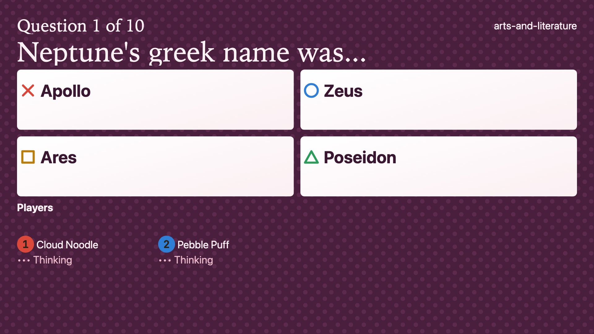
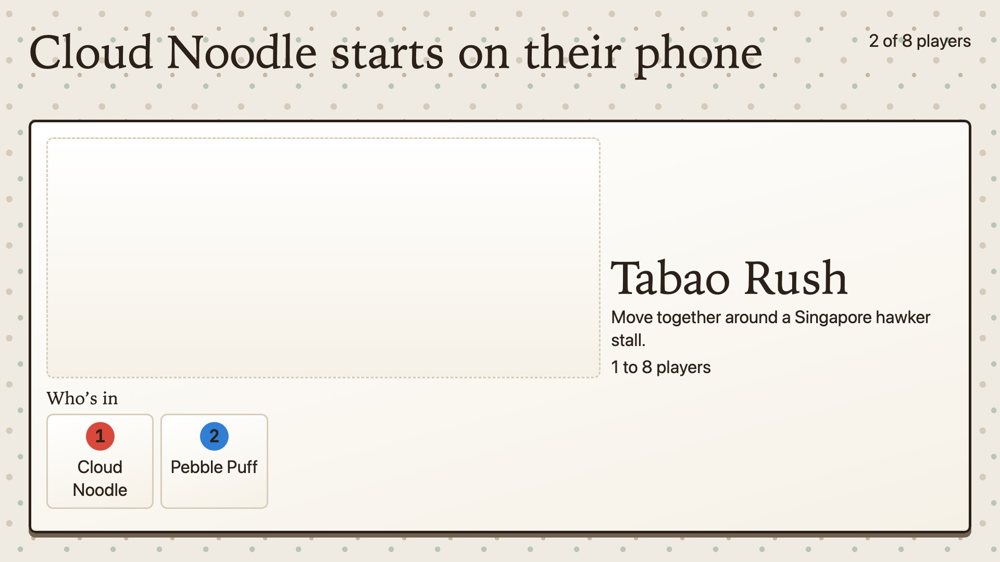
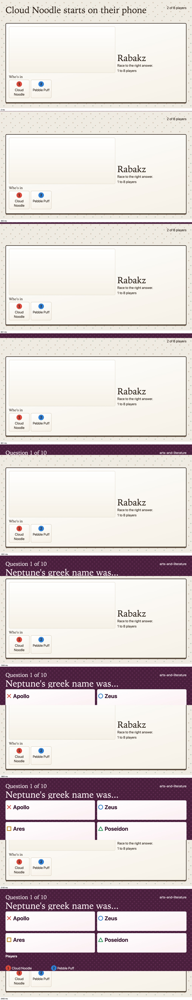
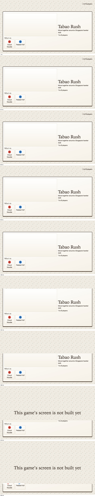

# C-16-start-game UAT evidence

Automated execution only. Visual review and acceptance decisions are pending.

Command: `node tools/uat/run.mjs -- C-16-start-game --phones 2`
Commit: `a08eabfd747371c68572b7d129149842e83323da`
Viewports: 1920×1080, 844×390

| Timing | ms | Status |
|---|---:|---|
| Create room through host page | 1170.4 | completed |
| Seat two phones for rabakz | 1455.4 | completed |
| Leader starts rabakz; TV and both shells follow | 5033.7 | completed |
| Create room through host page | 881.5 | completed |
| Seat two phones for tabao-rush | 1764.1 | completed |
| Leader starts tabao-rush; TV and both shells follow | 4825.4 | completed |

Expected errors (count):
None

## Real server

| Screenshot | What it shows | Looked at by |
|---|---|---|
|  | | |
|  | | |
|  | | |
|  | | |
|  | | |
|  | | |
|  | | |
|  | | |

## Strips

| Screenshot | What it shows | Looked at by |
|---|---|---|
|  | | |
|  | | |

| Acceptance statement | Pass / fail | Evidence |
|---|---|---|
| | | |

## Integrator's look (2026-11-17)
Run: `pnpm uat -- C-16-start-game --phones 2`, exit 0, no process left. Opened c16-a.jpg,
every still, and both frame strips at full height.
- Before start (01, 15): the start screen (layout B) with the game's name and both seated
  players; header "Cloud Noodle starts on their phone".
- Mask (11, 25): the game screen wipes in from the top over the start screen with no blank
  frame. The run slows the wipe on purpose so the strip shows its edge; real duration comes
  from the motion tokens.
- Rabakz running (14): question 1 of 10, four answers with their shapes, both players
  "Thinking". Fault: the category shows its raw id "arts-and-literature" (Rabakz host screen,
  R-03 code), to fix in the Rabakz track.
- Tabao Rush running (28): the "This game's screen is not built yet" stand-in with both seats,
  as expected before the T track.
- Phones (12, 13, 26, 27): the controller shell with seat disc, name and "Connected";
  "Keep your screen on" shows because headless Chromium refuses the wake lock. The play area is
  empty: no stick or buttons until K-02 and K-03, so nobody can answer yet.
Not checked: real phones, pause and quit (later issues), D-099 (netcode follow-up).
