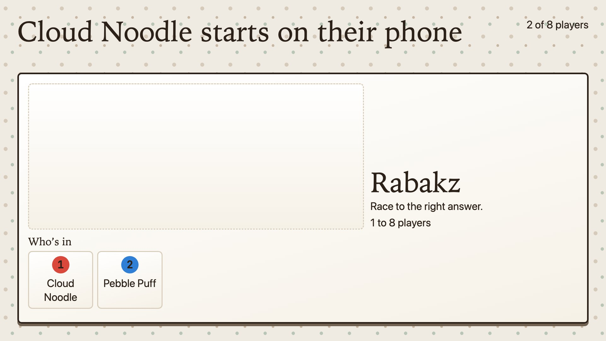
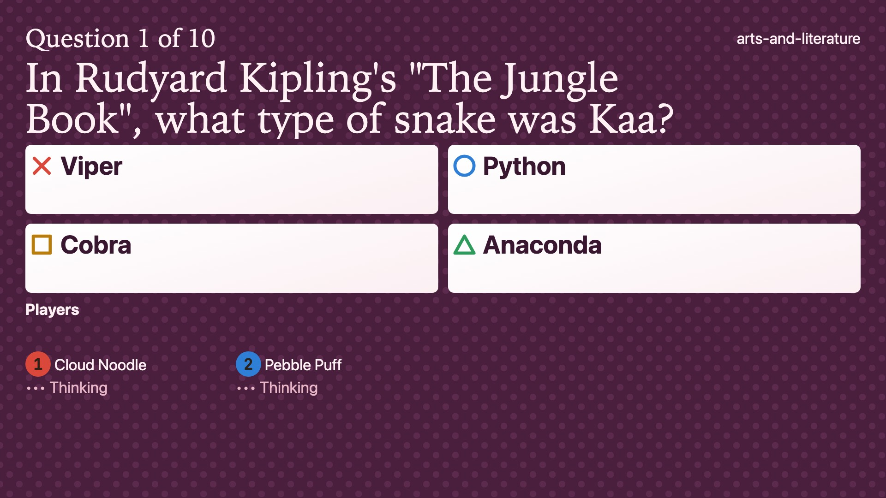
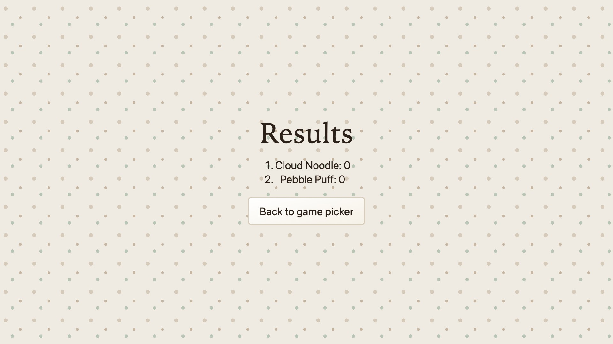
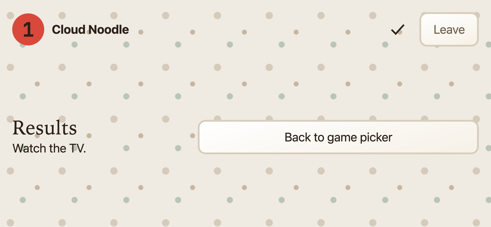
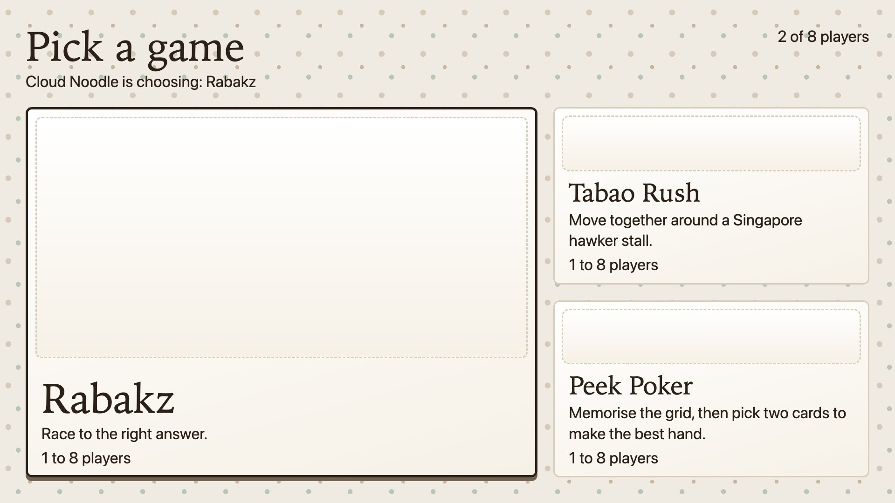
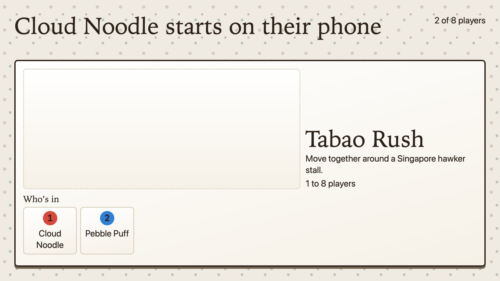
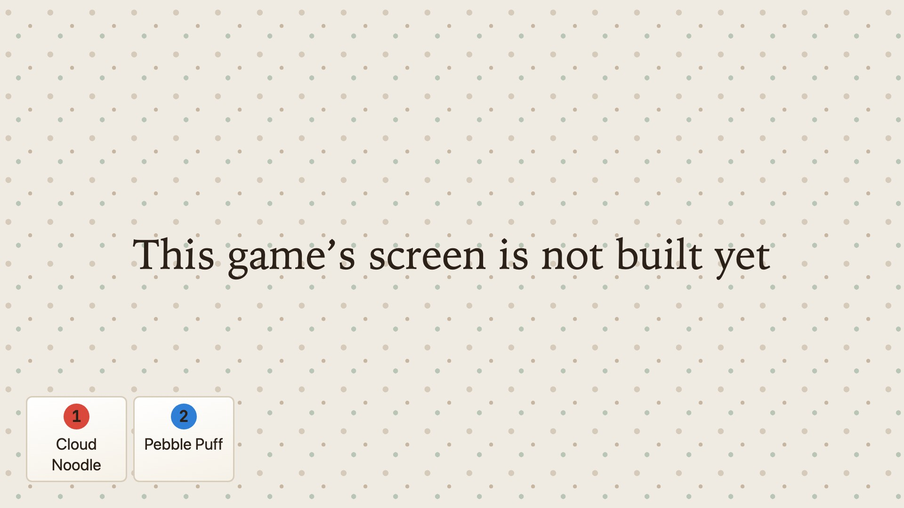
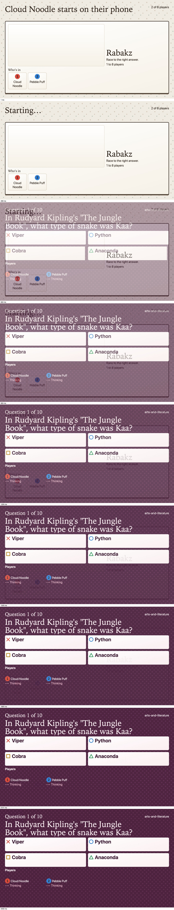
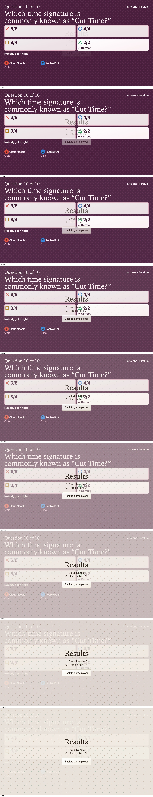
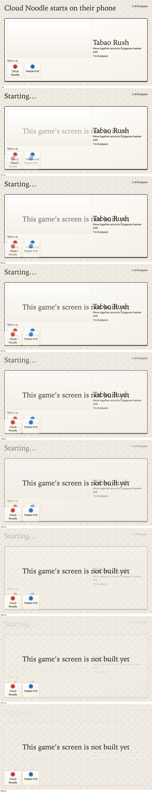

# C-16-start-game UAT evidence

Automated execution only. Visual review and acceptance decisions are pending.

Command: `node tools/uat/run.mjs -- C-16-start-game --phones 2`
Commit: `d1bac41bb2b6683d257992640a29f4e26f2f3319`
Viewports: 1920×1080, 844×390

| Timing | ms | Status |
|---|---:|---|
| Create room through host page | 1165.5 | completed |
| Seat two phones for rabakz | 424.6 | completed |
| Leader starts rabakz; TV and both shells follow | 113969.3 | completed |
| Create room through host page | 841.3 | completed |
| Seat two phones for tabao-rush | 320.8 | completed |
| Leader starts tabao-rush; TV and both shells follow | 4577.9 | completed |

Expected errors (count):
None

## Real server

| Screenshot | What it shows | Looked at by |
|---|---|---|
|  | | |
|  | | |
|  | | |
|  | | |
|  | | |
|  | | |
|  | | |
|  | | |
|  | | |
|  | | |
|  | | |

## Strips

| Screenshot | What it shows | Looked at by |
|---|---|---|
|  | | |
|  | | |
|  | | |

| Acceptance statement | Pass / fail | Evidence |
|---|---|---|
| | | |

## Integrator's look (2026-11-17)
Run: `pnpm uat -- C-16-start-game --phones 2`, exit 0, no process left, after two
integrator fixes to the script (below). Opened c16r2-a.jpg and both crossfade strips
(c16r2-11 and c16r2-24 are them at a quarter; the TV crossfade is slowed ten-fold for the strip).
- Start (strip 11): "Cloud Noodle starts on their phone", then "Starting…", then the Rabakz
  question fading in over the picker with both visible together for several frames: an
  overlapping crossfade (4A), no wipe and no blank frame.
- Running (14): question 1 of 10 with both players "Thinking"; both phones show the shell with
  seat, name and Connected (12, 13; the answer buttons are R-02).
- End (strip 24): the question 10 reveal crossfades into Results with both visible together.
- Results: the leader's phone shows "Results · Watch the TV" and "Back to game picker" (26);
  pressing it returns the TV to the picker with both players still in (27, "2 of 8 players").
- Tabao Rush: starts into the plain "This game's screen is not built yet" with both seats (41).
Faults:
1. The TV's Results (25) is an undesigned list in small body text below the 34 px reading
   floor, and it has a "Back to game picker" button although nobody can press a TV. Either the
   game's own final screen is shown (Rabakz's podium, R-05) or the console's results are
   designed; the TV should carry no button.
2. The category label shows its raw id ("arts-and-literature"); R-05 fixes it (not merged yet).
Integrator's fixes to the UAT script: the match step fast-forwards a whole ten-question match,
which took longer than the default 60 s step limit, so that step now has 240 s; and the slowed
crossfade setting is switched off before returning to the picker, because the slowed
crossfade outlasted the still's 3 s settle limit.
Not checked: perf run (to do before close); real phones and TV.
