# C-16-start-game UAT evidence

Automated execution only. Visual review and acceptance decisions are pending.

Command: `node tools/uat/run.mjs -- C-16-start-game --phones 2`
Commit: `c276979c0f7caa2a1b46817a4e398673749281ff`
Viewports: 1920×1080, 844×390

| Timing | ms | Status |
|---|---:|---|
| Create room through host page | 1119.6 | completed |
| Seat two phones for rabakz | 411.3 | completed |
| Leader starts rabakz; TV and both shells follow | 128013.9 | completed |
| Create room through host page | 842.4 | completed |
| Seat two phones for tabao-rush | 316.8 | completed |
| Leader starts tabao-rush; TV and both shells follow | 7942.3 | completed |

Expected errors (count):
None

## Strips

| Screenshot | What it shows | Looked at by |
|---|---|---|
| 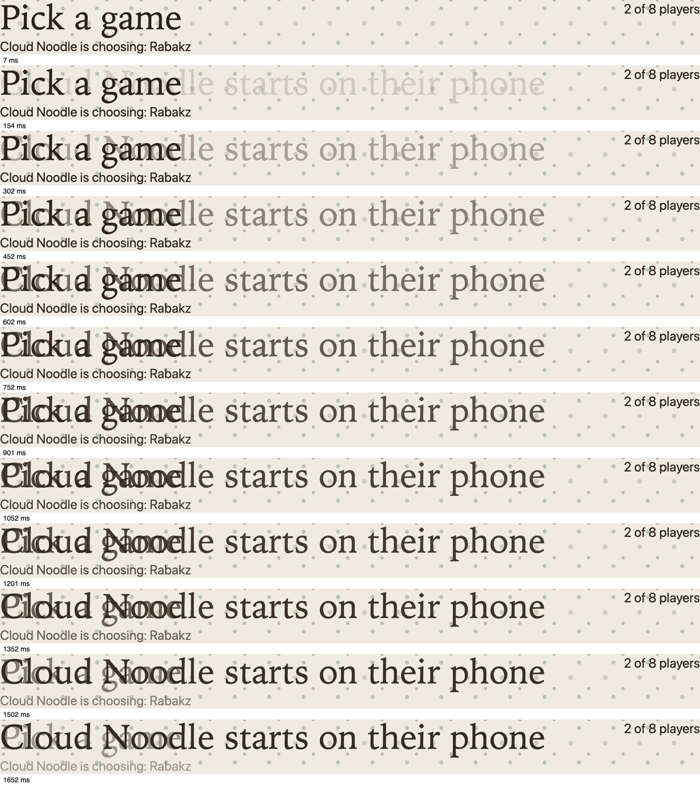 | | |
| 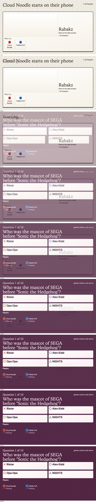 | | |
| 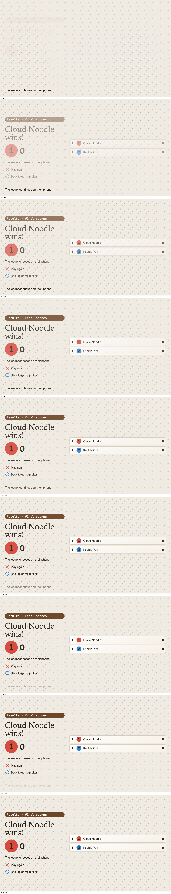 | | |
| 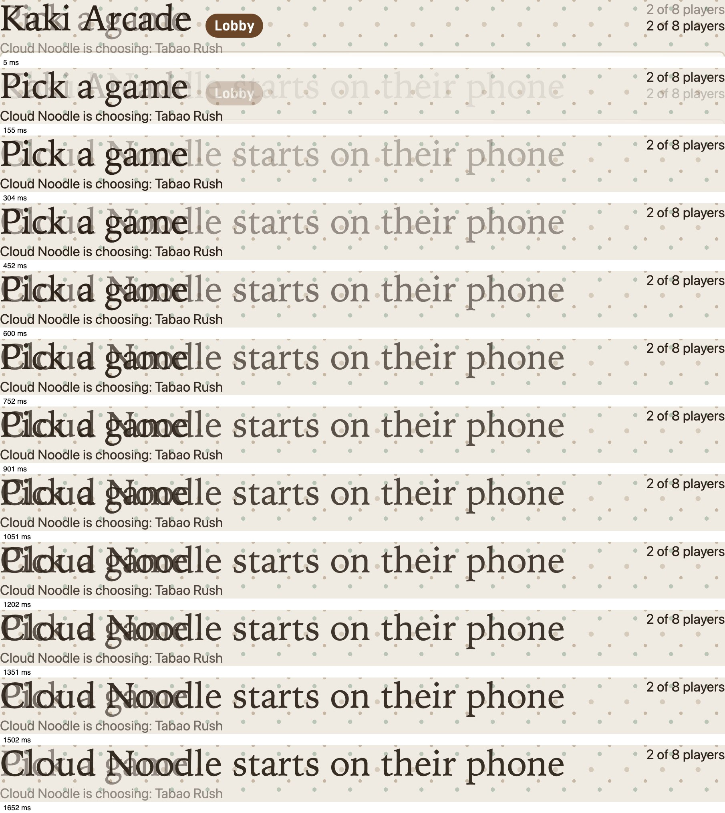 | | |
| 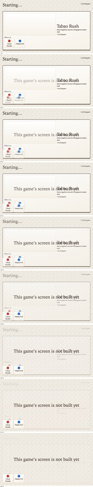 | | |

## Real server

| Screenshot | What it shows | Looked at by |
|---|---|---|
| 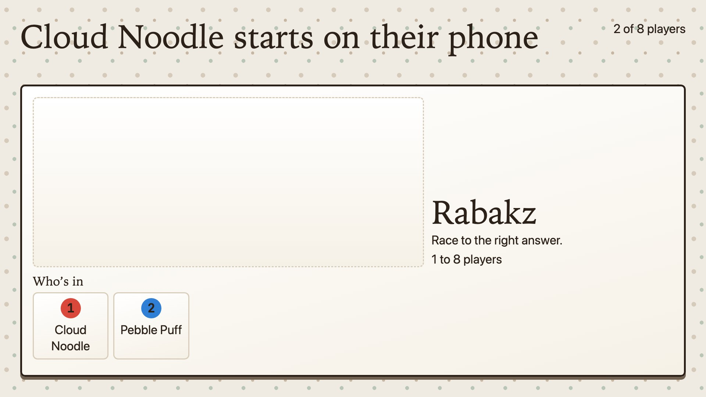 | | |
|  | | |
|  | | |
| 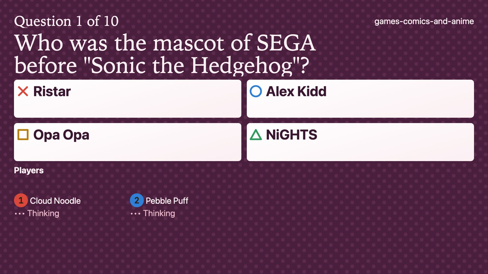 | | |
| 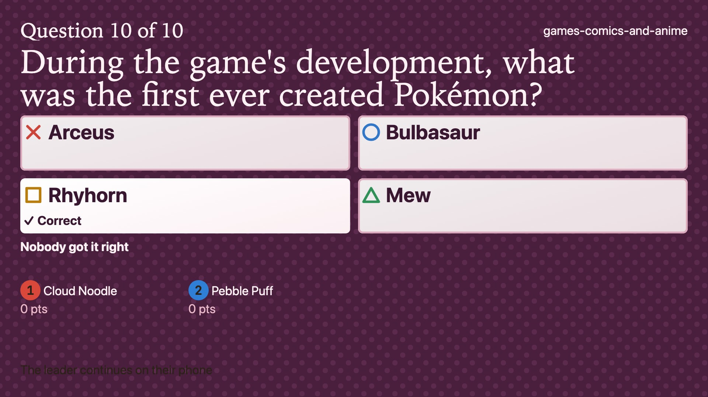 | | |
| 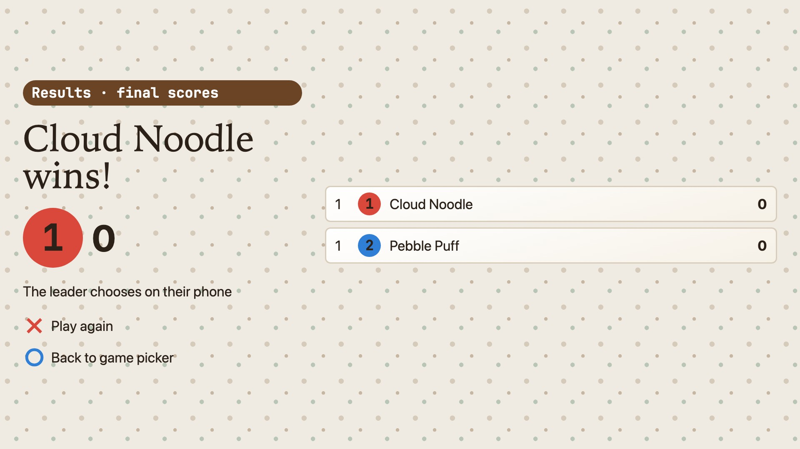 | | |
| 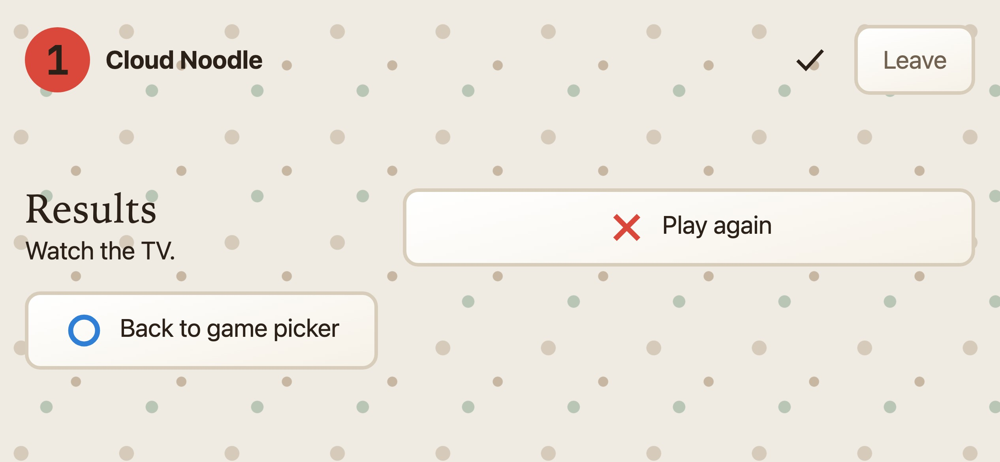 | | |
|  | | |
| 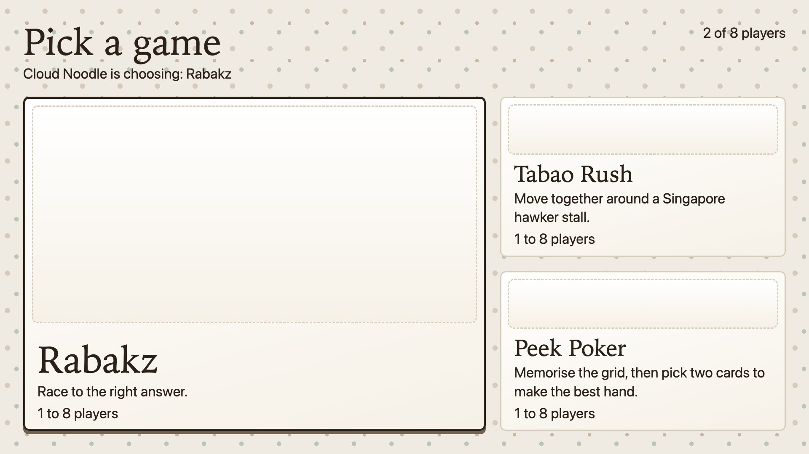 | | |
|  | | |
|  | | |
|  | | |
|  | | |
| 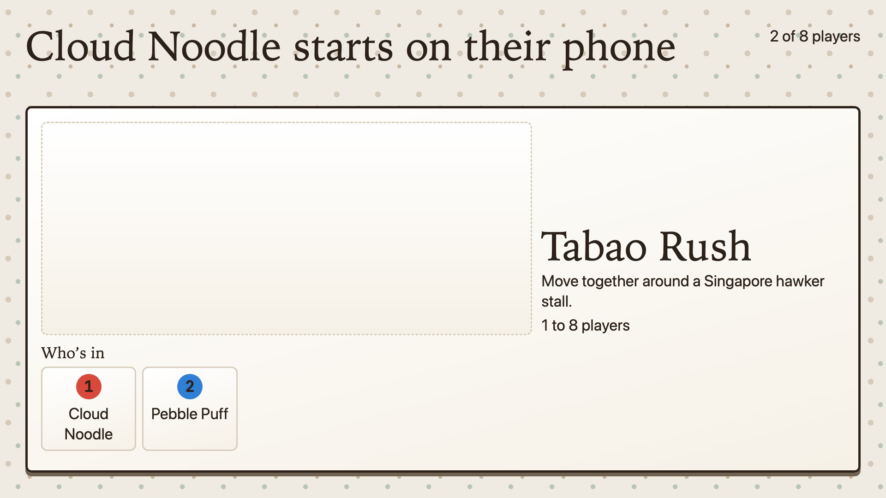 | | |
|  | | |
|  | | |
| 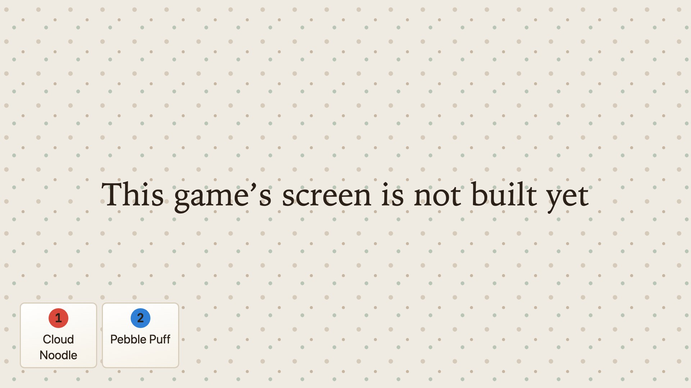 | | |

| Acceptance statement | Pass / fail | Evidence |
|---|---|---|
| | | |

## Integrator's look (2026-11-17)
Run: `pnpm uat -- C-16-start-game --phones 2`, exit 0, no process left, after one integrator
fix: the new heading strip asked for 15 frames and the harness allows 12 (now 12 every 150 ms).
Opened c16r3-a.jpg, 39-host-rabakz-results-tv at full size, the heading strip (13) at full
size, and a crop of 28.
Works:
- Heading crossfade (13, slowed ten-fold): "Pick a game" and "Cloud Noodle starts on their
  phone" overlap across frames 2 to 11; no cut.
- A second game in the same room: after Back to game picker, starting Rabakz again reaches both
  phones' controllers (45, 46); both phones return to the picker (43, 44).
- Console results (39) follow board 3: chip, winner, score, the table on the right at about
  1 : 1.618, and the two choices as phone hints with cross and circle; the leader's phone has
  Play again (cross) and Back to game picker (circle) (40); phone 2 says Results, Watch the TV (41).
Faults:
1. 39: "Cloud Noodle wins!" although both players have 0 and both are placed 1: a tie for
   first must say so (for example "Cloud Noodle and Pebble Puff share first"; with more than
   two, "3 players share first").
2. 39: the winner's seat badge "1" sits right against the score "0" and reads as "10"; the
   score needs its word ("0 points") or clear separation.
3. 28: on Rabakz's own final screen, "The leader continues on their phone" is dark ink on the
   plum (unreadable; see c16r3-28crop.jpg). It must use the Rabakz theme's text colour.
Not checked: perf run (before close); real phones and TV.
