# C-16-start-game UAT evidence

Automated execution only. Visual review and acceptance decisions are pending.

Command: `node tools/uat/run.mjs -- C-16-start-game --phones 2`
Commit: `a9d839e7f1e8e3ebb24a1ddbf8d75396d30b3fd4`
Viewports: 1920×1080, 844×390

| Timing | ms | Status |
|---|---:|---|
| Create room through host page | 975.6 | completed |
| Seat two phones for rabakz | 451.5 | completed |
| Leader starts rabakz; TV and both shells follow | 127494.0 | completed |
| Create room through host page | 850.7 | completed |
| Seat two phones for tabao-rush | 305.1 | completed |
| Leader starts tabao-rush; TV and both shells follow | 7941.1 | completed |

Expected errors (count):
None

## Strips

| Screenshot | What it shows | Looked at by |
|---|---|---|
| 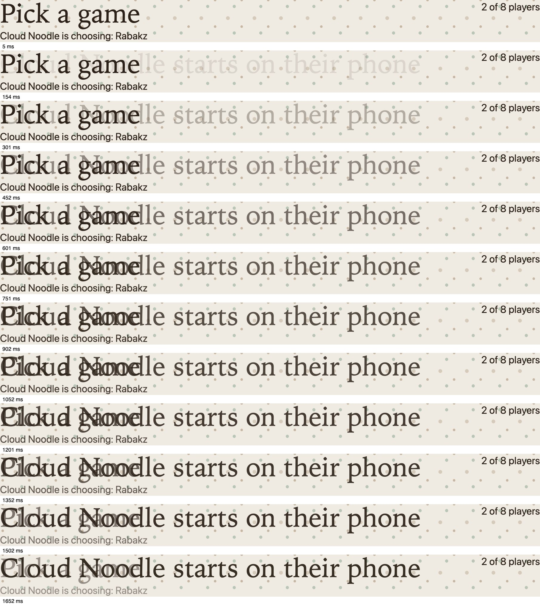 | | |
| 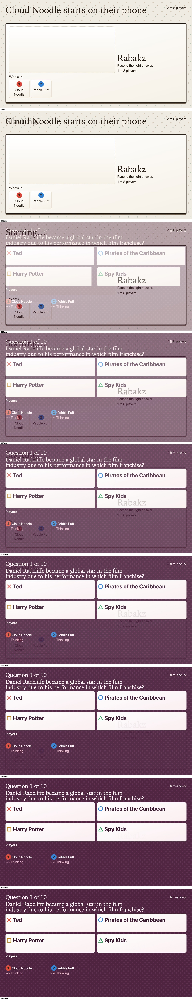 | | |
| 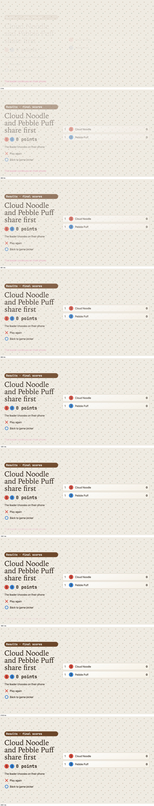 | | |
| 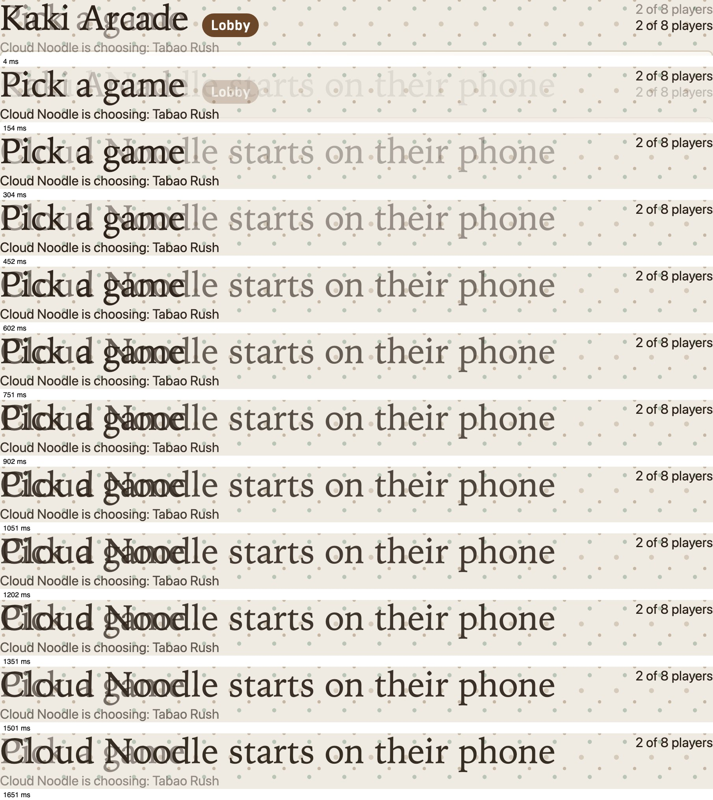 | | |
| 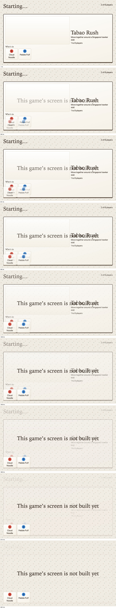 | | |

## Real server

| Screenshot | What it shows | Looked at by |
|---|---|---|
| 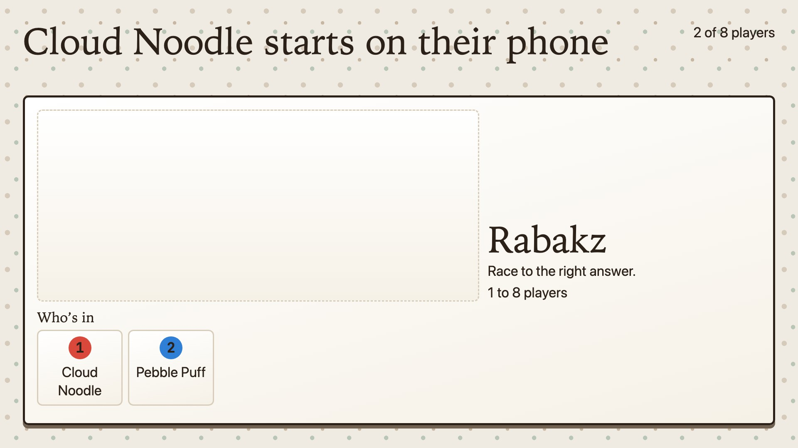 | | |
|  | | |
| 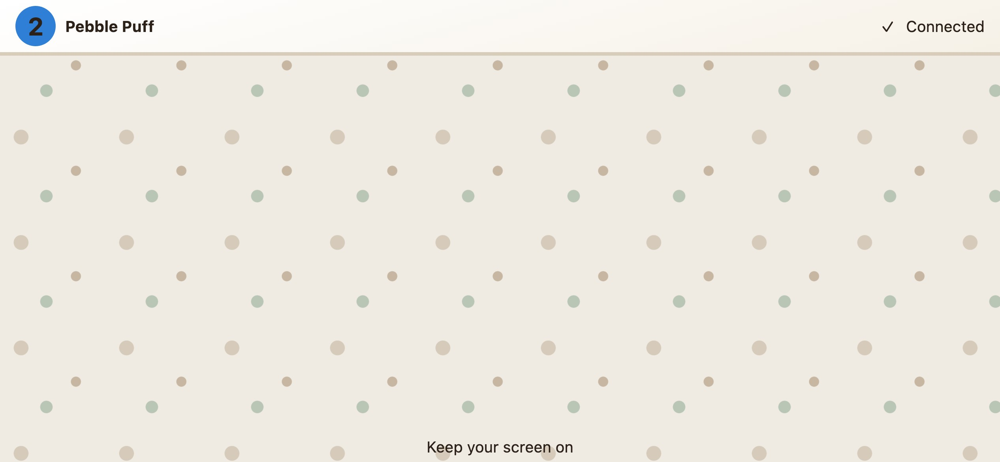 | | |
| 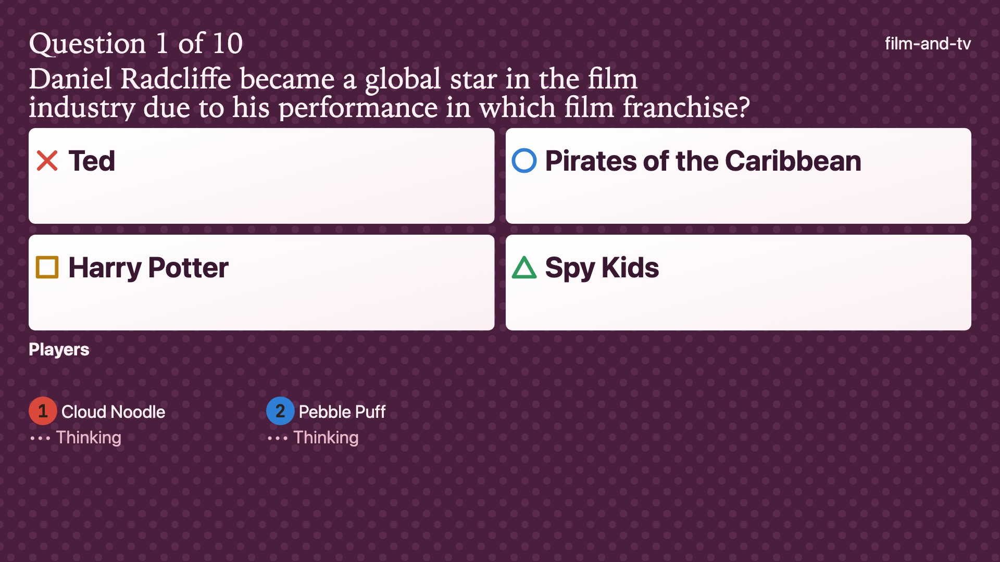 | | |
| 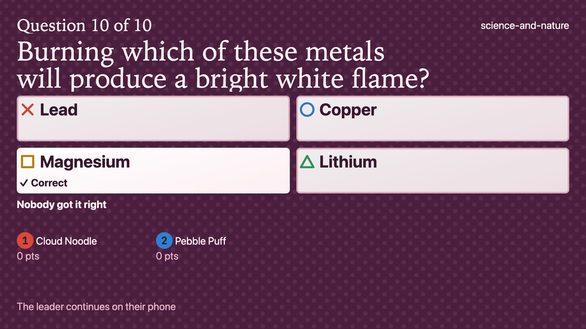 | | |
| 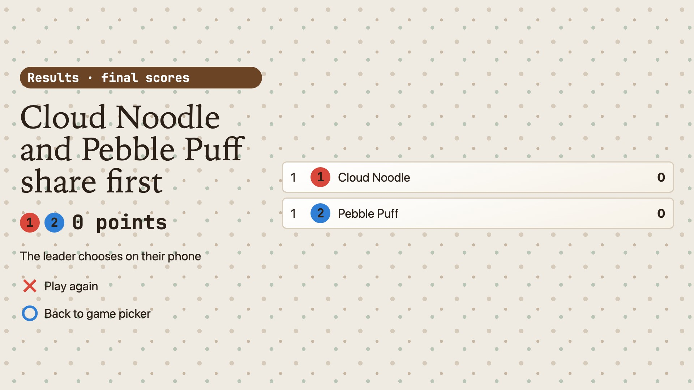 | | |
|  | | |
|  | | |
| 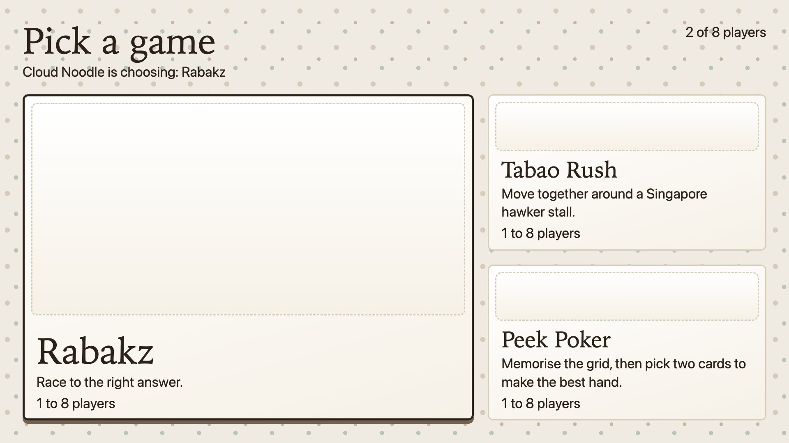 | | |
|  | | |
|  | | |
|  | | |
|  | | |
| 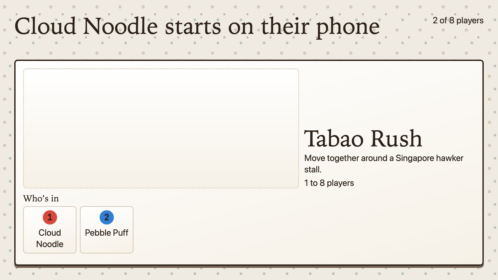 | | |
|  | | |
|  | | |
| 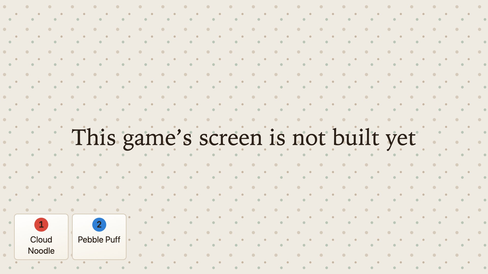 | | |

| Acceptance statement | Pass / fail | Evidence |
|---|---|---|
| | | |

## Integrator's look (2026-11-17)
Run: `pnpm uat -- C-16-start-game --phones 2`, exit 0, no process left. Opened
39-host-rabakz-results-tv at full size and a crop of 28 (c16r4-28crop.jpg).
- The three round-3 faults are fixed: the 0–0 result reads "Cloud Noodle and Pebble Puff share
  first" with both badges; the score reads "0 points" in the mono face, clearly apart from the
  badges; on Rabakz's own final screen "The leader continues on their phone" is the theme's pink
  secondary text on plum, readable.
Not checked: perf run (before close); real phones and TV.
