# C-16-start-game UAT evidence

Automated execution only. Visual review and acceptance decisions are pending.

Command: `node tools/uat/run.mjs -- C-16-start-game --phones 2`
Commit: `80a3bf88cd690939fa8008d6147b27ca97e010d8`
Viewports: 1920×1080, 844×390

| Timing | ms | Status |
|---|---:|---|
| Create room through host page | 1193.9 | completed |
| Seat two phones for rabakz | 489.2 | completed |
| Leader starts rabakz; TV and both shells follow | 126648.1 | completed |
| Create room through host page | 844.1 | completed |
| Seat two phones for tabao-rush | 259.0 | completed |
| Leader starts tabao-rush; TV and both shells follow | 7975.3 | completed |

Expected errors (count):
None

## Strips

| Screenshot | What it shows | Looked at by |
|---|---|---|
| 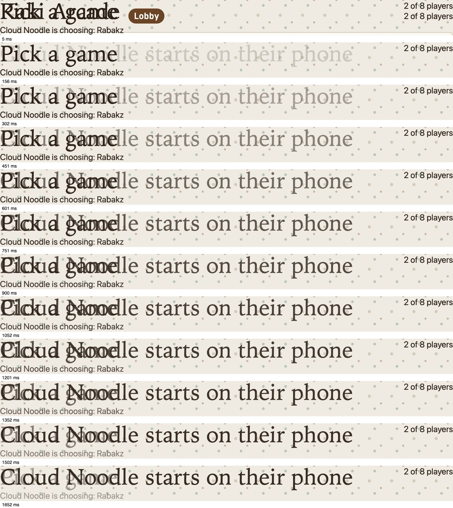 | | |
| 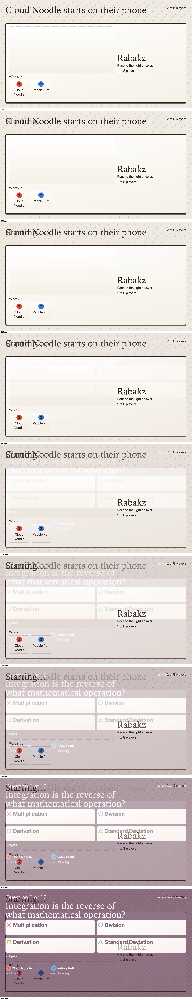 | | |
| 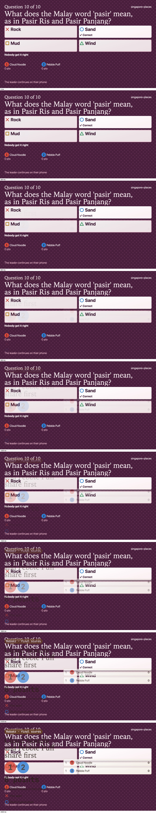 | | |
| 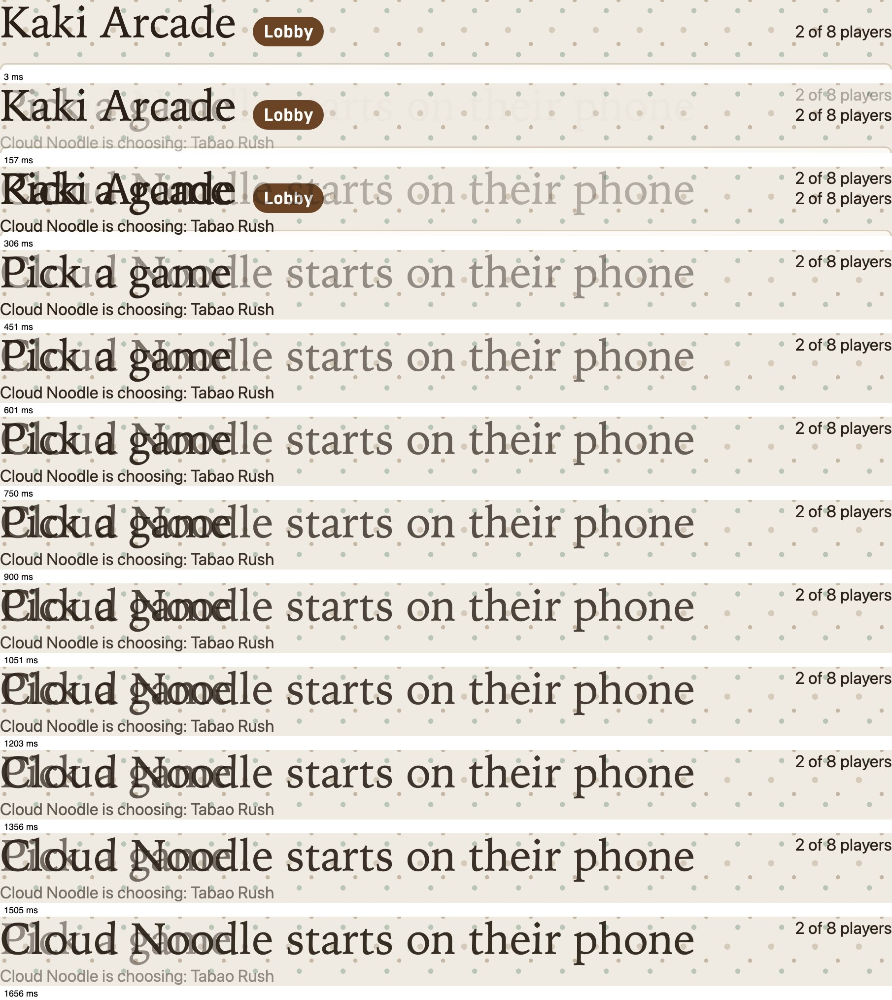 | | |
| 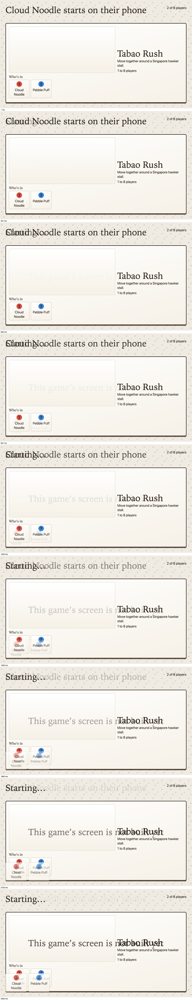 | | |

## Real server

| Screenshot | What it shows | Looked at by |
|---|---|---|
| 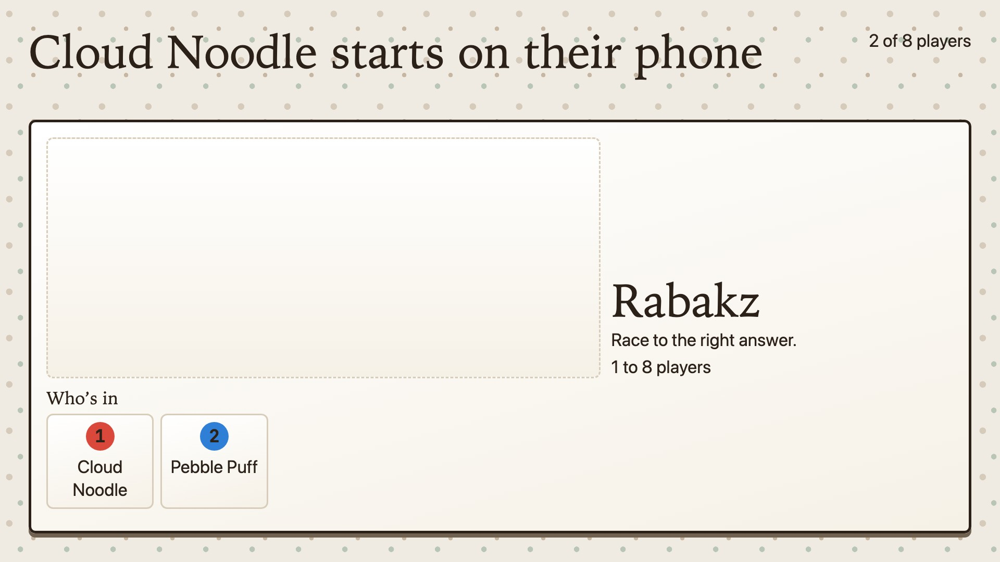 | | |
|  | | |
|  | | |
| 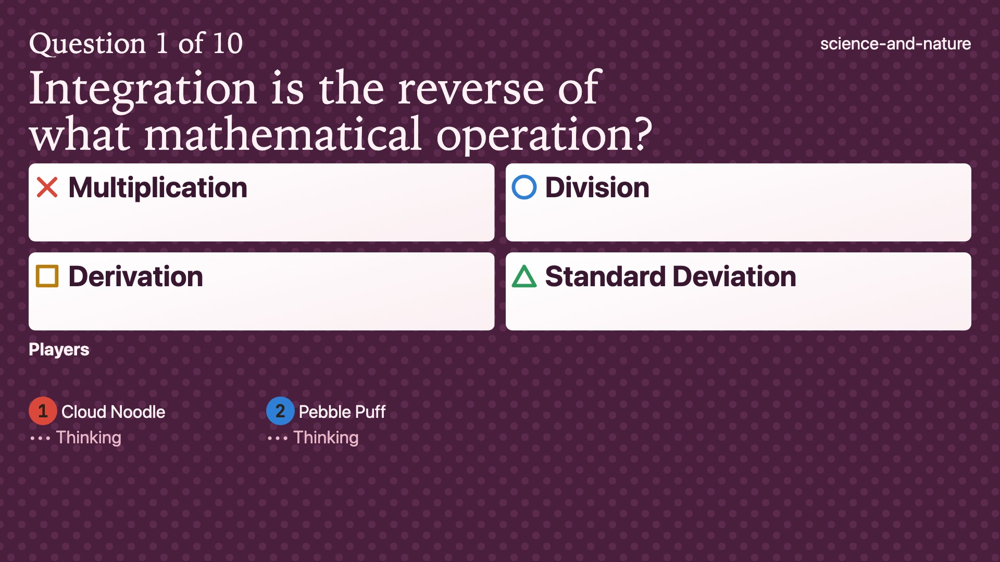 | | |
| 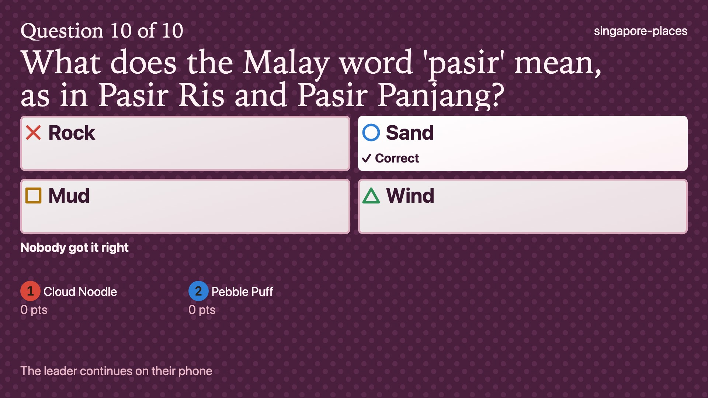 | | |
| 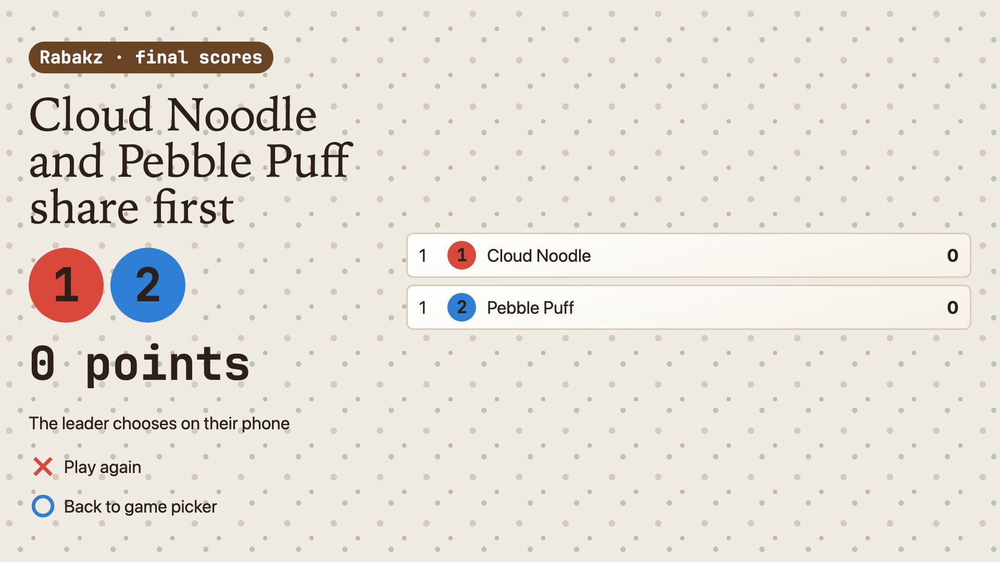 | | |
|  | | |
| 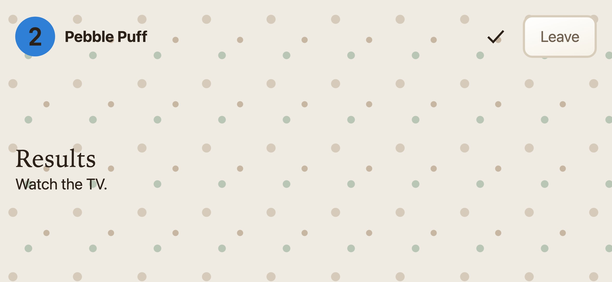 | | |
| 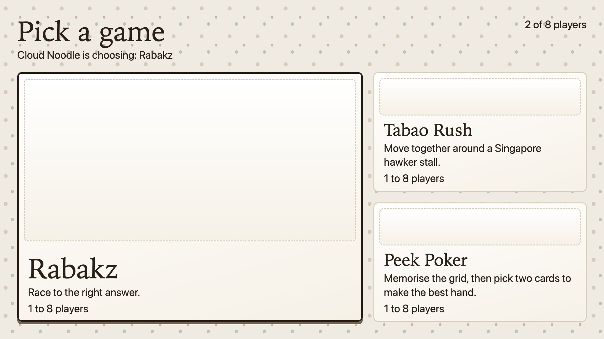 | | |
|  | | |
|  | | |
|  | | |
|  | | |
| 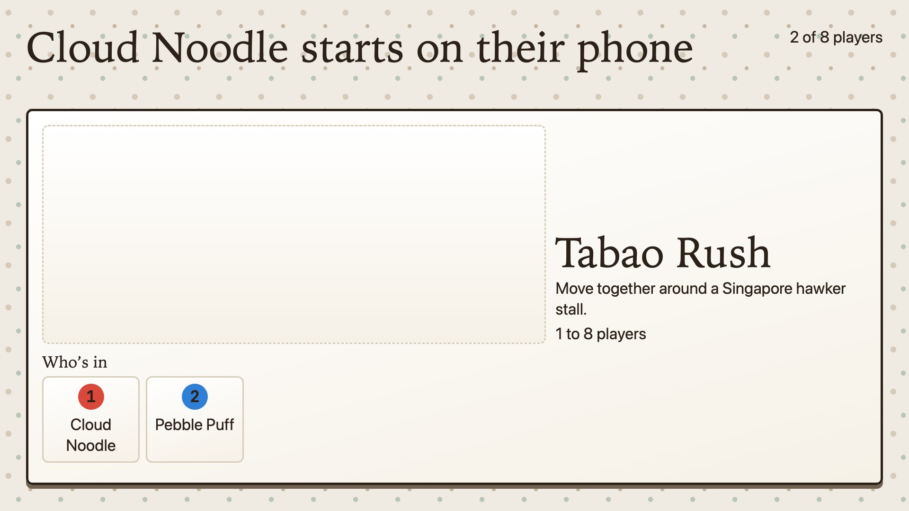 | | |
|  | | |
|  | | |
| 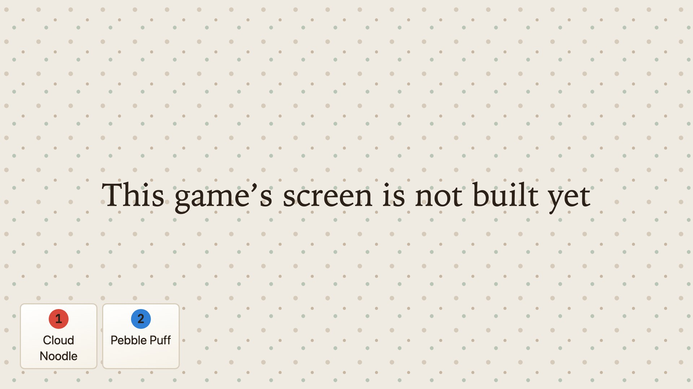 | | |

| Acceptance statement | Pass / fail | Evidence |
|---|---|---|
| | | |

## Integrator's look (2026-11-17)
Run: `pnpm uat -- C-16-start-game --phones 2`, exit 0, no process left. The new browser-backed
mount test (`Overlap.dom.test.ts`) passed when the integrator ran it. Opened 39 at full size
and the results strip (38, shrunk copy c16r5-strip.jpg) in full.
Works: 39 now follows board 3 and D-120: "Rabakz · final scores" chip at its own width, tie
headline at 144 px in three lines, badges 144 px, "0 points" 89 px mono, hints below, table on
the right. The outgoing Rabakz screen is now kept (no cut).
Fault: the incoming results layer has no surface of its own. Across the strip the plum quiz
screen stays fully visible while the results text fades in over it, so both screens' text
tangle mid-change (frames 3 to 9). The incoming whole-screen layer must paint its own surface
(the console's cream dot treatment) so it covers the outgoing one as it fades in, as fixed for
K-04 in its round 6.
