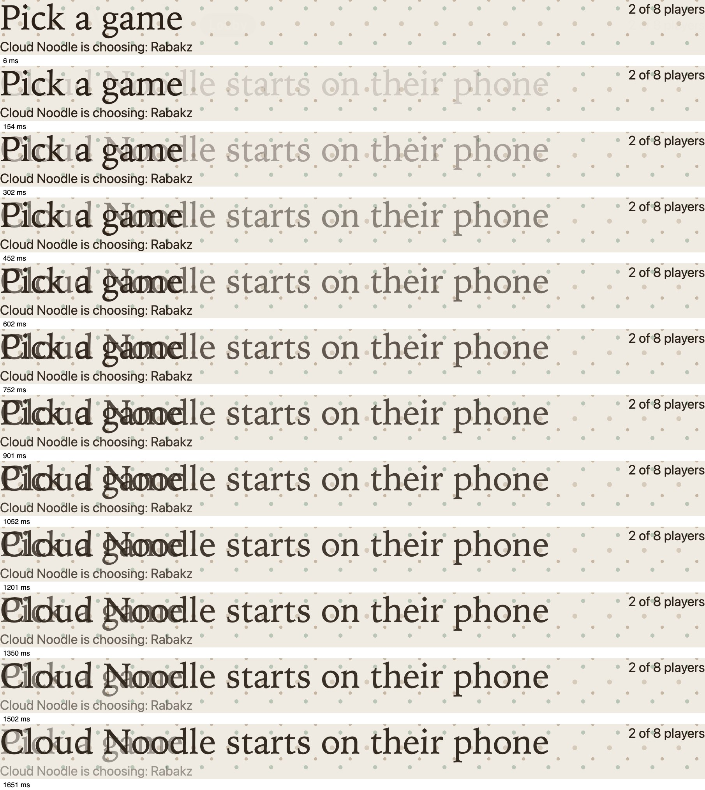
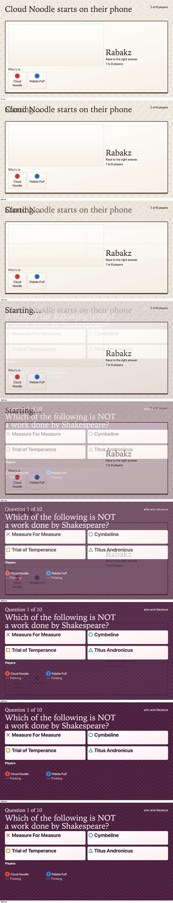
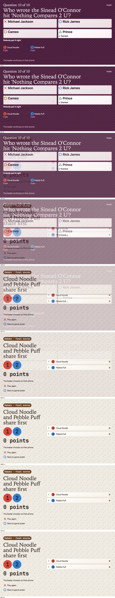
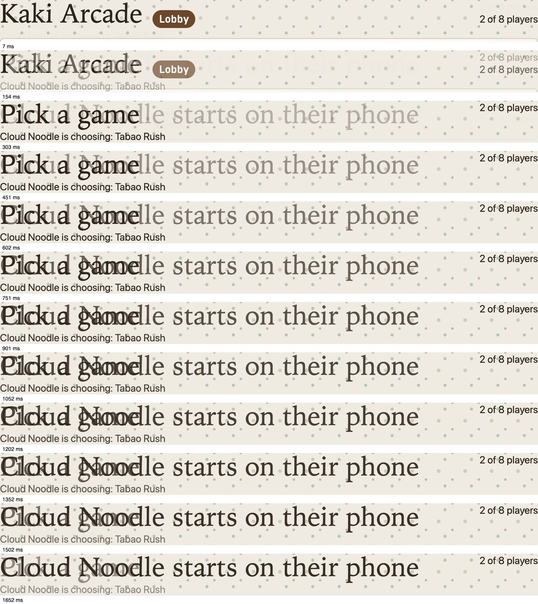
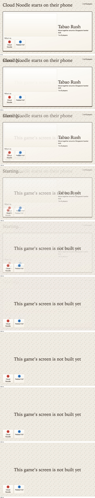
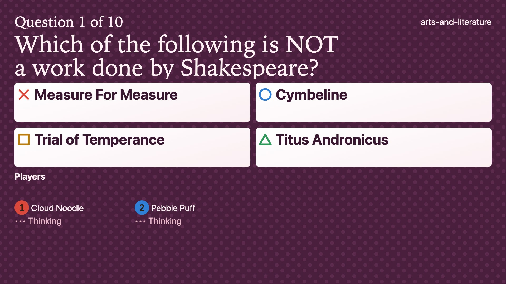
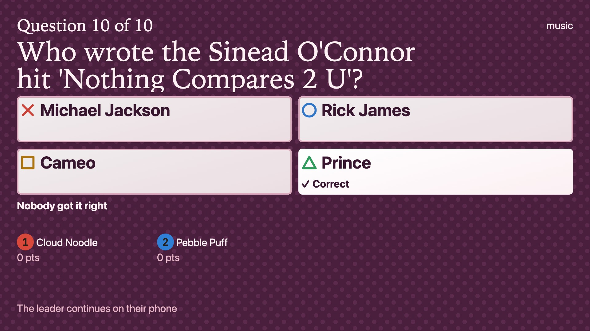
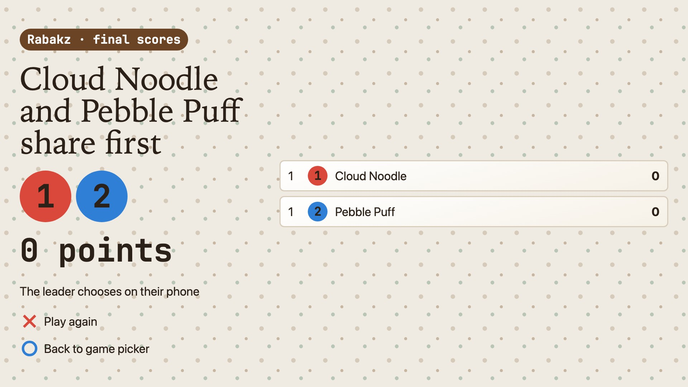

# C-16-start-game UAT evidence

Automated execution only. Visual review and acceptance decisions are pending.

Command: `node tools/uat/run.mjs -- C-16-start-game --phones 2`
Commit: `f86f7821f99c8713f7a22dc74fd538e5b7bb0b7e`
Viewports: 1920×1080, 844×390

| Timing | ms | Status |
|---|---:|---|
| Create room through host page | 1159.2 | completed |
| Seat two phones for rabakz | 412.2 | completed |
| Leader starts rabakz; TV and both shells follow | 129941.8 | completed |
| Create room through host page | 841.8 | completed |
| Seat two phones for tabao-rush | 315.3 | completed |
| Leader starts tabao-rush; TV and both shells follow | 9459.4 | completed |

Expected errors (count):
None

## Strips

| Screenshot | What it shows | Looked at by |
|---|---|---|
|  | | |
|  | | |
|  | | |
|  | | |
|  | | |

## Real server

| Screenshot | What it shows | Looked at by |
|---|---|---|
|  | | |
|  | | |
|  | | |
|  | | |
|  | | |
|  | | |
|  | | |
|  | | |
|  | | |
|  | | |
|  | | |
|  | | |
|  | | |
|  | | |
|  | | |
|  | | |
|  | | |

| Acceptance statement | Pass / fail | Evidence |
|---|---|---|
| | | |

## Integrator's look (2026-11-17)
Run: `pnpm uat -- C-16-start-game --phones 2`, exit 0, no process left, after one integrator
change to the UAT: the per-frame pixel checks now take their endpoints from the pixels measured
in the first and last frames (the sample point can sit on card shading or the dot texture, so
the flat background colour was the wrong endpoint and failed a correct transition). The
browser-backed mount test passed when the integrator ran it. Opened the results strip
(c16r6-strip.jpg) and the start strip (c16r6-start.jpg) in full.
- Results: the cream console surface rises over the plum quiz screen across frames 3 to 6 and
  covers it fully by frame 6; no tangled text at rest, no cut, no see-through blank frame.
- Start: the picker and the quiz screen overlap and blend across frames 3 to 6; no cut.
