# C-16-start-game UAT evidence

Automated execution only. Visual review and acceptance decisions are pending.

Command: `node tools/uat/run.mjs -- C-16-start-game --phones 2`
Commit: `2abd83fe83da352dbd447b88123508d6b08c20d6`
Viewports: 1920×1080, 844×390

| Timing | ms | Status |
|---|---:|---|
| Create room through host page | 890.6 | completed |
| Seat two phones for rabakz | 488.5 | completed |
| Leader starts rabakz; TV and both shells follow | 120698.3 | completed |
| Create room through host page | 840.1 | completed |
| Seat two phones for tabao-rush | 334.8 | completed |
| Leader starts tabao-rush; TV and both shells follow | 9422.0 | completed |

Expected errors (count):
None

## Real server

| Screenshot | What it shows | Looked at by |
|---|---|---|
| 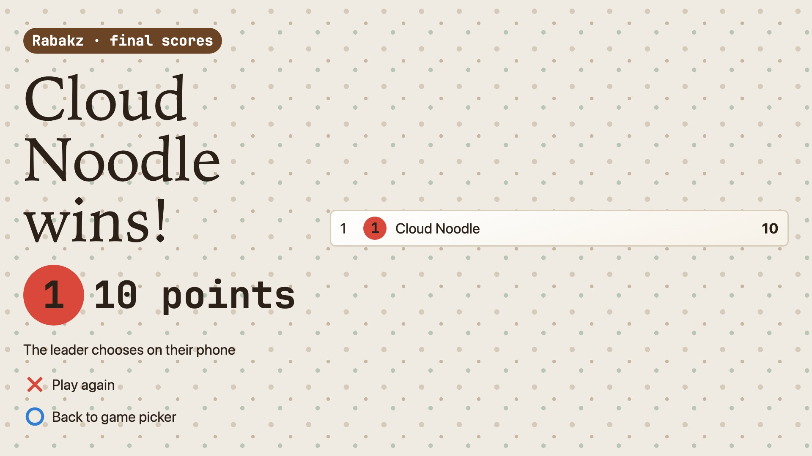 | | |
| 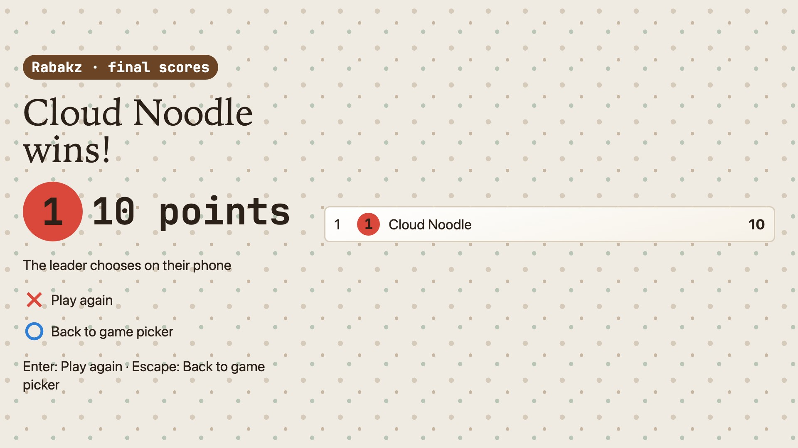 | | |
| 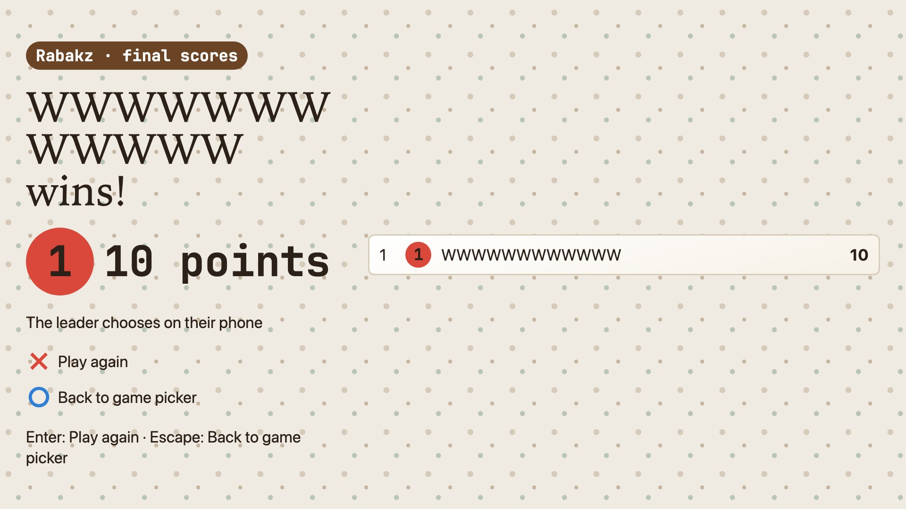 | | |
| 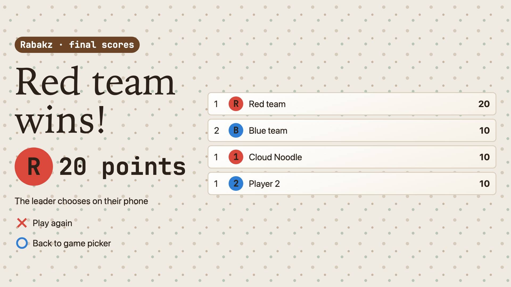 | | |
| 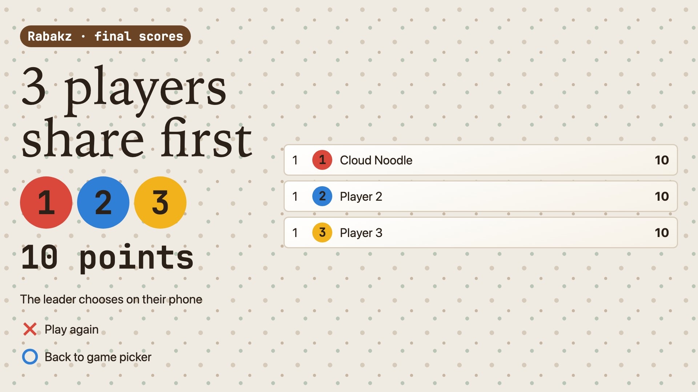 | | |
|  | | |
|  | | |
|  | | |
| 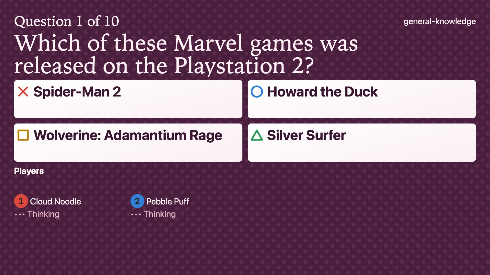 | | |
| 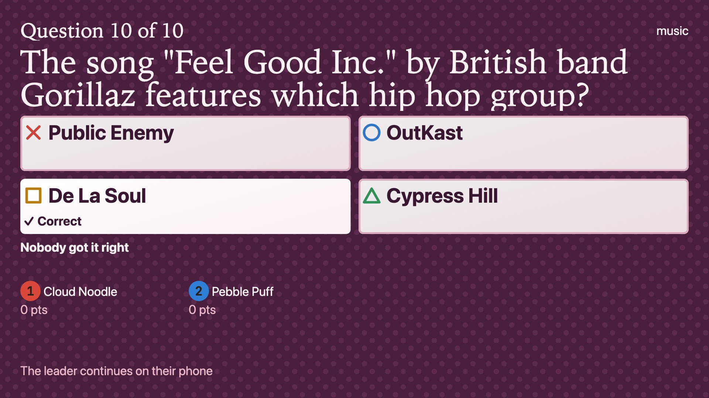 | | |
| 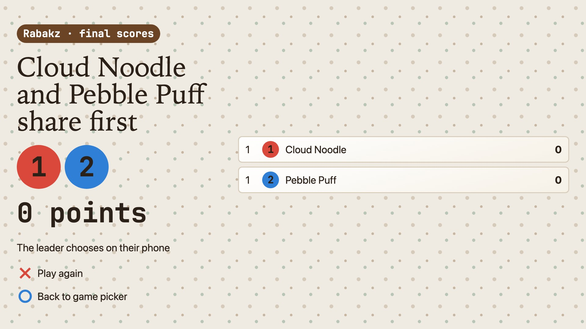 | | |
|  | | |
|  | | |
|  | | |
|  | | |
|  | | |
|  | | |
|  | | |
|  | | |
|  | | |
|  | | |
|  | | |

## Strips

| Screenshot | What it shows | Looked at by |
|---|---|---|
| 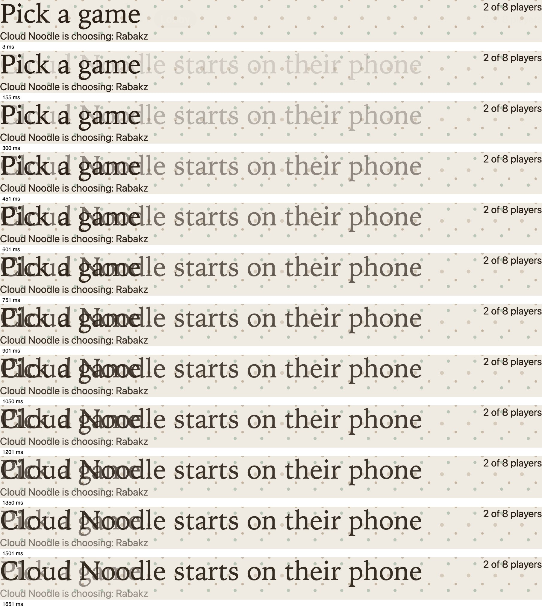 | | |
| 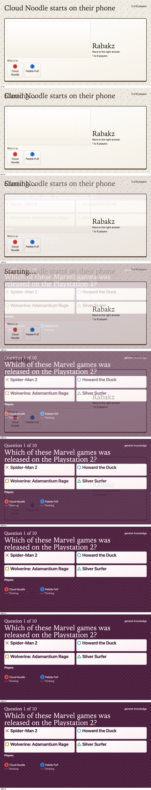 | | |
| 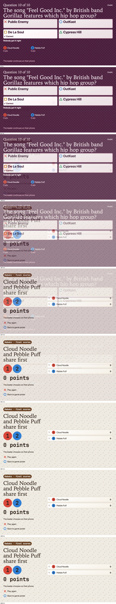 | | |
| 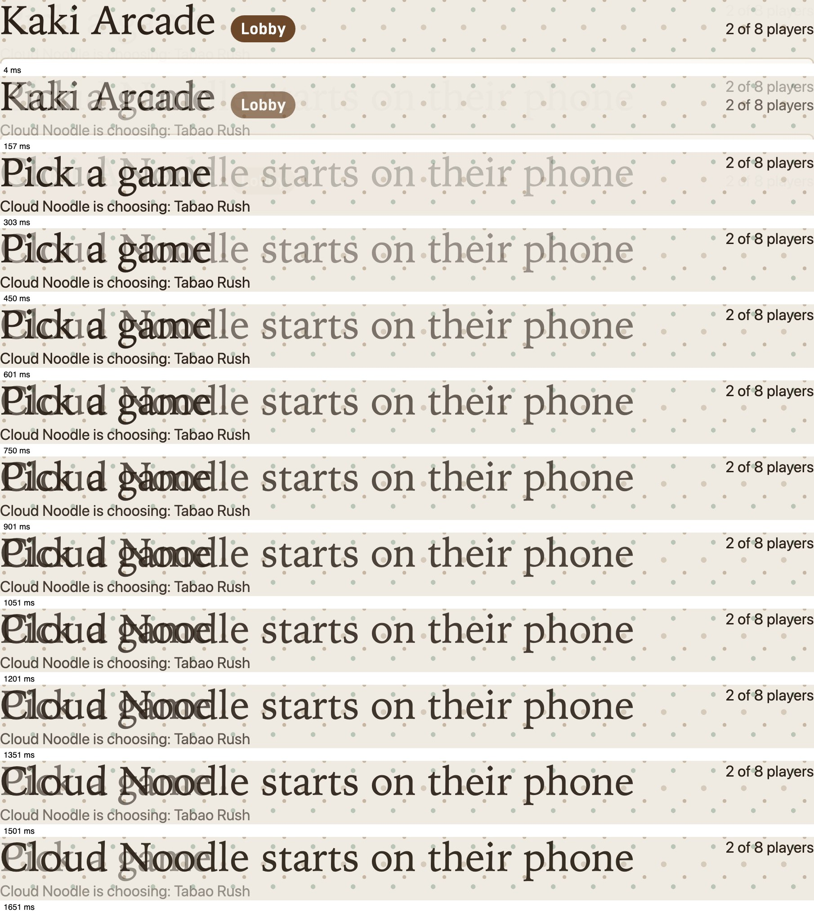 | | |
| 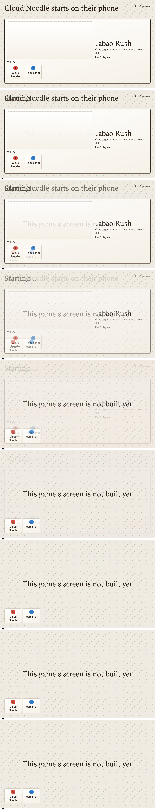 | | |

| Acceptance statement | Pass / fail | Evidence |
|---|---|---|
| | | |

## Integrator's look (2026-11-17)
Run: `pnpm uat -- C-16-start-game --phones 2`, exit 0, no process left. Integrator fixes to the
new results-fit capture before it could run: (1) it imported Preact from a path Vite does not
serve (`/@id/preact`); it now takes Vite's own pre-bundled URL from results.tsx, so the fixture
shares the page's one Preact instance; (2) the fixture page opened `h.host.url()` before the
host page had navigated (about:blank); it now opens `${h.origin}/host`; (3) the one-word case
used 30 characters, which no player can have (nickname limit `MAX_NICKNAME_CHARS = 12`); it now
uses 12 W's. `Overlap.dom.test.ts` passed when the integrator ran it.
Opened c16r7-fit.jpg (shots 01 to 05 at 1920 × 1080):
- 01 single winner "Cloud Noodle wins!" at 144 px; the column ends above the safe margin.
- 02 the same with the keyboard hint: steps to 89 px (D-123) and fits.
- 03 twelve W's: 89 px, wrapping by character, fits.
- 04 team result "Red team wins!" with team totals then players; fits.
- 05 three-way tie "3 players share first" with three 144 px badges; fits.
| Shot | What it shows | Looked at by |
|---|---|---|
| 01–05 | Results fit for single, keyboard, longest name, team and three-way tie | Claude (integrator) |
| 38, 24 | Results and start crossfades (as round 6) | Claude (integrator), round 6 |
