# C-16-start-game UAT evidence

Automated execution only. Visual review and acceptance decisions are pending.

Command: `node tools/uat/run.mjs -- C-16-start-game --phones 2`
Commit: `a45703833c590dcb822717e7873a57f88b1079f8`
Viewports: 1920×1080, 844×390

| Timing | ms | Status |
|---|---:|---|
| Create room through host page | 868.1 | completed |
| Seat two phones for rabakz | 444.2 | completed |
| Leader starts rabakz; TV and both shells follow | 120651.2 | completed |
| Create room through host page | 867.9 | completed |
| Seat two phones for tabao-rush | 334.5 | completed |
| Leader starts tabao-rush; TV and both shells follow | 9556.6 | completed |

Expected errors (count):
None

## Real server

| Screenshot | What it shows | Looked at by |
|---|---|---|
| 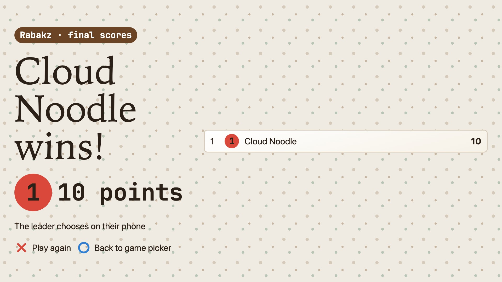 | | |
| 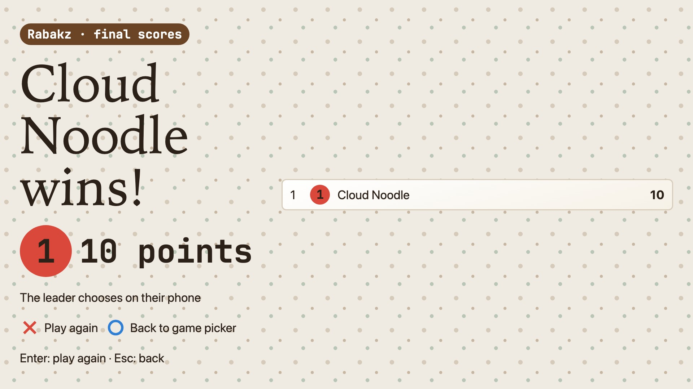 | | |
| 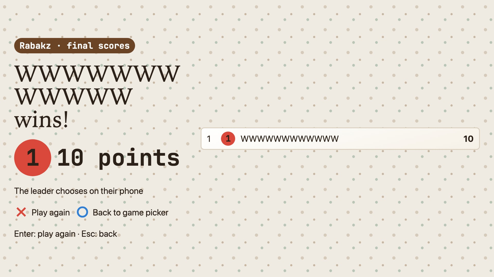 | | |
| 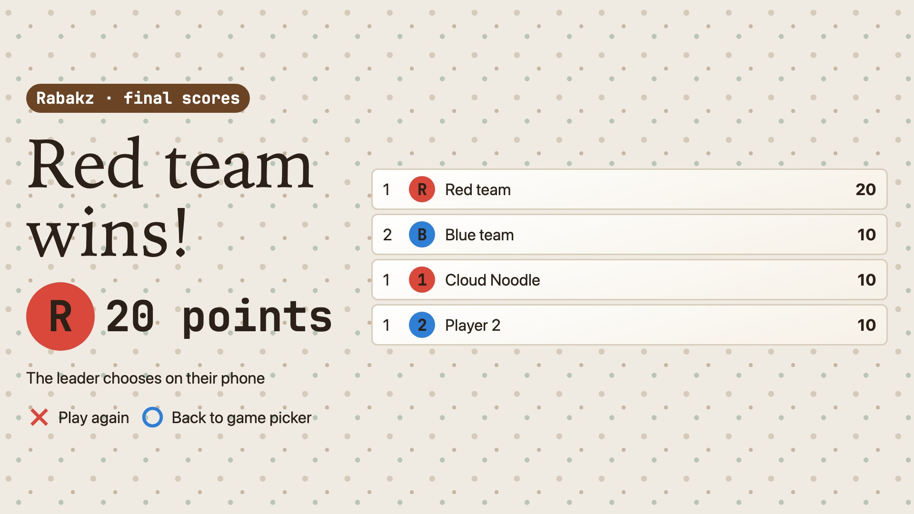 | | |
| 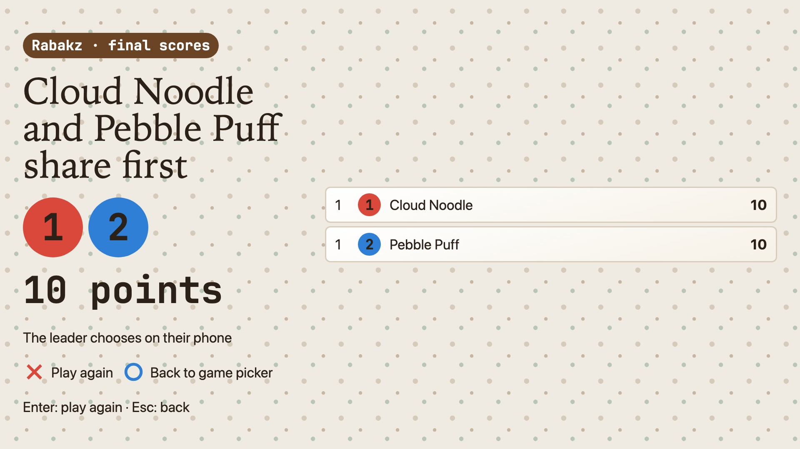 | | |
| 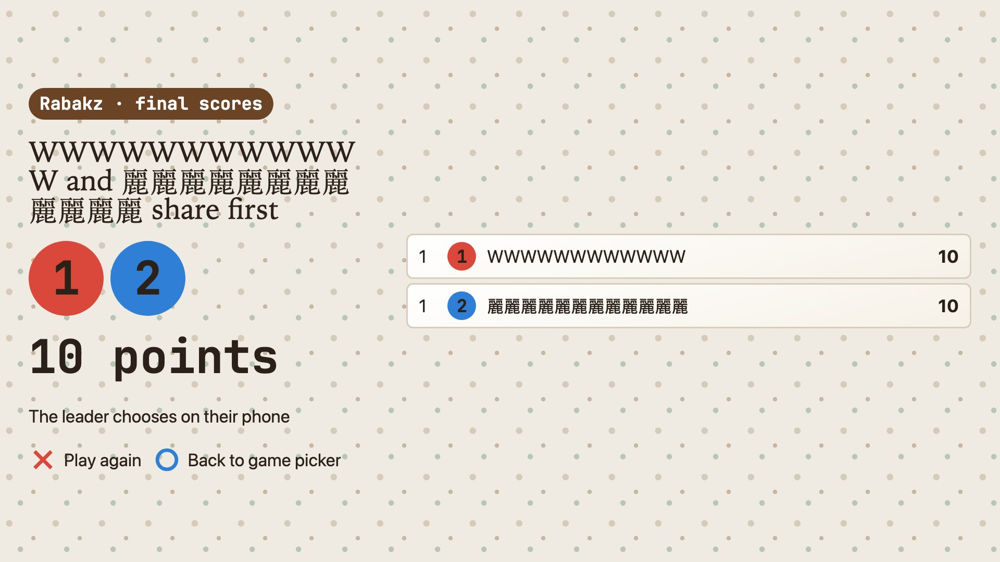 | | |
| 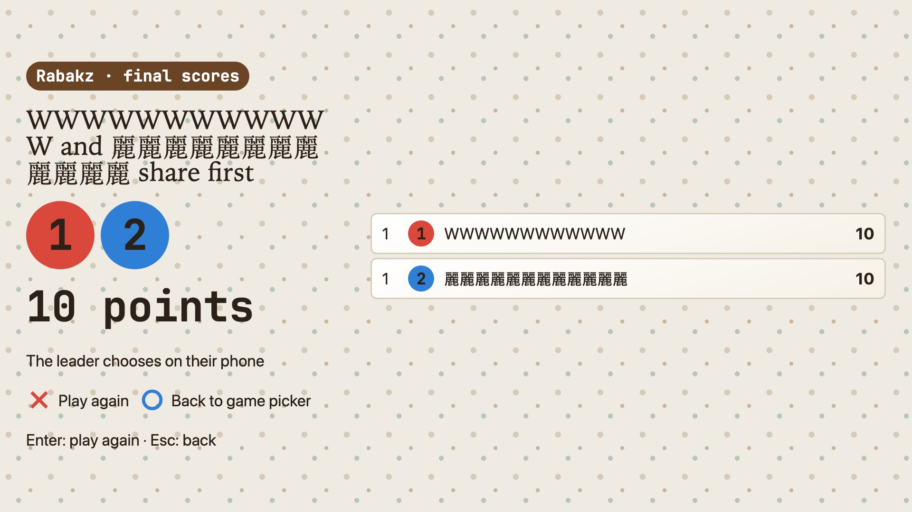 | | |
| 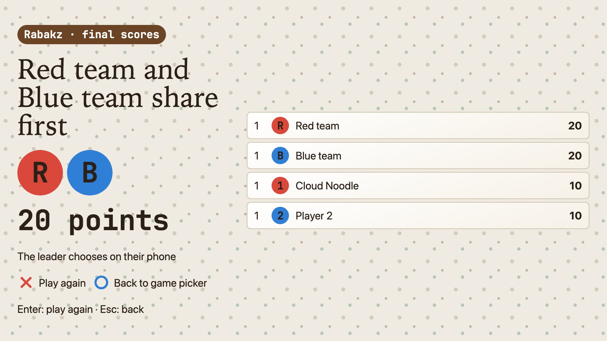 | | |
| 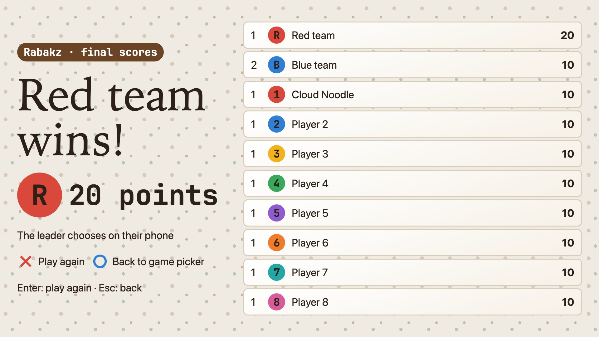 | | |
| 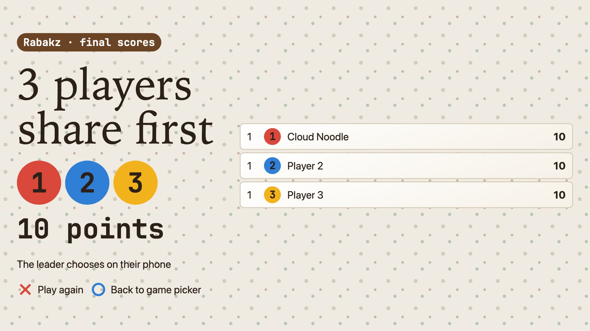 | | |
|  | | |
|  | | |
|  | | |
| 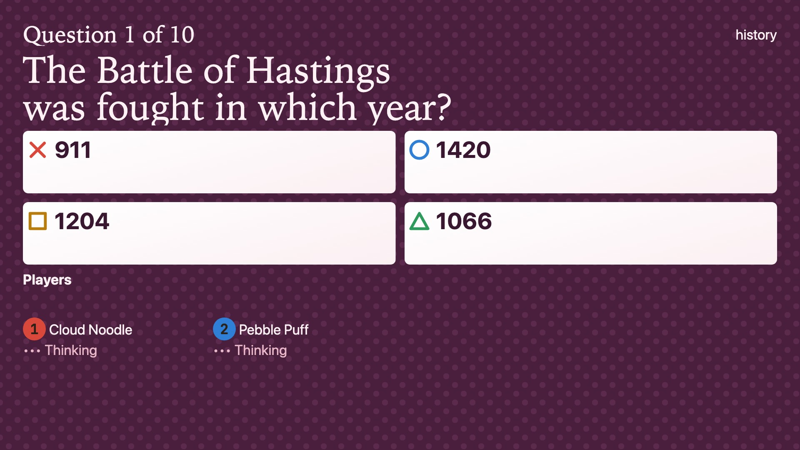 | | |
| 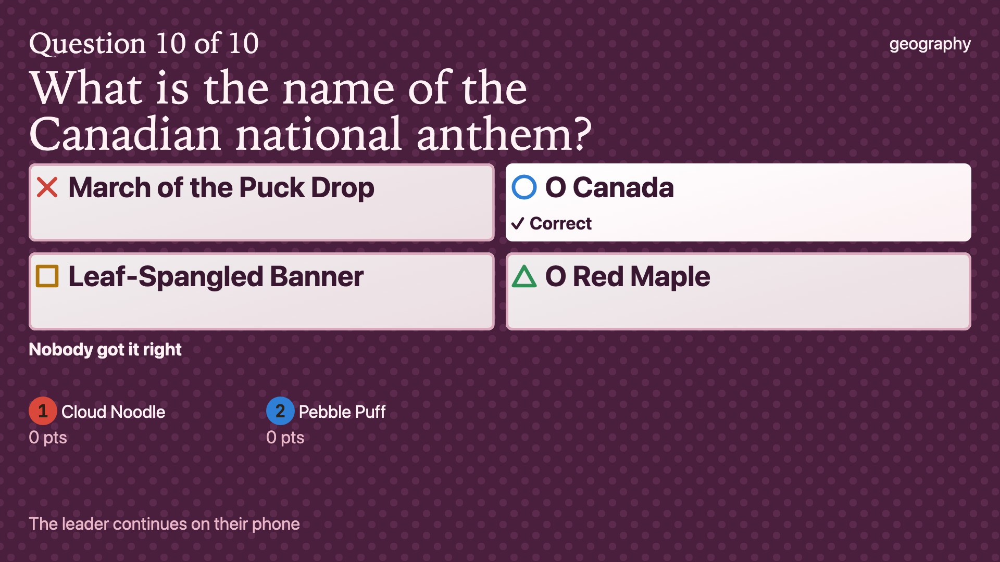 | | |
|  | | |
|  | | |
|  | | |
|  | | |
|  | | |
|  | | |
|  | | |
|  | | |
|  | | |
|  | | |
|  | | |
|  | | |

## Strips

| Screenshot | What it shows | Looked at by |
|---|---|---|
| 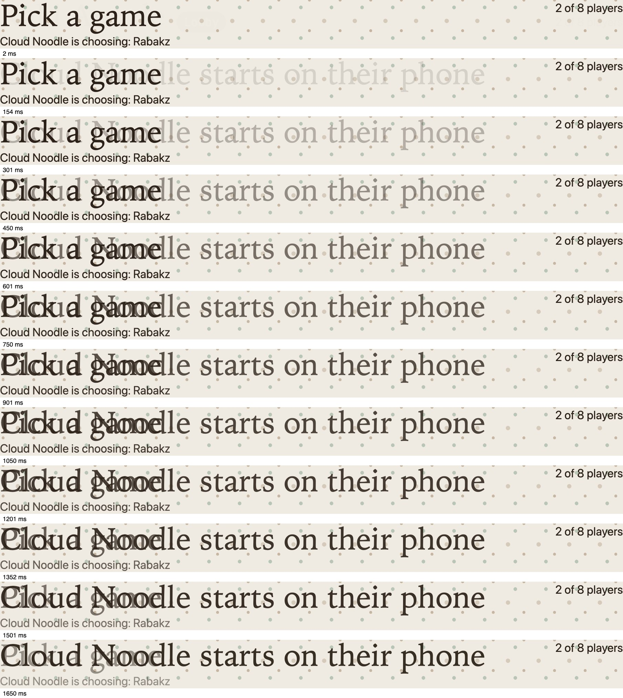 | | |
| 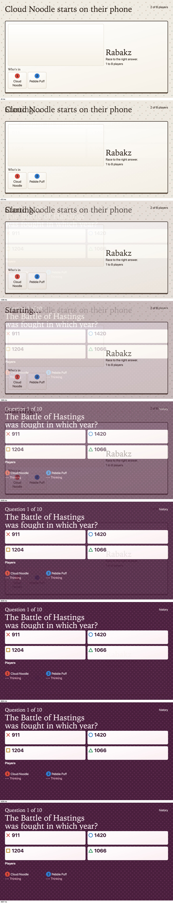 | | |
| 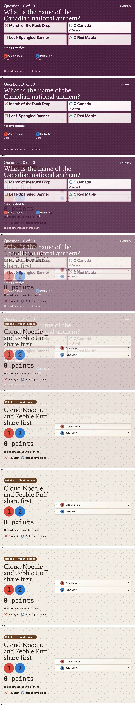 | | |
| 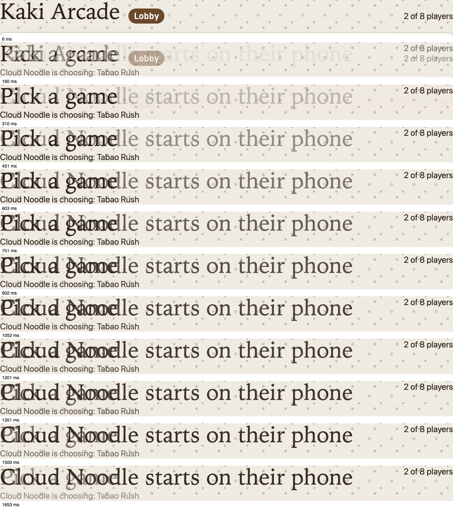 | | |
| 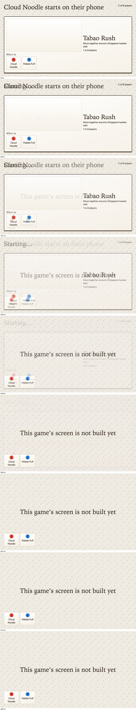 | | |

| Acceptance statement | Pass / fail | Evidence |
|---|---|---|
| | | |

## Integrator's look (2026-11-17)
Run: `pnpm uat -- C-16-start-game --phones 2`, exit 0, no process left; every results-fit case
asserts both the winner column and the ranking list stay inside the 55 px safe margin (D-126).
`Overlap.dom.test.ts` passed when the integrator ran it. Opened c16r8-fit.jpg (shots 01-10), then
c16-hanzi.png (4× crop) and c16-team8-bottom.png at full size.
- 01 single winner at 144 px; 02 the same with the keyboard hint, still 144 px now the hint is
  one line ("Enter: play again · Esc: back") and the two action hints share a row.
- 05 two-way tie "Cloud Noodle and Pebble Puff share first" with the hint: fits (the review's
  failing case).
- 06, 07 two 12-character names (W's and 麗) with and without the hint: headline steps down and
  fits; the 麗 glyphs are real characters, not missing-glyph boxes (4× crop).
- 08 team tie with the hint, 09 eight-player team result: the ranking list ends about 15 px above
  the bottom margin (crop), 10 three-way tie: all fit.
| Shot | What it shows | Looked at by |
|---|---|---|
| 01-10 | Results fit for every case the final review listed | Claude (integrator) |
