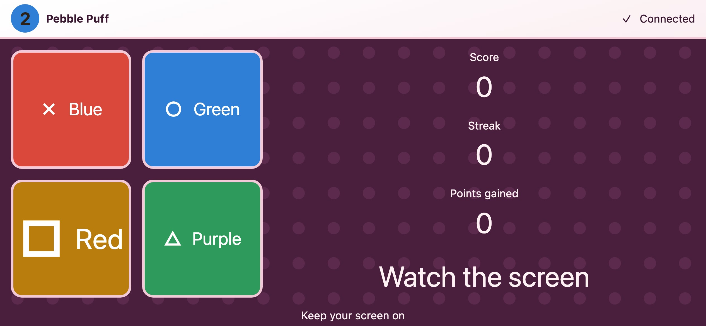
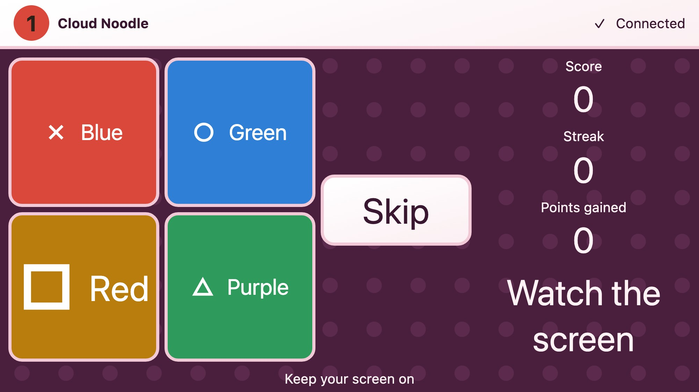
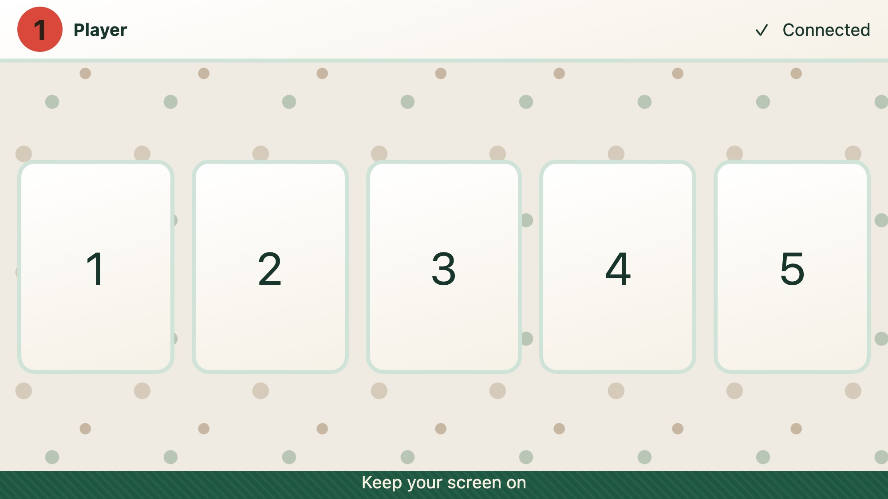
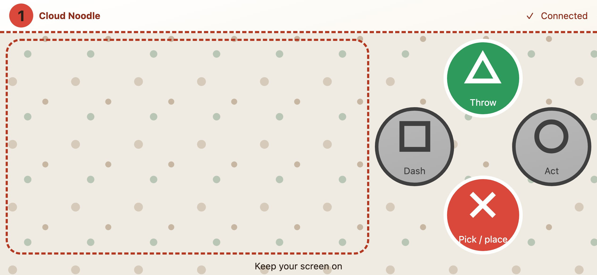
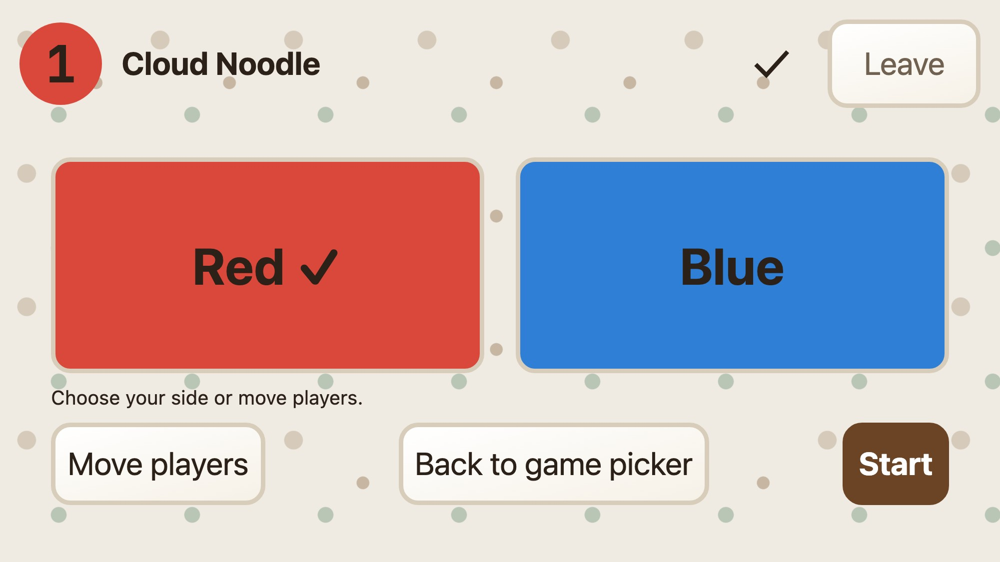

# C-16b-private-panel UAT evidence

Automated execution only. Visual review and acceptance decisions are pending.

Command: `node tools/uat/run.mjs -- C-16b-private-panel --phones 2 --out round2`
Commit: `e724cc3e3b5c27303a20403857442d591be9d68c`
Viewports: 667×375, 844×390

| Timing | ms | Status |
|---|---:|---|
| Create room through host page | 1089.4 | completed |

Expected errors (count):
None

## Real server

| Screenshot | What it shows | Looked at by |
|---|---|---|
|  | | |
|  | | |
|  | | |
|  | | |
|  | | |
|  | | |
|  | | |
|  | | |

| Acceptance statement | Pass / fail | Evidence |
|---|---|---|
| | | |
