# C-17-late-join UAT evidence

Automated execution only. Visual review and acceptance decisions are pending.

Command: `node tools/uat/run.mjs -- C-17-late-join --phones 3 --out r3-p3c`
Commit: `718685a0aee3797a27f6c821f96b0c884685c093`
Viewports: 1920×1080, 844×390

| Timing | ms | Status |
|---|---:|---|
| Create room through host page | 1358.0 | completed |
| Two players seated; third phone has not joined | 1100.7 | completed |
| Rabakz running with two players | 2433.8 | completed |
| Third phone seated with zero and safe next-question controls | 5155.8 | completed |
| Rabakz next question enables third phone at zero | 19634.6 | failed |

Expected errors (count):
None

## Real server

| Screenshot | What it shows | Looked at by |
|---|---|---|
| 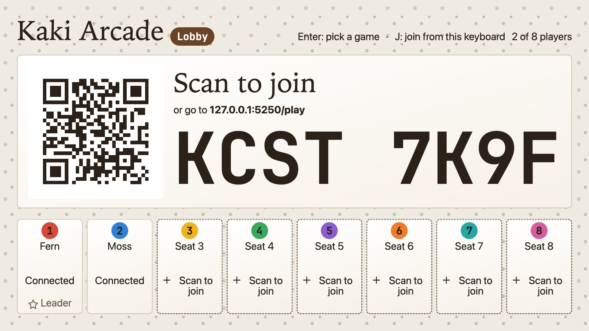 | | |
| 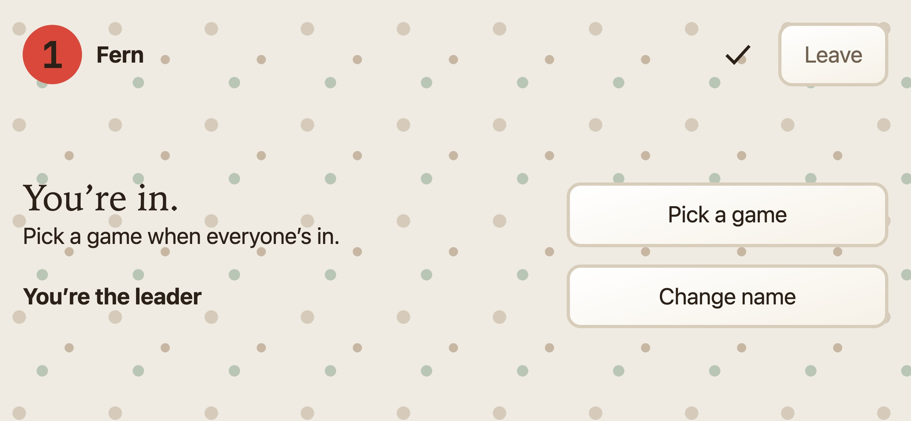 | | |
| 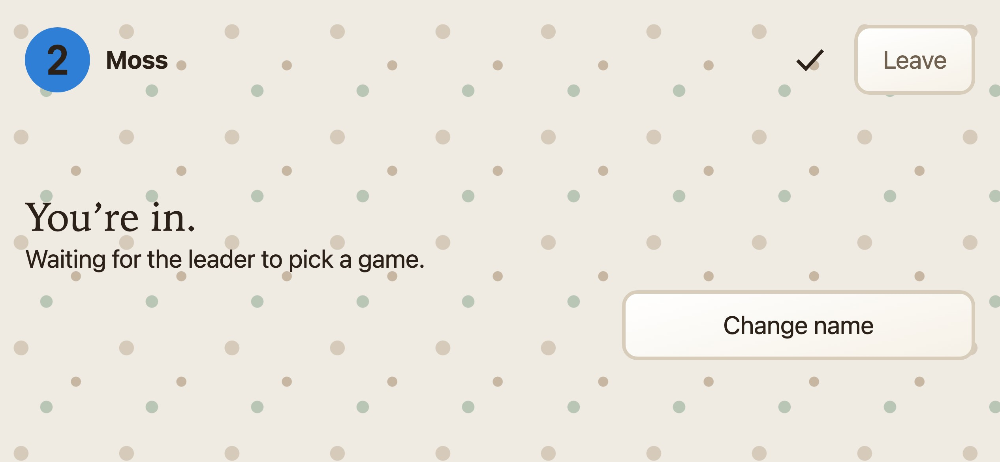 | | |
|  | | |
| 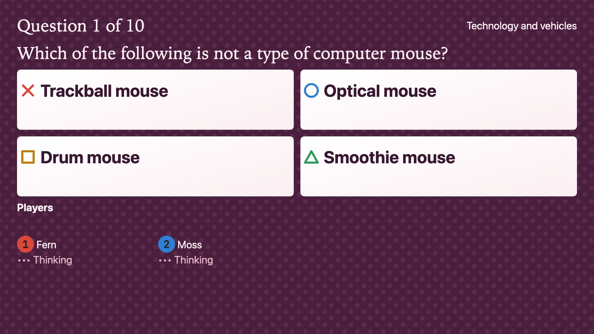 | | |
| 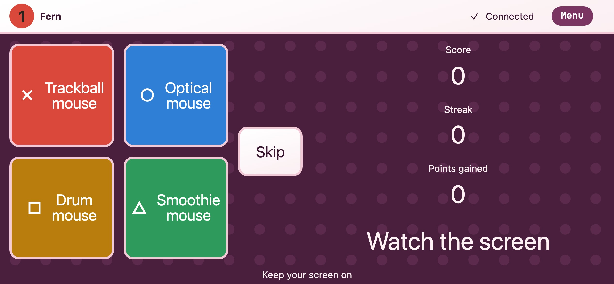 | | |
| 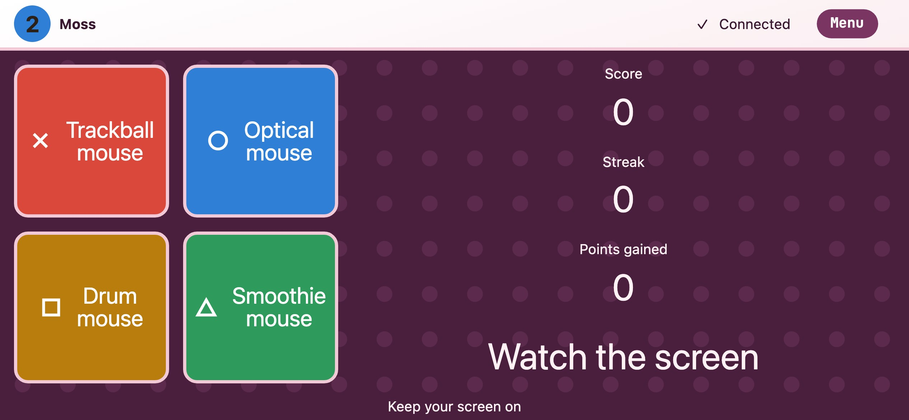 | | |
| 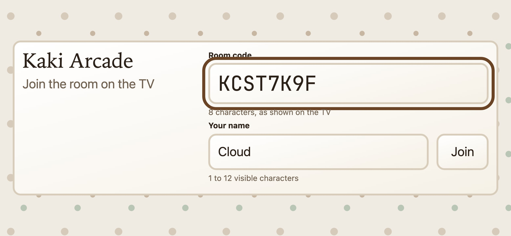 | | |
| 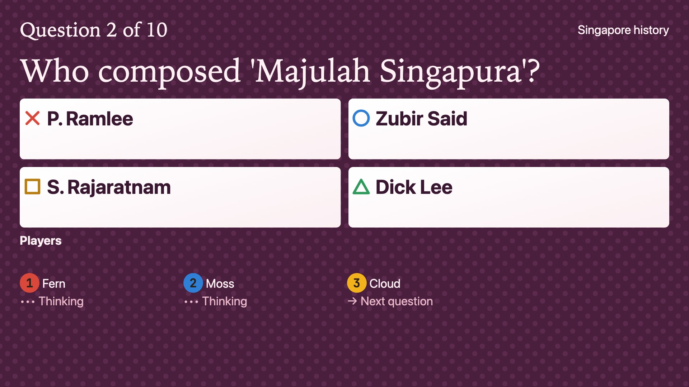 | | |
| 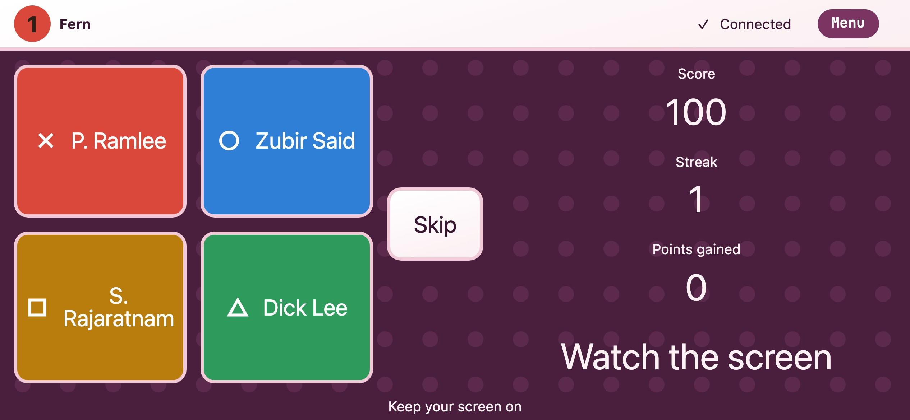 | | |
| 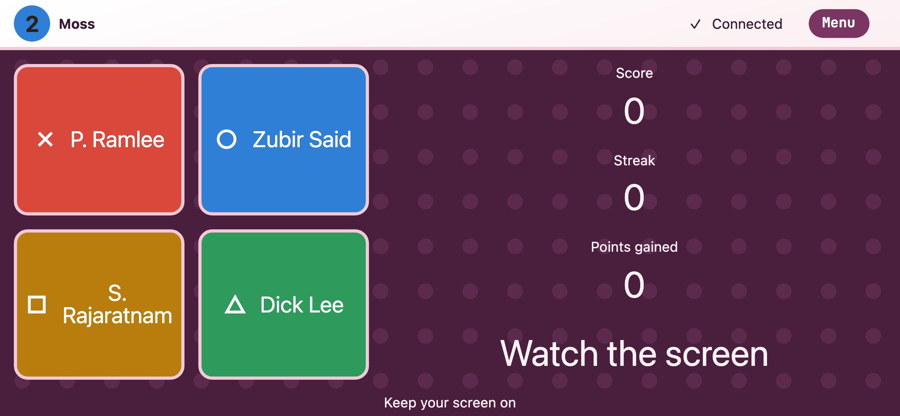 | | |
|  | | |
|  | | |
| 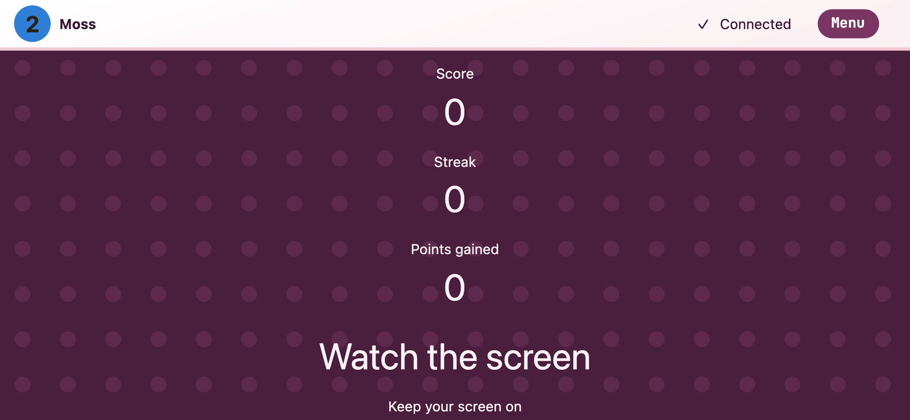 | | |
| 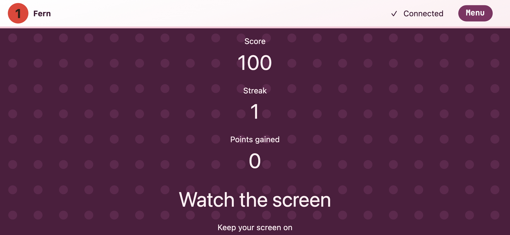 | | |
|  | | |

| Acceptance statement | Pass / fail | Evidence |
|---|---|---|
| | | |

## Superseded by r3-p3d

This run is superseded because a 30 s wind was too short after joining at question 2. See ../r3-p3d/REPORT.md for the reviewed run.
