# C-18-final-hint UAT evidence

Host browser: chromium 156.0.8078.4
Phone browser: chromium (legacy iPhone emulation) 156.0.8078.4

Automated execution only. Visual review and acceptance decisions are pending.

Command: `node tools/uat/run.mjs -- C-18-final-hint --phones 8 --timeout-min 25 --out r20-merged`
Commit: `71c70d4278d3dad72ade8702514ea5209acedc5c`
Viewports: 1920×1080, 1280×720, 3840×2160

| Timing | ms | Status |
|---|---:|---|
| Create room through host page | 837.3 | completed |
| peek-poker: run unanswered rounds to the final screen | 20735.5 | completed |
| peek-poker: 1920 phone band clearance | 144.4 | completed |
| peek-poker: 1280 phone band clearance | 147.2 | completed |
| peek-poker: 3840 phone band clearance | 506.8 | completed |
| peek-poker: 1920 keyboard band clearance | 134.2 | completed |
| peek-poker: 1280 keyboard band clearance | 105.2 | completed |
| peek-poker: 3840 keyboard band clearance | 486.5 | completed |
| Create room through host page | 867.9 | completed |
| rabakz-ffa: run unanswered rounds to the final screen | 162408.7 | completed |
| rabakz-ffa: 1920 phone band clearance | 138.3 | completed |
| rabakz-ffa: 1280 phone band clearance | 94.1 | completed |
| rabakz-ffa: 3840 phone band clearance | 251.6 | completed |
| rabakz-ffa: 1920 keyboard band clearance | 100.3 | completed |
| rabakz-ffa: 1280 keyboard band clearance | 87.8 | completed |
| rabakz-ffa: 3840 keyboard band clearance | 237.1 | completed |
| Create room through host page | 854.2 | completed |
| rabakz-teams: run unanswered rounds to the final screen | 165026.2 | completed |
| rabakz-teams: 1920 phone band clearance | 111.9 | completed |
| rabakz-teams: 1280 phone band clearance | 102.7 | completed |
| rabakz-teams: 3840 phone band clearance | 237.9 | completed |
| rabakz-teams: 1920 keyboard band clearance | 131.6 | completed |
| rabakz-teams: 1280 keyboard band clearance | 107.5 | completed |
| rabakz-teams: 3840 keyboard band clearance | 240.6 | completed |
| Create room through host page | 869.7 | completed |
| rabakz-teams-untied: run scored rounds to the final screen | 142214.9 | completed |
| rabakz-teams-untied: 1920 phone band clearance | 112.8 | completed |
| rabakz-teams-untied: 1920 keyboard band clearance | 113.2 | completed |
| Create room through host page | 853.9 | completed |
| rabakz-solo: run unanswered rounds to the final screen | 138590.1 | completed |
| rabakz-solo: 1920 phone band clearance | 93.0 | completed |
| rabakz-solo: 1920 keyboard band clearance | 109.8 | completed |
| Create room through host page | 874.2 | completed |
| rabakz-four: run unanswered rounds to the final screen | 151742.9 | completed |
| rabakz-four: 1920 phone band clearance | 104.7 | completed |
| rabakz-four: 1920 keyboard band clearance | 114.0 | completed |

Expected errors (count):
None

## Real server

| Screenshot | What it shows | Looked at by |
|---|---|---|
|  | | |
|  | | |
| 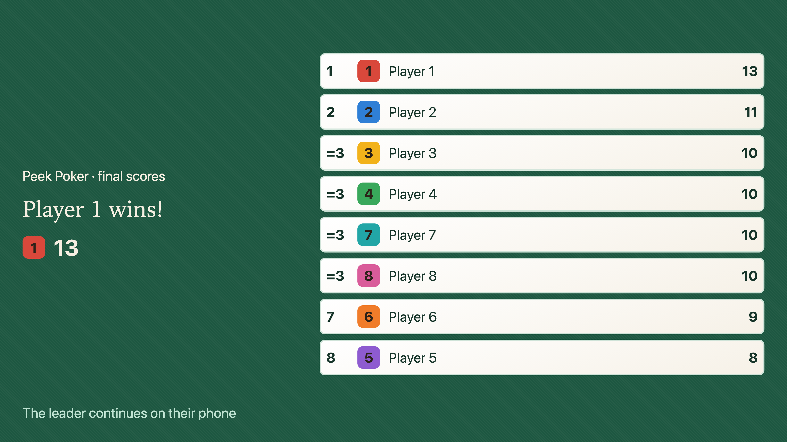 | | |
|  | | |
| 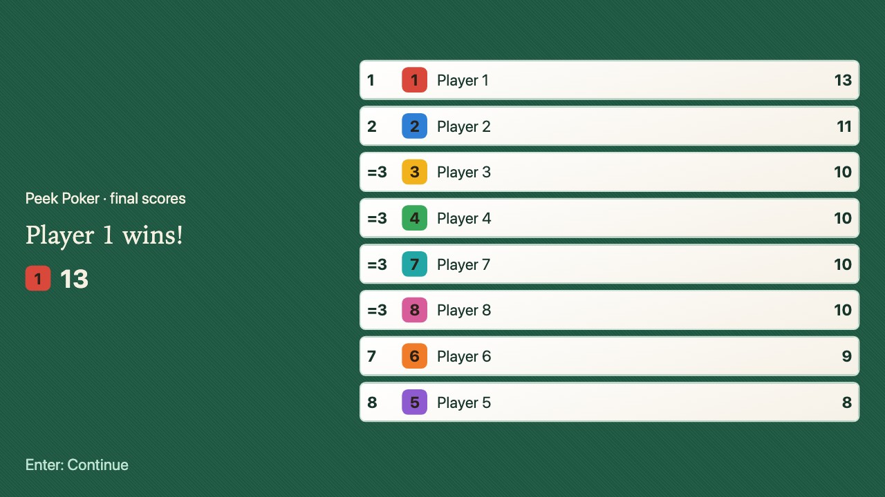 | | |
|  | | |
| 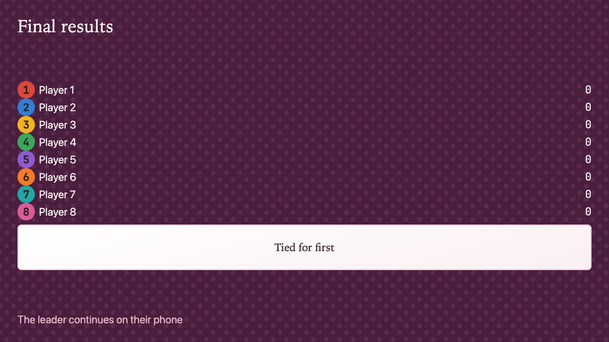 | | |
| 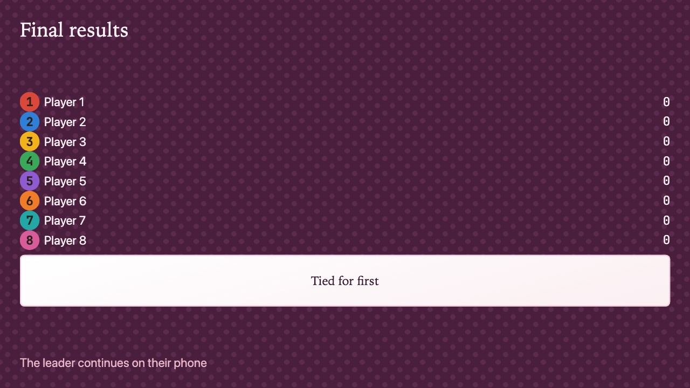 | | |
| 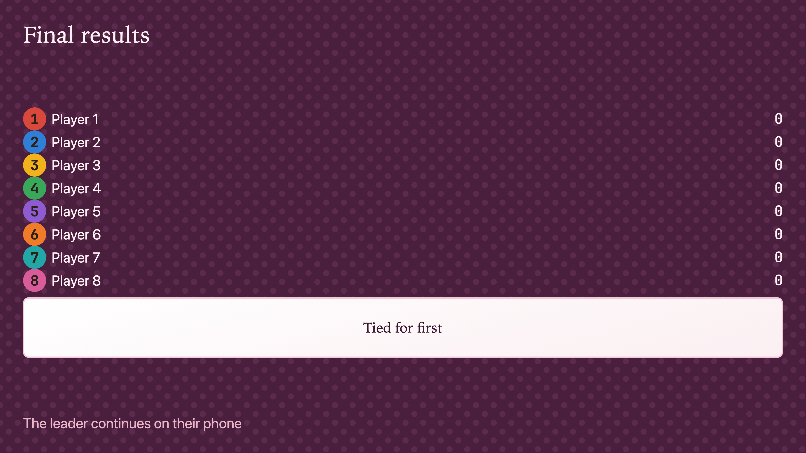 | | |
|  | | |
| 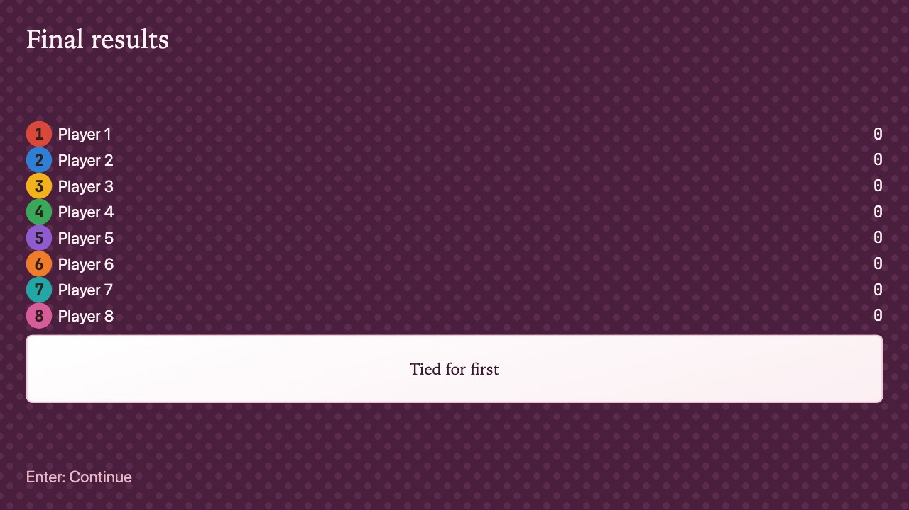 | | |
| 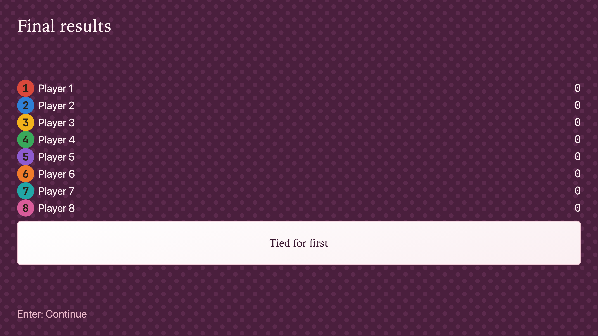 | | |
| 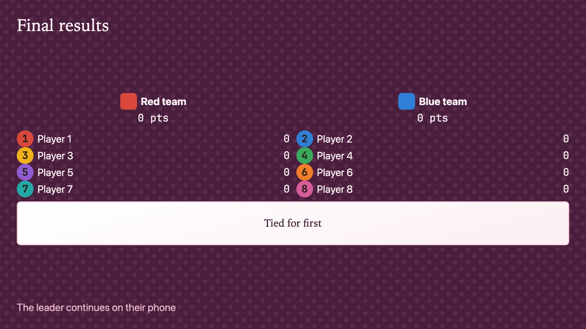 | | |
|  | | |
| 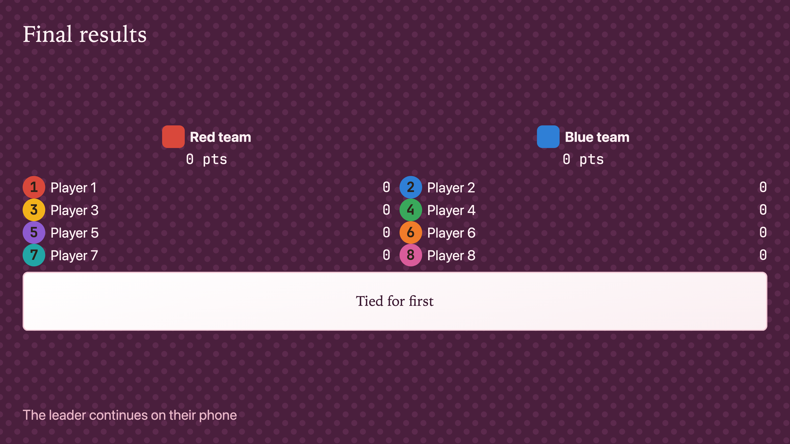 | | |
| 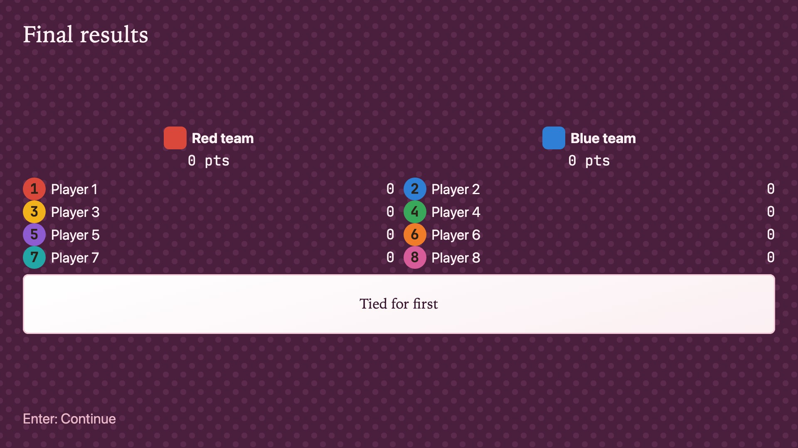 | | |
| 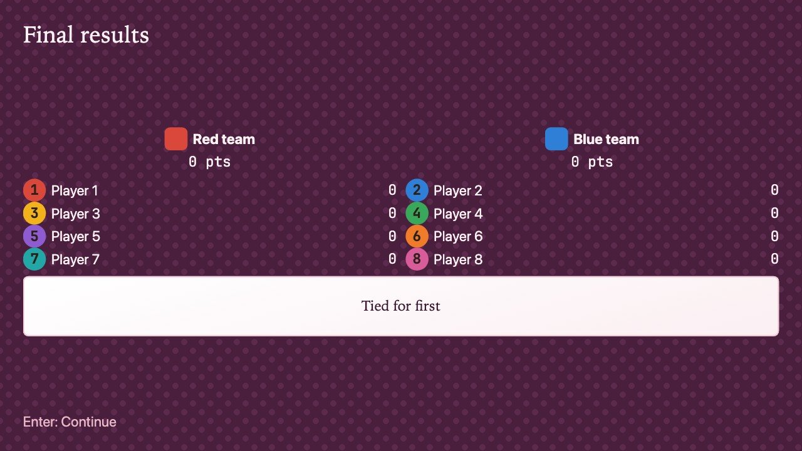 | | |
| 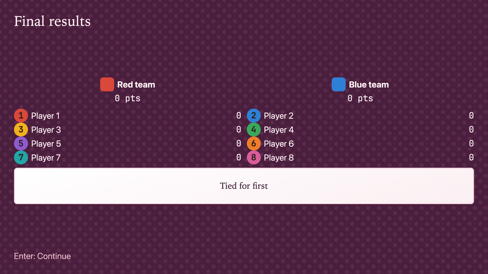 | | |
|  | | |
| 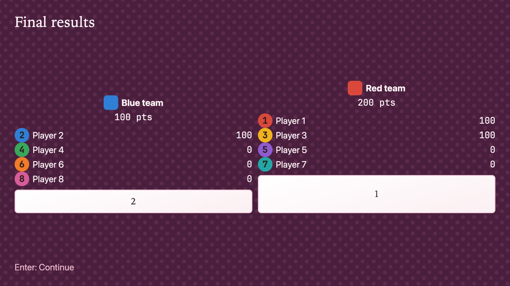 | | |
| 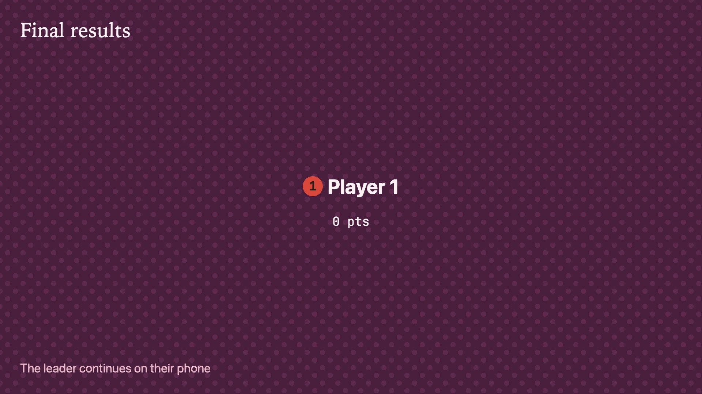 | | |
| 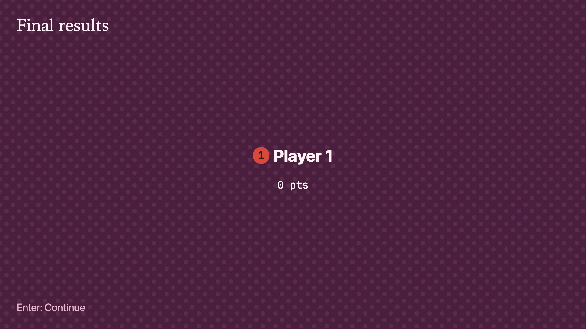 | | |
| 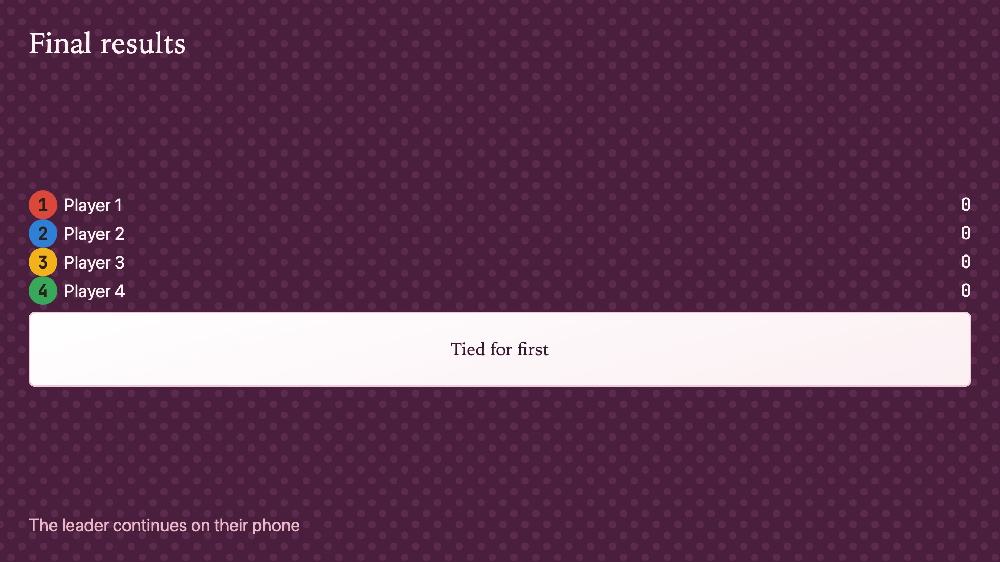 | | |
| 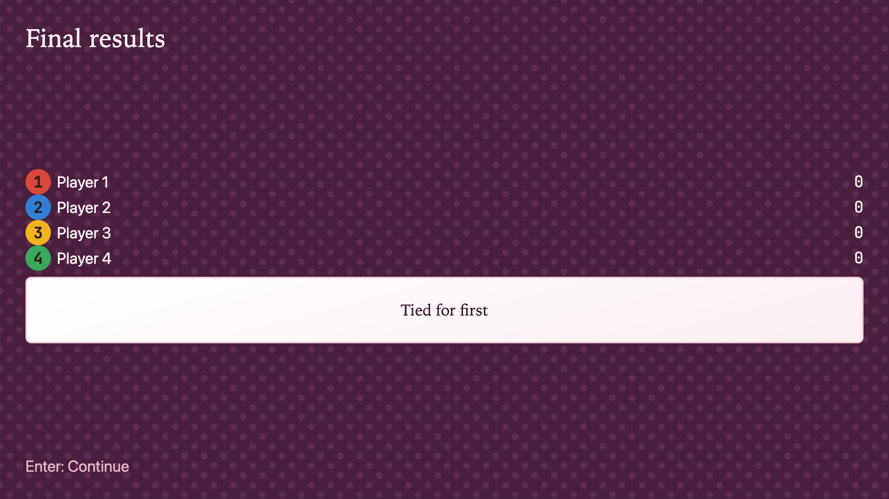 | | |

| Acceptance statement | Pass / fail | Evidence |
|---|---|---|
| | | |

## Visual review (Claude, integrator, 2026-11-19; R-20 merged tree)

| Screenshots | What they show | Looked at by |
|---|---|---|
| 07, 08 rabakz-ffa | 8 players all on 0, one "Tied for first" step; "The leader continues on their phone" clear below at 1920 and 1280 | Claude |
| 13, 14 rabakz-teams | Red and Blue 0 pts, four players each, shared "Tied for first" step; hint clear below | Claude |
| 19 rabakz-teams-untied | Red 200 on step 1, Blue 100 on step 2; totals match members; hint clear below | Claude |
| 23 rabakz-four | Four players tied; hint clear below | Claude |
| 01–06, 09–12, 15–18, 20–22, 24 | Peek Poker, 3840 and keyboard variants; same hint position | Claude |
