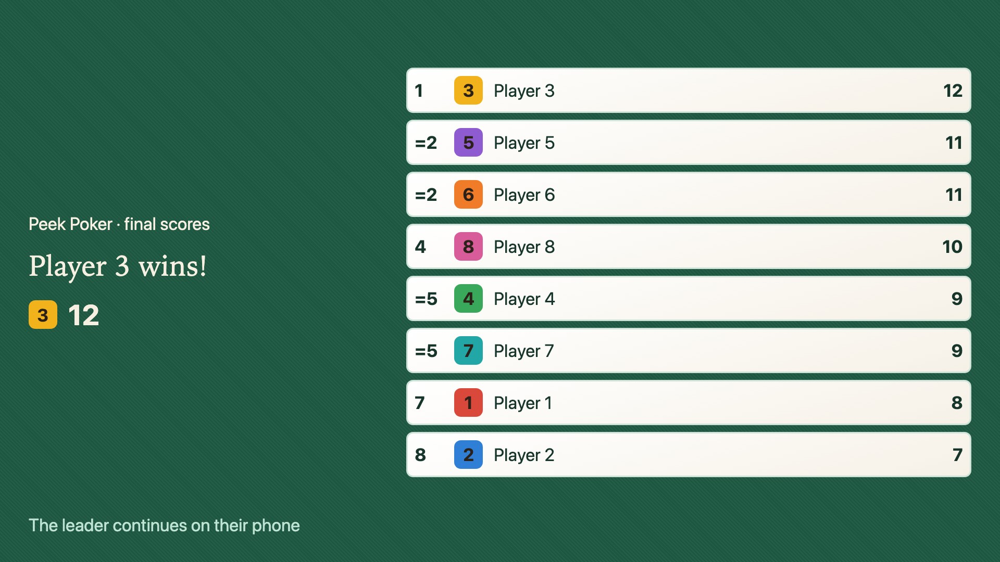

# C-18-final-hint UAT evidence

Automated execution only. Visual review and acceptance decisions are pending.

Command: `node tools/uat/run.mjs -- C-18-final-hint --phones 8 --max-mb 24 --timeout-min 25 --out round2`
Commit: `6469c45e5090be74120943e5a990dcaa006010ee`
Viewports: 1920×1080, 1280×720, 3840×2160

| Timing | ms | Status |
|---|---:|---|
| Create room through host page | 864.1 | completed |
| peek-poker: run unanswered rounds to the final screen | 21554.1 | completed |
| Create room through host page | 852.9 | completed |
| rabakz: run unanswered rounds to the final screen | 177886.8 | completed |

Expected errors (count):
None

## Real server

| Screenshot | What it shows | Looked at by |
|---|---|---|
|  | | |
|  | | |
|  | | |
|  | | |
|  | | |
|  | | |

| Acceptance statement | Pass / fail | Evidence |
|---|---|---|
| | | |
