# C-18-final-hint UAT evidence

Automated execution only. Visual review and acceptance decisions are pending.

Command: `node tools/uat/run.mjs -- C-18-final-hint --phones 8 --max-mb 32 --timeout-min 30 --out round3`
Commit: `532178e69667defc376b32857ccc054500f709ab`
Viewports: 1920×1080, 1280×720, 3840×2160

| Timing | ms | Status |
|---|---:|---|
| Create room through host page | 962.8 | completed |
| peek-poker: run unanswered rounds to the final screen | 22113.1 | completed |
| peek-poker: 1920 phone band clearance | 104.4 | completed |
| peek-poker: 1280 phone band clearance | 92.5 | completed |
| peek-poker: 3840 phone band clearance | 674.3 | completed |
| peek-poker: 1920 keyboard band clearance | 196.0 | completed |
| peek-poker: 1280 keyboard band clearance | 111.3 | completed |
| peek-poker: 3840 keyboard band clearance | 718.7 | completed |
| Create room through host page | 967.7 | completed |
| rabakz-ffa: run unanswered rounds to the final screen | 172587.7 | completed |
| rabakz-ffa: 1920 phone band clearance | 117.7 | completed |
| rabakz-ffa: 1280 phone band clearance | 94.5 | completed |
| rabakz-ffa: 3840 phone band clearance | 271.2 | completed |
| rabakz-ffa: 1920 keyboard band clearance | 94.4 | completed |
| rabakz-ffa: 1280 keyboard band clearance | 104.6 | completed |
| rabakz-ffa: 3840 keyboard band clearance | 237.4 | completed |
| Create room through host page | 862.2 | completed |
| rabakz-teams: run unanswered rounds to the final screen | 177600.9 | completed |
| rabakz-teams: 1920 phone band clearance | 132.3 | completed |
| rabakz-teams: 1280 phone band clearance | 111.1 | completed |
| rabakz-teams: 3840 phone band clearance | 228.5 | completed |
| rabakz-teams: 1920 keyboard band clearance | 105.1 | completed |
| rabakz-teams: 1280 keyboard band clearance | 91.5 | completed |
| rabakz-teams: 3840 keyboard band clearance | 231.0 | completed |

Expected errors (count):
None

## Real server

| Screenshot | What it shows | Looked at by |
|---|---|---|
|  | | |
|  | | |
| 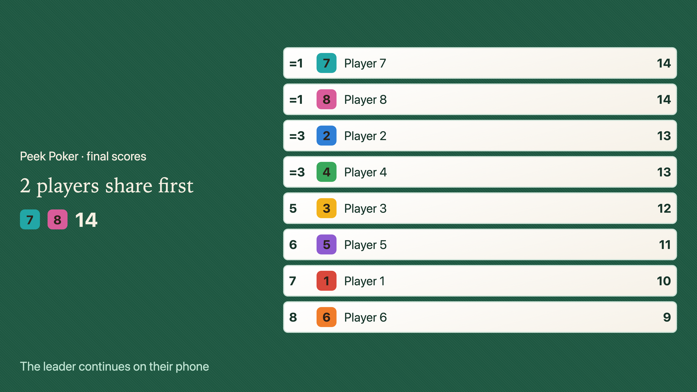 | | |
|  | | |
|  | | |
|  | | |
| 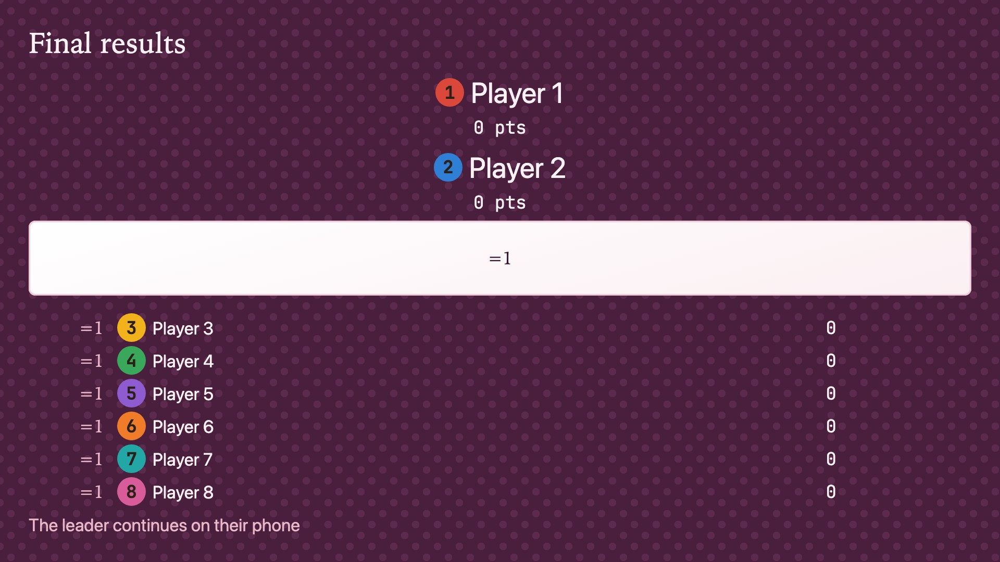 | | |
| 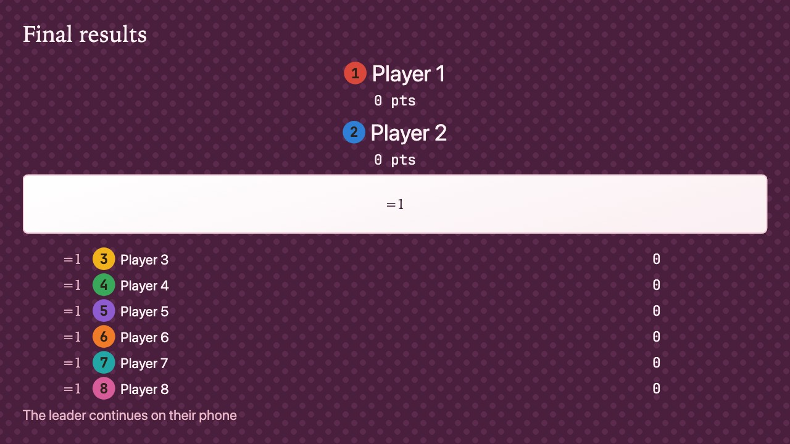 | | |
| 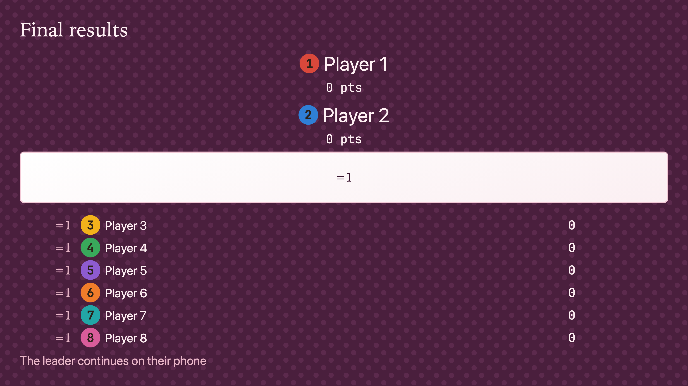 | | |
| 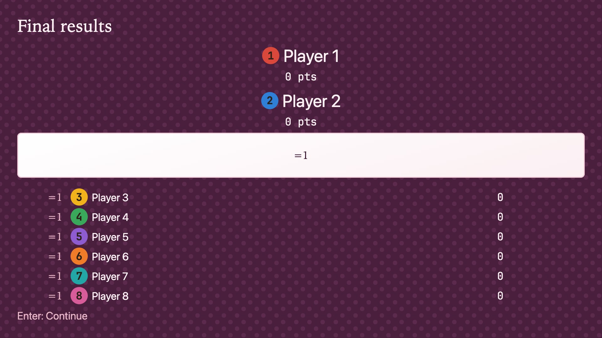 | | |
| 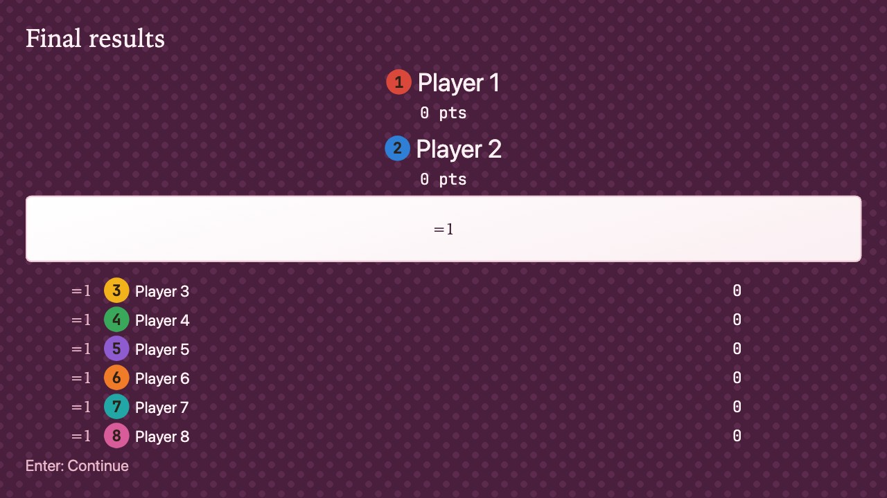 | | |
| 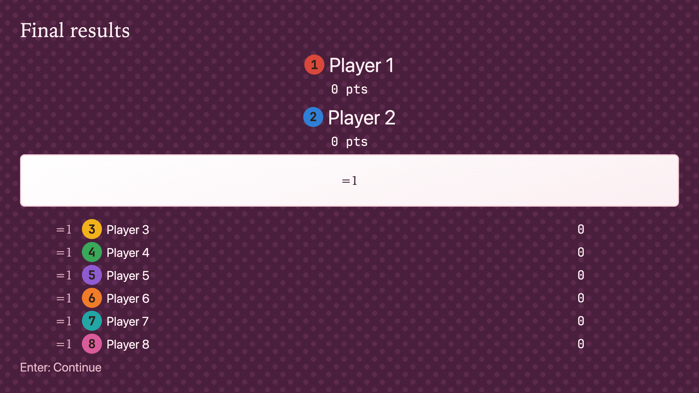 | | |
| 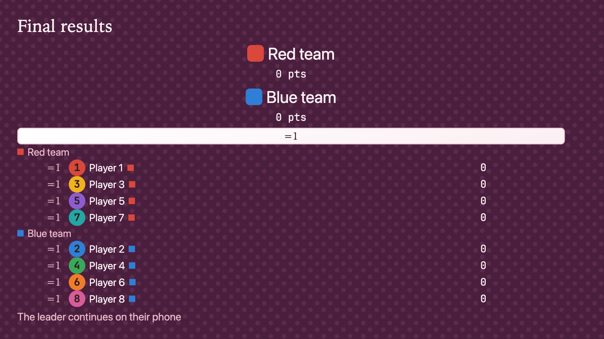 | | |
| 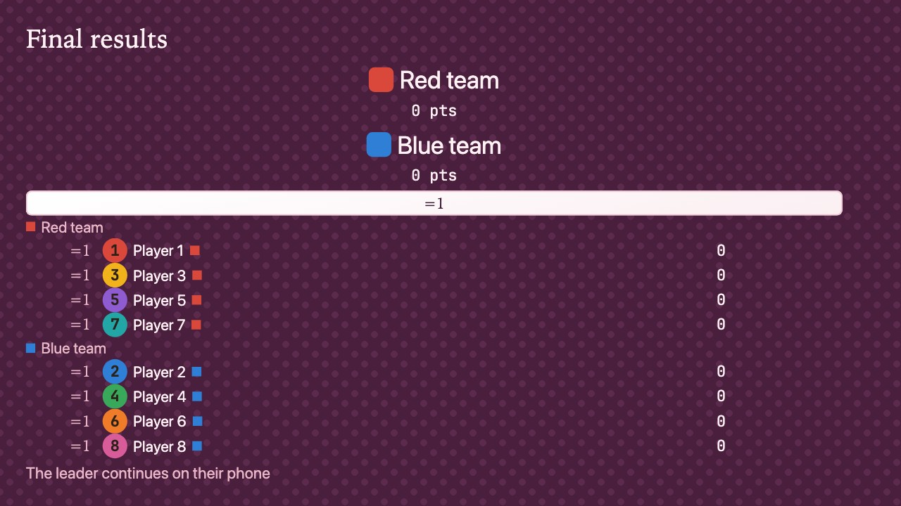 | | |
|  | | |
| 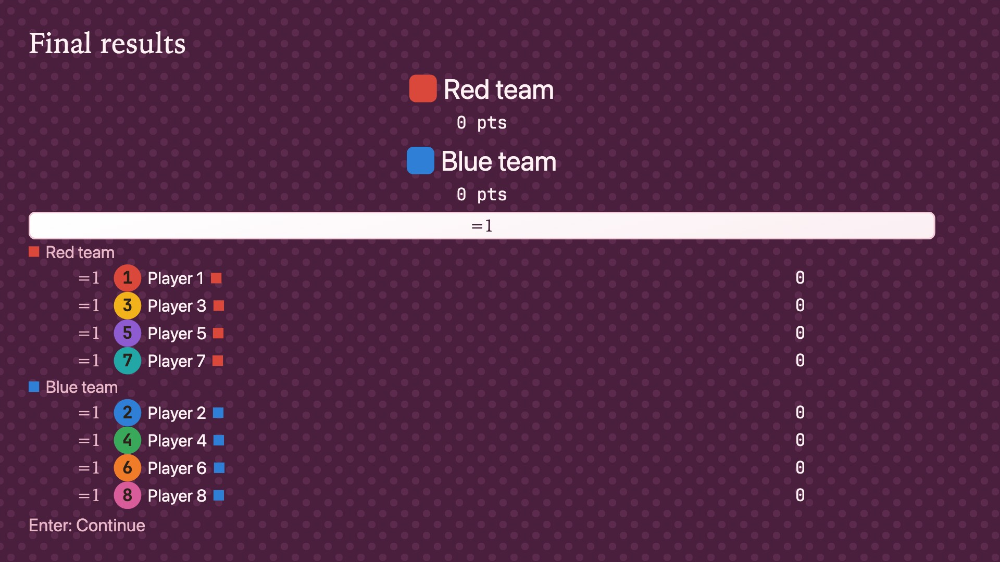 | | |
| 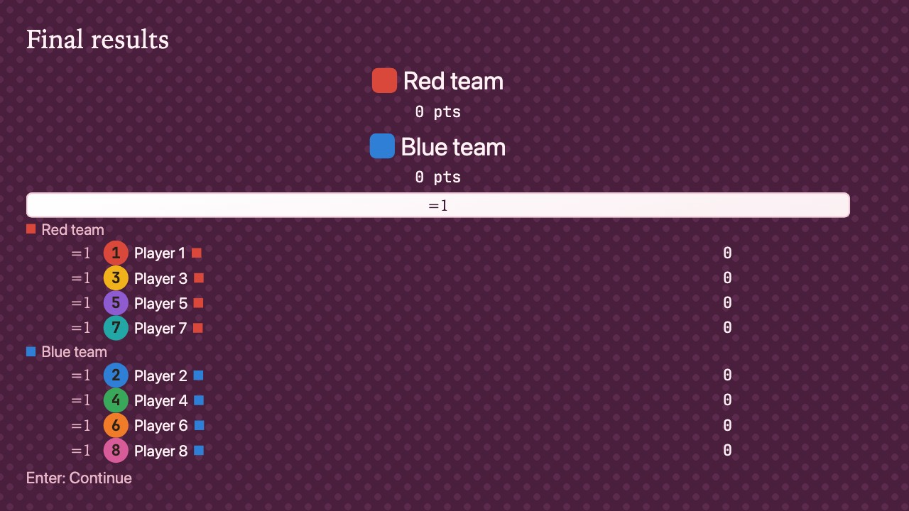 | | |
| 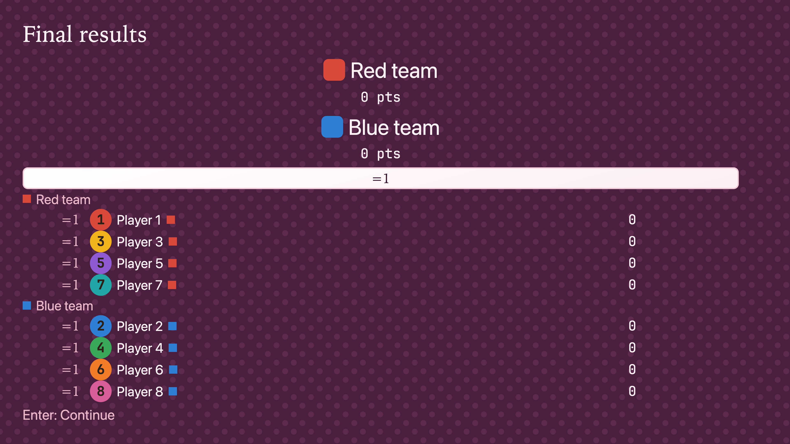 | | |

| Acceptance statement | Pass / fail | Evidence |
|---|---|---|
| | | |
