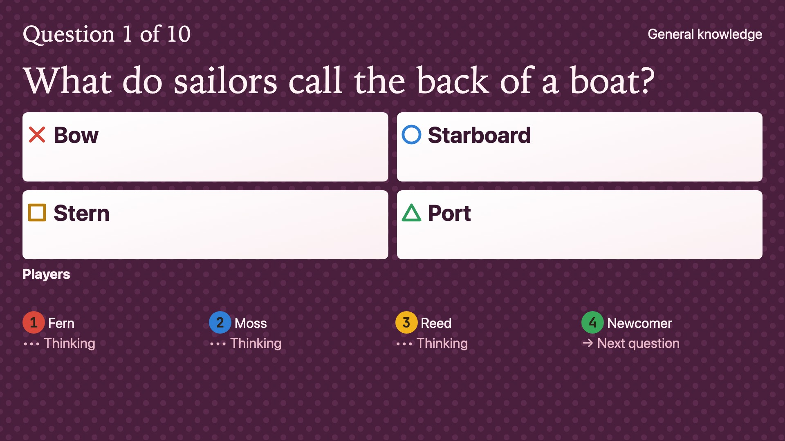
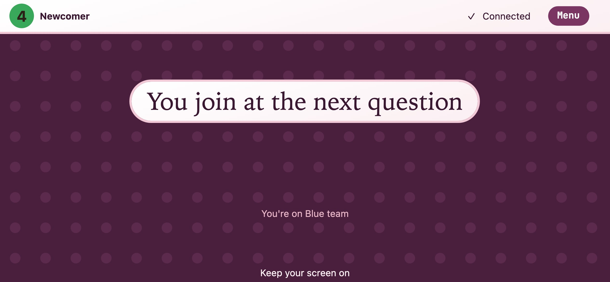
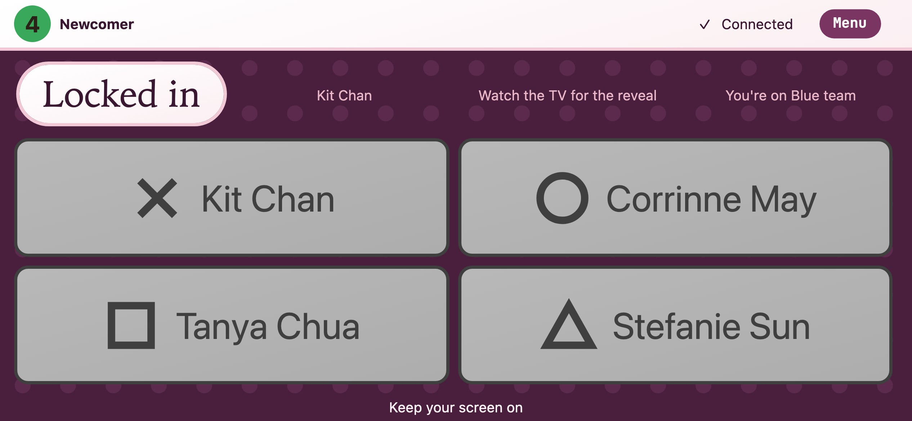
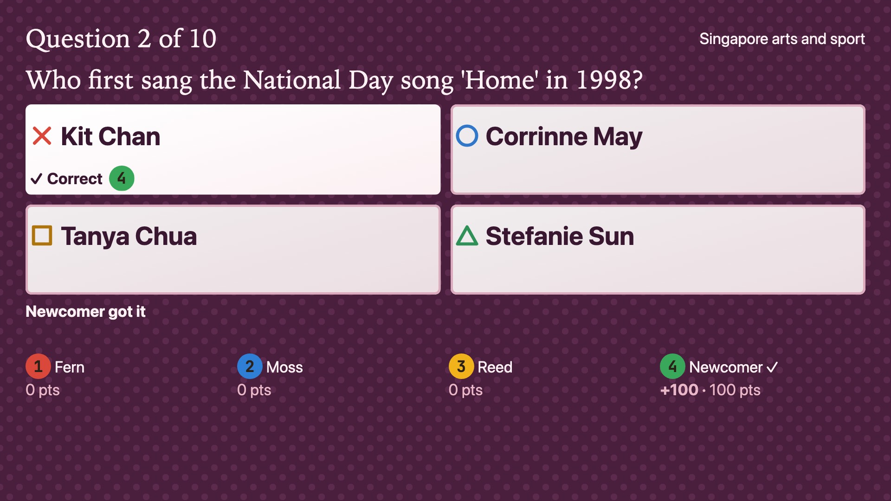
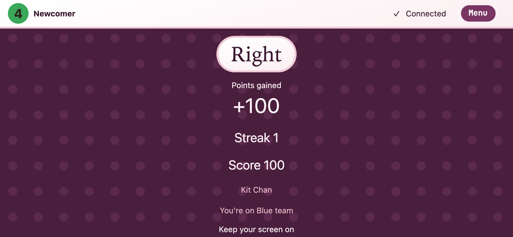
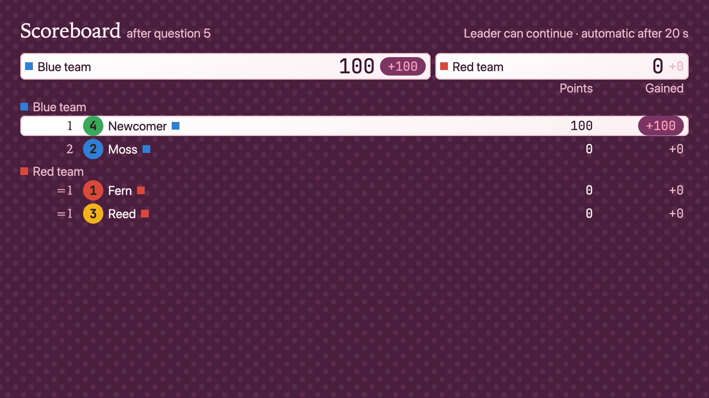
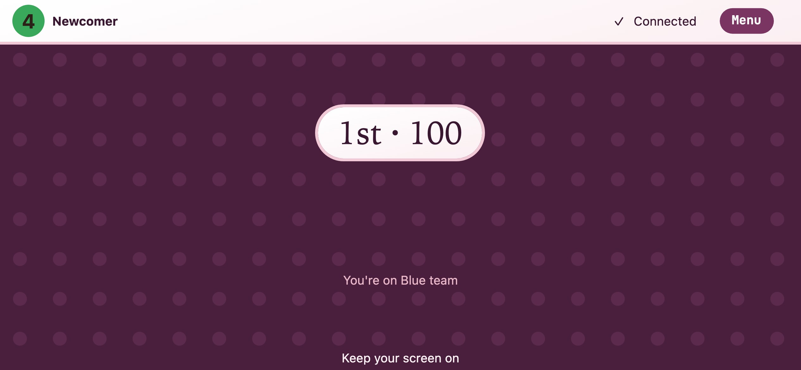

# C-21-late-joiner-team UAT evidence

Host browser: chromium 156.0.8078.4
Phone browser: chromium (legacy iPhone emulation) 156.0.8078.4

Automated execution only. Visual review and acceptance decisions are pending.

Command: `node tools/uat/run.mjs -- C-21-late-joiner-team --phones 4 --out round3`
Commit: `9b41bdb67b3a46221760eb20f2074ad634f128b8`
Viewports: 1920×1080, 844×390

| Timing | ms | Status |
|---|---:|---|
| Create room through host page | 1089.7 | completed |

Expected errors (count):
None

## Real server

| Screenshot | What it shows | Looked at by |
|---|---|---|
|  | | |
|  | | |
|  | | |
|  | | |
|  | | |
|  | | |
|  | | |

| Acceptance statement | Pass / fail | Evidence |
|---|---|---|
| | | |

## Visual review (Claude, integrator, 2026-11-19; merged tree with main at R-20)

| Screenshot | What it shows | Looked at by |
|---|---|---|
| 01-host-joined-tv | Question 1; Fern, Moss, Reed "Thinking"; seat 4 Newcomer "→ Next question" | Claude |
| 02-phone4-joined-phone | "You join at the next question", no answer pads; "You're on Blue team" | Claude |
| 03-phone4-next-question-locked-in-phone | Question 2: "Locked in" with the four answers greyed; "Watch the TV for the reveal"; "You're on Blue team" | Claude |
| 04-host-next-question-settled-score-reveal-tv | Kit Chan ✓ Correct with seat 4; "Newcomer got it"; Newcomer "+100 · 100 pts", settled | Claude |
| 05-phone4-next-question-reveal-phone | Right, +100, Streak 1, Score 100, "Kit Chan", "You're on Blue team" | Claude |
| 06-host-team-total-scoreboard-tv | Blue team 100 (+100), Red 0; Newcomer 1st with 100 | Claude |
| 07-phone4-team-total-scoreboard-phone | Newcomer's scoreboard view with its team line | Claude |
