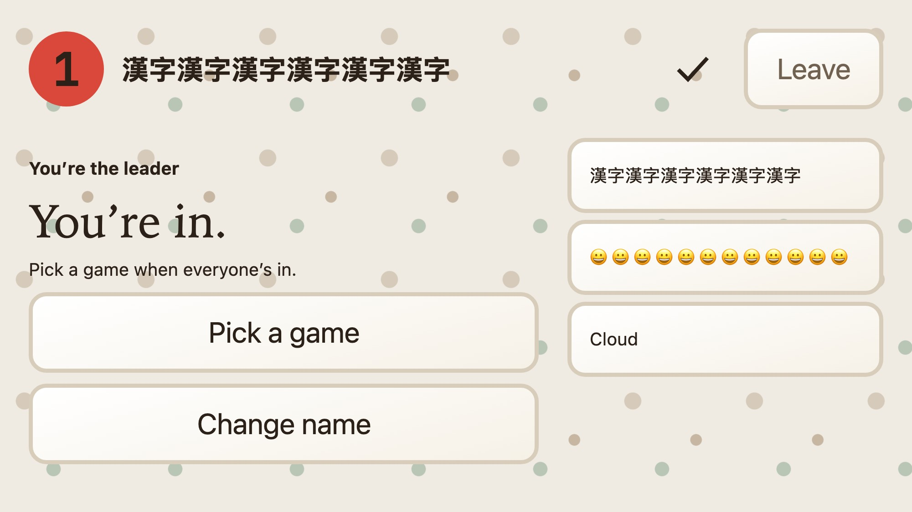
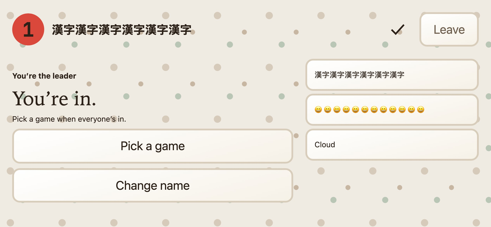
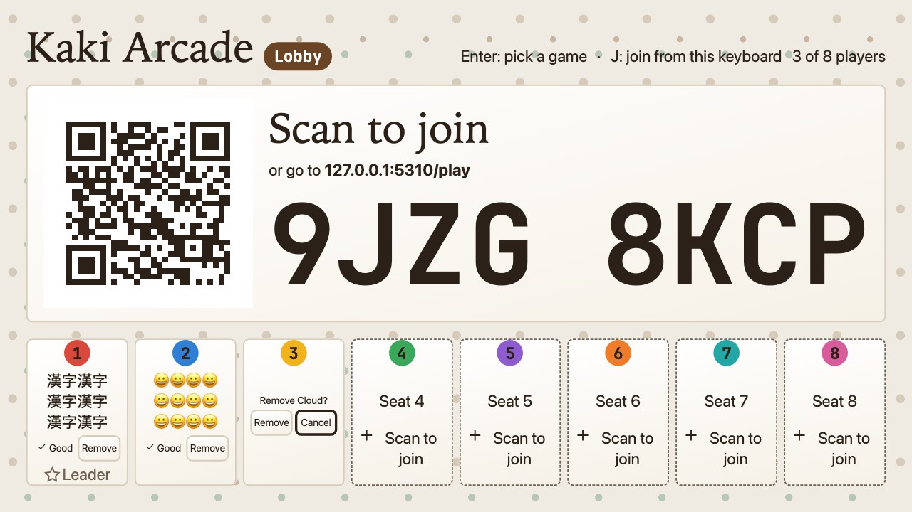
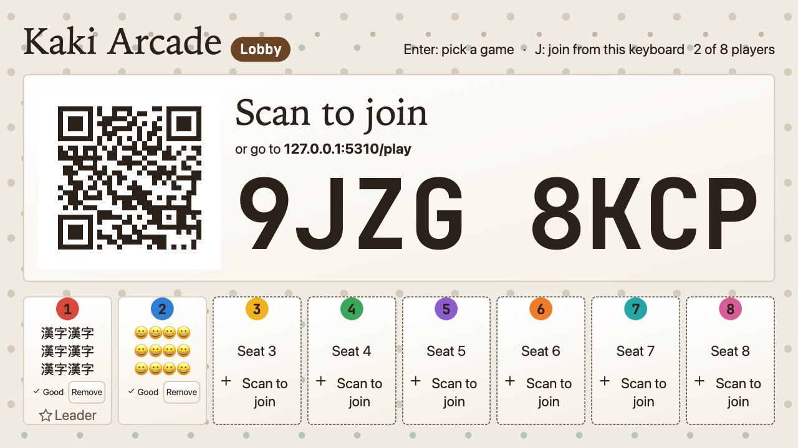
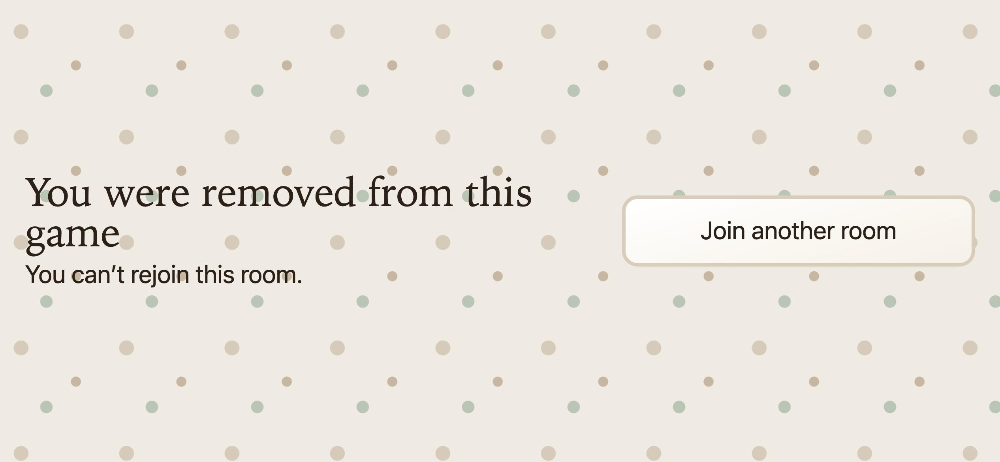
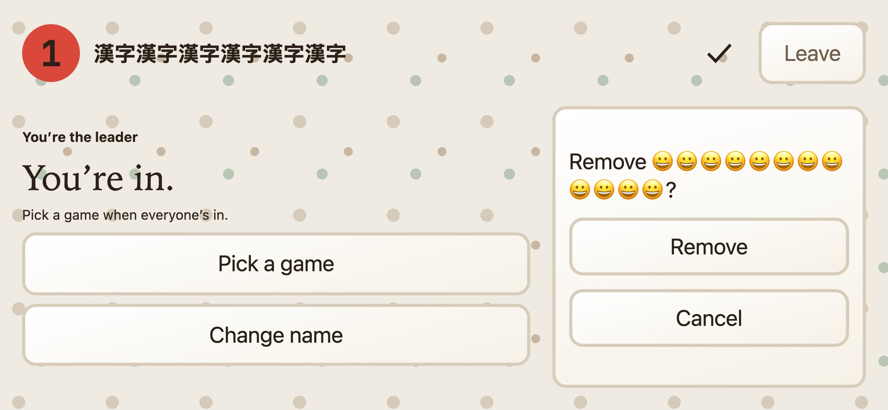
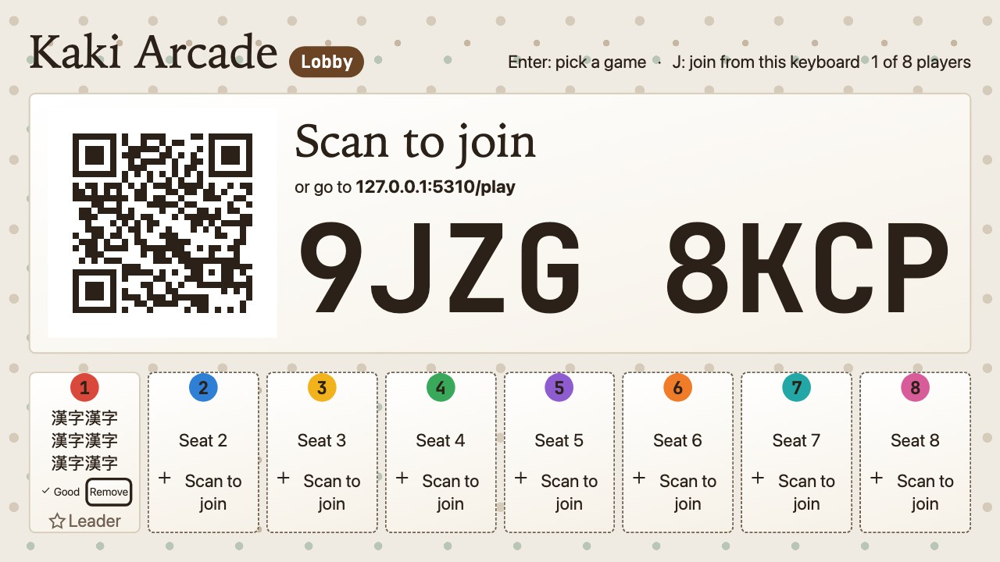
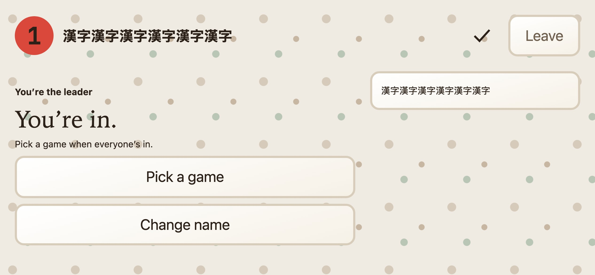

# C-23-host-kick UAT evidence

Host browser: chromium 156.0.8078.4
Phone browser: chromium (legacy iPhone emulation) 156.0.8078.4

Automated execution only. Visual review and acceptance decisions are pending.

Command: `node tools/uat/run.mjs -- C-23-host-kick --phones 3 --out round9`
Commit: `267f492ccf224c700d1700400868583a7520621a`
Viewports: 667×375, 844×390, 1920×1080, 1280×720

| Timing | ms | Status |
|---|---:|---|
| Create room through host page | 1382.3 | completed |

Expected errors (count):
None

## Real server

| Screenshot | What it shows | Looked at by |
|---|---|---|
|  | | |
|  | | |
|  | | |
|  | | |
|  | | |
|  | | |
|  | | |
|  | | |
|  | | |
|  | | |

| Acceptance statement | Pass / fail | Evidence |
|---|---|---|
| | | |

## Visual review (integrator, 2026-11-20)

| Screenshot | What it shows | Looked at by |
|---|---|---|
| 01-phone1-leader-lobby-667-before-removal.jpg | The leader phone at 667 × 375. The 12-character CJK name fits the header; the side column lists the CJK name, a 12-emoji name and Cloud in 55 px rows. The leader's own row still looks pressable (deferred, D-302). | Claude, 2026-11-20 |
| 02-phone1-leader-lobby-844-before-removal.jpg | The same at 844 × 390; the column is the secondary side of 1.618 : 1 and nothing is clipped. | Claude, 2026-11-20 |
| 03-host-01-tv-confirm-1920.jpg | The TV at 1920: "Remove Cloud?" with Remove and Cancel inside Cloud's card. The CJK leader card and the emoji card each wrap to three lines inside the card; the Leader mark is whole; empty seats keep "+ Scan to join". | Claude, 2026-11-20 |
| 04-host-02-tv-confirm-1280.jpg | The same at 1280. The confirmation is 21 board px, legible but small from 3 m (OQ-054). | Claude, 2026-11-20 |
| 05-host-03-lobby-after-host-removal.jpg | Cloud's seat 3 is free again ("Seat 3 · Scan to join"); 2 of 8 players. | Claude, 2026-11-20 |
| 06-phone3-04-removed-phone.jpg | "You were removed from this game", "You can’t rejoin this room." and Join another room. | Claude, 2026-11-20 |
| 07-phone3-05-reload-refused.jpg | The same screen after a reload; the script asserts a new document, so the still alone does not prove the reload. | Claude, 2026-11-20 |
| 08-phone1-06-leader-confirm.jpg | The leader phone: the emoji player's row has opened into "Remove ⟨12 emoji⟩?" wrapping on two lines, with Remove and Cancel. | Claude, 2026-11-20 |
| 09-host-07-lobby-after-leader-removal.jpg | The TV after the leader's removal: only the leader is left, 1 of 8 players; the focused Remove's ring sits inside its button. | Claude, 2026-11-20 |
| 10-phone1-leader-lobby-after-removing-moss.jpg | The leader phone lists only itself; the confirmation has closed. | Claude, 2026-11-20 |
