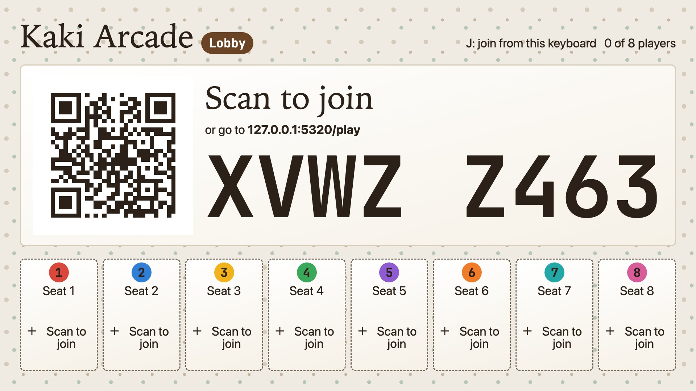
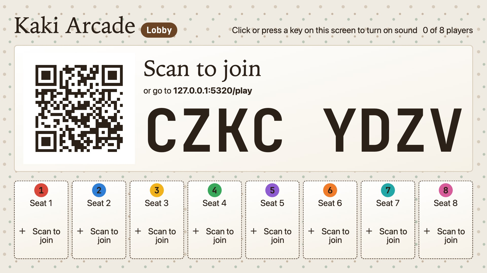
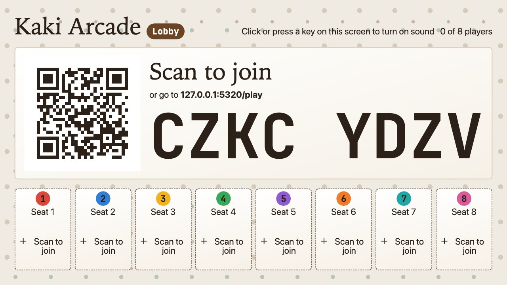
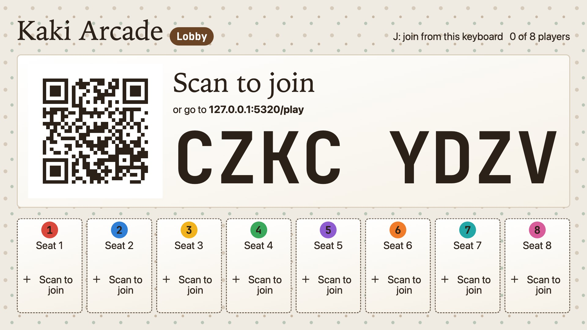
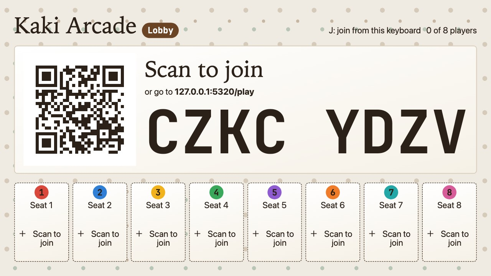
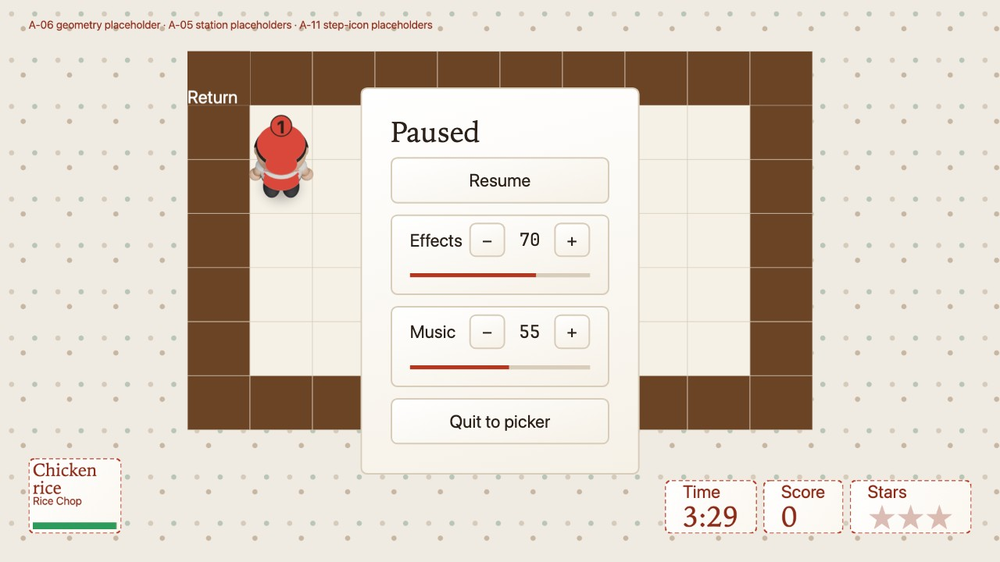
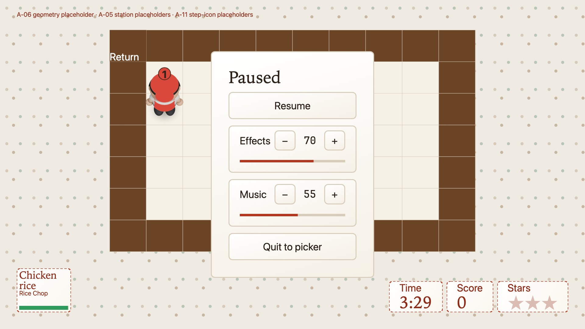

# C-24-sound-unlock UAT evidence

Host browser: chromium 156.0.8078.4
Phone browser: chromium (legacy iPhone emulation) 156.0.8078.4

Automated run passed; every still looked at by the integrator and by reviewer 3 on 2026-11-19.

Command: `node tools/uat/run.mjs -- C-24-sound-unlock --phones 1 --host-browser chromium --out round5`
Commit: `1567fb66c764d0a8c9b9ab497e587c0990859e86`
Viewports: 1920×1080, 1280×720

| Timing | ms | Status |
|---|---:|---|

Expected errors (count):
None

## Real server

| Screenshot | What it shows | Looked at by |
|---|---|---|
|  | After the landing's Host a game click, the lobby hint reads "J: join from this keyboard · 0 of 8 players"; sound runs on the shared engine (one AudioContext across two Back and re-entry passes) | Claude (integrator) and Claude (reviewer 3), 2026-11-19 |
|  | A fresh /host page with no gesture: the hint reads exactly "Click or press a key on this screen to turn on sound", fits the header beside "0 of 8 players", no collision | Claude (integrator) and Claude (reviewer 3), 2026-11-19 |
|  | The same blocked hint at 1280 × 720, on one line, clear of the title and chip | Claude (integrator) and Claude (reviewer 3), 2026-11-19 |
|  | After one key the normal hint is back; same room code as 02 | Claude (integrator) and Claude (reviewer 3), 2026-11-19 |
|  | The same at 720p | Claude (integrator) and Claude (reviewer 3), 2026-11-19 |
|  | Paused with the context suspended: both rows read "Sound is off" in DM Sans on the row's second line, the number column empty, bars hidden; Resume focused | Claude (integrator) and Claude (reviewer 3), 2026-11-19 |
|  | The same at 720p; the panel fits with its 55 px padding | Claude (integrator) and Claude (reviewer 3), 2026-11-19 |
|  | After a click: 70 and 55 in mono with their bars; pixel diff with 07 changes only the value column, row 2 and Resume's focus ring | Claude (integrator) and Claude (reviewer 3), 2026-11-19 |
|  | After the click at 1080p: panel, Resume, −/+ and Quit in the same places as 06 (pixel diff confined to the value column, row 2 and the focus ring) | Claude (integrator) and Claude (reviewer 3), 2026-11-19 |
|  | Effects at 100: three mono digits inside the 68 px column with clear space each side; full bar | Claude (integrator) and Claude (reviewer 3), 2026-11-19 |

| Acceptance statement | Pass / fail | Evidence |
|---|---|---|
| Host a game starts sound within the click and opens the lobby without a reload; one engine survives Back and re-entry (RZ-033, TR-063) | Pass | 01; one-context assertions |
| While sound is blocked, the lobby hint reads "Click or press a key on this screen to turn on sound" (D-229) | Pass | 02, 03 |
| The first key turns sound on and the normal hint returns | Pass | 04, 05 |
| Paused rows read "Sound is off" in the body font while blocked, and their numbers (mono) once running | Pass | 06, 07, 08, 09 |
| Panel width and height, Resume, −/+ and Quit do not move on unlock, at 1080p and 720p | Pass | 06 against 09, 07 against 08; rect assertions |
| 100 fits its column | Pass | 10 |

Caveat: `sound-policy.json` reads `noGestureState: running`, so this Chromium does not block sound without a gesture. The gesture requirement, synchronous resume before navigation, and modified and middle clicks are shown by DOM and unit fakes; programmatic suspension proves recovery and row layout only. A real TV's autoplay block, a remote's OK key and resume after TV sleep are checked on X-09. A pad-only TV stays blocked until a click or key. The running pause panel is about 72 px taller than R-07's at 1080p (D-29x).
