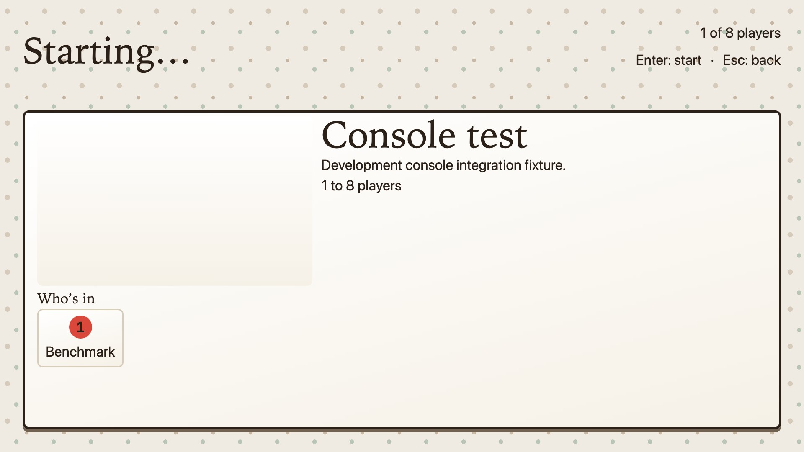
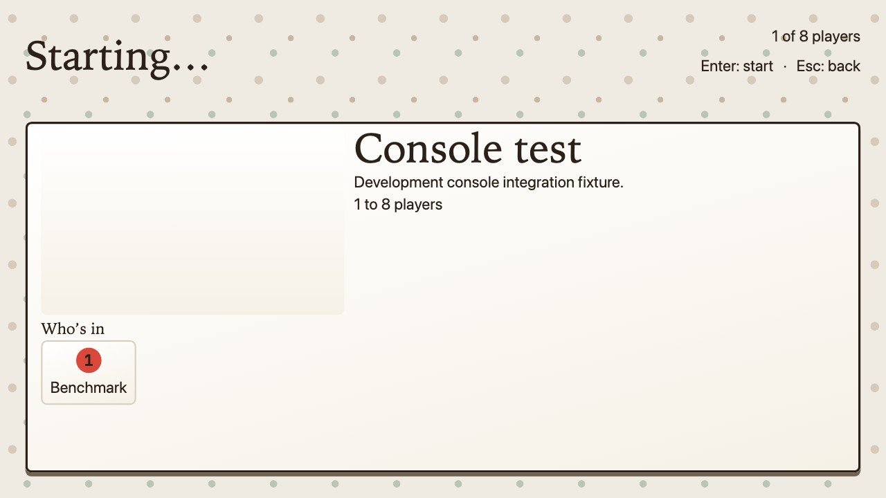
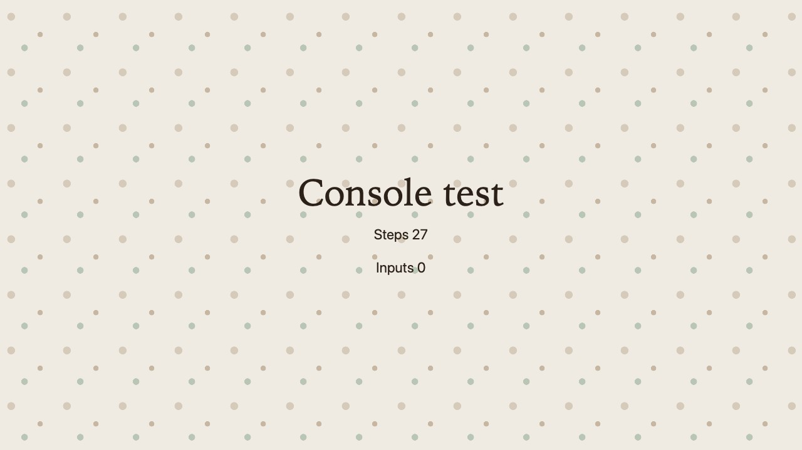

# C-25-detail-benchmark UAT evidence

Host browser: chromium 156.0.8078.4
Phone browser: chromium (legacy iPhone emulation) 156.0.8078.4

Automated execution only. Visual review and acceptance decisions are pending.

Command: `node tools/uat/run.mjs -- C-25-detail-benchmark --phones 1 --out round1`
Commit: `939277f093948d74a0b15ec134f10dbcfaab96ce`
Viewports: 1920×1080, 1280×720

| Timing | ms | Status |
|---|---:|---|
| Create room through host page | 1835.9 | completed |
| Join Benchmark | 575.5 | completed |
| Benchmark | 185.0 | joined |

Expected errors (count):
None

## Real server

| Screenshot | What it shows | Looked at by |
|---|---|---|
|  | | |
|  | | |
|  | | |
|  | | |
|  | | |
|  | | |

| Acceptance statement | Pass / fail | Evidence |
|---|---|---|
| | | |
