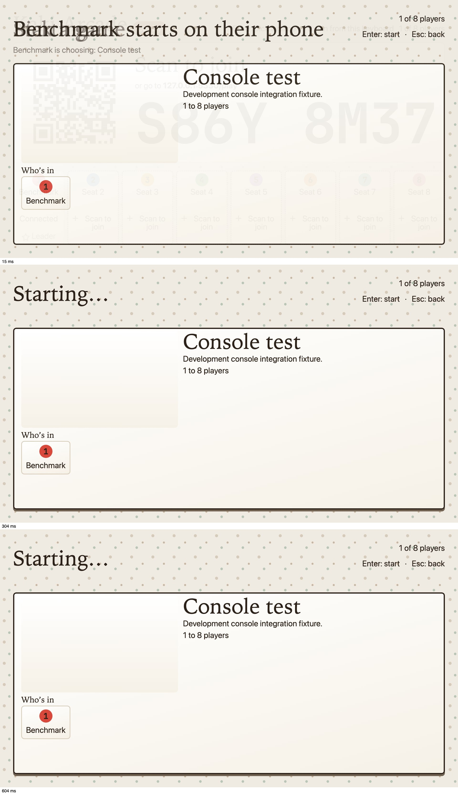
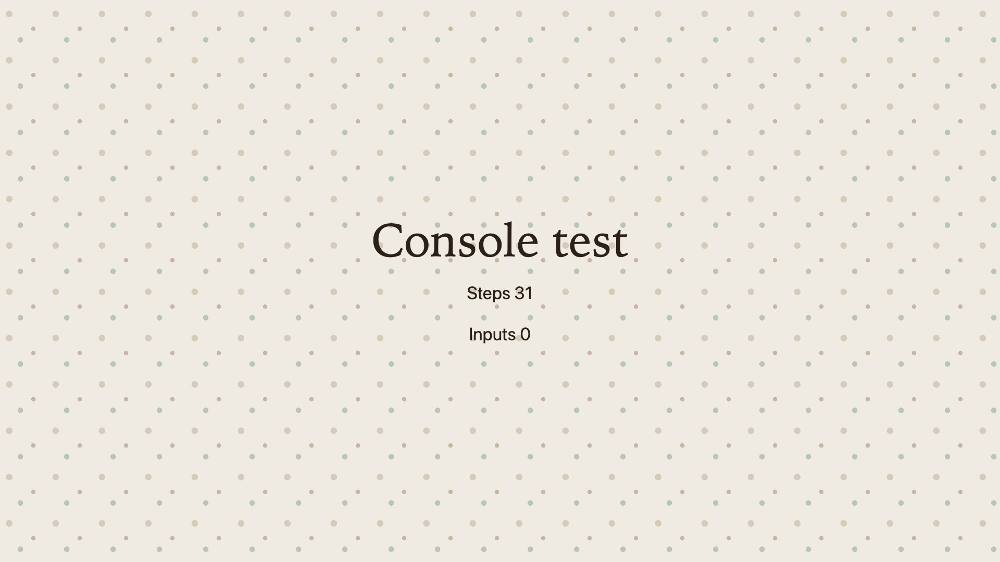
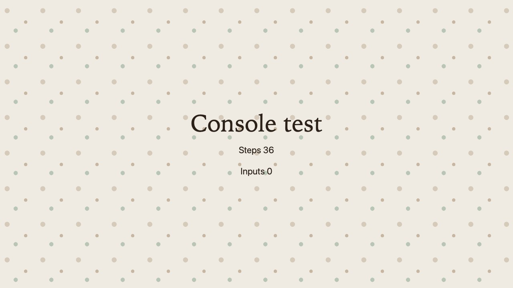
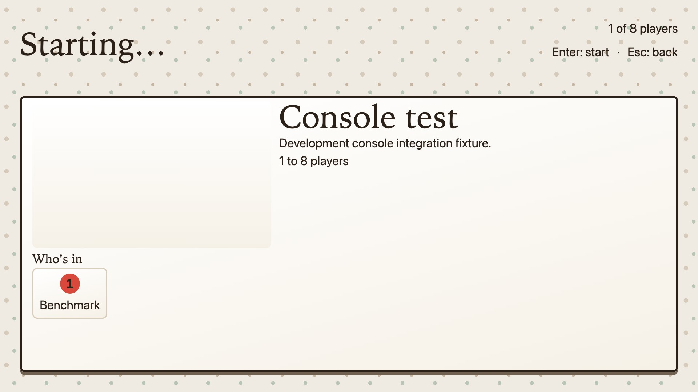
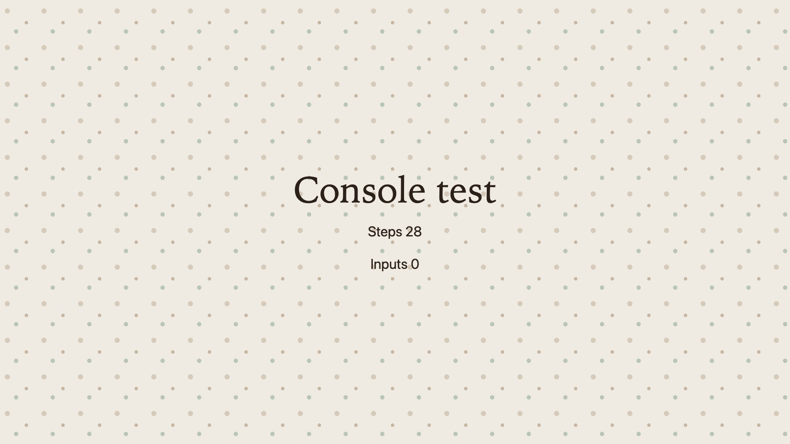

# C-25-detail-benchmark UAT evidence

Host browser: chromium 156.0.8078.4
Phone browser: chromium (legacy iPhone emulation) 156.0.8078.4

Looked at by Claude (integrator), 2026-11-19, with the C-25 reviewer's round-2 notes. detail.json records each scenario's own values (round 3 clears the record between scenarios).

Command: `node tools/uat/run.mjs -- C-25-detail-benchmark --phones 1 --out round3`
Commit: `ead6f10dd447bca360ec4b205dfa395d1211980c`
Viewports: 1920×1080, 1280×720

| Timing | ms | Status |
|---|---:|---|
| Create room through host page | 1300.7 | completed |
| Join Benchmark | 333.0 | completed |
| Benchmark | 141.5 | joined |

Expected errors (count):
None

## Strips

| Screenshot | What it shows | Looked at by |
|---|---|---|
|  | Strip: lobby crossfades to "Starting…" (15 ms), then the Starting screen stays identical at 304 and 604 ms while the scene samples off-screen | Claude (integrator) and reviewer, 2026-11-19 |

## Real server

| Screenshot | What it shows | Looked at by |
|---|---|---|
|  | Ready after Auto chose Full (detail.json auto: full, about 1.08 s, 1 scene run) | Claude (integrator) and reviewer, 2026-11-19 |
|  | Same at 1280×720 | Claude (integrator) and reviewer, 2026-11-19 |
|  | Second launch reused the cached verdict: 0 scene runs, 0 ms, no assets loaded | Claude (integrator) and reviewer, 2026-11-19 |
|  | Same at 1280×720 | Claude (integrator) and reviewer, 2026-11-19 |
|  | Slow benchmark: Starting screen unchanged | Claude (integrator) and reviewer, 2026-11-19 |
|  | Ready after Lower chosen; half atlas decoded before Ready | Claude (integrator) and reviewer, 2026-11-19 |
|  | Same at 1280×720 | Claude (integrator) and reviewer, 2026-11-19 |
|  | Explicit Full: benchmark skipped, 0 scene runs, no half resources | Claude (integrator) and reviewer, 2026-11-19 |
|  | Same at 1280×720 | Claude (integrator) and reviewer, 2026-11-19 |
|  | Auto with no scene: Full, nothing cached, 0 scene runs | Claude (integrator) and reviewer, 2026-11-19 |
|  | Same at 1280×720 | Claude (integrator) and reviewer, 2026-11-19 |

| Acceptance statement | Pass / fail | Evidence |
|---|---|---|
| | | |
