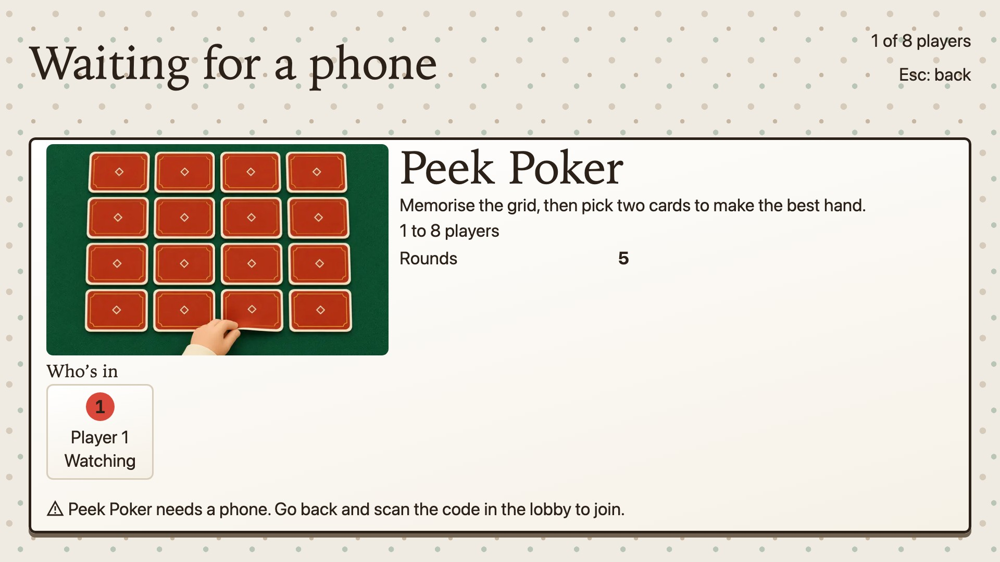
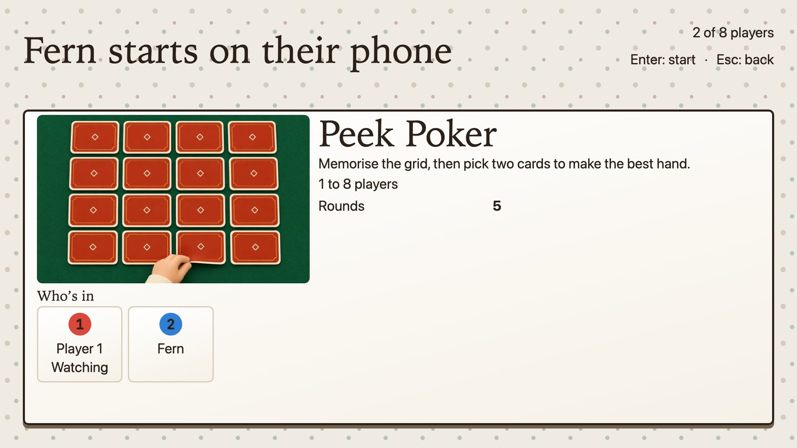
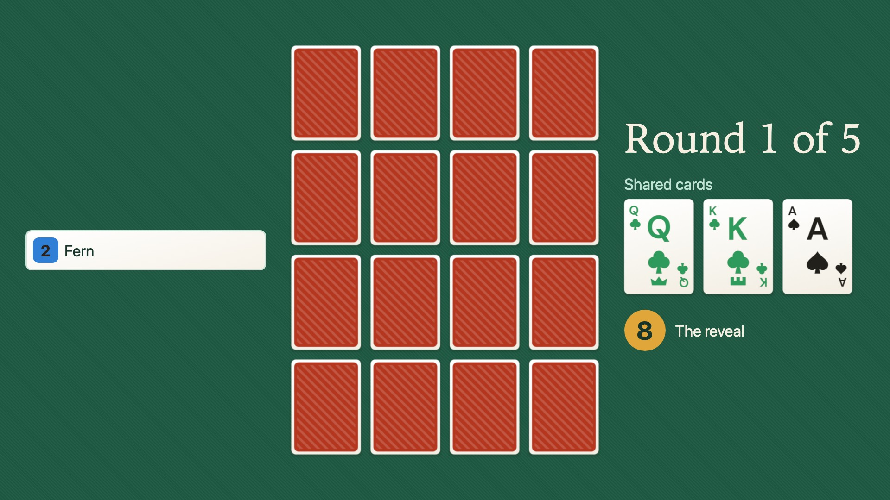
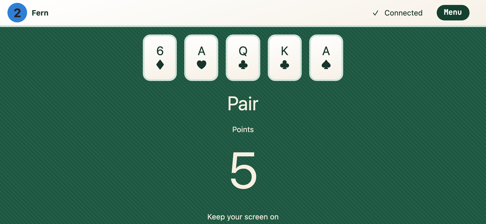

# C-27-local-seat UAT evidence

Host browser: chromium 156.0.8078.4
Phone browser: chromium (legacy iPhone emulation) 156.0.8078.4

Automated execution only. Visual review and acceptance decisions are pending.

Command: `node tools/uat/run.mjs -- C-27-local-seat --phones 1 --out round2`
Commit: `4d52533a630a2c57dfffb2bc7ae48ecb76681c03`
Viewports: 1920×1080, 844×390

| Timing | ms | Status |
|---|---:|---|
| Create room through host page | 1853.2 | completed |

Expected errors (count):
None

## Real server

| Screenshot | What it shows | Looked at by |
|---|---|---|
|  | Only the TV seat, Peek Poker focused: heading "Waiting for a phone", hints "Esc: back" only, the tile has no minimum-player reason, Player 1 reads Watching, band "Peek Poker needs a phone. Go back and scan the code in the lobby to join." | Claude (integrator) and reviewer, 2026-11-19 |
|  | A phone joins: heading "Fern starts on their phone", "Enter: start · Esc: back", 2 of 8 players, Player 1 still Watching | Claude (integrator) and reviewer, 2026-11-19 |
|  | Peek Poker round 1: the player list holds only Fern; the TV seat has no hand or entry | Claude (integrator) and reviewer, 2026-11-19 |
|  | Fern's phone shows her hand (6♦ A♥ with Q♣ K♣ A♠), Pair, 5 points | Claude (integrator) and reviewer, 2026-11-19 |

| Acceptance statement | Pass / fail | Evidence |
|---|---|---|
| A watch game with only the TV seat refuses Start with one message and no contradicting tile reason (PLAT-021) | Pass | 01 |
| A connected phone leads; the TV seat is marked Watching (PLAT-006, CTRL-009) | Pass | 02 |
| A watching seat never enters the game or gets a hand (CTRL-009) | Pass | 03, 04 |
