# C-29-rejoin-seat UAT evidence

Host browser: chromium 156.0.8078.4
Phone browser: chromium (legacy iPhone emulation) 156.0.8078.4

Automated execution only. Visual review and acceptance decisions are pending.

Command: `node tools/uat/run.mjs -- C-29-rejoin-seat --phones 3 --max-mb 18 --out round4`
Commit: `7d070019090d774c8ab24652c2820bc93bb0fe4f`
Viewports: 1920×1080, 1280×720, 844×390

| Timing | ms | Status |
|---|---:|---|
| Create room through host page | 1465.1 | completed |
| Join Mei | 359.0 | completed |
| Join Randy | 321.7 | completed |
| Join Cloud | 315.3 | completed |
| Mei | 120.8 | joined |
| Randy | 127.5 | joined |
| Cloud | 127.2 | joined |

Expected errors (count):
None

## Real server

| Screenshot | What it shows | Looked at by |
|---|---|---|
|  | | |
|  | | |
| 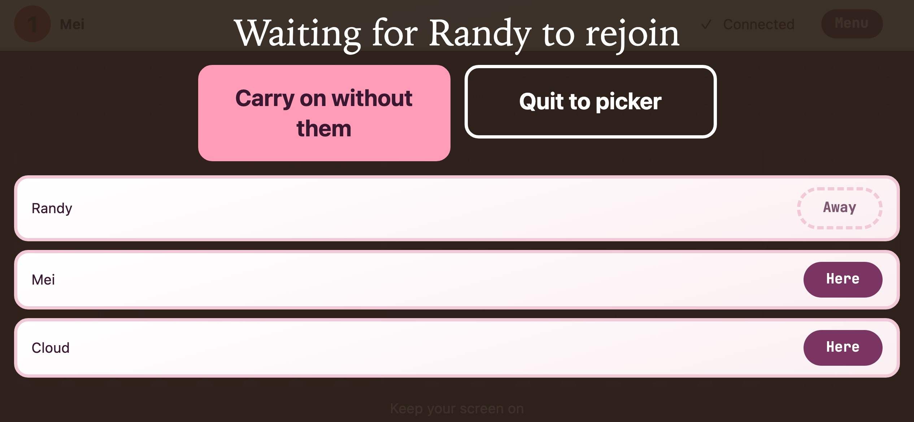 | | |
| 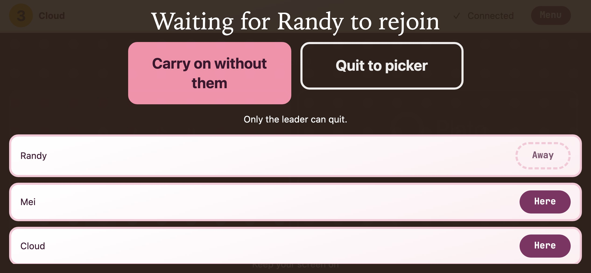 | | |
| 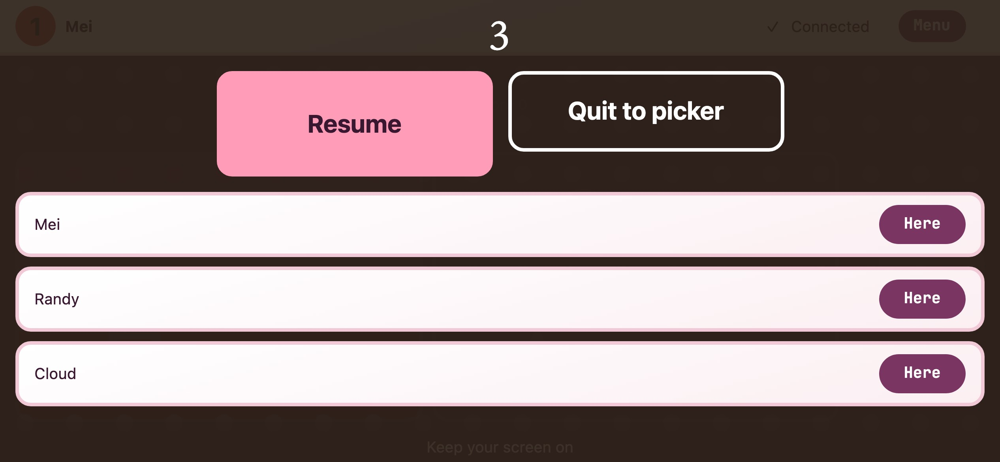 | | |
| 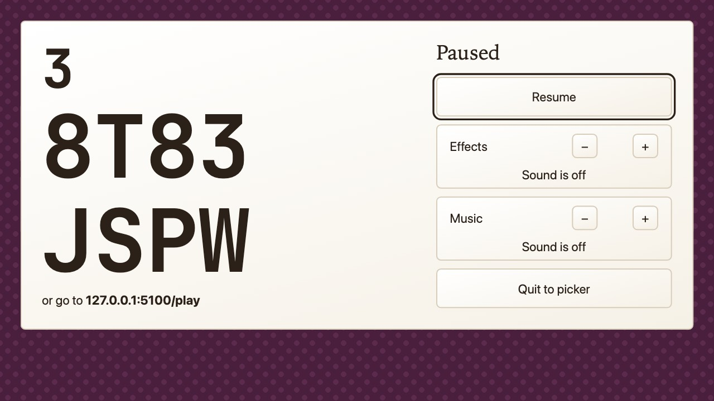 | | |
| 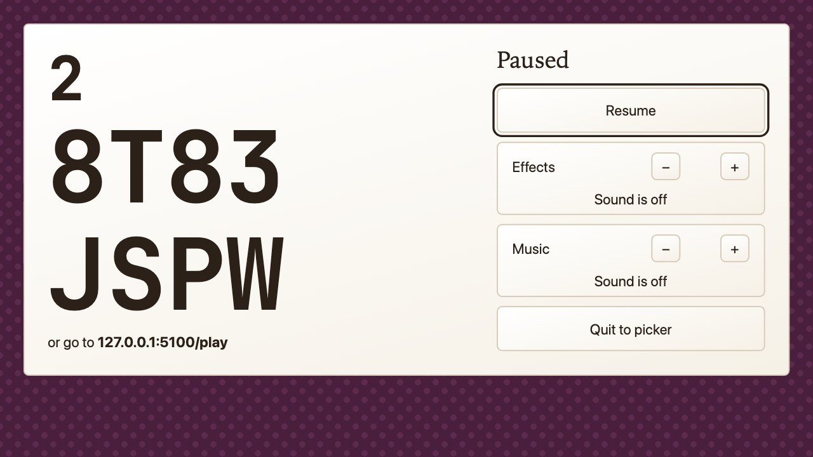 | | |
| 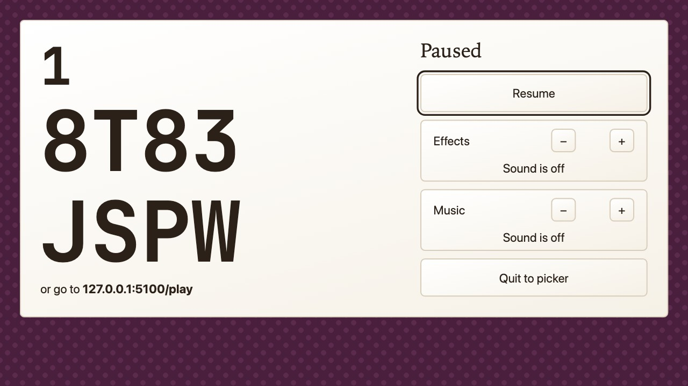 | | |
| 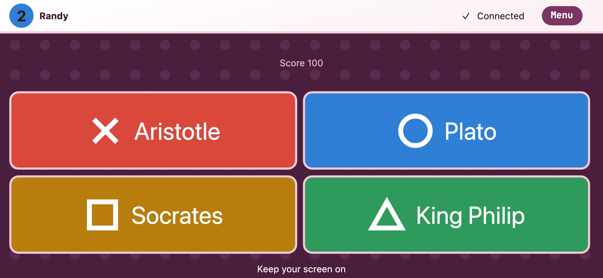 | | |
| 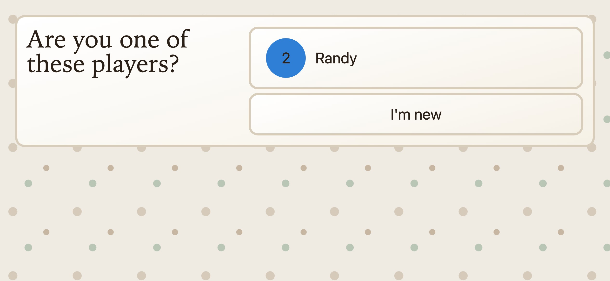 | | |
| 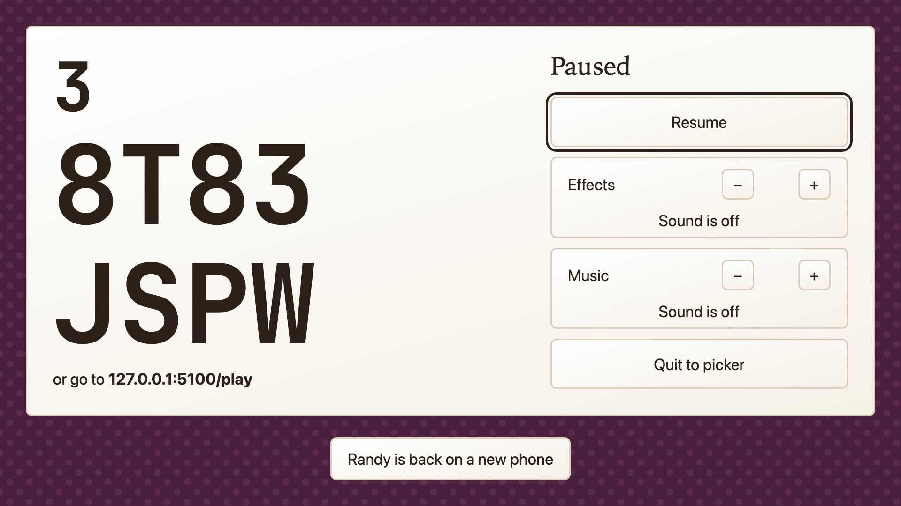 | | |
| 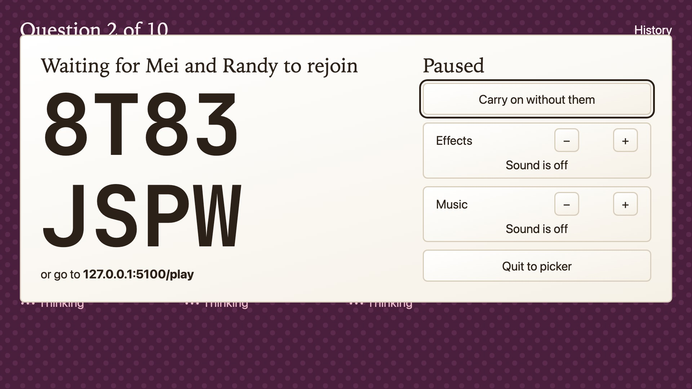 | | |
| 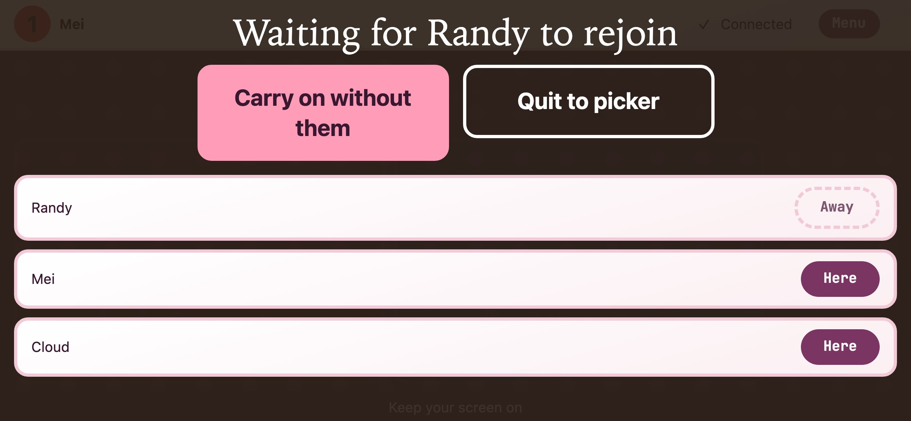 | | |
|  | | |
| 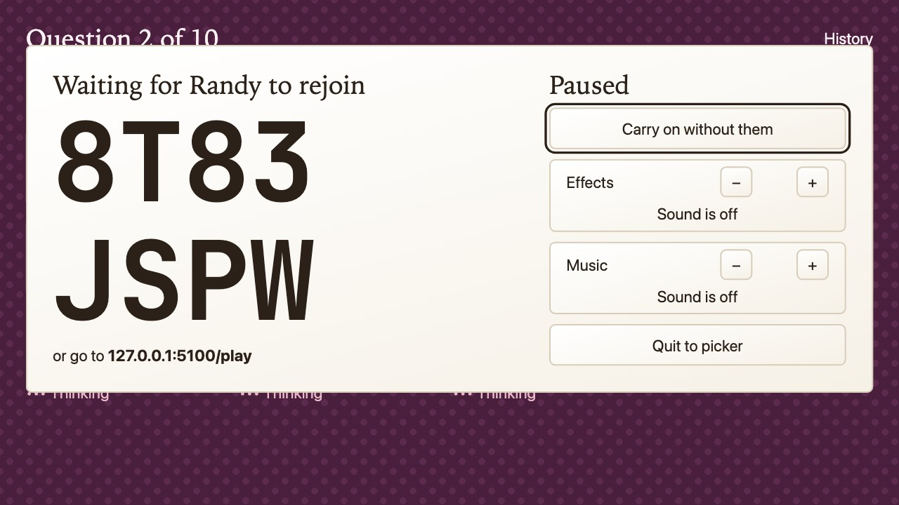 | | |
| 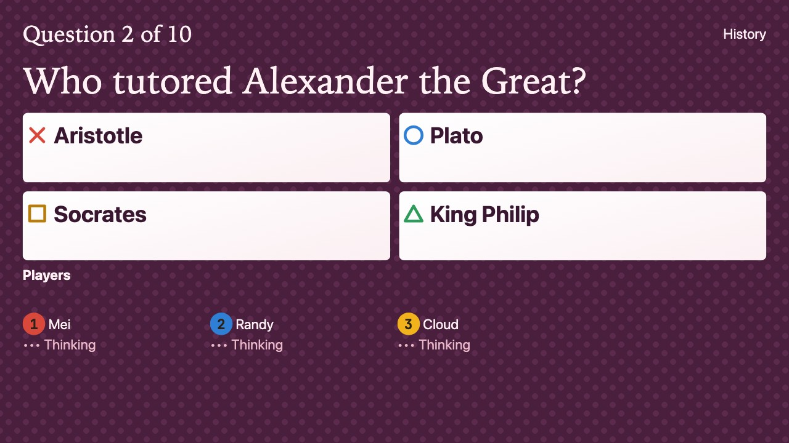 | | |
|  | | |
| 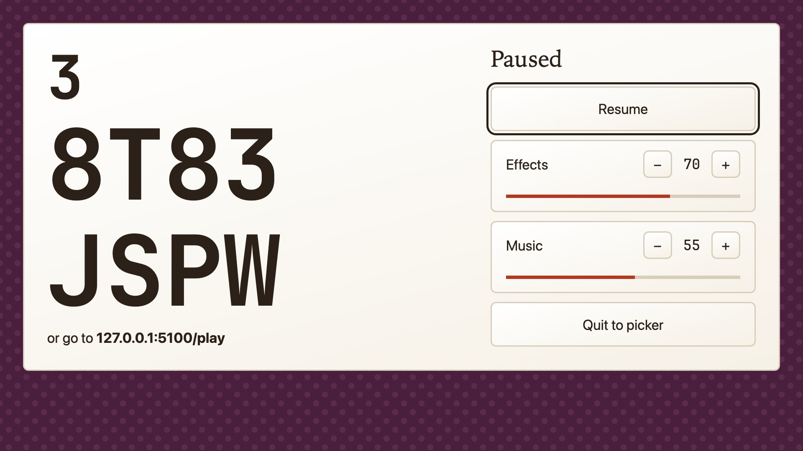 | | |
| 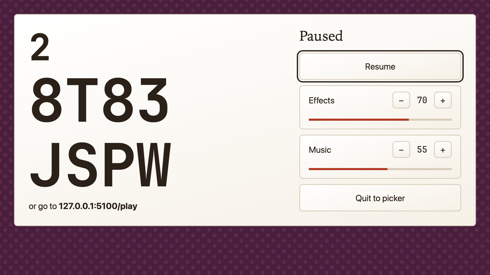 | | |
|  | | |
| 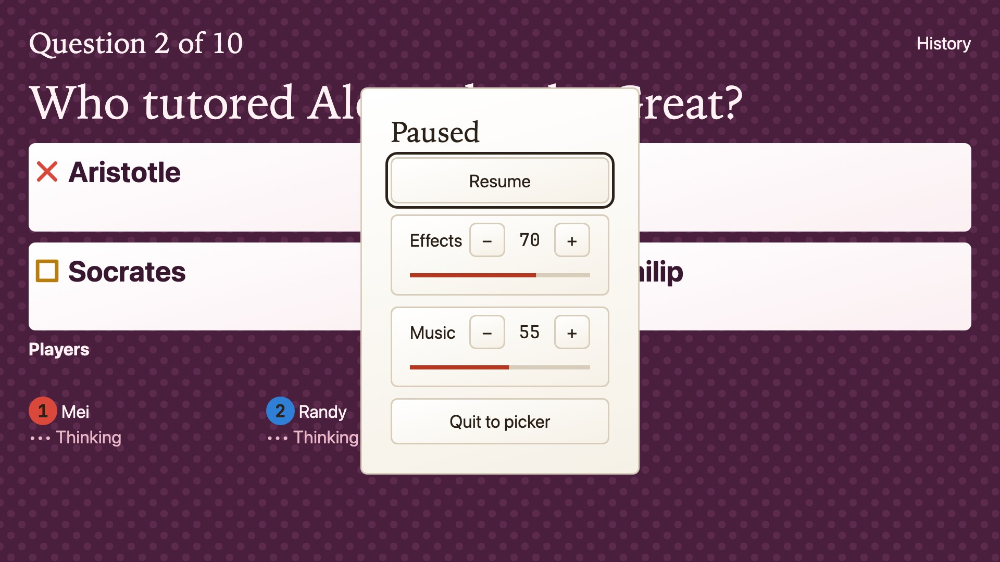 | | |

## Strips

| Screenshot | What it shows | Looked at by |
|---|---|---|
| 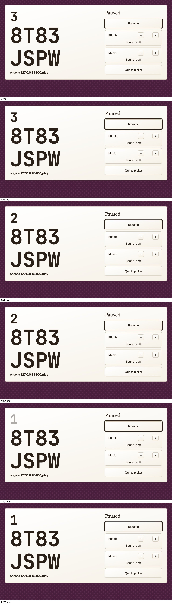 | | |

| Acceptance statement | Pass / fail | Evidence |
|---|---|---|
| | | |

## REPORT.md visual review, round4 (commit 7d070019, includes round 5)

| Screenshot | What it shows | Looked at by |
|---|---|---|
| 01-host-waiting-code-1920.jpg | TV 1920, question 2: "Waiting for Randy to rejoin", code 8T83 JSPW at lobby size, join address; controls Carry on without them (focused), Effects, Music, Quit. The background heading and status row are half-covered (S5, for Randy). | Claude reviewer |
| 02-host-waiting-code-1280.jpg | Same at 1280. | Claude reviewer |
| 03-phone1-phone-1-waiting.jpg | Leader phone (Mei): waiting heading, Carry on without them, Quit to picker, no "Only the leader…" line; Randy Away (dashed chip) first, then Mei and Cloud Here. | Claude reviewer |
| 04-phone3-non-leader-waiting.jpg | Non-leader phone (Cloud): same list without remove controls; buttons disabled (Carry on barely distinguishable, note 1); "Only the leader can quit." | Claude reviewer |
| 05-phone1-phone-countdown.jpg | Leader phone in the countdown: heading "3", button "Resume", all three Here. | Claude reviewer |
| 07-host-countdown-3.jpg | TV 1280: "3" above the code; button "Resume". | Claude reviewer |
| 10-host-countdown-2.jpg | TV 1280: "2"; "Resume". | Claude reviewer |
| 13-host-countdown-1.jpg | TV 1280: "1"; "Resume". | Claude reviewer |
| 15-strip-countdown-3-2-1.jpg | Six frames over 2.26 s: 3, 3, 2, 2, 1 (fading in), 1. Entrance is a fade with no overshoot; one number per second. | Claude reviewer |
| 16-page-phone-2-same-seat-name-score.jpg | Randy's phone after a same-browser rejoin: seat 2 "Randy", Connected, **Score 100**, question 2's answers. | Claude reviewer |
| 17-phone4-fresh-browser-name-list.jpg | Fresh browser: "Are you one of these players?", "2 Randy" with a blue seat badge, "I'm new". Connected players are not listed. | Claude reviewer |
| 18-host-claimed-seat-notice-1920.jpg | TV 1920 countdown "3"; "Randy is back on a new phone" centred below the panel, about 57 px above the bottom edge, inside the 55 px safe margin, covering no text; "Resume". | Claude reviewer |
| 19-host-two-missing-players.jpg | TV 1920: "Waiting for Mei and Randy to rejoin" with the code. | Claude reviewer |
| 20-page-leader-carry-on.jpg | Mei back in her original browser: waiting for Randy, Carry on without them, Randy Away first. | Claude reviewer |
| 21-host-tv-waiting-before-carry-on-1920.jpg | TV 1920 waiting for Randy after the claimer left; the status row behind reads "Thinking" (M1 fixed). | Claude reviewer |
| 22-host-tv-waiting-before-carry-on-1280.jpg | Same at 1280; "Thinking" behind. | Claude reviewer |
| 23-host-tv-keyboard-carry-on.jpg | TV 1280 right after Enter on "Carry on without them": play resumed, question 2, all "Thinking". | Claude reviewer |
| 24-host-tv-after-carry-on-1920.jpg | TV 1920 in play without Randy: Randy "Thinking", not "Next question" (M1 fixed). No room code during play (M4, with Randy). | Claude reviewer |
| 25-host-reduced-countdown-3.jpg | Reduced motion: "3" at full strength; "Resume"; sound levels 70 and 55. | Claude reviewer |
| 26-host-reduced-countdown-2.jpg | Reduced motion: "2". | Claude reviewer |
| 27-host-reduced-countdown-1.jpg | Reduced motion: "1". | Claude reviewer |
| 28-host-chosen-pause-stays-paused.jpg | A chosen pause after Cloud dropped and returned: plain centred Paused panel with Resume, still paused after 4 s (PLAT-023 kept); no bottom reserve (S7). | Claude reviewer |

| Acceptance statement | Pass / fail | Evidence |
|---|---|---|
| Same-browser rejoin keeps seat, name and a non-zero score | Pass | 16; script line 75 |
| Another browser sees only disconnected names, then "I'm new" | Pass | 17 |
| A claim keeps score and game state | Pass | Script lines 90–93; 21, 22, 24 "Thinking" |
| "⟨name⟩ is back on a new phone" covers no text, at both sizes | Pass | 18 (1920); round1 16 (1280) |
| TV shows "Waiting for ⟨name⟩" (and two names) with the code and join address | Pass | 01, 02, 19, 21, 22 |
| Leader and non-leader phones show who is Away and Here | Pass | 03, 04, 20 |
| 3-2-1 resumes, labelled Resume, no animation under reduced motion | Pass | 05, 07, 10, 13, 15, 25–27 |
| Carry on from the phone and from the TV keyboard | Pass | 23, 24 |
| A chosen pause is not auto-resumed | Pass | 28 |
| Room code readable while a game is playing | Not met (with Randy) | 24 |
| Layout chosen by Randy | Pending | — |
