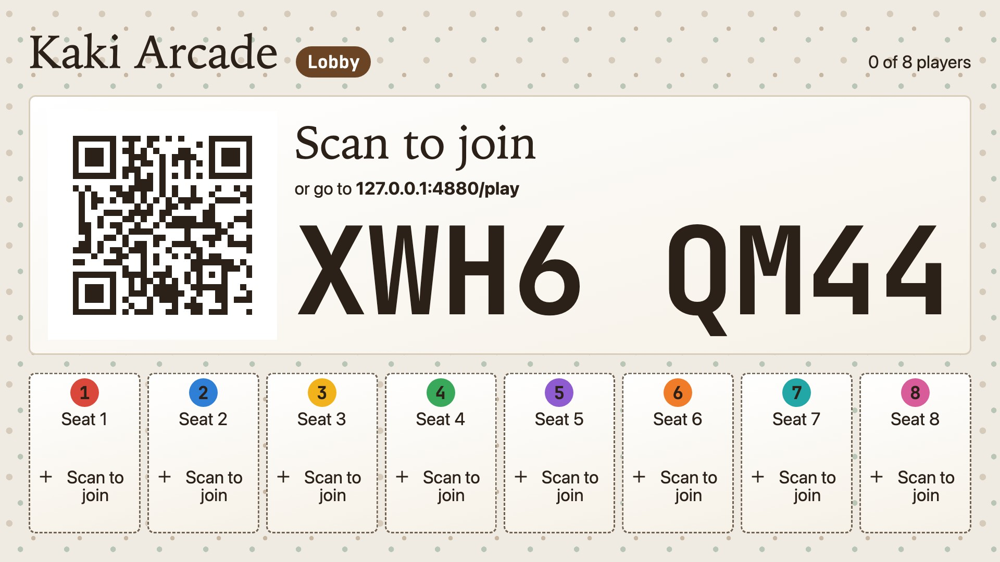
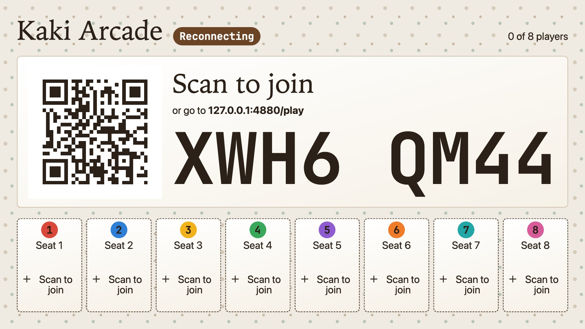
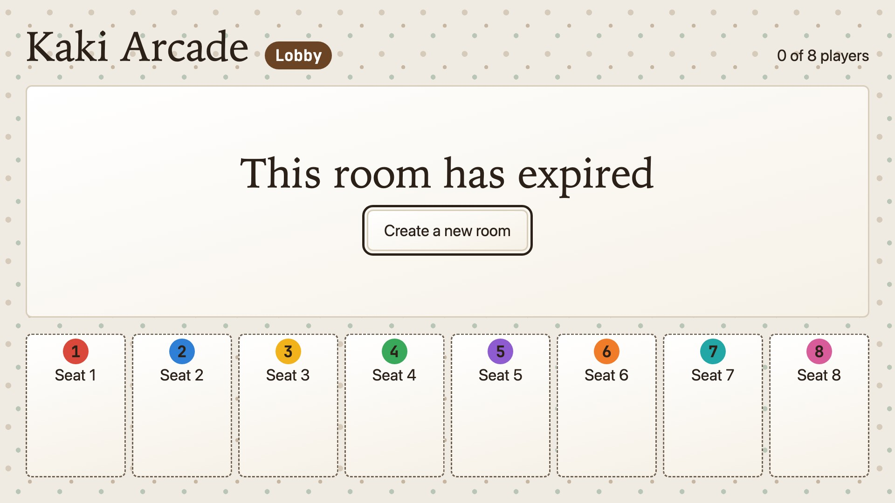
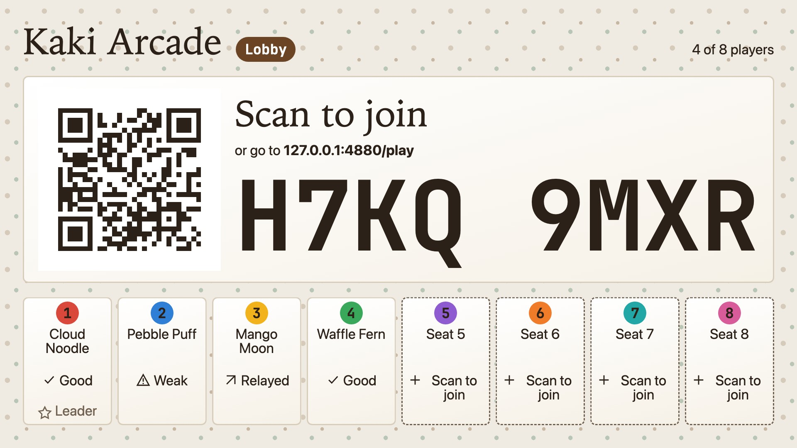
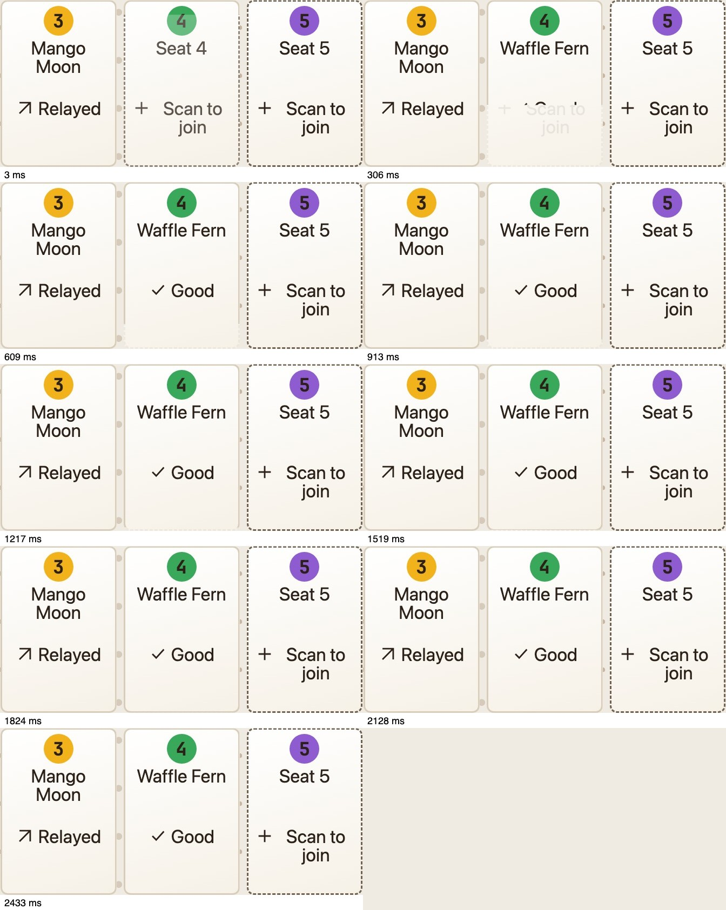
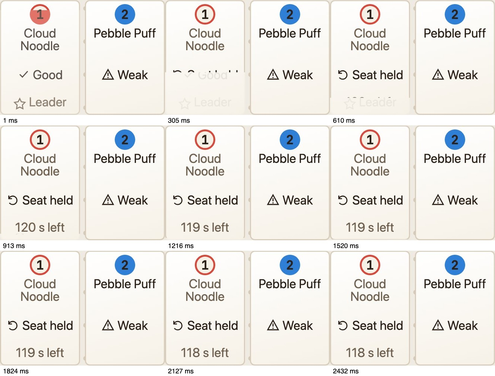
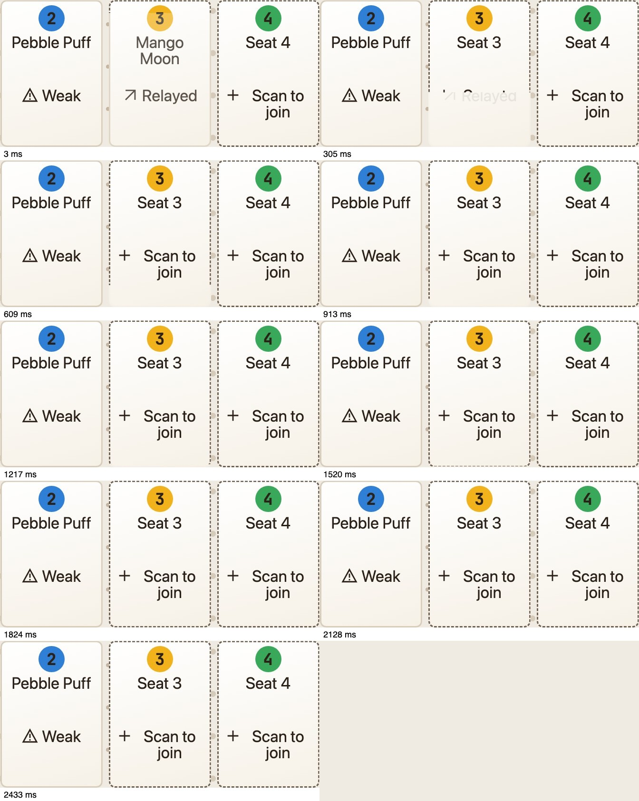
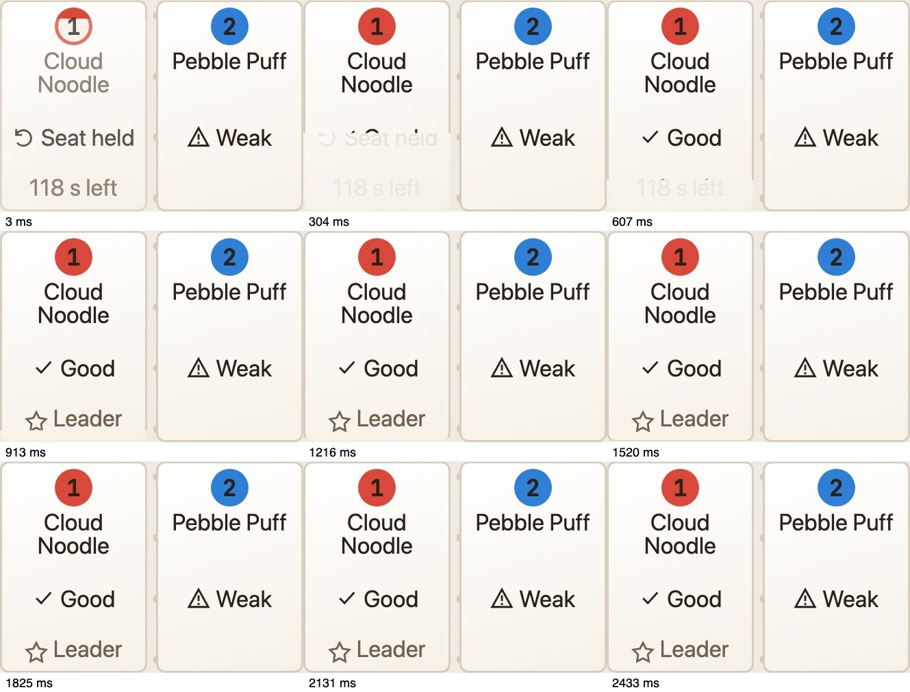

# C-07-host-lobby UAT evidence

Automated execution only. Visual review and acceptance decisions are pending.

Command: `node tools/uat/run.mjs -- C-07-host-lobby`
Commit: `ce95e2b5ee39e66ed3289051941faeb176aa4c5d`
Viewports: 1920×1080, 1280×720, 3840×2160

| Timing | ms | Status |
|---|---:|---|
| Create room through host page | 1122.3 | completed |
| Reload reopens the same real room | 1069.4 | completed |
| Pairing outage retains open room | 2181.1 | completed |
| Saved room missing from real server expires | 3116.5 | completed |
| Demo 720p demo=0 | 1047.5 | completed |
| Demo 720p demo=1 | 1034.1 | completed |
| Demo 720p demo=3 | 1033.7 | completed |
| Demo 720p demo=8 | 1034.2 | completed |
| Demo 720p demo=8&names=long | 1051.5 | completed |
| Demo 720p demo=8&state=creating | 1033.3 | completed |
| Demo 720p demo=8&state=restoring | 1034.4 | completed |
| Demo 720p demo=8&state=unreachable | 1035.4 | completed |
| Demo 720p demo=8&state=expired | 1035.3 | completed |
| Demo 720p demo=8&state=replaced | 1031.6 | completed |
| Demo 1080p demo=0 | 1058.3 | completed |
| Demo 1080p demo=1 | 1057.9 | completed |
| Demo 1080p demo=3 | 1057.9 | completed |
| Demo 1080p demo=8 | 1060.0 | completed |
| Demo 1080p demo=8&names=long | 1060.4 | completed |
| Demo 1080p demo=8&state=creating | 1058.6 | completed |
| Demo 1080p demo=8&state=restoring | 1058.3 | completed |
| Demo 1080p demo=8&state=unreachable | 1057.4 | completed |
| Demo 1080p demo=8&state=expired | 1057.4 | completed |
| Demo 1080p demo=8&state=replaced | 1059.1 | completed |
| Demo 4K demo=8 | 1379.4 | completed |
| Demo 4K demo=8&names=long | 1399.9 | completed |
| Slowed demo join strip | 4609.8 | completed |
| Slowed demo held strip | 4565.7 | completed |
| Slowed demo leave strip | 4644.6 | completed |
| Slowed demo return strip | 4608.2 | completed |
| Reduced motion settles within one frame | 2193.6 | completed |

Expected errors (count):
- 2 × host: net::ERR_CONNECTION_REFUSED
- 2 × host: Failed to load resource: net::ERR_CONNECTION_REFUSED
- 1 × host: WebSocket connection to 'ws://127.0.0.1:4881/rooms/XWH6QM44/host' failed: Error in connection establishment: net::ERR_CONNECTION_REFUSED
- 1 × host: WebSocket connection to 'ws://127.0.0.1:4881/rooms/XWH6QM44/host' failed: Error during WebSocket handshake: Unexpected response code: 404
- 1 × host: Failed to load resource: the server responded with a status of 404 (Not Found)
- 1 × host: net::ERR_ABORTED

## Real server

| Screenshot | What it shows | Looked at by |
|---|---|---|
|  | | |
|  | | |
|  | | |
|  | | |

## Demo 720p

| Screenshot | What it shows | Looked at by |
|---|---|---|
|  | | |
|  | | |
|  | | |
|  | | |
|  | | |
|  | | |
|  | | |
|  | | |
|  | | |
|  | | |

## Demo 1080p

| Screenshot | What it shows | Looked at by |
|---|---|---|
|  | | |
|  | | |
|  | | |
|  | | |
|  | | |
|  | | |
|  | | |
|  | | |
|  | | |
|  | | |
|  | | |

## Demo 4K

| Screenshot | What it shows | Looked at by |
|---|---|---|
|  | | |
|  | | |

## Strips

| Screenshot | What it shows | Looked at by |
|---|---|---|
|  | | |
|  | | |
|  | | |
|  | | |

| Acceptance statement | Pass / fail | Evidence |
|---|---|---|
| | | |
