# C-08-join-page UAT evidence

Automated execution only. Visual review and acceptance decisions are pending.

Command: `node tools/uat/run.mjs -- C-08-join-page`
Commit: `ce95e2b5ee39e66ed3289051941faeb176aa4c5d`
Viewports: 844×390, 1920×1080, 390×844

| Timing | ms | Status |
|---|---:|---|
| Create room through host page | 1341.4 | completed |
| Join Mango | 596.3 | completed |
| Join Pebble | 580.2 | completed |
| Join Fern | 629.6 | completed |
| Join Comet | 634.1 | completed |
| Join Noodle | 663.4 | completed |
| Join Waffle | 617.0 | completed |
| Join Puddle | 579.7 | completed |
| Join Kite | 626.4 | completed |
| Ninth phone sees room full | 1155.2 | completed |
| Phone reload keeps its seat | 1099.0 | completed |
| Closed host disconnects phones; reopened host restores all eight | 11308.1 | completed |
| Pairing alone stopped for 25 seconds; rename still reaches host | 29384.7 | completed |
| Reduced motion rename reaches final host state within one frame | 226.5 | completed |
| Mango | 389.9 | joined |
| Pebble | 372.6 | joined |
| Fern | 374.0 | joined |
| Comet | 385.3 | joined |
| Noodle | 368.4 | joined |
| Waffle | 374.5 | joined |
| Puddle | 362.8 | joined |
| Kite | 379.3 | joined |

Expected errors (count):
- 5 × host: net::ERR_CONNECTION_REFUSED
- 5 × host: Failed to load resource: net::ERR_CONNECTION_REFUSED
- 4 × host: WebSocket connection to 'ws://127.0.0.1:4881/rooms/7RQN6WKS/host' failed: Error in connection establishment: net::ERR_CONNECTION_REFUSED

## Real server

| Screenshot | What it shows | Looked at by |
|---|---|---|
| 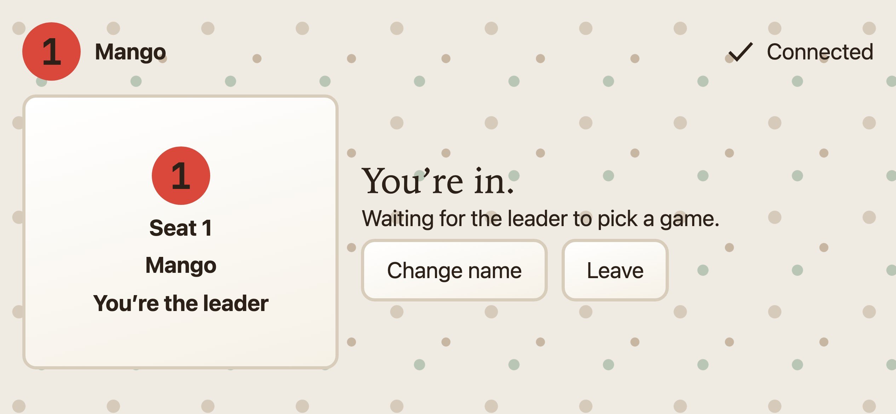 | | |
| 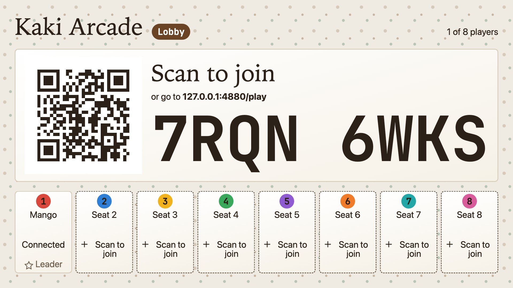 | | |
| 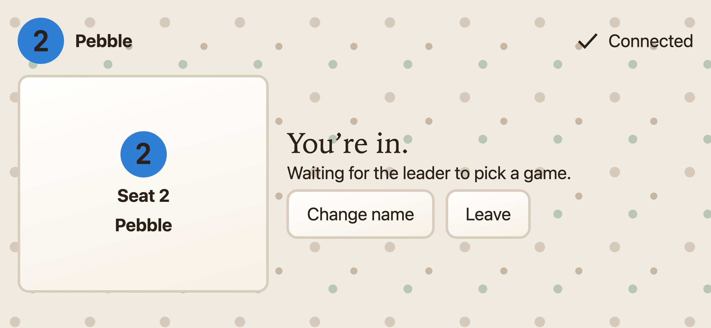 | | |
| 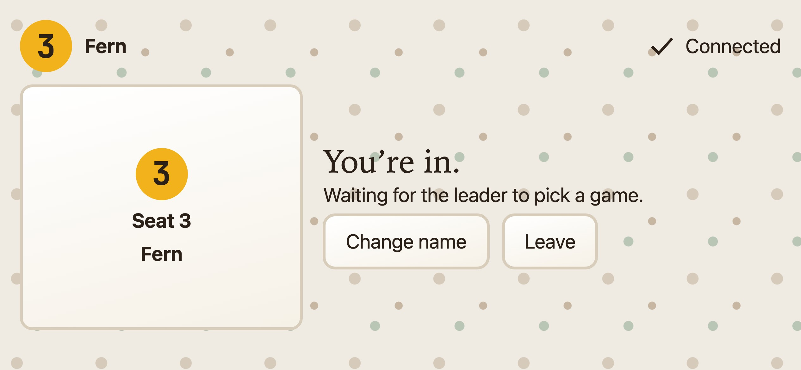 | | |
| 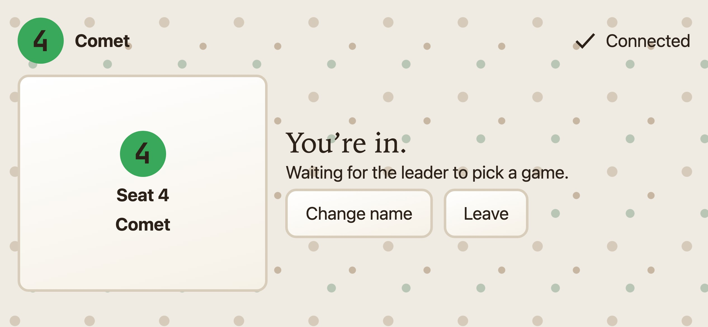 | | |
| 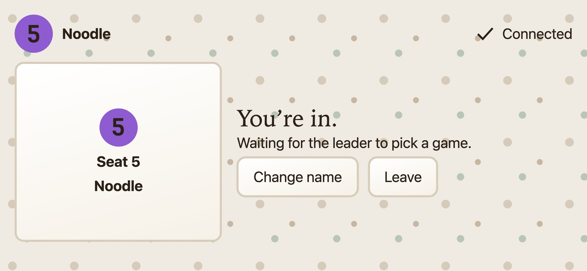 | | |
| 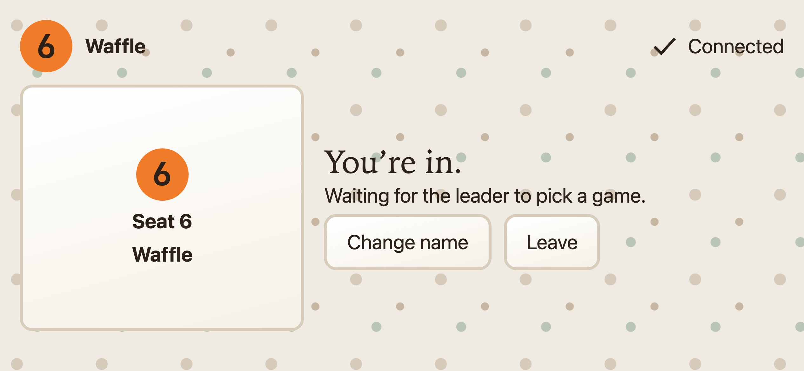 | | |
|  | | |
| 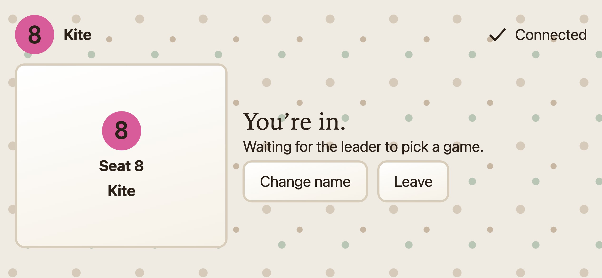 | | |
|  | | |
| 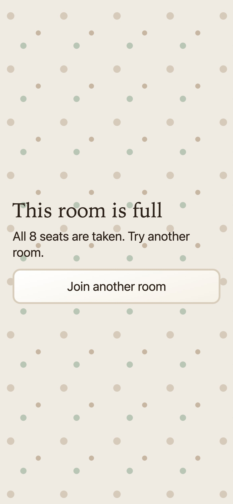 | | |
|  | | |
| 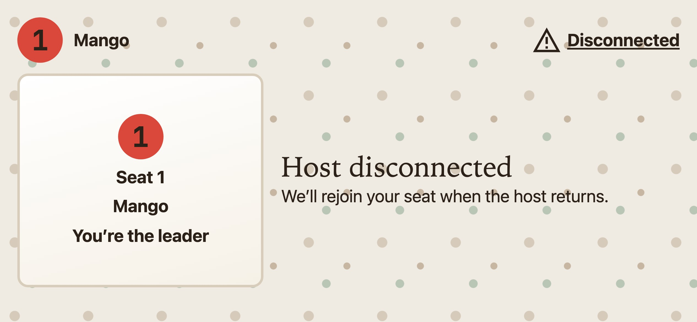 | | |
| 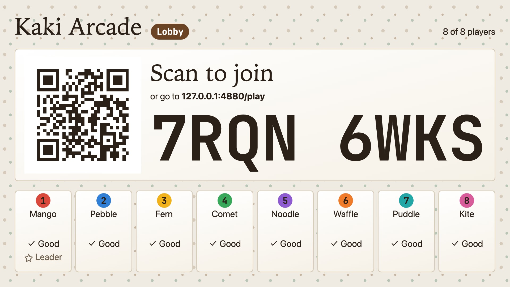 | | |
| 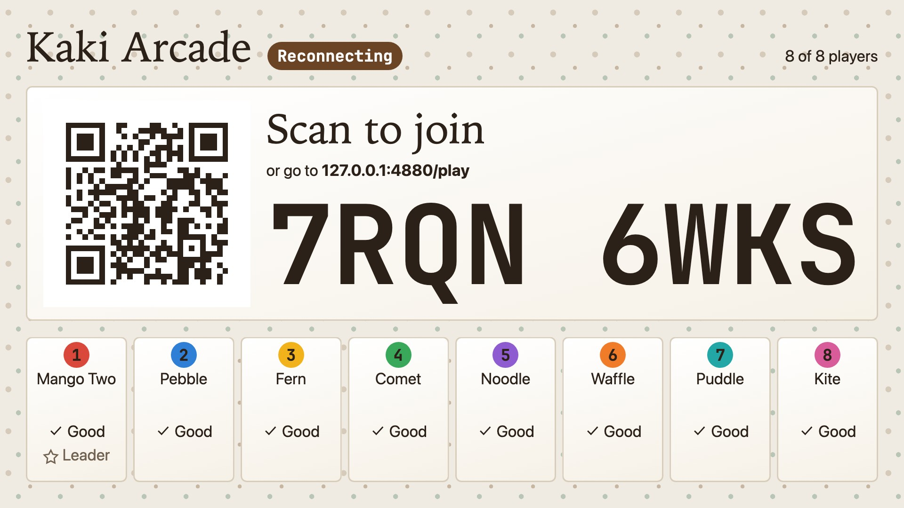 | | |
| 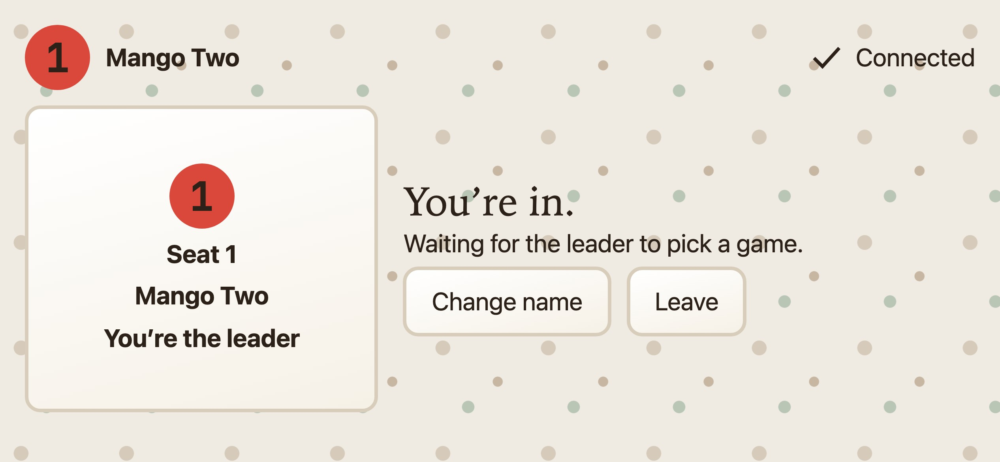 | | |
|  | | |

| Acceptance statement | Pass / fail | Evidence |
|---|---|---|
| | | |
