# K-02-left-stick UAT evidence

Automated execution only. Visual review and acceptance decisions are pending.

Command: `node tools/uat/run.mjs -- K-02-left-stick --phones 1 --out k03-merge-check`
Commit: `88c31ee9f51958308cb8707520ae133064cfe05d`
Viewports: 844×390, 667×375

| Timing | ms | Status |
|---|---:|---|
| 844x390 touch tracking, rubber-band and multi-touch | 3178.1 | completed |
| 667x375 touch tracking, rubber-band and multi-touch | 2724.4 | completed |
| Reduced motion keeps values and removes stretch and release animation | 381.8 | completed |

Expected errors (count):
None

## Real server

| Screenshot | What it shows | Looked at by |
|---|---|---|
| 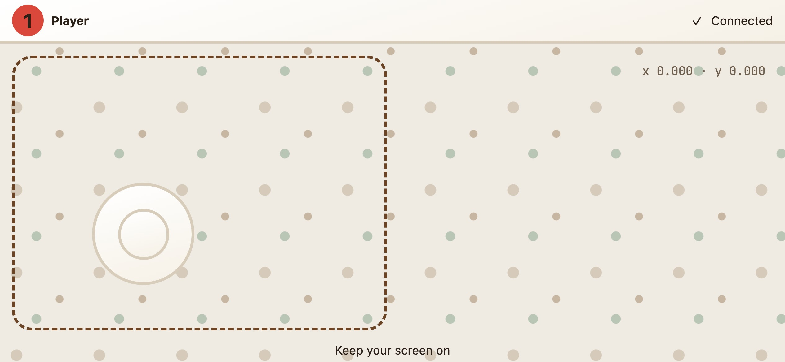 | | |
| 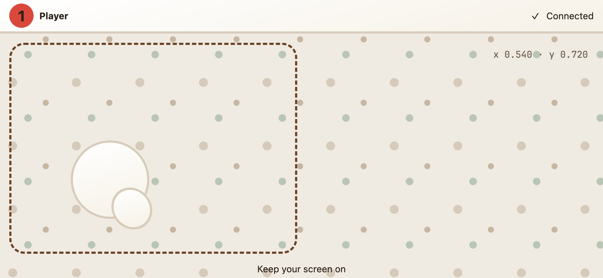 | | |
| 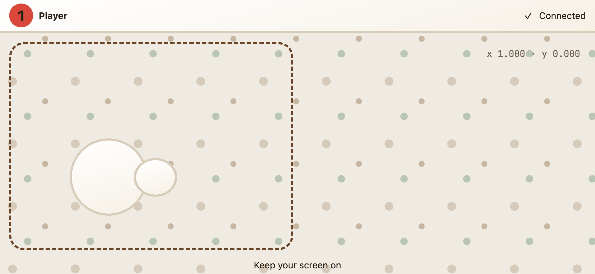 | | |
|  | | |
| 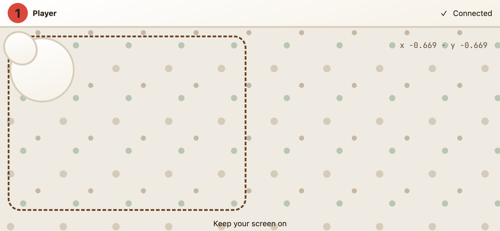 | | |
| 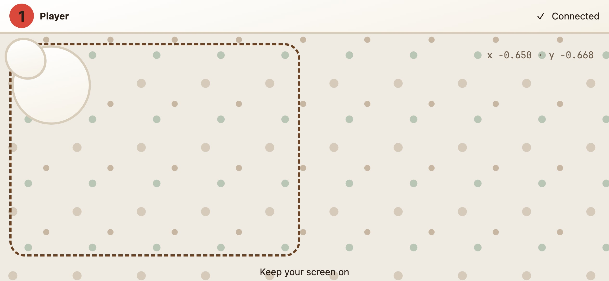 | | |
| 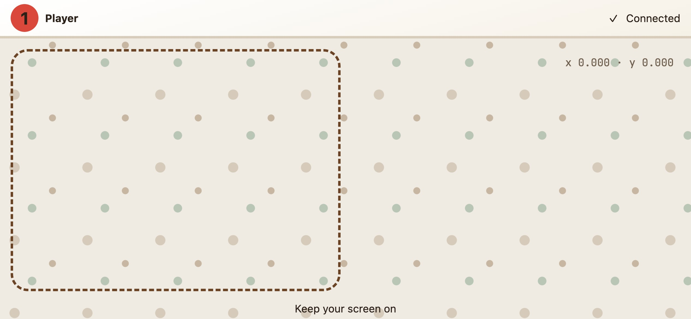 | | |
| 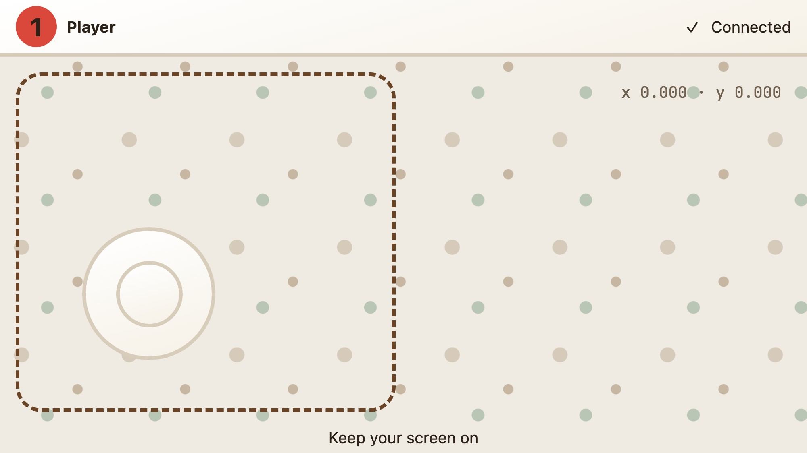 | | |
| 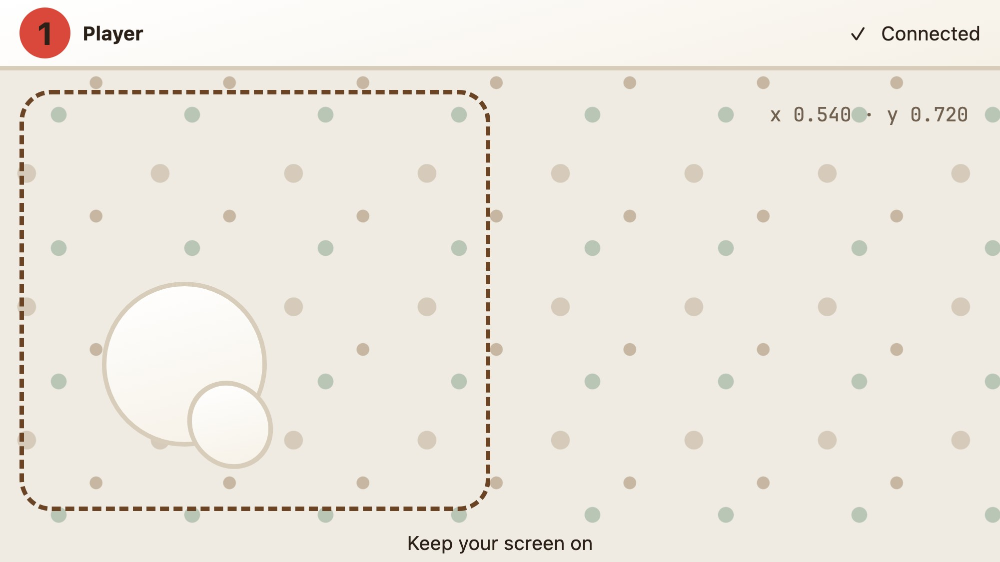 | | |
| 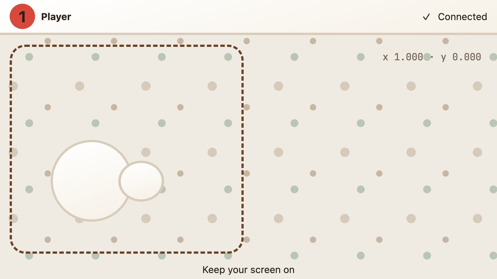 | | |
|  | | |
| 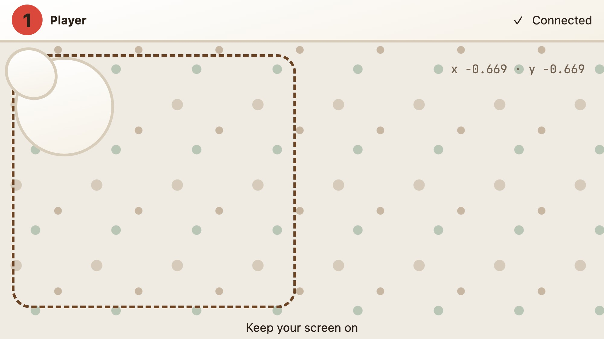 | | |
|  | | |
| 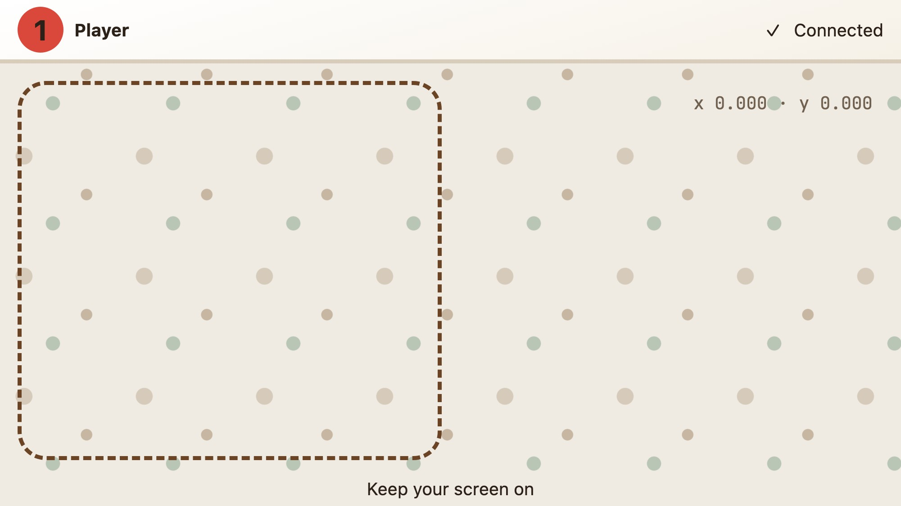 | | |
| 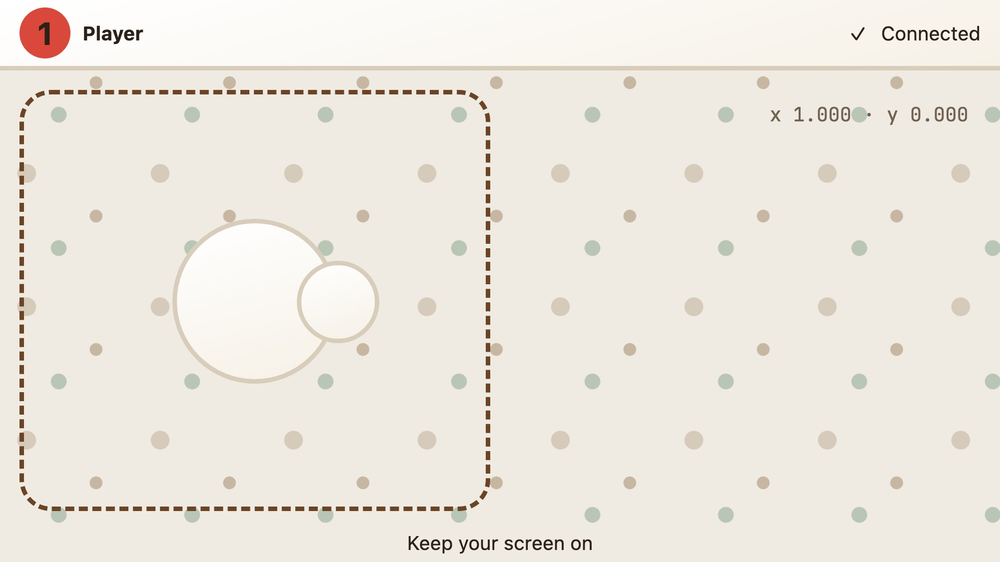 | | |
|  | | |

## Strips

| Screenshot | What it shows | Looked at by |
|---|---|---|
| 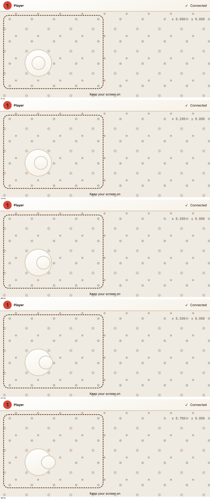 | | |
| 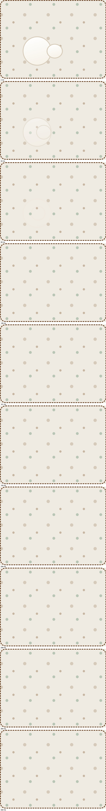 | | |
| 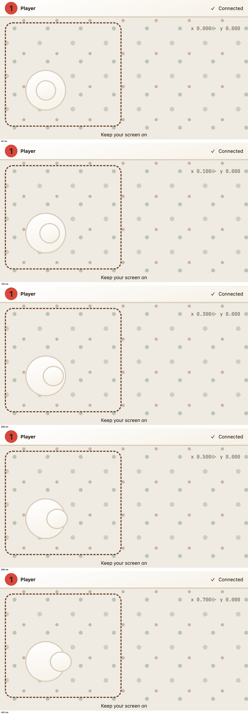 | | |
| 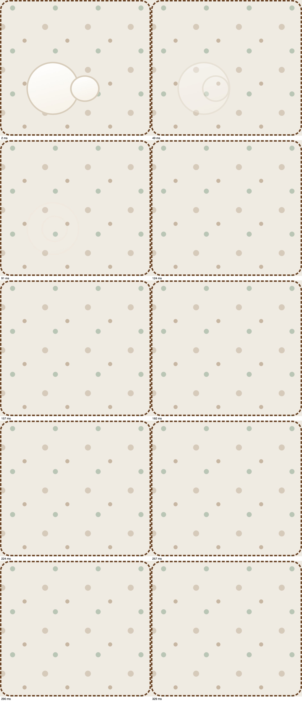 | | |

| Acceptance statement | Pass / fail | Evidence |
|---|---|---|
| | | |

## Integrator's note (2026-11-17)
The stick's own UAT, run unchanged on the K-03 branch after the integrator merged K-02 in and
put the buttons behind `?controls=buttons`: exit 0, every step passed. This shows the merged
controller demo still serves the stick by default. Images not re-examined beyond the pass;
the stick's visual evidence is K-02 round 4.
