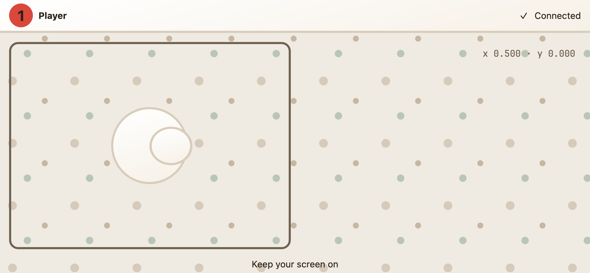

# K-02-left-stick UAT evidence

Automated execution only. Visual review and acceptance decisions are pending.

Command: `node tools/uat/run.mjs -- K-02-left-stick --phones 1`
Commit: `c2c209ce88b0b5643f16792c46952c5f25566da9`
Viewports: 844×390

| Timing | ms | Status |
|---|---:|---|
| 844x390 touch tracking, rubber-band and multi-touch | 654.8 | failed |

Expected errors (count):
None

## Real server

| Screenshot | What it shows | Looked at by |
|---|---|---|
|  | | |
|  | | |

| Acceptance statement | Pass / fail | Evidence |
|---|---|---|
| | | |

## Integrator's look (2026-11-17)
Failed at "Knob tracks without tweening". Opened 05-phone1-failure.png: the knob sits right of
centre, stretched in its direction of travel; readout x 0.500. Probe in Chromium at 844 × 390
(touch emulation, CDP touch events): while held the knob's transition-duration is 0s and it
has no running animations; after a move to +30 the knob read +20 because Chromium delivers
pointermove aligned to animation frames, so the script read before the event arrived. The
component is right; the script must wait for each move to be delivered before comparing.
