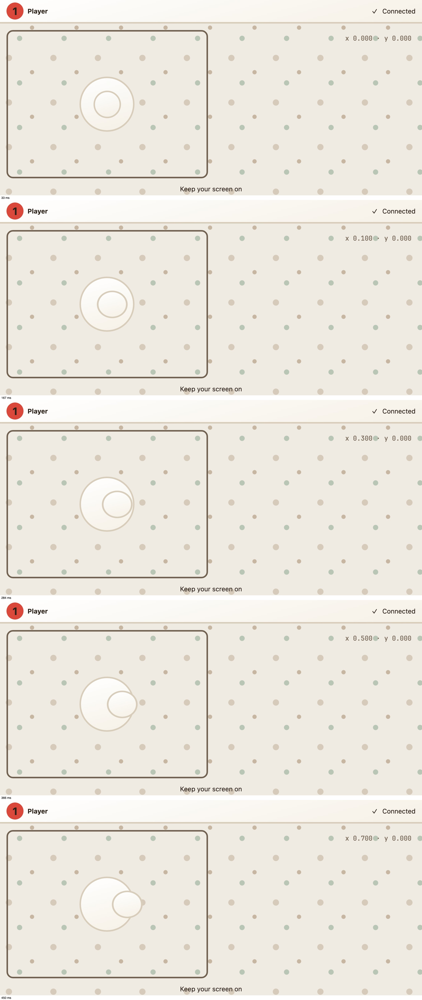
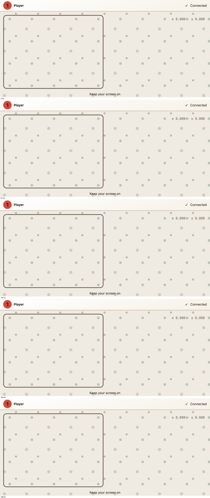
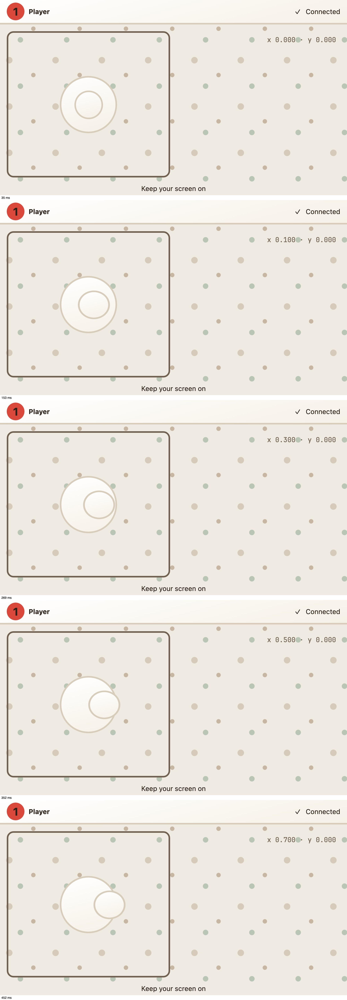
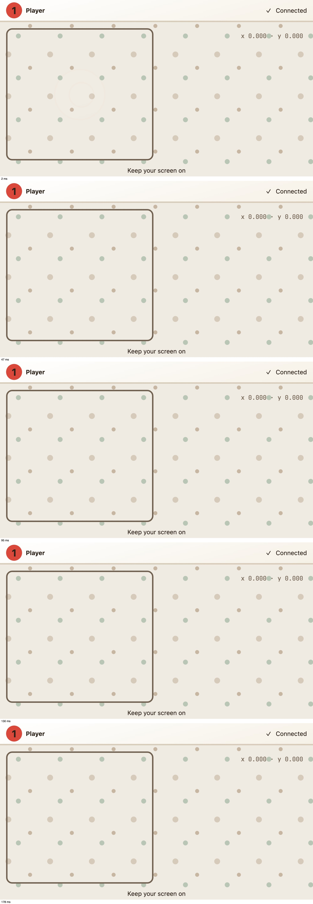
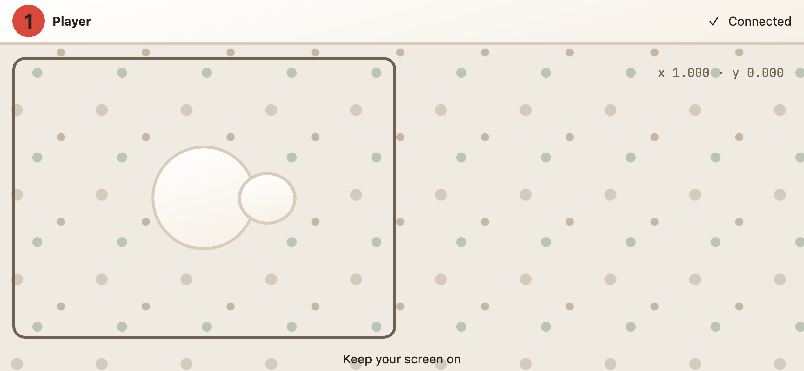
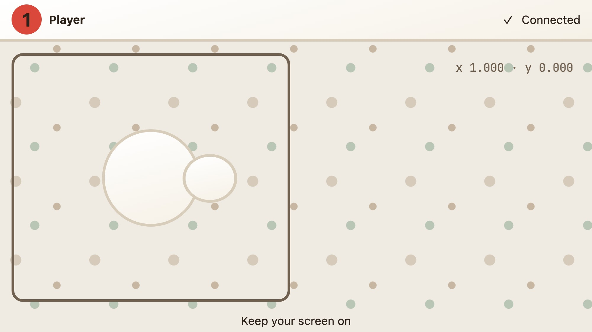
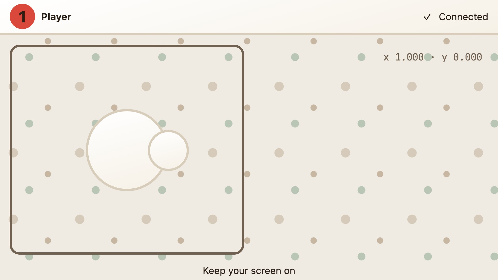
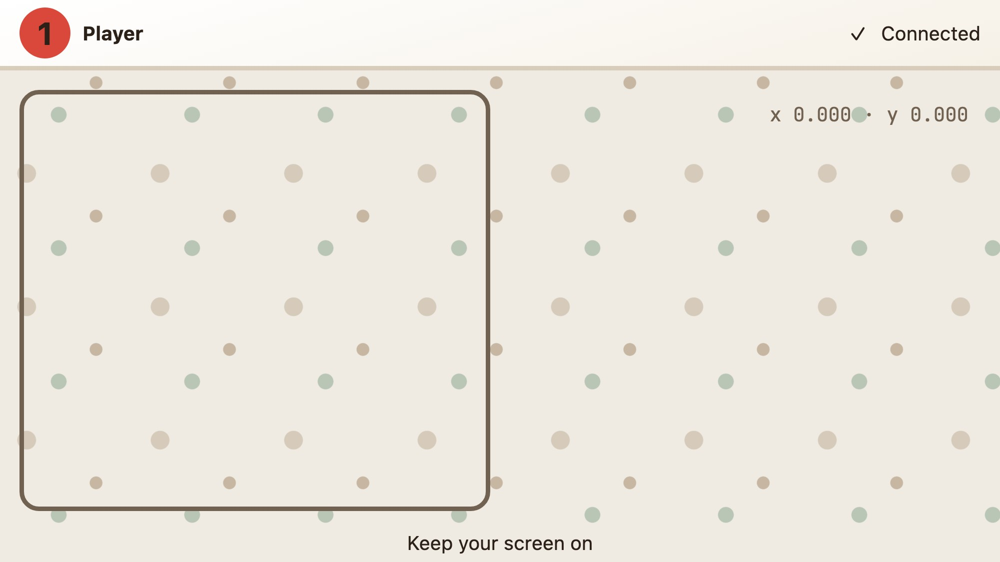

# K-02-left-stick UAT evidence

Automated execution only. Visual review and acceptance decisions are pending.

Command: `node tools/uat/run.mjs -- K-02-left-stick --phones 1`
Commit: `bbf2fd0b32d3d0f4a03a16a1410627c75e6cfd15`
Viewports: 844×390, 667×375

| Timing | ms | Status |
|---|---:|---|
| 844x390 touch tracking, rubber-band and multi-touch | 1840.7 | completed |
| 667x375 touch tracking, rubber-band and multi-touch | 1493.1 | completed |
| Reduced motion keeps values and removes stretch and release animation | 399.0 | completed |

Expected errors (count):
None

## Strips

| Screenshot | What it shows | Looked at by |
|---|---|---|
|  | | |
|  | | |
|  | | |
|  | | |

## Real server

| Screenshot | What it shows | Looked at by |
|---|---|---|
|  | | |
|  | | |
|  | | |
|  | | |
|  | | |
|  | | |

| Acceptance statement | Pass / fail | Evidence |
|---|---|---|
| | | |

## Integrator's look (2026-11-17)
Run: `pnpm uat -- K-02-left-stick --phones 1`, exit 0, no browser errors, no process left.
Opened k02-a.jpg, every still, and the 844 tracking and release strips at full height.
- Tracking (06, 20): the knob follows each move with the readout (0.100, 0.300, 0.500,
  0.700) and stretches along its direction of travel; transition 0s and no animations while
  held (asserted after each move is delivered).
- Rubber-band (07, 21): the knob sits just past the base edge at readout 1.000.
- Second touch (08, 22): a finger elsewhere does not move or steal the stick; lifting it
  leaves the stick held.
- Release (14, 28): the base fades and the knob is back at centre within about 60 ms.
- Reduced motion (29, 30): no stretch while held; nothing shown after release.
Integrator's fixes at UAT, both small: the script lifted only the second finger with a CDP
touchEnd that listed the first (CDP touchEnd carries no points, so Chromium lifted both); it
now sends a touchMove without finger 2. Chromium logged "Ignored attempt to cancel a touchmove
event with cancelable=false" from K-01's page lock (lock.ts): it now cancels a multi-touch move
only when the event is cancelable (touch-action none and the cancelable moves still stop zoom).
Not checked: real iPhone and Android (K-07).
