# K-02-left-stick UAT evidence

Automated execution only. Visual review and acceptance decisions are pending.

Command: `node tools/uat/run.mjs -- K-02-left-stick --phones 1`
Commit: `1aefd83406ffd1fb4827a34aac95092f09d472c0`
Viewports: 844×390, 667×375

| Timing | ms | Status |
|---|---:|---|
| 844x390 touch tracking, rubber-band and multi-touch | 3373.1 | completed |
| 667x375 touch tracking, rubber-band and multi-touch | 2860.7 | completed |
| Reduced motion keeps values and removes stretch and release animation | 397.6 | completed |

Expected errors (count):
None

## Real server

| Screenshot | What it shows | Looked at by |
|---|---|---|
| 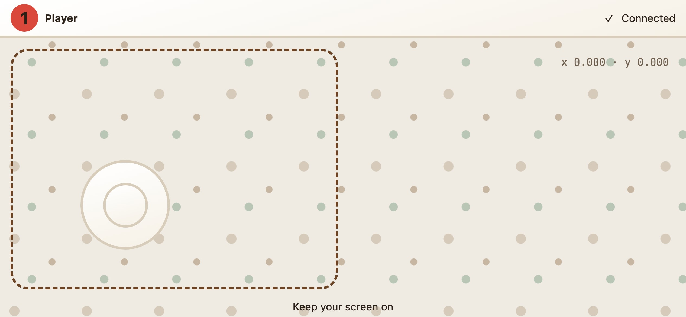 | | |
| 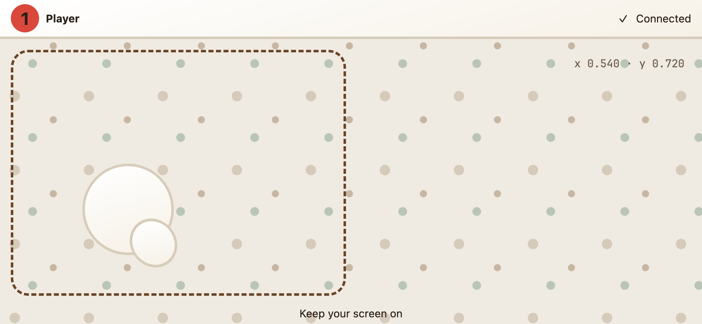 | | |
| 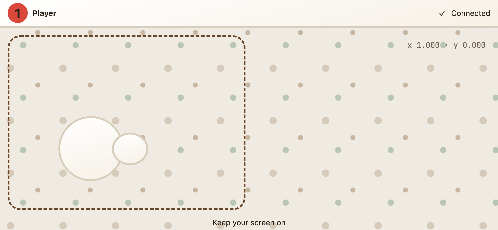 | | |
|  | | |
| 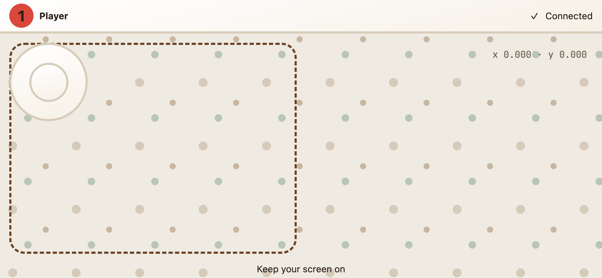 | | |
| 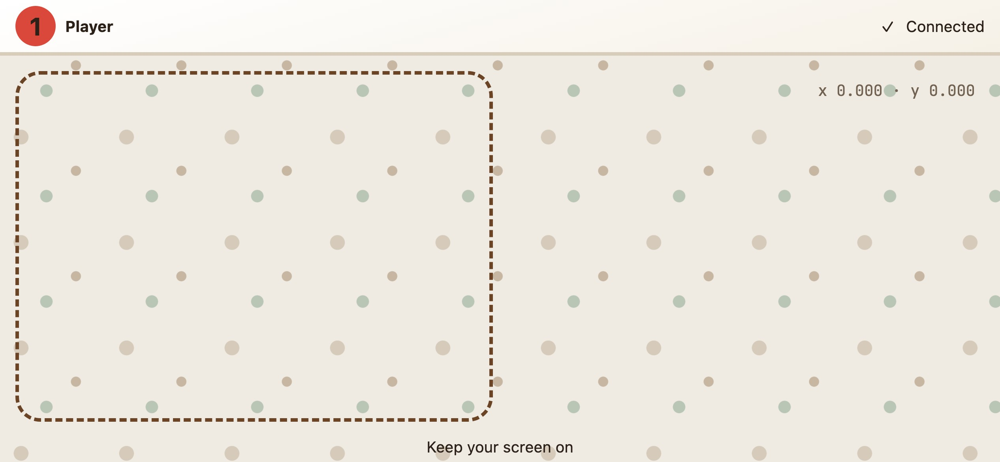 | | |
| 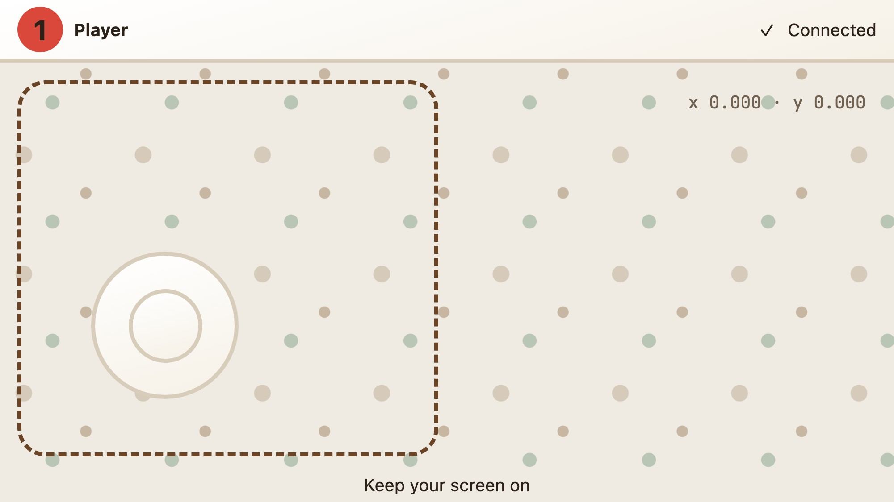 | | |
| 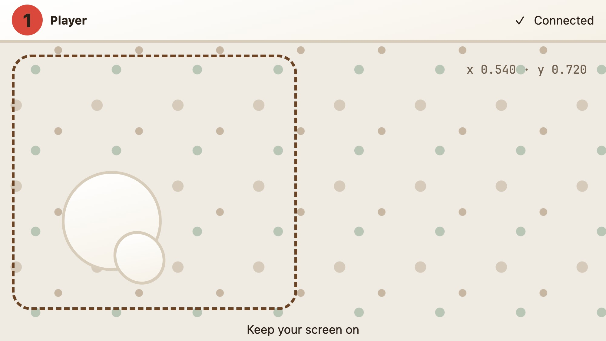 | | |
| 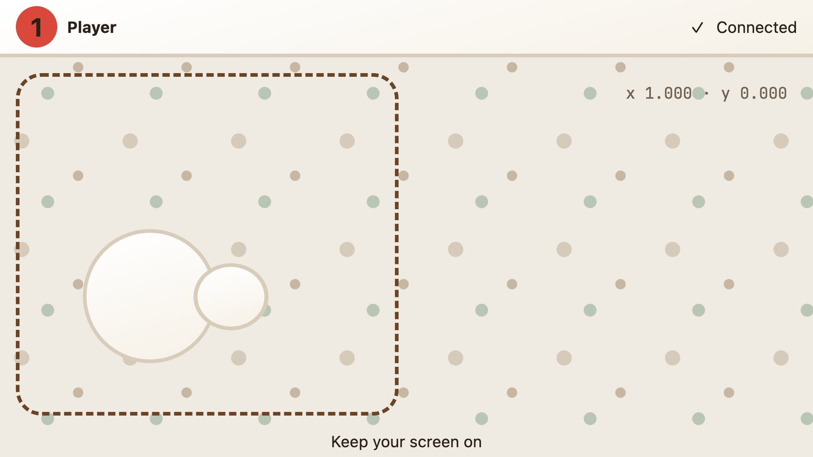 | | |
|  | | |
| 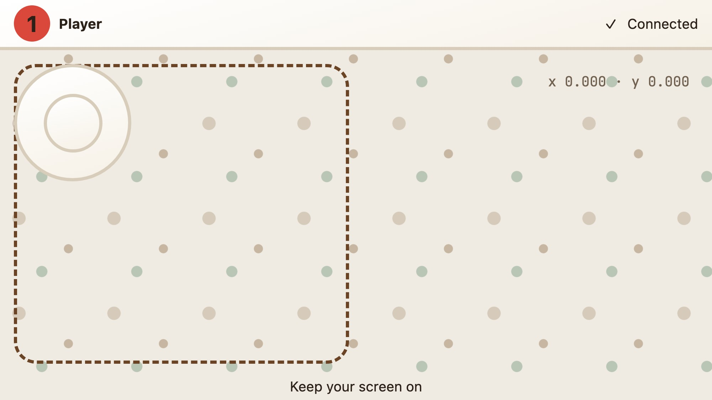 | | |
| 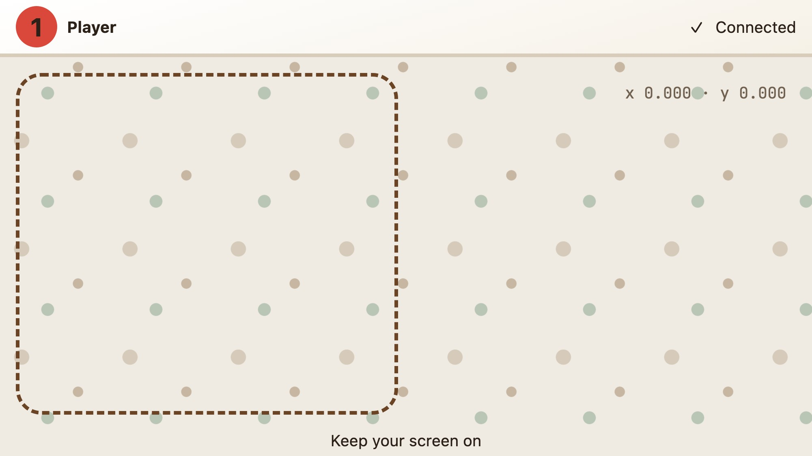 | | |
| 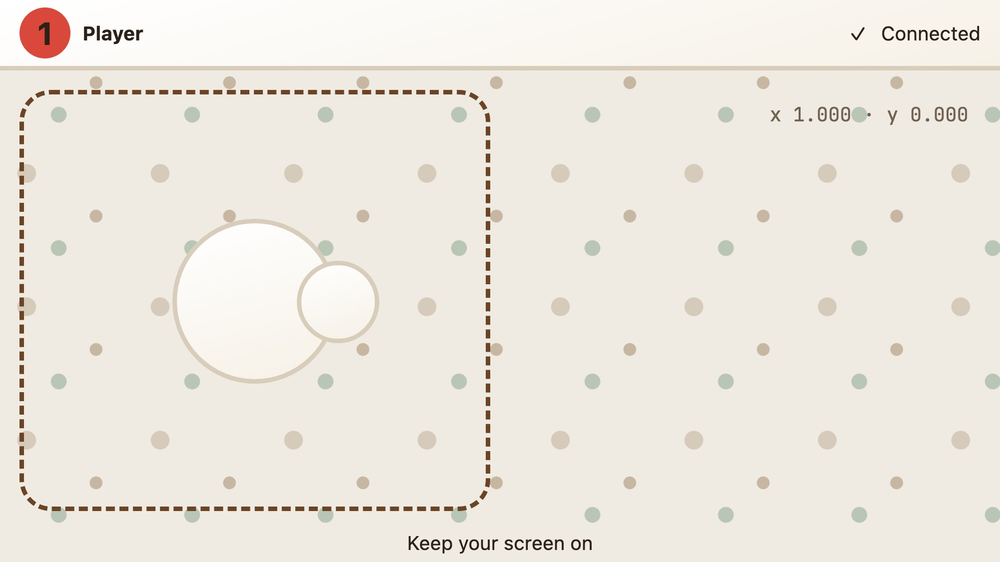 | | |
|  | | |

## Strips

| Screenshot | What it shows | Looked at by |
|---|---|---|
| 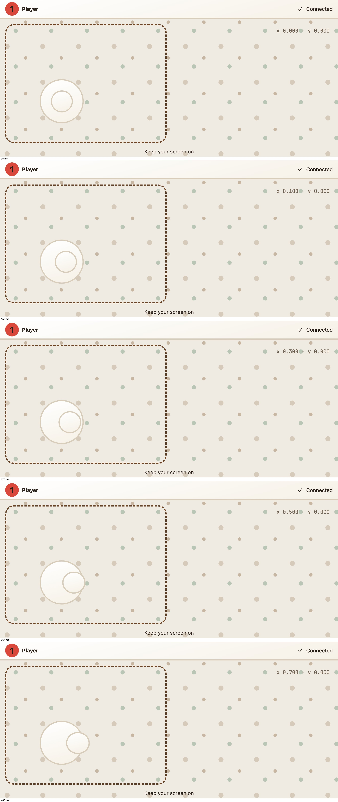 | | |
|  | | |
| 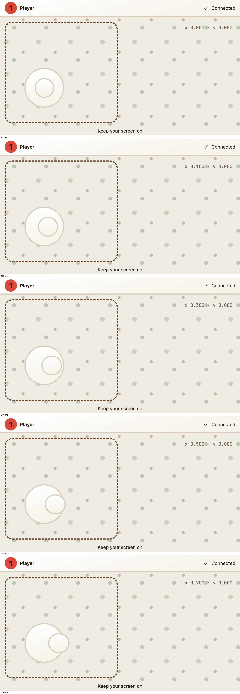 | | |
|  | | |

| Acceptance statement | Pass / fail | Evidence |
|---|---|---|
| | | |

## Integrator's look (2026-11-17)
Run: `pnpm uat -- K-02-left-stick --phones 1`, exit 0, no browser errors, no process left.
Opened k02r3-a.jpg (off-centre, diagonal, rubber-band, edge landing, touch cancel, reduced
motion held) and the 844 release strip at full height (k02r3-release.jpg is it at one third).
- Floating (01, 24): the base sits where the touch landed, well off the area's centre.
- Diagonal (08, 31): readout x 0.540, y 0.720 and the knob down and to the right, stretched
  along that line.
- Rubber-band (09, 32): readout 1.000, the knob just past the base edge.
- Edge landing (22, 45): a touch at the area's corner puts the base fully inside the area
  (clamped), touching the dashed outline.
- Touch cancel (23, 46): nothing shown, readout 0.
- Outline: dashed, in the stick-outline token.
- Release strip (21): frame 1 (2 ms) held at full deflection and stretched; frame 2 (63 ms)
  the base faded to a ghost and the knob almost back at centre; frame 3 (116 ms) gone. The
  return is captured, but only one in-between frame: the strip samples about every 50 ms, not
  the 16 to 34 ms asked.
- Reduced motion (47): a round knob at 1.000, no stretch.
Not checked: real phones (K-07); PERF-012 is not assessed by this UAT (it waits for each move).
