# K-02-left-stick UAT evidence

Automated execution only. Visual review and acceptance decisions are pending.

Command: `node tools/uat/run.mjs -- K-02-left-stick --phones 1`
Commit: `1fc4a98c1383ff7e1628eb71b4684ddd121d3956`
Viewports: 844×390, 667×375

| Timing | ms | Status |
|---|---:|---|
| 844x390 touch tracking, rubber-band and multi-touch | 3006.2 | completed |
| 667x375 touch tracking, rubber-band and multi-touch | 2700.1 | completed |
| Reduced motion keeps values and removes stretch and release animation | 413.4 | completed |

Expected errors (count):
None

## Real server

| Screenshot | What it shows | Looked at by |
|---|---|---|
| 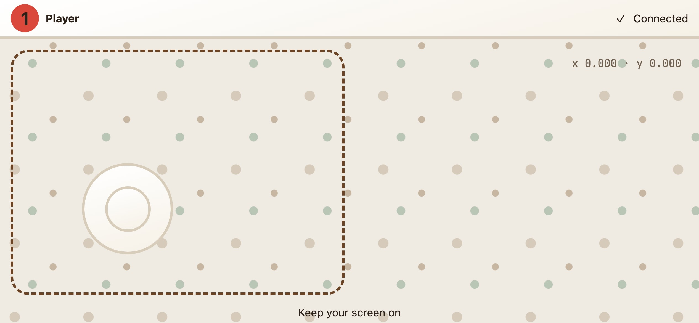 | | |
| 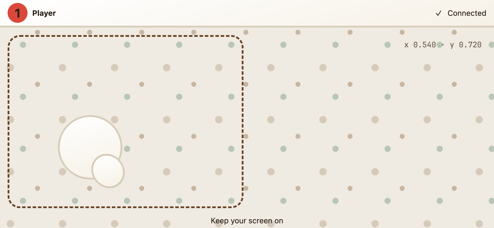 | | |
| 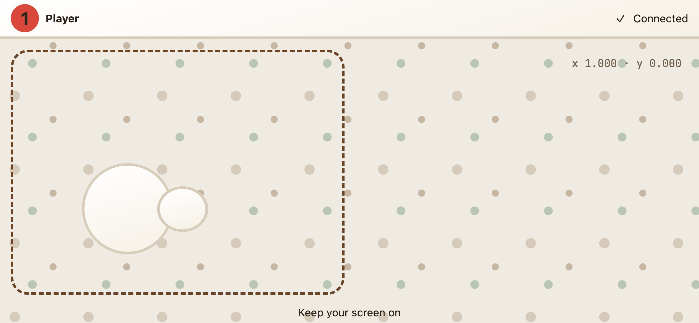 | | |
|  | | |
| 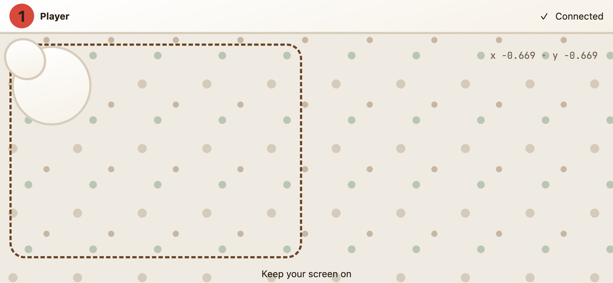 | | |
| 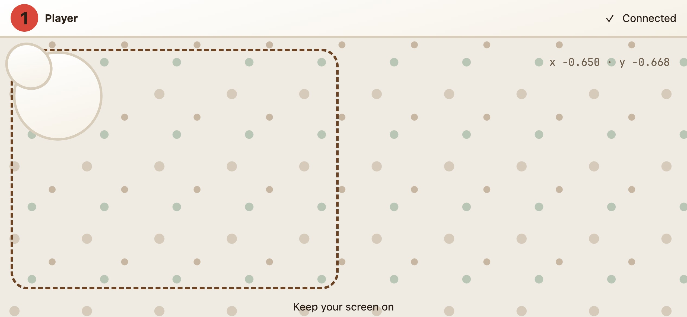 | | |
| 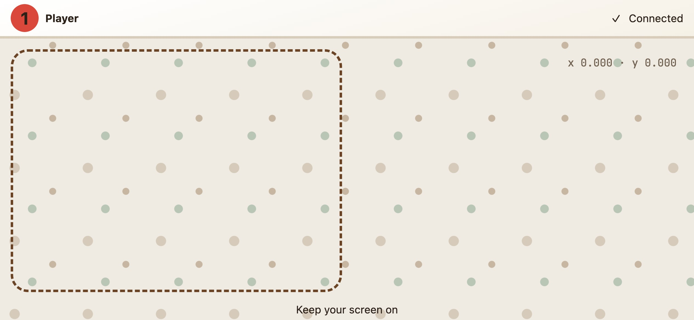 | | |
| 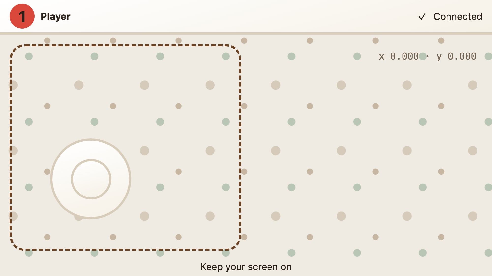 | | |
| 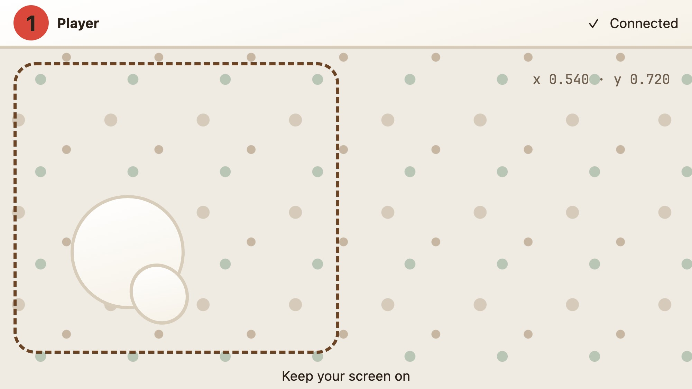 | | |
| 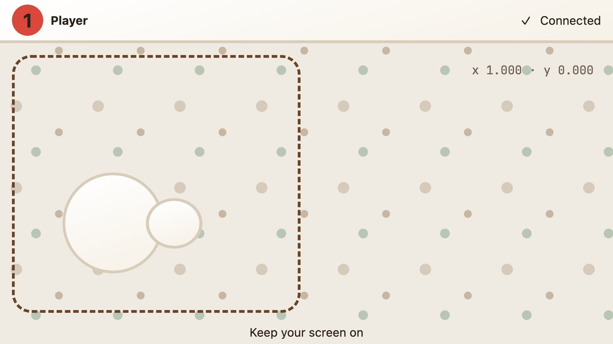 | | |
|  | | |
| 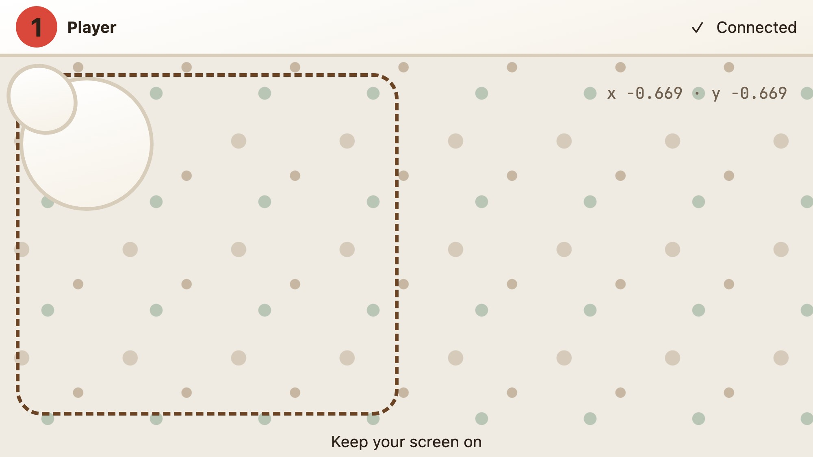 | | |
|  | | |
|  | | |
| 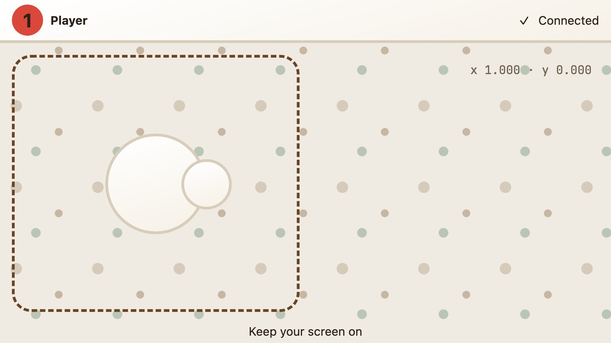 | | |
| 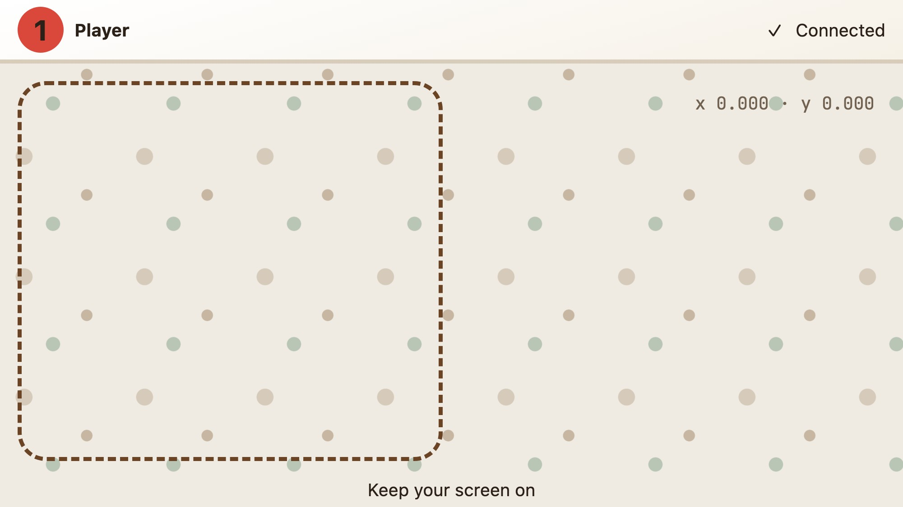 | | |

## Strips

| Screenshot | What it shows | Looked at by |
|---|---|---|
| 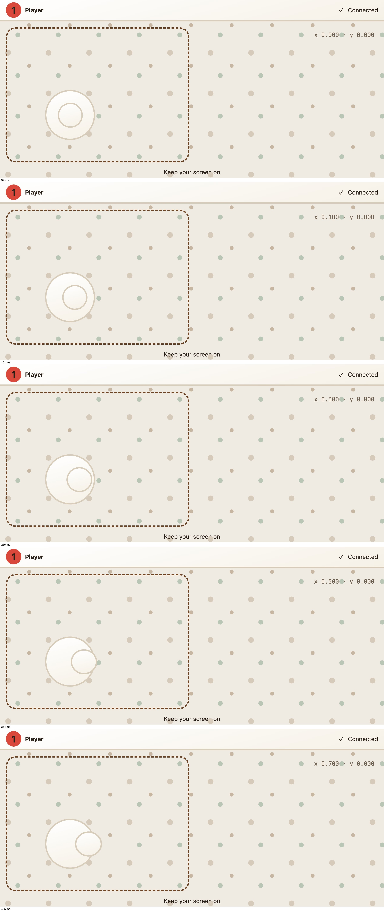 | | |
| 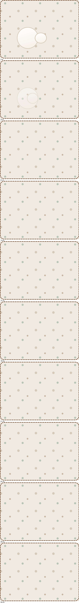 | | |
| 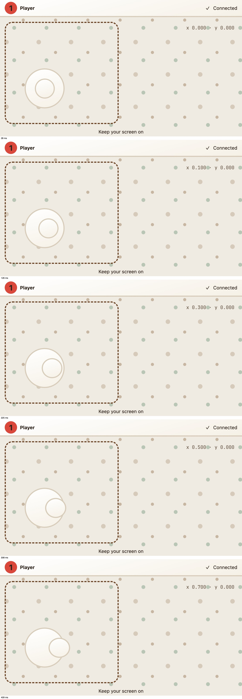 | | |
| 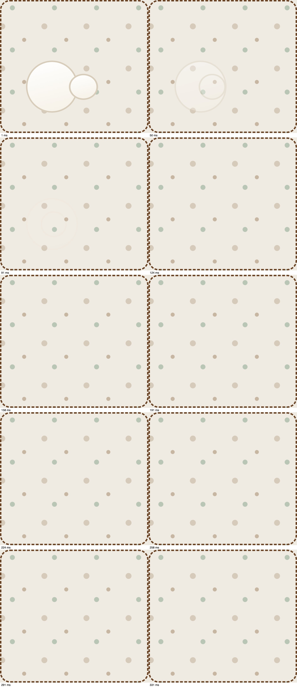 | | |

| Acceptance statement | Pass / fail | Evidence |
|---|---|---|
| | | |

## Integrator's look (2026-11-17)
Run: `pnpm uat -- K-02-left-stick --phones 1`, exit 0, no process left. Opened k02r4-a.jpg
(edge landing and 1 px move at 844 and 667, off-centre, reduced motion released) and the 844
release strip (clipped to the stick area) at full size.
- Edge landing (22, 46): the base is moved inside the dashed outline and the knob sits under
  the thumb at the corner from the first frame; readout x -0.669, y -0.669 (D-116).
- 1 px move (23, 47): readout -0.650, -0.668: a small change, no jump.
- Release strip (21): 2 ms held and stretched; 43 ms the knob part-way back with base and
  knob fading; 84 ms nearly at centre and faint; 118 ms gone. Frames land 31 to 41 ms apart.
- Off-centre landing (01) and reduced motion released (50) as before.
Note: at the corner the knob, being under the thumb, sits partly outside the dashed outline;
the base itself is inside.
Not checked: real phones (K-07); PERF-012 not assessed here.
Correction (integrator, after review): the 667 release strip (45) has a 49 ms gap between its
first two frames; the 844 strip's gaps are 31 to 41 ms. The release's eased path is proven by
the UAT's per-frame transform samples (strictly decreasing, settled by 149 ms), not by the
strips alone.
