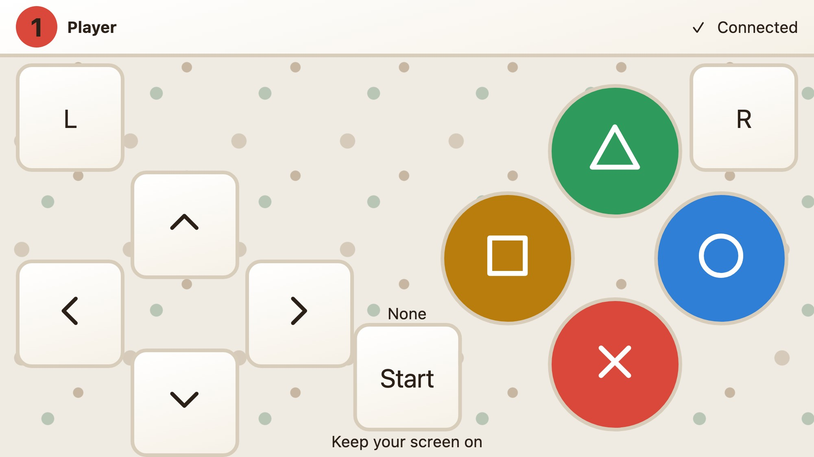
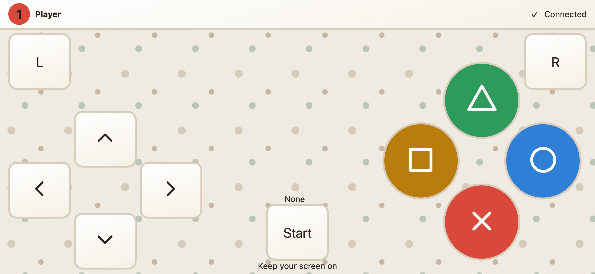
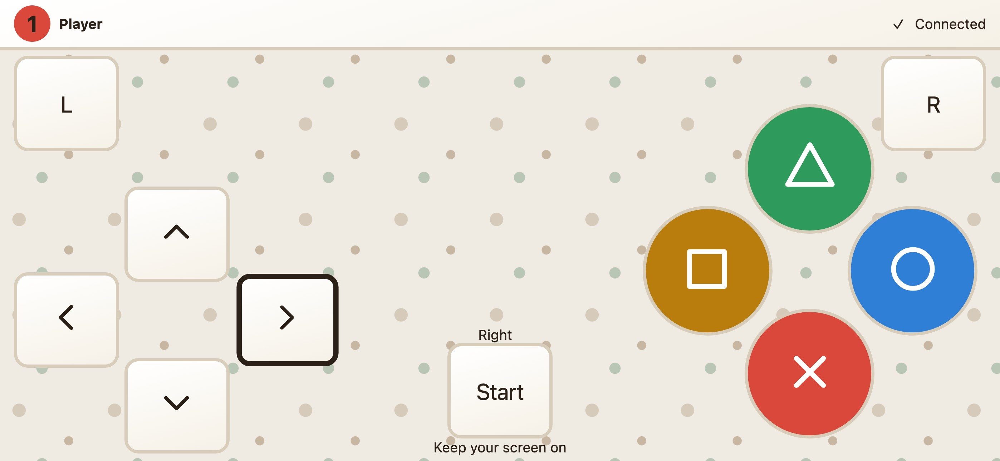
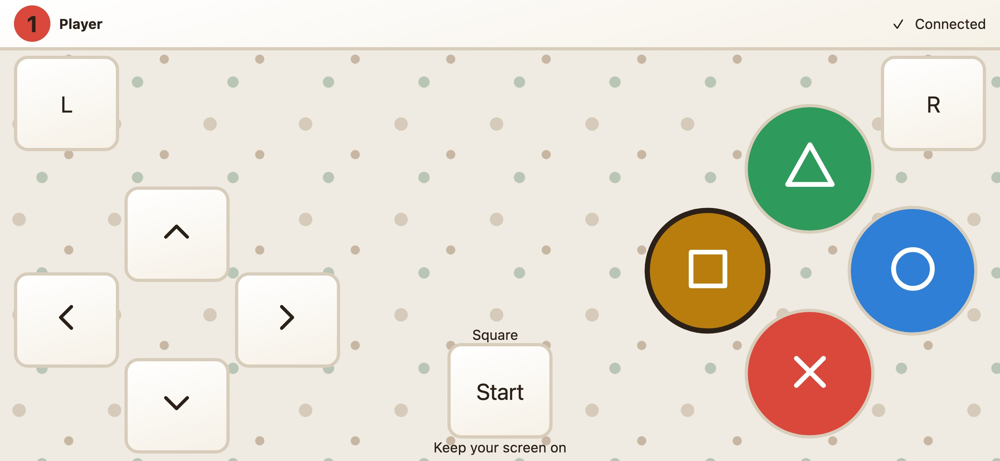
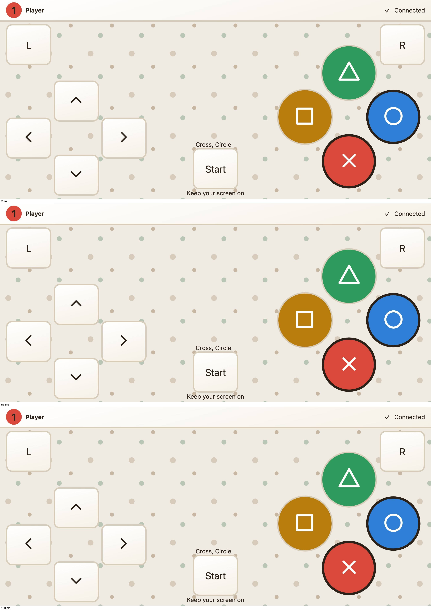

# K-03-buttons UAT evidence

Automated execution only. Visual review and acceptance decisions are pending.

Command: `node tools/uat/run.mjs -- K-03-buttons --phones 1`
Commit: `584f2a8f31eb42b9e378ecc9899fbed6bbce334c`
Viewports: 667×375, 844×390, 932×430

| Timing | ms | Status |
|---|---:|---|
| layout-667x375 | 602.2 | completed |
| layout-844x390 | 261.4 | completed |
| layout-932x430 | 261.8 | completed |
| Two simultaneous face presses and first-frame feedback | 348.4 | completed |
| D-pad slide switches directions | 447.0 | completed |
| Reduced motion retains immediate pressed state | 166.7 | completed |

Expected errors (count):
None

## Real server

| Screenshot | What it shows | Looked at by |
|---|---|---|
|  | | |
|  | | |
|  | | |
|  | | |
|  | | |

## Strips

| Screenshot | What it shows | Looked at by |
|---|---|---|
|  | | |

| Acceptance statement | Pass / fail | Evidence |
|---|---|---|
| | | |

## Integrator's look (2026-11-17)
Run: `pnpm uat -- K-03-buttons --phones 1`, exit 0, no browser errors, no process left (after
the integrator's harness fix below). Opened k03-a.jpg, 02-phone1-layout-844 at full size, and
the press strip.
Works: the shape diamond (cross red, circle blue, square amber, triangle green, white shapes,
no letters); two face buttons held at once; a finger sliding off Cross releases it; the D-pad
switches Up to Right on a slide; a press is 0.97 in the first frame; reduced motion keeps the
pressed state.
Faults to fix:
1. No edge margin: the D-pad's Down button reaches the bottom edge at 667, 844 and 932 wide,
   and would sit under an iPhone's home indicator; keep a margin from the φ scale and the
   safe-area insets on every edge.
2. Crowding: Triangle nearly touches R at all three widths; "Keep your screen on" sits
   directly under Start where a thumb lands.
3. Pressed style: a pressed button gets a thick dark ink ring (08, 09). The decided style is
   3A, filled colour with a press shown by scale 0.97 and a vibration (DESIGN §4.4); the ring
   is not part of it.
Integrator's fix at UAT: tools/uat/thumb.ts `dispose()` sent touchCancel with no touch in
progress, which CDP rejects ("Must send a TouchStart first"); it now cancels only when a finger
is down, with the harness test updated for both cases. All six steps had passed before it.
Not checked: real phones (K-07); vibration (headless Chromium).
