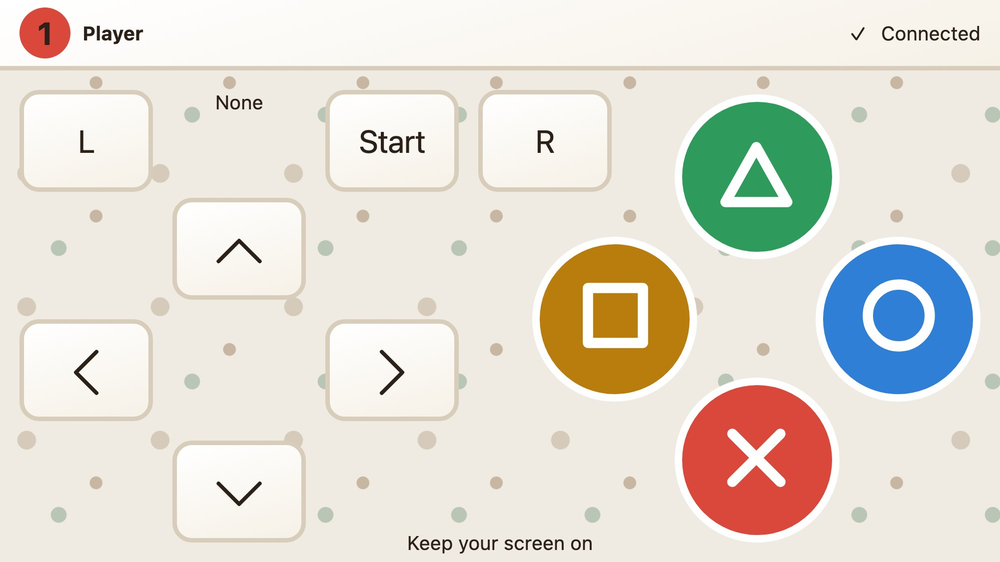
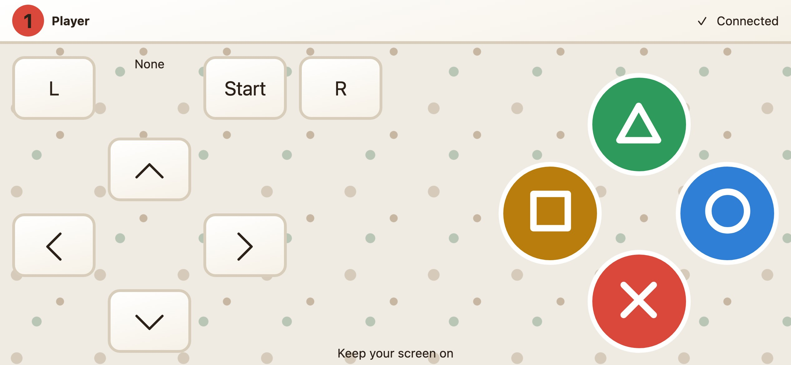
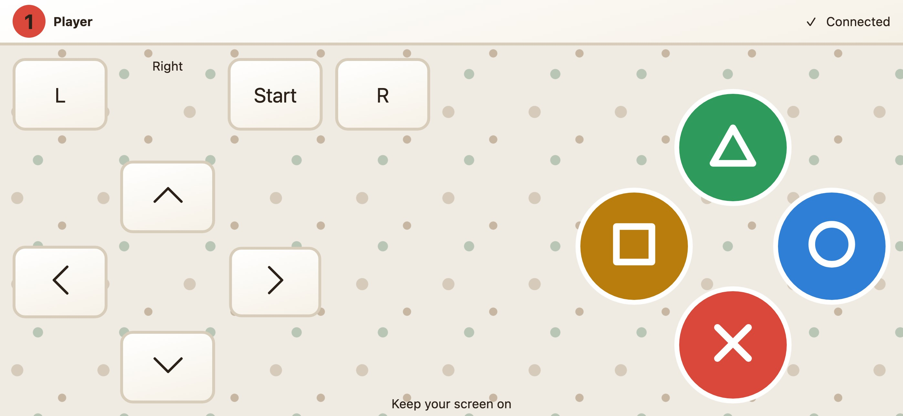
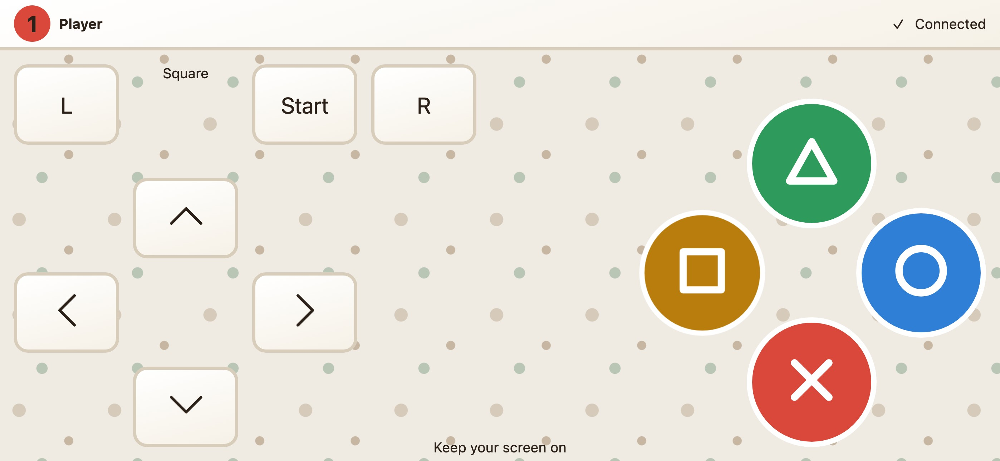
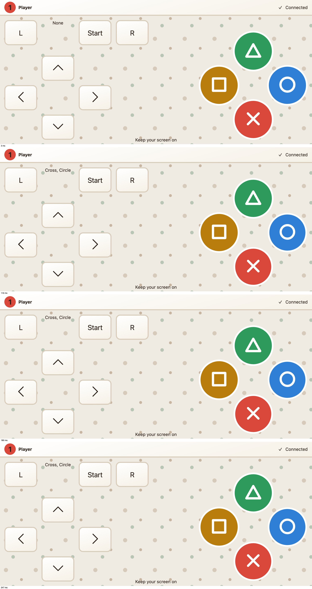

# K-03-buttons UAT evidence

Automated execution only. Visual review and acceptance decisions are pending.

Command: `node tools/uat/run.mjs -- K-03-buttons --phones 1`
Commit: `9bfb567c885543a26abc6f3ccde546dd63a8a404`
Viewports: 667×375, 844×390, 932×430

| Timing | ms | Status |
|---|---:|---|
| layout-667x375 | 630.0 | completed |
| layout-844x390 | 326.6 | completed |
| layout-932x430 | 295.9 | completed |
| Two simultaneous face presses and first-frame feedback | 653.1 | completed |
| Twenty first-animation-frame samples across controls | 1212.8 | completed |
| Release strip begins while held and eases out | 1411.8 | completed |
| Trusted touchCancel and hidden visibility release held inputs | 51.6 | completed |
| D-pad slide switches directions | 431.4 | completed |
| Reduced motion retains immediate pressed state | 319.4 | completed |

Expected errors (count):
None

## Real server

| Screenshot | What it shows | Looked at by |
|---|---|---|
|  | | |
|  | | |
|  | | |
|  | | |
|  | | |

## Strips

| Screenshot | What it shows | Looked at by |
|---|---|---|
|  | | |
|  | | |

| Acceptance statement | Pass / fail | Evidence |
|---|---|---|
| | | |

## Integrator's look (2026-11-17)
Run: `pnpm uat -- K-03-buttons --phones 1`, exit 0, no process left. Opened k03r2-a.jpg,
01-phone1-layout-667 at full size, and both strips (k03r2-08 and k03r2-21 are them at a third).
Fixed: controls at their own sizes (D-pad keys about 89 × 68); white rims on the face
buttons; no pressed ring; shapes thick and matching the TV's; L, Start and R along the top;
every control at least 13 px from its neighbours and the edges at 667 (D-pad Down about 14 px
from the bottom, Cross about 13 px, Square about 17 px from D-pad Right).
Faults:
1. Chrome's blue tap highlight shows on a pressed control: a light-blue square over Start in
   frame 1 of the release strip and over Cross in frames 2 and 3. Kit controls need
   `-webkit-tap-highlight-color: transparent`.
2. The strips cannot show what they claim: frames land about 60 to 115 ms apart (3 ms then
   116 ms in the press strip), not 16 ms, so "pressed in the next frame" and the eased release
   are not visible; the in-page frame records are the only proof. The 0.97 press is too small
   to see at full-page scale.
Not checked: real phones (K-07); vibration (headless).
