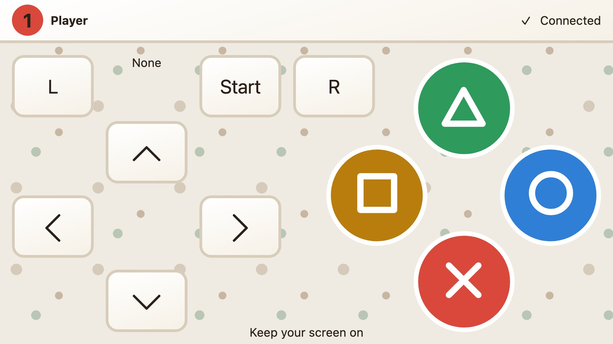
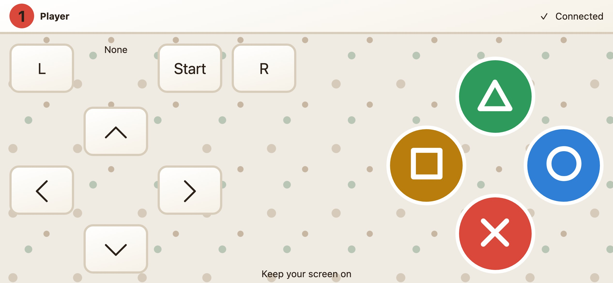
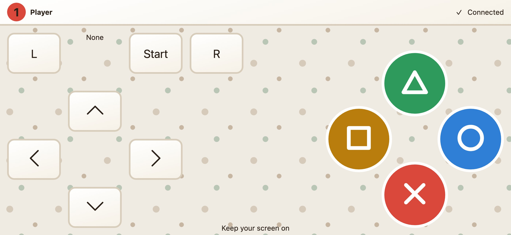
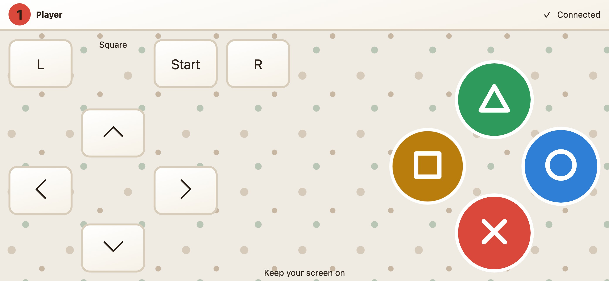
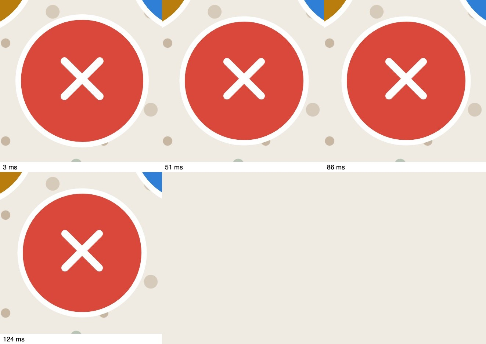
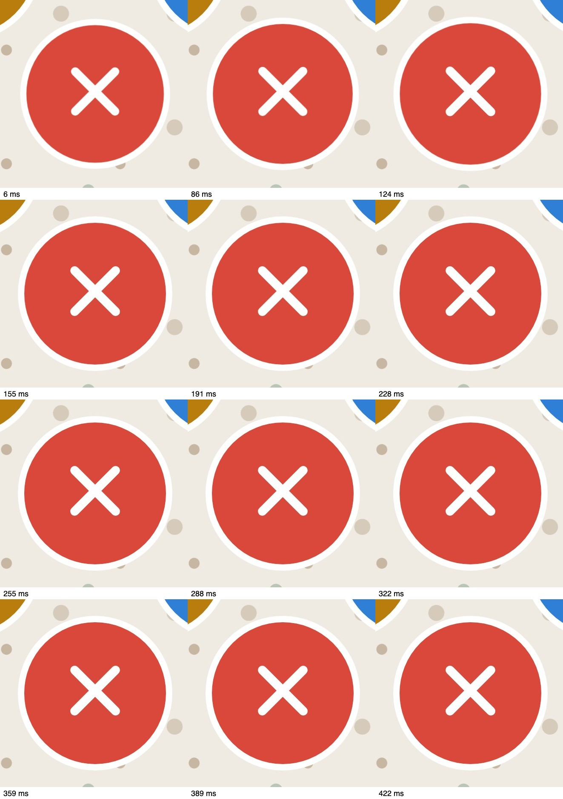
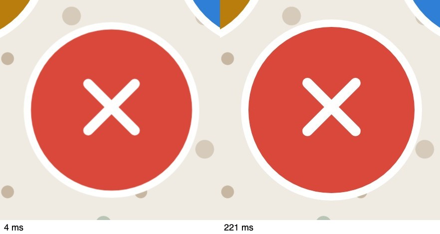

# K-03-buttons UAT evidence

Automated execution only. Visual review and acceptance decisions are pending.

Command: `node tools/uat/run.mjs -- K-03-buttons --phones 1`
Commit: `a7c707954c9609986235deddcdb216ca9563cd1e`
Viewports: 667×375, 844×390, 932×430

| Timing | ms | Status |
|---|---:|---|
| layout-667x375 | 641.0 | completed |
| layout-844x390 | 299.0 | completed |
| layout-932x430 | 276.9 | completed |
| Two simultaneous face presses and first-frame feedback | 330.2 | completed |
| Twenty first-animation-frame samples across controls | 1199.1 | completed |
| Release strip begins while held and eases out | 540.1 | completed |
| Close-up Cross held and at rest, side by side | 317.5 | completed |
| Trusted touchCancel and hidden visibility release held inputs | 55.5 | completed |
| D-pad slide switches directions | 451.4 | completed |
| Reduced motion retains immediate pressed state | 315.3 | completed |

Expected errors (count):
None

## Real server

| Screenshot | What it shows | Looked at by |
|---|---|---|
|  | | |
|  | | |
|  | | |
|  | | |
|  | | |

## Strips

| Screenshot | What it shows | Looked at by |
|---|---|---|
|  | | |
|  | | |
|  | | |

| Acceptance statement | Pass / fail | Evidence |
|---|---|---|
| | | |

## Integrator's look (2026-11-17)
Run: `pnpm uat -- K-03-buttons --phones 1`, exit 0, no process left. Opened the three strips
at full size (press, release, held-and-rest close-up).
- Press (08): frame 1 (3 ms) at rest, Cross about 360 px across at 3x; frame 2 (51 ms) and
  after pressed, about 350 px (0.97). No ring, no tap highlight.
- Release (21): 6 ms pressed (350), 86 ms in between (355), 124 ms at rest (360): one
  in-between frame; the release eases and is done by about 124 ms.
- Close-up (24): held on the left visibly smaller than at rest on the right.
- The UAT asserts the tap highlight is transparent on every control.
Integrator's fix to the UAT script: the round-3 check that screenshot captures land at most
34 ms apart measured the test runner's capture speed, which depends on machine load (46 ms
with two reviews running); it now reports the spacing (48, 34, 38, 80, 38, 31, 36, 36, 28,
33, 33, 38, 29, 34 ms this run) and the frames' content checks stay the proof. This run
printed through console.log; the committed script uses process.stdout (lint), same output.
Not checked: real phones (K-07); vibration (headless); PERF-012 by the perf harness.
