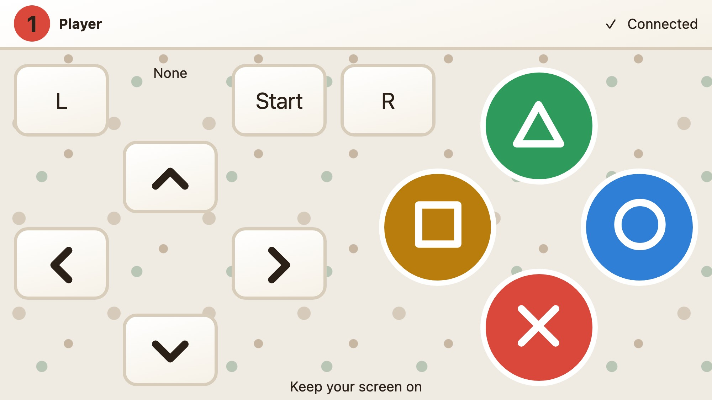
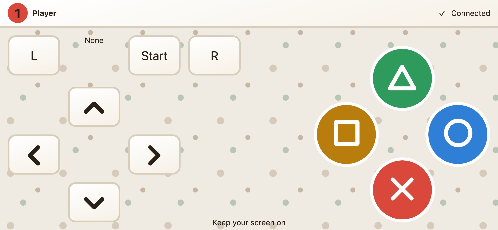
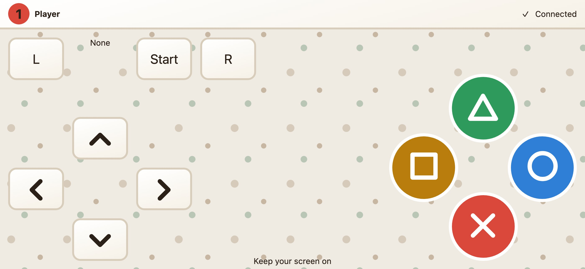
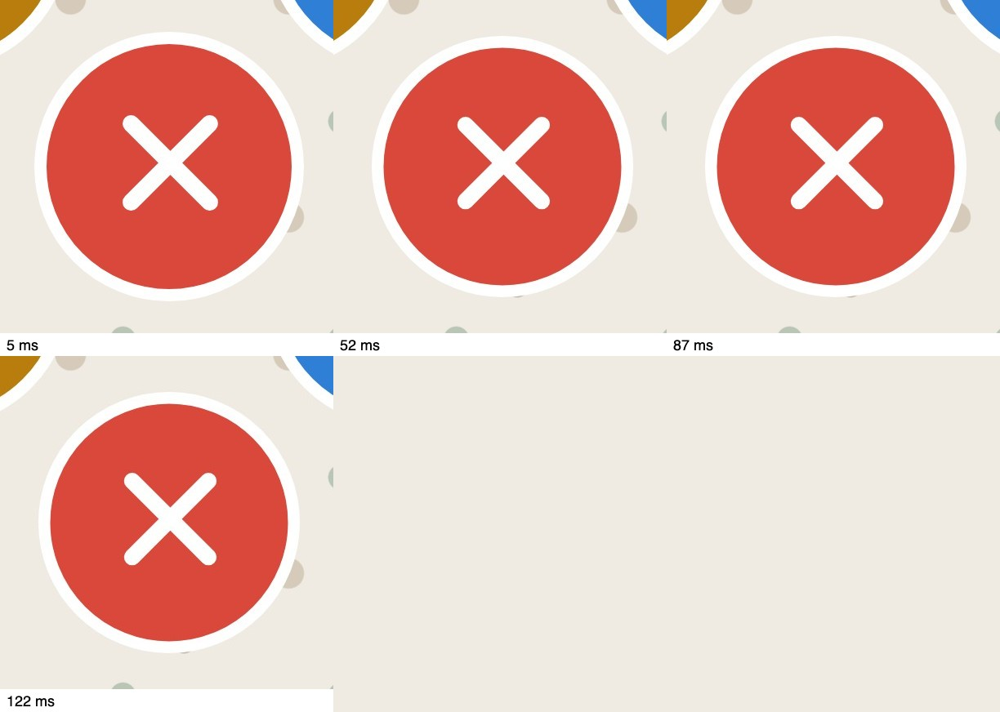
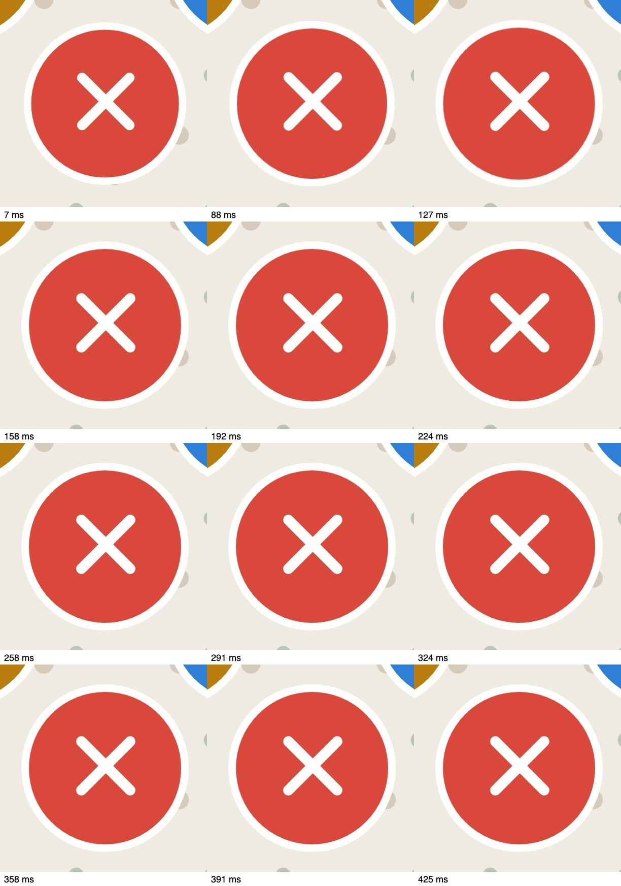
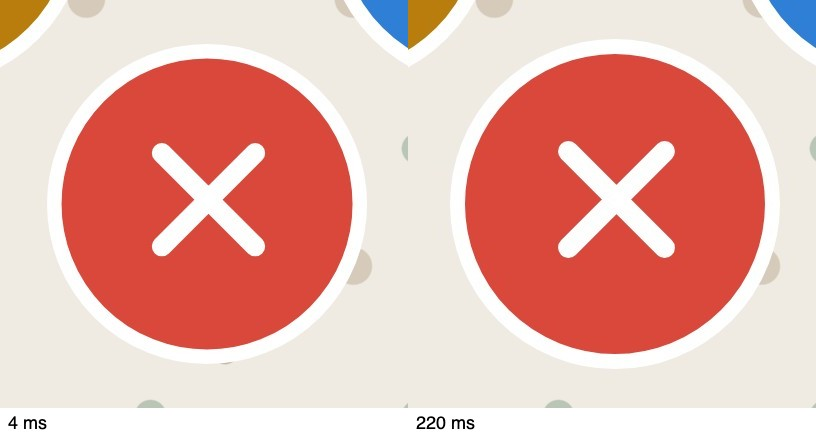

# K-03-buttons UAT evidence

Automated execution only. Visual review and acceptance decisions are pending.

Command: `node tools/uat/run.mjs -- K-03-buttons --phones 1`
Commit: `f8e3c95410ec47cf22235144601a910feed6cf48`
Viewports: 667×375, 844×390, 932×430

| Timing | ms | Status |
|---|---:|---|
| layout-667x375 | 463.8 | completed |
| layout-844x390 | 293.0 | completed |
| layout-932x430 | 260.9 | completed |
| Press vibrates once with HAPTIC_TICK_MS; release does not | 211.6 | completed |
| Empty D-pad centre captures a slide onto Right | 317.2 | completed |
| Cross stays held moving from 2 px inside rim to 1 px inside | 247.9 | completed |
| Two simultaneous face presses and first-frame feedback | 334.1 | completed |
| Twenty first-animation-frame samples across controls | 1200.3 | completed |
| Release strip begins while held and eases out | 530.2 | completed |
| Release run notes: 1 visibly intermediate frames (0.97 < scale < 0.995); per-frame scales [0.97,0.97,0.986441,0.997354,0.999563,0.999972,1,1,1,1,1,1] | 0.1 | completed |
| Close-up Cross held and at rest, side by side | 313.9 | completed |
| Trusted touchCancel and hidden visibility release held inputs | 64.3 | completed |
| D-pad slide switches directions | 448.3 | completed |
| Reduced motion retains immediate pressed state | 317.6 | completed |

Expected errors (count):
None

## Real server

| Screenshot | What it shows | Looked at by |
|---|---|---|
|  | | |
|  | | |
|  | | |
|  | | |
|  | | |

## Strips

| Screenshot | What it shows | Looked at by |
|---|---|---|
|  | | |
|  | | |
|  | | |

| Acceptance statement | Pass / fail | Evidence |
|---|---|---|
| | | |

## Integrator's look (2026-11-17)
Run: `pnpm uat -- K-03-buttons --phones 1` (on `/play?demo=controller&controls=buttons`, after
the integrator merged K-02 into this branch), exit 0, all 15 steps completed, no process left.
Opened 02-phone1-layout-844 and 21-strip-release at full size.
- 844 layout: L, Start, R along the top; D-pad keys about 89 × 68 with chevrons now drawn as
  thick as the face shapes; face diamond with white rims; every control clear of its
  neighbours, the edges and "Keep your screen on".
- Release strip: 7 ms pressed, 88 ms between, 127 ms at rest, then unchanged; the run notes
  say one visibly in-between frame, which matches the picture.
- New steps passed: vibration once with HAPTIC_TICK_MS on press and none on release; landing
  in the D-pad's empty centre then sliding onto Right holds Right; Cross held 2 px inside its
  rim stays held moving 1 px.
Not checked: real phones (K-07); PERF-012 by the perf harness.
