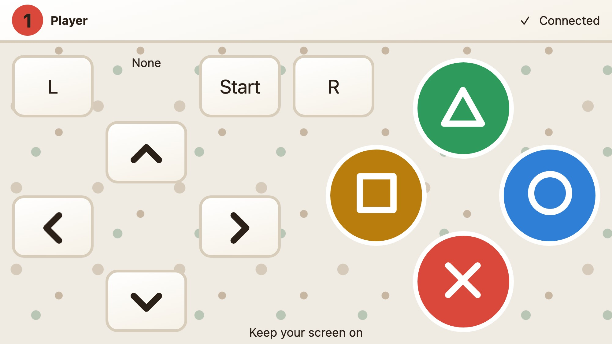
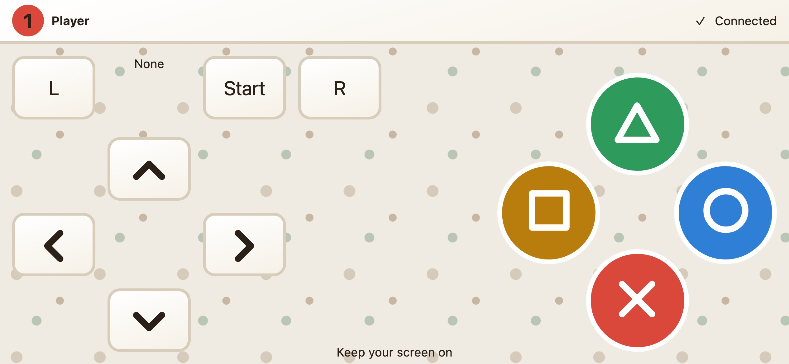
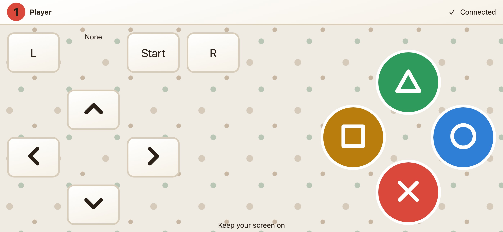
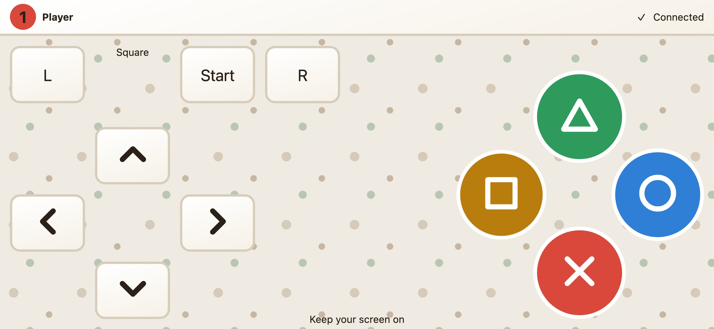
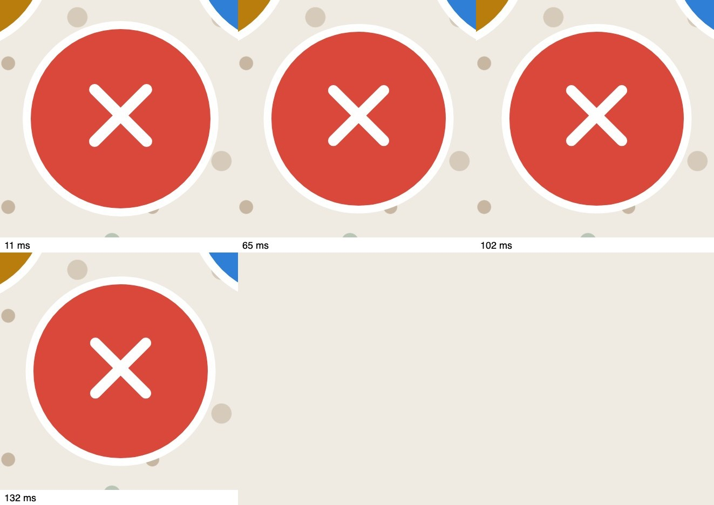
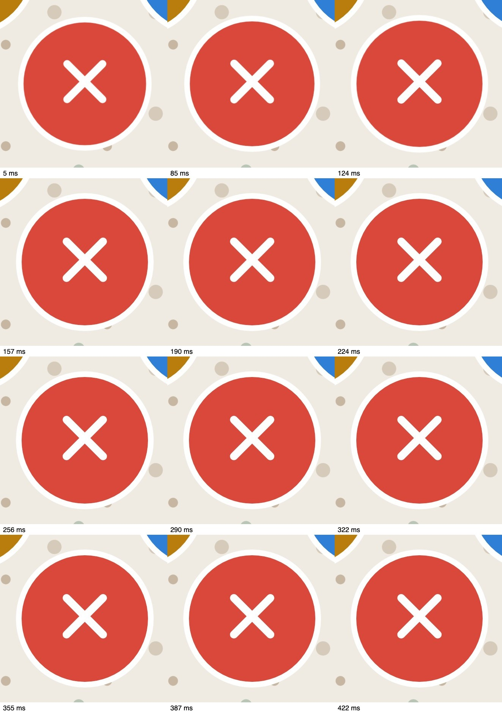
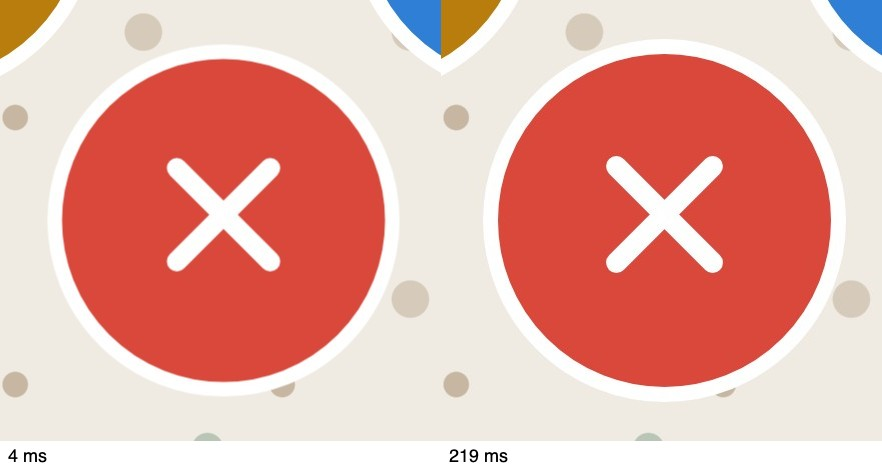

# K-03-buttons UAT evidence

Automated execution only. Visual review and acceptance decisions are pending.

Command: `node tools/uat/run.mjs -- K-03-buttons --phones 1`
Commit: `d3aedd062ca6721c8262207fcd779e25decfff95`
Viewports: 667×375, 844×390, 932×430

| Timing | ms | Status |
|---|---:|---|
| layout-667x375 | 451.7 | completed |
| layout-844x390 | 283.1 | completed |
| layout-932x430 | 297.1 | completed |
| Press vibrates once with HAPTIC_TICK_MS; release does not | 208.2 | completed |
| Empty D-pad centre captures a slide onto Right | 321.6 | completed |
| Cross stays held moving from 2 px inside rim to 1 px inside | 244.3 | completed |
| Two simultaneous face presses and first-frame feedback | 361.1 | completed |
| Twenty first-animation-frame samples across controls | 1200.6 | completed |
| Release strip begins while held and eases out | 548.4 | completed |
| Release run notes: 1 intermediate pre-capture samples (0.97 < scale < 0.995); samples lag the picture by one frame; per-frame pre-capture scales [0.97,0.97,0.986435,0.997366,0.999563,0.999972,1,1,1,1,1,1] | 0.0 | completed |
| Close-up Cross held and at rest, side by side | 292.1 | completed |
| Trusted touchCancel and hidden visibility release held inputs | 55.6 | completed |
| D-pad slide switches directions | 448.2 | completed |
| Reduced motion retains immediate pressed state | 319.4 | completed |

Expected errors (count):
None

## Real server

| Screenshot | What it shows | Looked at by |
|---|---|---|
|  | | |
|  | | |
|  | | |
|  | | |
|  | | |

## Strips

| Screenshot | What it shows | Looked at by |
|---|---|---|
|  | | |
|  | | |
|  | | |

| Acceptance statement | Pass / fail | Evidence |
|---|---|---|
| | | |

## Integrator's look (2026-11-17)
Run: `pnpm uat -- K-03-buttons --phones 1`, exit 0, 14 steps completed, no process left.
Opened 03-phone1-layout-932 at full size: the shape buttons are about 119 CSS px across with
their rim (they were at the 110 floor in round 4, the review's must-fix), every control about
14 px or more from the edges, L, Start and R clear of each other. Release notes now say
"pre-capture samples" lagging the picture by one frame: 0.97, 0.97, 0.986, 0.997, then rest.
Closes the round-4 review's must-fix (size from the phone, play area as a fit check) and its
should-fixes (labels, one NodeList per move, mutant-killing tests, empty-centre assertion).
