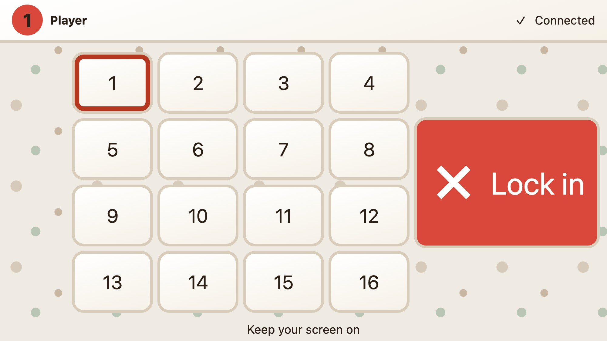
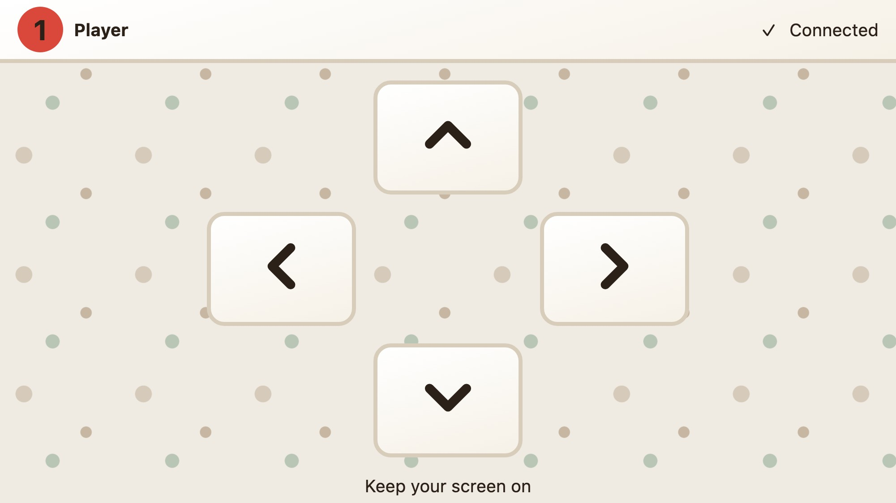
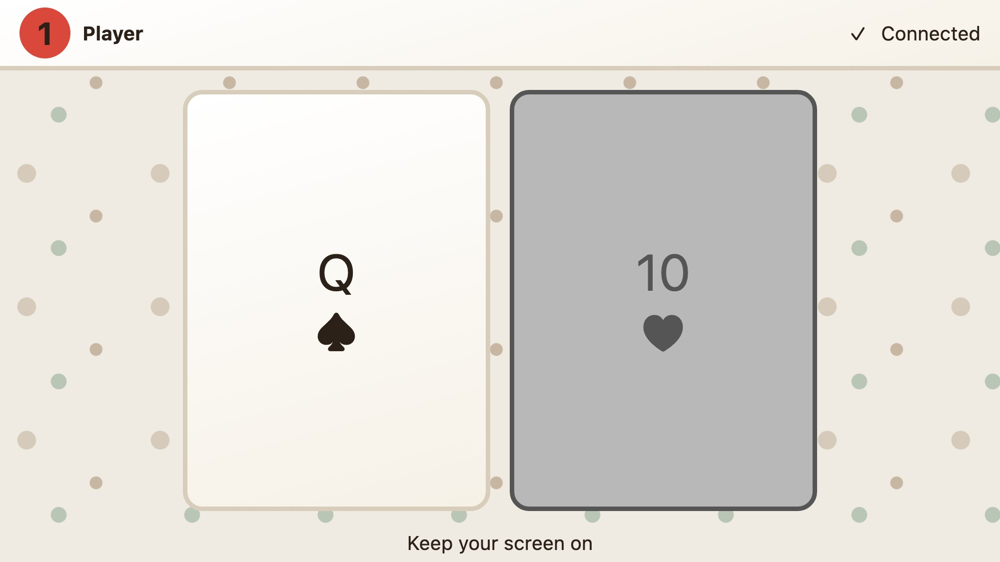
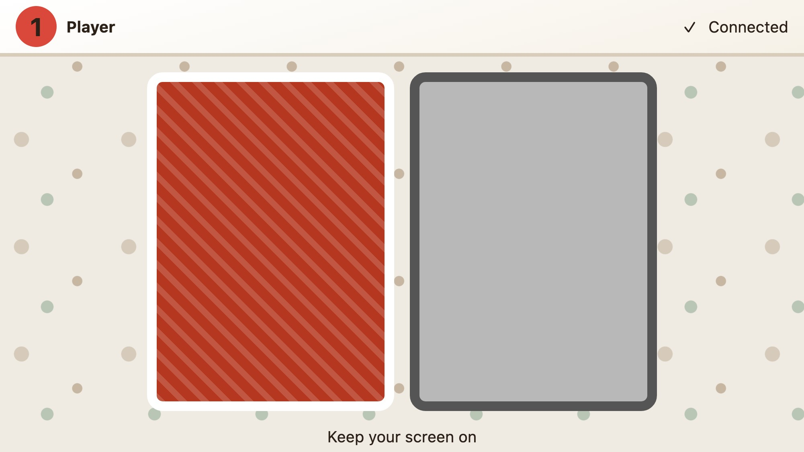
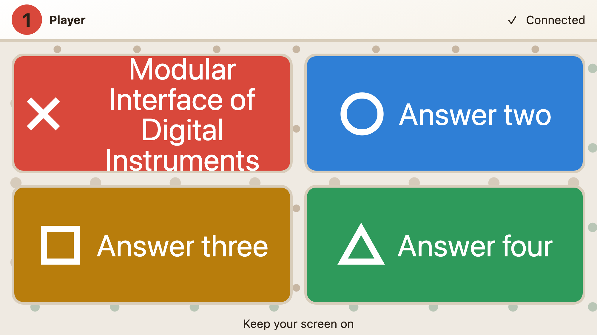

# K-04-layout-engine UAT evidence

Automated execution only. Visual review and acceptance decisions are pending.

Command: `node tools/uat/run.mjs -- K-04-layout-engine --phones 1`
Commit: `6f3c6355366535bb34ef7a054ed03275d7a2aba7`
Viewports: 667×375

| Timing | ms | Status |
|---|---:|---|
| stick-faces-667x375 | 354.0 | completed |
| options-667x375 | 240.6 | completed |
| picker-667x375 | 207.6 | completed |
| dpad-only-667x375 | 188.6 | completed |
| text-only-667x375 | 188.6 | completed |
| cards-667x375 | 186.9 | completed |
| hidden-cards-667x375 | 240.4 | completed |
| long-answer-667x375 | 122.1 | failed |

Expected errors (count):
None

## Real server

| Screenshot | What it shows | Looked at by |
|---|---|---|
|  | | |
|  | | |
|  | | |
|  | | |
|  | | |
|  | | |
|  | | |
|  | | |
|  | | |

| Acceptance statement | Pass / fail | Evidence |
|---|---|---|
| | | |

## Integrator's look (2026-11-17)
Run with the fixture changed to a real 40-character bank answer, "Modular Interface of Digital
Instruments" (raised by the round-9 final review). Fails as expected: "answers:a label overflows
its button". Opened 09-phone1-failure.png: at 34 px the label breaks into four lines (Modular /
Interface of / Digital / Instruments) and is cut at the top and bottom of the red button at
667 × 375. Fix in round 10 under D-127.
