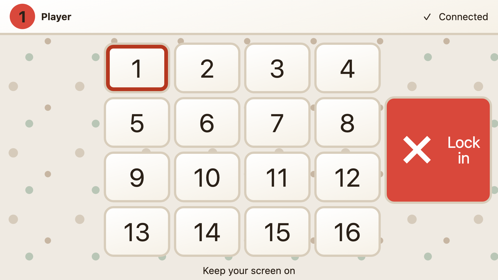

# K-04-layout-engine UAT evidence

Automated execution only. Visual review and acceptance decisions are pending.

Command: `node tools/uat/run.mjs -- K-04-layout-engine --phones 1`
Commit: `0b4b9addfcdf2f43aeb0110c8448a2567b096ad2`
Viewports: 667×375

| Timing | ms | Status |
|---|---:|---|
| stick-faces-667x375 | 578.5 | completed |
| options-667x375 | 259.1 | completed |
| picker-667x375 | 78.3 | failed |

Expected errors (count):
None

## Real server

| Screenshot | What it shows | Looked at by |
|---|---|---|
|  | | |
|  | | |
|  | | |
|  | | |

| Acceptance statement | Pass / fail | Evidence |
|---|---|---|
| | | |

## Integrator's look (2026-11-17)
Round 10's browser test fails: "Lock in: one line". Opened 04-phone1-failure.png: on the picker
(4 × 4 grid with the Lock in action), "Lock in" now wraps to two lines ("Lock" / "in") at about
the 34 px size although the red button has room for one line. Round 10 changed the only-child
option span from `flex: none` to `min-width: 0` (layout.css:30) and added a rule that turns
wrapping on at step 21 (:31); the label-step measurement compares the span's scrollWidth with its
own clientWidth, which shrinks once the span may shrink. Sent back as round 11.
