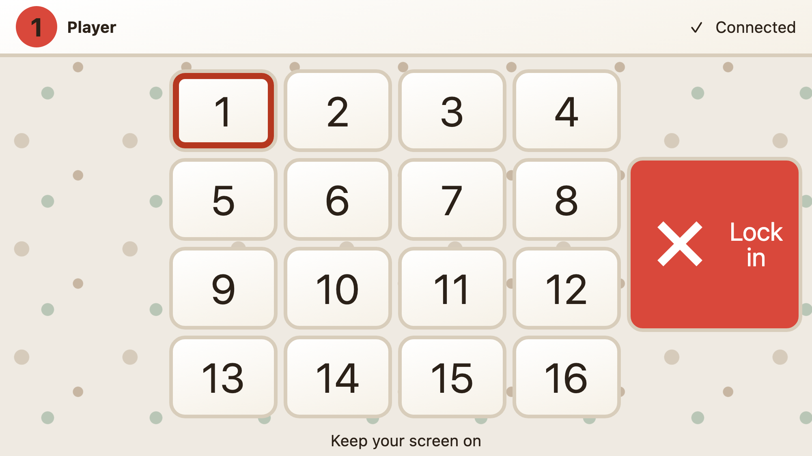

# K-04-layout-engine UAT evidence

Automated execution only. Visual review and acceptance decisions are pending.

Command: `node tools/uat/run.mjs -- K-04-layout-engine --phones 1`
Commit: `82bd98ec73c37ff69b0756d87b9821ace8f438db`
Viewports: 667×375

| Timing | ms | Status |
|---|---:|---|
| stick-faces-667x375 | 927.3 | completed |
| options-667x375 | 262.9 | completed |
| picker-667x375 | 130.1 | failed |

Expected errors (count):
None

## Real server

| Screenshot | What it shows | Looked at by |
|---|---|---|
|  | | |
|  | | |
|  | | |
|  | | |

| Acceptance statement | Pass / fail | Evidence |
|---|---|---|
| | | |

## Integrator's look (2026-11-17)
Round 11's browser test still fails "Lock in: one line". Opened 04-phone1-failure.png: "Lock" /
"in" still wraps in the red button. Likely cause, from reading layout-label.ts: `available.width`
subtracts `parseFloat(css.columnGap)`, which is NaN when the gap is `normal`; every comparison
with NaN is false, so `labelTypeStep` returns 21 and the step-21 rule turns wrapping on inside a
span that may shrink. Sent back as round 12.
